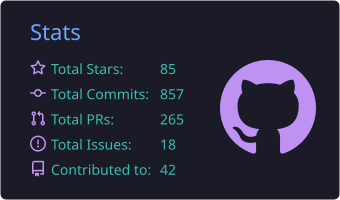
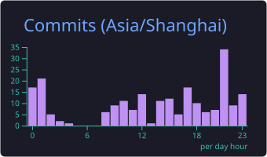
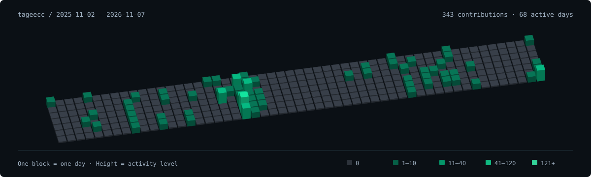

<div align="center">

<picture></picture>

<p>
  <a href="https://github.com/tageecc?tab=followers"></a>
  <picture></picture>
  <a href="mailto:tageecc@gmail.com"></a>
</p>

</div>

## About me

<p align="center">
  <picture></picture>
</p>

## My toolkit

<p align="center">
  <picture></picture>
  <br/>
  <picture></picture>
</p>

## Things I've built

<table>
  <tr>
    <td width="50%" valign="top">
      <h3><a href="https://github.com/tageecc/cursor-agent-api-proxy">cursor-agent-api-proxy</a></h3>
      <p>Use your Cursor subscription with any OpenAI-compatible client — wraps Cursor CLI as an OpenAI-compatible API proxy.</p>
      <picture></picture>
      <picture></picture>
    </td>
    <td width="50%" valign="top">
      <h3><a href="https://github.com/tageecc/clawteam">clawteam</a></h3>
      <p>Desktop control center for OpenClaw — multi-instance orchestration, team collaboration, real-time chat &amp; observability.</p>
      <picture></picture>
      <picture></picture>
      <picture></picture>
    </td>
  </tr>
  <tr>
    <td width="50%" valign="top">
      <h3><a href="https://github.com/tageecc/circle">circle</a></h3>
      <p>Local-first AI IDE with editor, Git, terminal, MCP, and human-in-the-loop coding agents.</p>
      <picture></picture>
      <picture></picture>
    </td>
    <td width="50%" valign="top">
      <h3><a href="https://github.com/tageecc/clipture">clipture</a></h3>
      <p>Screenshots, scrolling capture, OCR, annotations and clipboard history for macOS &amp; Windows.</p>
      <picture></picture>
      <picture></picture>
    </td>
  </tr>
  <tr>
    <td width="50%" valign="top">
      <h3><a href="https://github.com/tageecc/droidlume-agent-control">droidlume-agent-control</a></h3>
      <p>Android emulator MCP server, CLI and Agent Skill for Codex, Claude, Gemini and Cursor on macOS.</p>
      <picture></picture>
      <picture></picture>
    </td>
    <td width="50%" valign="top">
      <h3><a href="https://github.com/tageecc/reality-tear">reality-tear</a></h3>
      <p>A camera-fed, tearable reality experiment built with Three.js and position-based dynamics.</p>
      <picture></picture>
      <picture></picture>
    </td>
  </tr>
</table>

<details>
<summary><b>More activity &amp; language stats</b></summary>
<br />

<p align="center">
  <picture></picture>
</p>
<p align="center">
  <picture></picture>
  <picture></picture>
</p>
<p align="center">
  <picture></picture>
  <picture></picture>
</p>
<p align="center">
  <picture></picture>
</p>

</details>

## The contribution loop

Desktop: drag to rotate · Scroll to zoom · Play for auto-rotation. Mobile: use the viewer buttons.

<sub>GitHub provides a fixed blue material; custom colors and growth animations are not supported.</sub>

<!-- contribution-stl:start -->

```stl
solid contribution_heatmap
facet normal 0 0 -1
outer loop
vertex -24.7 -2.9 0
vertex -22.3 -1.1 0
vertex -20.5 -3.5 0
endloop
endfacet
facet normal 0 0 -1
outer loop
vertex -24.7 -2.9 0
vertex -20.5 -3.5 0
vertex -22.9 -5.3 0
endloop
endfacet
facet normal .6 -.8 0
outer loop
vertex -22.9 -5.3 0
vertex -20.5 -3.5 0
vertex -20.5 -3.5 2.5
endloop
endfacet
facet normal .6 -.8 0
outer loop
vertex -22.9 -5.3 0
vertex -20.5 -3.5 2.5
vertex -22.9 -5.3 2.5
endloop
endfacet
facet normal .8 .6 0
outer loop
vertex -20.5 -3.5 0
vertex -22.3 -1.1 0
vertex -22.3 -1.1 2.5
endloop
endfacet
facet normal .8 .6 0
outer loop
vertex -20.5 -3.5 0
vertex -22.3 -1.1 2.5
vertex -20.5 -3.5 2.5
endloop
endfacet
facet normal -.6 .8 0
outer loop
vertex -22.3 -1.1 0
vertex -24.7 -2.9 0
vertex -24.7 -2.9 2.5
endloop
endfacet
facet normal -.6 .8 0
outer loop
vertex -22.3 -1.1 0
vertex -24.7 -2.9 2.5
vertex -22.3 -1.1 2.5
endloop
endfacet
facet normal -.8 -.6 0
outer loop
vertex -24.7 -2.9 0
vertex -22.9 -5.3 0
vertex -22.9 -5.3 2.5
endloop
endfacet
facet normal -.8 -.6 0
outer loop
vertex -24.7 -2.9 0
vertex -22.9 -5.3 2.5
vertex -24.7 -2.9 2.5
endloop
endfacet
facet normal 0 0 1
outer loop
vertex -22.9 -5.3 2.5
vertex -20.5 -3.5 2.5
vertex -22.3 -1.1 2.5
endloop
endfacet
facet normal 0 0 1
outer loop
vertex -22.9 -5.3 2.5
vertex -22.3 -1.1 2.5
vertex -24.7 -2.9 2.5
endloop
endfacet
facet normal 0 0 -1
outer loop
vertex -22.6 -5.7 0
vertex -20.2 -3.9 0
vertex -18.4 -6.3 0
endloop
endfacet
facet normal 0 0 -1
outer loop
vertex -22.6 -5.7 0
vertex -18.4 -6.3 0
vertex -20.8 -8.1 0
endloop
endfacet
facet normal .6 -.8 0
outer loop
vertex -20.8 -8.1 0
vertex -18.4 -6.3 0
vertex -18.4 -6.3 .5
endloop
endfacet
facet normal .6 -.8 0
outer loop
vertex -20.8 -8.1 0
vertex -18.4 -6.3 .5
vertex -20.8 -8.1 .5
endloop
endfacet
facet normal .8 .6 0
outer loop
vertex -18.4 -6.3 0
vertex -20.2 -3.9 0
vertex -20.2 -3.9 .5
endloop
endfacet
facet normal .8 .6 0
outer loop
vertex -18.4 -6.3 0
vertex -20.2 -3.9 .5
vertex -18.4 -6.3 .5
endloop
endfacet
facet normal -.6 .8 0
outer loop
vertex -20.2 -3.9 0
vertex -22.6 -5.7 0
vertex -22.6 -5.7 .5
endloop
endfacet
facet normal -.6 .8 0
outer loop
vertex -20.2 -3.9 0
vertex -22.6 -5.7 .5
vertex -20.2 -3.9 .5
endloop
endfacet
facet normal -.8 -.6 0
outer loop
vertex -22.6 -5.7 0
vertex -20.8 -8.1 0
vertex -20.8 -8.1 .5
endloop
endfacet
facet normal -.8 -.6 0
outer loop
vertex -22.6 -5.7 0
vertex -20.8 -8.1 .5
vertex -22.6 -5.7 .5
endloop
endfacet
facet normal 0 0 1
outer loop
vertex -20.8 -8.1 .5
vertex -18.4 -6.3 .5
vertex -20.2 -3.9 .5
endloop
endfacet
facet normal 0 0 1
outer loop
vertex -20.8 -8.1 .5
vertex -20.2 -3.9 .5
vertex -22.6 -5.7 .5
endloop
endfacet
facet normal 0 0 -1
outer loop
vertex -20.5 -8.5 0
vertex -18.1 -6.7 0
vertex -16.3 -9.1 0
endloop
endfacet
facet normal 0 0 -1
outer loop
vertex -20.5 -8.5 0
vertex -16.3 -9.1 0
vertex -18.7 -10.9 0
endloop
endfacet
facet normal .6 -.8 0
outer loop
vertex -18.7 -10.9 0
vertex -16.3 -9.1 0
vertex -16.3 -9.1 .5
endloop
endfacet
facet normal .6 -.8 0
outer loop
vertex -18.7 -10.9 0
vertex -16.3 -9.1 .5
vertex -18.7 -10.9 .5
endloop
endfacet
facet normal .8 .6 0
outer loop
vertex -16.3 -9.1 0
vertex -18.1 -6.7 0
vertex -18.1 -6.7 .5
endloop
endfacet
facet normal .8 .6 0
outer loop
vertex -16.3 -9.1 0
vertex -18.1 -6.7 .5
vertex -16.3 -9.1 .5
endloop
endfacet
facet normal -.6 .8 0
outer loop
vertex -18.1 -6.7 0
vertex -20.5 -8.5 0
vertex -20.5 -8.5 .5
endloop
endfacet
facet normal -.6 .8 0
outer loop
vertex -18.1 -6.7 0
vertex -20.5 -8.5 .5
vertex -18.1 -6.7 .5
endloop
endfacet
facet normal -.8 -.6 0
outer loop
vertex -20.5 -8.5 0
vertex -18.7 -10.9 0
vertex -18.7 -10.9 .5
endloop
endfacet
facet normal -.8 -.6 0
outer loop
vertex -20.5 -8.5 0
vertex -18.7 -10.9 .5
vertex -20.5 -8.5 .5
endloop
endfacet
facet normal 0 0 1
outer loop
vertex -18.7 -10.9 .5
vertex -16.3 -9.1 .5
vertex -18.1 -6.7 .5
endloop
endfacet
facet normal 0 0 1
outer loop
vertex -18.7 -10.9 .5
vertex -18.1 -6.7 .5
vertex -20.5 -8.5 .5
endloop
endfacet
facet normal 0 0 -1
outer loop
vertex -18.4 -11.3 0
vertex -16 -9.5 0
vertex -14.2 -11.9 0
endloop
endfacet
facet normal 0 0 -1
outer loop
vertex -18.4 -11.3 0
vertex -14.2 -11.9 0
vertex -16.6 -13.7 0
endloop
endfacet
facet normal .6 -.8 0
outer loop
vertex -16.6 -13.7 0
vertex -14.2 -11.9 0
vertex -14.2 -11.9 .5
endloop
endfacet
facet normal .6 -.8 0
outer loop
vertex -16.6 -13.7 0
vertex -14.2 -11.9 .5
vertex -16.6 -13.7 .5
endloop
endfacet
facet normal .8 .6 0
outer loop
vertex -14.2 -11.9 0
vertex -16 -9.5 0
vertex -16 -9.5 .5
endloop
endfacet
facet normal .8 .6 0
outer loop
vertex -14.2 -11.9 0
vertex -16 -9.5 .5
vertex -14.2 -11.9 .5
endloop
endfacet
facet normal -.6 .8 0
outer loop
vertex -16 -9.5 0
vertex -18.4 -11.3 0
vertex -18.4 -11.3 .5
endloop
endfacet
facet normal -.6 .8 0
outer loop
vertex -16 -9.5 0
vertex -18.4 -11.3 .5
vertex -16 -9.5 .5
endloop
endfacet
facet normal -.8 -.6 0
outer loop
vertex -18.4 -11.3 0
vertex -16.6 -13.7 0
vertex -16.6 -13.7 .5
endloop
endfacet
facet normal -.8 -.6 0
outer loop
vertex -18.4 -11.3 0
vertex -16.6 -13.7 .5
vertex -18.4 -11.3 .5
endloop
endfacet
facet normal 0 0 1
outer loop
vertex -16.6 -13.7 .5
vertex -14.2 -11.9 .5
vertex -16 -9.5 .5
endloop
endfacet
facet normal 0 0 1
outer loop
vertex -16.6 -13.7 .5
vertex -16 -9.5 .5
vertex -18.4 -11.3 .5
endloop
endfacet
facet normal 0 0 -1
outer loop
vertex -16.3 -14.1 0
vertex -13.9 -12.3 0
vertex -12.1 -14.7 0
endloop
endfacet
facet normal 0 0 -1
outer loop
vertex -16.3 -14.1 0
vertex -12.1 -14.7 0
vertex -14.5 -16.5 0
endloop
endfacet
facet normal .6 -.8 0
outer loop
vertex -14.5 -16.5 0
vertex -12.1 -14.7 0
vertex -12.1 -14.7 .5
endloop
endfacet
facet normal .6 -.8 0
outer loop
vertex -14.5 -16.5 0
vertex -12.1 -14.7 .5
vertex -14.5 -16.5 .5
endloop
endfacet
facet normal .8 .6 0
outer loop
vertex -12.1 -14.7 0
vertex -13.9 -12.3 0
vertex -13.9 -12.3 .5
endloop
endfacet
facet normal .8 .6 0
outer loop
vertex -12.1 -14.7 0
vertex -13.9 -12.3 .5
vertex -12.1 -14.7 .5
endloop
endfacet
facet normal -.6 .8 0
outer loop
vertex -13.9 -12.3 0
vertex -16.3 -14.1 0
vertex -16.3 -14.1 .5
endloop
endfacet
facet normal -.6 .8 0
outer loop
vertex -13.9 -12.3 0
vertex -16.3 -14.1 .5
vertex -13.9 -12.3 .5
endloop
endfacet
facet normal -.8 -.6 0
outer loop
vertex -16.3 -14.1 0
vertex -14.5 -16.5 0
vertex -14.5 -16.5 .5
endloop
endfacet
facet normal -.8 -.6 0
outer loop
vertex -16.3 -14.1 0
vertex -14.5 -16.5 .5
vertex -16.3 -14.1 .5
endloop
endfacet
facet normal 0 0 1
outer loop
vertex -14.5 -16.5 .5
vertex -12.1 -14.7 .5
vertex -13.9 -12.3 .5
endloop
endfacet
facet normal 0 0 1
outer loop
vertex -14.5 -16.5 .5
vertex -13.9 -12.3 .5
vertex -16.3 -14.1 .5
endloop
endfacet
facet normal 0 0 -1
outer loop
vertex -14.2 -16.9 0
vertex -11.8 -15.1 0
vertex -10 -17.5 0
endloop
endfacet
facet normal 0 0 -1
outer loop
vertex -14.2 -16.9 0
vertex -10 -17.5 0
vertex -12.4 -19.3 0
endloop
endfacet
facet normal .6 -.8 0
outer loop
vertex -12.4 -19.3 0
vertex -10 -17.5 0
vertex -10 -17.5 .5
endloop
endfacet
facet normal .6 -.8 0
outer loop
vertex -12.4 -19.3 0
vertex -10 -17.5 .5
vertex -12.4 -19.3 .5
endloop
endfacet
facet normal .8 .6 0
outer loop
vertex -10 -17.5 0
vertex -11.8 -15.1 0
vertex -11.8 -15.1 .5
endloop
endfacet
facet normal .8 .6 0
outer loop
vertex -10 -17.5 0
vertex -11.8 -15.1 .5
vertex -10 -17.5 .5
endloop
endfacet
facet normal -.6 .8 0
outer loop
vertex -11.8 -15.1 0
vertex -14.2 -16.9 0
vertex -14.2 -16.9 .5
endloop
endfacet
facet normal -.6 .8 0
outer loop
vertex -11.8 -15.1 0
vertex -14.2 -16.9 .5
vertex -11.8 -15.1 .5
endloop
endfacet
facet normal -.8 -.6 0
outer loop
vertex -14.2 -16.9 0
vertex -12.4 -19.3 0
vertex -12.4 -19.3 .5
endloop
endfacet
facet normal -.8 -.6 0
outer loop
vertex -14.2 -16.9 0
vertex -12.4 -19.3 .5
vertex -14.2 -16.9 .5
endloop
endfacet
facet normal 0 0 1
outer loop
vertex -12.4 -19.3 .5
vertex -10 -17.5 .5
vertex -11.8 -15.1 .5
endloop
endfacet
facet normal 0 0 1
outer loop
vertex -12.4 -19.3 .5
vertex -11.8 -15.1 .5
vertex -14.2 -16.9 .5
endloop
endfacet
facet normal 0 0 -1
outer loop
vertex -12.1 -19.7 0
vertex -9.7 -17.9 0
vertex -7.9 -20.3 0
endloop
endfacet
facet normal 0 0 -1
outer loop
vertex -12.1 -19.7 0
vertex -7.9 -20.3 0
vertex -10.3 -22.1 0
endloop
endfacet
facet normal .6 -.8 0
outer loop
vertex -10.3 -22.1 0
vertex -7.9 -20.3 0
vertex -7.9 -20.3 .5
endloop
endfacet
facet normal .6 -.8 0
outer loop
vertex -10.3 -22.1 0
vertex -7.9 -20.3 .5
vertex -10.3 -22.1 .5
endloop
endfacet
facet normal .8 .6 0
outer loop
vertex -7.9 -20.3 0
vertex -9.7 -17.9 0
vertex -9.7 -17.9 .5
endloop
endfacet
facet normal .8 .6 0
outer loop
vertex -7.9 -20.3 0
vertex -9.7 -17.9 .5
vertex -7.9 -20.3 .5
endloop
endfacet
facet normal -.6 .8 0
outer loop
vertex -9.7 -17.9 0
vertex -12.1 -19.7 0
vertex -12.1 -19.7 .5
endloop
endfacet
facet normal -.6 .8 0
outer loop
vertex -9.7 -17.9 0
vertex -12.1 -19.7 .5
vertex -9.7 -17.9 .5
endloop
endfacet
facet normal -.8 -.6 0
outer loop
vertex -12.1 -19.7 0
vertex -10.3 -22.1 0
vertex -10.3 -22.1 .5
endloop
endfacet
facet normal -.8 -.6 0
outer loop
vertex -12.1 -19.7 0
vertex -10.3 -22.1 .5
vertex -12.1 -19.7 .5
endloop
endfacet
facet normal 0 0 1
outer loop
vertex -10.3 -22.1 .5
vertex -7.9 -20.3 .5
vertex -9.7 -17.9 .5
endloop
endfacet
facet normal 0 0 1
outer loop
vertex -10.3 -22.1 .5
vertex -9.7 -17.9 .5
vertex -12.1 -19.7 .5
endloop
endfacet
facet normal 0 0 -1
outer loop
vertex -21.9 -.8 0
vertex -19.5 1 0
vertex -17.7 -1.4 0
endloop
endfacet
facet normal 0 0 -1
outer loop
vertex -21.9 -.8 0
vertex -17.7 -1.4 0
vertex -20.1 -3.2 0
endloop
endfacet
facet normal .6 -.8 0
outer loop
vertex -20.1 -3.2 0
vertex -17.7 -1.4 0
vertex -17.7 -1.4 .5
endloop
endfacet
facet normal .6 -.8 0
outer loop
vertex -20.1 -3.2 0
vertex -17.7 -1.4 .5
vertex -20.1 -3.2 .5
endloop
endfacet
facet normal .8 .6 0
outer loop
vertex -17.7 -1.4 0
vertex -19.5 1 0
vertex -19.5 1 .5
endloop
endfacet
facet normal .8 .6 0
outer loop
vertex -17.7 -1.4 0
vertex -19.5 1 .5
vertex -17.7 -1.4 .5
endloop
endfacet
facet normal -.6 .8 0
outer loop
vertex -19.5 1 0
vertex -21.9 -.8 0
vertex -21.9 -.8 .5
endloop
endfacet
facet normal -.6 .8 0
outer loop
vertex -19.5 1 0
vertex -21.9 -.8 .5
vertex -19.5 1 .5
endloop
endfacet
facet normal -.8 -.6 0
outer loop
vertex -21.9 -.8 0
vertex -20.1 -3.2 0
vertex -20.1 -3.2 .5
endloop
endfacet
facet normal -.8 -.6 0
outer loop
vertex -21.9 -.8 0
vertex -20.1 -3.2 .5
vertex -21.9 -.8 .5
endloop
endfacet
facet normal 0 0 1
outer loop
vertex -20.1 -3.2 .5
vertex -17.7 -1.4 .5
vertex -19.5 1 .5
endloop
endfacet
facet normal 0 0 1
outer loop
vertex -20.1 -3.2 .5
vertex -19.5 1 .5
vertex -21.9 -.8 .5
endloop
endfacet
facet normal 0 0 -1
outer loop
vertex -19.8 -3.6 0
vertex -17.4 -1.8 0
vertex -15.6 -4.2 0
endloop
endfacet
facet normal 0 0 -1
outer loop
vertex -19.8 -3.6 0
vertex -15.6 -4.2 0
vertex -18 -6 0
endloop
endfacet
facet normal .6 -.8 0
outer loop
vertex -18 -6 0
vertex -15.6 -4.2 0
vertex -15.6 -4.2 .5
endloop
endfacet
facet normal .6 -.8 0
outer loop
vertex -18 -6 0
vertex -15.6 -4.2 .5
vertex -18 -6 .5
endloop
endfacet
facet normal .8 .6 0
outer loop
vertex -15.6 -4.2 0
vertex -17.4 -1.8 0
vertex -17.4 -1.8 .5
endloop
endfacet
facet normal .8 .6 0
outer loop
vertex -15.6 -4.2 0
vertex -17.4 -1.8 .5
vertex -15.6 -4.2 .5
endloop
endfacet
facet normal -.6 .8 0
outer loop
vertex -17.4 -1.8 0
vertex -19.8 -3.6 0
vertex -19.8 -3.6 .5
endloop
endfacet
facet normal -.6 .8 0
outer loop
vertex -17.4 -1.8 0
vertex -19.8 -3.6 .5
vertex -17.4 -1.8 .5
endloop
endfacet
facet normal -.8 -.6 0
outer loop
vertex -19.8 -3.6 0
vertex -18 -6 0
vertex -18 -6 .5
endloop
endfacet
facet normal -.8 -.6 0
outer loop
vertex -19.8 -3.6 0
vertex -18 -6 .5
vertex -19.8 -3.6 .5
endloop
endfacet
facet normal 0 0 1
outer loop
vertex -18 -6 .5
vertex -15.6 -4.2 .5
vertex -17.4 -1.8 .5
endloop
endfacet
facet normal 0 0 1
outer loop
vertex -18 -6 .5
vertex -17.4 -1.8 .5
vertex -19.8 -3.6 .5
endloop
endfacet
facet normal 0 0 -1
outer loop
vertex -17.7 -6.4 0
vertex -15.3 -4.6 0
vertex -13.5 -7 0
endloop
endfacet
facet normal 0 0 -1
outer loop
vertex -17.7 -6.4 0
vertex -13.5 -7 0
vertex -15.9 -8.8 0
endloop
endfacet
facet normal .6 -.8 0
outer loop
vertex -15.9 -8.8 0
vertex -13.5 -7 0
vertex -13.5 -7 .5
endloop
endfacet
facet normal .6 -.8 0
outer loop
vertex -15.9 -8.8 0
vertex -13.5 -7 .5
vertex -15.9 -8.8 .5
endloop
endfacet
facet normal .8 .6 0
outer loop
vertex -13.5 -7 0
vertex -15.3 -4.6 0
vertex -15.3 -4.6 .5
endloop
endfacet
facet normal .8 .6 0
outer loop
vertex -13.5 -7 0
vertex -15.3 -4.6 .5
vertex -13.5 -7 .5
endloop
endfacet
facet normal -.6 .8 0
outer loop
vertex -15.3 -4.6 0
vertex -17.7 -6.4 0
vertex -17.7 -6.4 .5
endloop
endfacet
facet normal -.6 .8 0
outer loop
vertex -15.3 -4.6 0
vertex -17.7 -6.4 .5
vertex -15.3 -4.6 .5
endloop
endfacet
facet normal -.8 -.6 0
outer loop
vertex -17.7 -6.4 0
vertex -15.9 -8.8 0
vertex -15.9 -8.8 .5
endloop
endfacet
facet normal -.8 -.6 0
outer loop
vertex -17.7 -6.4 0
vertex -15.9 -8.8 .5
vertex -17.7 -6.4 .5
endloop
endfacet
facet normal 0 0 1
outer loop
vertex -15.9 -8.8 .5
vertex -13.5 -7 .5
vertex -15.3 -4.6 .5
endloop
endfacet
facet normal 0 0 1
outer loop
vertex -15.9 -8.8 .5
vertex -15.3 -4.6 .5
vertex -17.7 -6.4 .5
endloop
endfacet
facet normal 0 0 -1
outer loop
vertex -15.6 -9.2 0
vertex -13.2 -7.4 0
vertex -11.4 -9.8 0
endloop
endfacet
facet normal 0 0 -1
outer loop
vertex -15.6 -9.2 0
vertex -11.4 -9.8 0
vertex -13.8 -11.6 0
endloop
endfacet
facet normal .6 -.8 0
outer loop
vertex -13.8 -11.6 0
vertex -11.4 -9.8 0
vertex -11.4 -9.8 .5
endloop
endfacet
facet normal .6 -.8 0
outer loop
vertex -13.8 -11.6 0
vertex -11.4 -9.8 .5
vertex -13.8 -11.6 .5
endloop
endfacet
facet normal .8 .6 0
outer loop
vertex -11.4 -9.8 0
vertex -13.2 -7.4 0
vertex -13.2 -7.4 .5
endloop
endfacet
facet normal .8 .6 0
outer loop
vertex -11.4 -9.8 0
vertex -13.2 -7.4 .5
vertex -11.4 -9.8 .5
endloop
endfacet
facet normal -.6 .8 0
outer loop
vertex -13.2 -7.4 0
vertex -15.6 -9.2 0
vertex -15.6 -9.2 .5
endloop
endfacet
facet normal -.6 .8 0
outer loop
vertex -13.2 -7.4 0
vertex -15.6 -9.2 .5
vertex -13.2 -7.4 .5
endloop
endfacet
facet normal -.8 -.6 0
outer loop
vertex -15.6 -9.2 0
vertex -13.8 -11.6 0
vertex -13.8 -11.6 .5
endloop
endfacet
facet normal -.8 -.6 0
outer loop
vertex -15.6 -9.2 0
vertex -13.8 -11.6 .5
vertex -15.6 -9.2 .5
endloop
endfacet
facet normal 0 0 1
outer loop
vertex -13.8 -11.6 .5
vertex -11.4 -9.8 .5
vertex -13.2 -7.4 .5
endloop
endfacet
facet normal 0 0 1
outer loop
vertex -13.8 -11.6 .5
vertex -13.2 -7.4 .5
vertex -15.6 -9.2 .5
endloop
endfacet
facet normal 0 0 -1
outer loop
vertex -13.5 -12 0
vertex -11.1 -10.2 0
vertex -9.3 -12.6 0
endloop
endfacet
facet normal 0 0 -1
outer loop
vertex -13.5 -12 0
vertex -9.3 -12.6 0
vertex -11.7 -14.4 0
endloop
endfacet
facet normal .6 -.8 0
outer loop
vertex -11.7 -14.4 0
vertex -9.3 -12.6 0
vertex -9.3 -12.6 .5
endloop
endfacet
facet normal .6 -.8 0
outer loop
vertex -11.7 -14.4 0
vertex -9.3 -12.6 .5
vertex -11.7 -14.4 .5
endloop
endfacet
facet normal .8 .6 0
outer loop
vertex -9.3 -12.6 0
vertex -11.1 -10.2 0
vertex -11.1 -10.2 .5
endloop
endfacet
facet normal .8 .6 0
outer loop
vertex -9.3 -12.6 0
vertex -11.1 -10.2 .5
vertex -9.3 -12.6 .5
endloop
endfacet
facet normal -.6 .8 0
outer loop
vertex -11.1 -10.2 0
vertex -13.5 -12 0
vertex -13.5 -12 .5
endloop
endfacet
facet normal -.6 .8 0
outer loop
vertex -11.1 -10.2 0
vertex -13.5 -12 .5
vertex -11.1 -10.2 .5
endloop
endfacet
facet normal -.8 -.6 0
outer loop
vertex -13.5 -12 0
vertex -11.7 -14.4 0
vertex -11.7 -14.4 .5
endloop
endfacet
facet normal -.8 -.6 0
outer loop
vertex -13.5 -12 0
vertex -11.7 -14.4 .5
vertex -13.5 -12 .5
endloop
endfacet
facet normal 0 0 1
outer loop
vertex -11.7 -14.4 .5
vertex -9.3 -12.6 .5
vertex -11.1 -10.2 .5
endloop
endfacet
facet normal 0 0 1
outer loop
vertex -11.7 -14.4 .5
vertex -11.1 -10.2 .5
vertex -13.5 -12 .5
endloop
endfacet
facet normal 0 0 -1
outer loop
vertex -11.4 -14.8 0
vertex -9 -13 0
vertex -7.2 -15.4 0
endloop
endfacet
facet normal 0 0 -1
outer loop
vertex -11.4 -14.8 0
vertex -7.2 -15.4 0
vertex -9.6 -17.2 0
endloop
endfacet
facet normal .6 -.8 0
outer loop
vertex -9.6 -17.2 0
vertex -7.2 -15.4 0
vertex -7.2 -15.4 .5
endloop
endfacet
facet normal .6 -.8 0
outer loop
vertex -9.6 -17.2 0
vertex -7.2 -15.4 .5
vertex -9.6 -17.2 .5
endloop
endfacet
facet normal .8 .6 0
outer loop
vertex -7.2 -15.4 0
vertex -9 -13 0
vertex -9 -13 .5
endloop
endfacet
facet normal .8 .6 0
outer loop
vertex -7.2 -15.4 0
vertex -9 -13 .5
vertex -7.2 -15.4 .5
endloop
endfacet
facet normal -.6 .8 0
outer loop
vertex -9 -13 0
vertex -11.4 -14.8 0
vertex -11.4 -14.8 .5
endloop
endfacet
facet normal -.6 .8 0
outer loop
vertex -9 -13 0
vertex -11.4 -14.8 .5
vertex -9 -13 .5
endloop
endfacet
facet normal -.8 -.6 0
outer loop
vertex -11.4 -14.8 0
vertex -9.6 -17.2 0
vertex -9.6 -17.2 .5
endloop
endfacet
facet normal -.8 -.6 0
outer loop
vertex -11.4 -14.8 0
vertex -9.6 -17.2 .5
vertex -11.4 -14.8 .5
endloop
endfacet
facet normal 0 0 1
outer loop
vertex -9.6 -17.2 .5
vertex -7.2 -15.4 .5
vertex -9 -13 .5
endloop
endfacet
facet normal 0 0 1
outer loop
vertex -9.6 -17.2 .5
vertex -9 -13 .5
vertex -11.4 -14.8 .5
endloop
endfacet
facet normal 0 0 -1
outer loop
vertex -9.3 -17.6 0
vertex -6.9 -15.8 0
vertex -5.1 -18.2 0
endloop
endfacet
facet normal 0 0 -1
outer loop
vertex -9.3 -17.6 0
vertex -5.1 -18.2 0
vertex -7.5 -20 0
endloop
endfacet
facet normal .6 -.8 0
outer loop
vertex -7.5 -20 0
vertex -5.1 -18.2 0
vertex -5.1 -18.2 .5
endloop
endfacet
facet normal .6 -.8 0
outer loop
vertex -7.5 -20 0
vertex -5.1 -18.2 .5
vertex -7.5 -20 .5
endloop
endfacet
facet normal .8 .6 0
outer loop
vertex -5.1 -18.2 0
vertex -6.9 -15.8 0
vertex -6.9 -15.8 .5
endloop
endfacet
facet normal .8 .6 0
outer loop
vertex -5.1 -18.2 0
vertex -6.9 -15.8 .5
vertex -5.1 -18.2 .5
endloop
endfacet
facet normal -.6 .8 0
outer loop
vertex -6.9 -15.8 0
vertex -9.3 -17.6 0
vertex -9.3 -17.6 .5
endloop
endfacet
facet normal -.6 .8 0
outer loop
vertex -6.9 -15.8 0
vertex -9.3 -17.6 .5
vertex -6.9 -15.8 .5
endloop
endfacet
facet normal -.8 -.6 0
outer loop
vertex -9.3 -17.6 0
vertex -7.5 -20 0
vertex -7.5 -20 .5
endloop
endfacet
facet normal -.8 -.6 0
outer loop
vertex -9.3 -17.6 0
vertex -7.5 -20 .5
vertex -9.3 -17.6 .5
endloop
endfacet
facet normal 0 0 1
outer loop
vertex -7.5 -20 .5
vertex -5.1 -18.2 .5
vertex -6.9 -15.8 .5
endloop
endfacet
facet normal 0 0 1
outer loop
vertex -7.5 -20 .5
vertex -6.9 -15.8 .5
vertex -9.3 -17.6 .5
endloop
endfacet
facet normal 0 0 -1
outer loop
vertex -19.1 1.3 0
vertex -16.7 3.1 0
vertex -14.9 .7 0
endloop
endfacet
facet normal 0 0 -1
outer loop
vertex -19.1 1.3 0
vertex -14.9 .7 0
vertex -17.3 -1.1 0
endloop
endfacet
facet normal .6 -.8 0
outer loop
vertex -17.3 -1.1 0
vertex -14.9 .7 0
vertex -14.9 .7 .5
endloop
endfacet
facet normal .6 -.8 0
outer loop
vertex -17.3 -1.1 0
vertex -14.9 .7 .5
vertex -17.3 -1.1 .5
endloop
endfacet
facet normal .8 .6 0
outer loop
vertex -14.9 .7 0
vertex -16.7 3.1 0
vertex -16.7 3.1 .5
endloop
endfacet
facet normal .8 .6 0
outer loop
vertex -14.9 .7 0
vertex -16.7 3.1 .5
vertex -14.9 .7 .5
endloop
endfacet
facet normal -.6 .8 0
outer loop
vertex -16.7 3.1 0
vertex -19.1 1.3 0
vertex -19.1 1.3 .5
endloop
endfacet
facet normal -.6 .8 0
outer loop
vertex -16.7 3.1 0
vertex -19.1 1.3 .5
vertex -16.7 3.1 .5
endloop
endfacet
facet normal -.8 -.6 0
outer loop
vertex -19.1 1.3 0
vertex -17.3 -1.1 0
vertex -17.3 -1.1 .5
endloop
endfacet
facet normal -.8 -.6 0
outer loop
vertex -19.1 1.3 0
vertex -17.3 -1.1 .5
vertex -19.1 1.3 .5
endloop
endfacet
facet normal 0 0 1
outer loop
vertex -17.3 -1.1 .5
vertex -14.9 .7 .5
vertex -16.7 3.1 .5
endloop
endfacet
facet normal 0 0 1
outer loop
vertex -17.3 -1.1 .5
vertex -16.7 3.1 .5
vertex -19.1 1.3 .5
endloop
endfacet
facet normal 0 0 -1
outer loop
vertex -17 -1.5 0
vertex -14.6 .3 0
vertex -12.8 -2.1 0
endloop
endfacet
facet normal 0 0 -1
outer loop
vertex -17 -1.5 0
vertex -12.8 -2.1 0
vertex -15.2 -3.9 0
endloop
endfacet
facet normal .6 -.8 0
outer loop
vertex -15.2 -3.9 0
vertex -12.8 -2.1 0
vertex -12.8 -2.1 .5
endloop
endfacet
facet normal .6 -.8 0
outer loop
vertex -15.2 -3.9 0
vertex -12.8 -2.1 .5
vertex -15.2 -3.9 .5
endloop
endfacet
facet normal .8 .6 0
outer loop
vertex -12.8 -2.1 0
vertex -14.6 .3 0
vertex -14.6 .3 .5
endloop
endfacet
facet normal .8 .6 0
outer loop
vertex -12.8 -2.1 0
vertex -14.6 .3 .5
vertex -12.8 -2.1 .5
endloop
endfacet
facet normal -.6 .8 0
outer loop
vertex -14.6 .3 0
vertex -17 -1.5 0
vertex -17 -1.5 .5
endloop
endfacet
facet normal -.6 .8 0
outer loop
vertex -14.6 .3 0
vertex -17 -1.5 .5
vertex -14.6 .3 .5
endloop
endfacet
facet normal -.8 -.6 0
outer loop
vertex -17 -1.5 0
vertex -15.2 -3.9 0
vertex -15.2 -3.9 .5
endloop
endfacet
facet normal -.8 -.6 0
outer loop
vertex -17 -1.5 0
vertex -15.2 -3.9 .5
vertex -17 -1.5 .5
endloop
endfacet
facet normal 0 0 1
outer loop
vertex -15.2 -3.9 .5
vertex -12.8 -2.1 .5
vertex -14.6 .3 .5
endloop
endfacet
facet normal 0 0 1
outer loop
vertex -15.2 -3.9 .5
vertex -14.6 .3 .5
vertex -17 -1.5 .5
endloop
endfacet
facet normal 0 0 -1
outer loop
vertex -14.9 -4.3 0
vertex -12.5 -2.5 0
vertex -10.7 -4.9 0
endloop
endfacet
facet normal 0 0 -1
outer loop
vertex -14.9 -4.3 0
vertex -10.7 -4.9 0
vertex -13.1 -6.7 0
endloop
endfacet
facet normal .6 -.8 0
outer loop
vertex -13.1 -6.7 0
vertex -10.7 -4.9 0
vertex -10.7 -4.9 .5
endloop
endfacet
facet normal .6 -.8 0
outer loop
vertex -13.1 -6.7 0
vertex -10.7 -4.9 .5
vertex -13.1 -6.7 .5
endloop
endfacet
facet normal .8 .6 0
outer loop
vertex -10.7 -4.9 0
vertex -12.5 -2.5 0
vertex -12.5 -2.5 .5
endloop
endfacet
facet normal .8 .6 0
outer loop
vertex -10.7 -4.9 0
vertex -12.5 -2.5 .5
vertex -10.7 -4.9 .5
endloop
endfacet
facet normal -.6 .8 0
outer loop
vertex -12.5 -2.5 0
vertex -14.9 -4.3 0
vertex -14.9 -4.3 .5
endloop
endfacet
facet normal -.6 .8 0
outer loop
vertex -12.5 -2.5 0
vertex -14.9 -4.3 .5
vertex -12.5 -2.5 .5
endloop
endfacet
facet normal -.8 -.6 0
outer loop
vertex -14.9 -4.3 0
vertex -13.1 -6.7 0
vertex -13.1 -6.7 .5
endloop
endfacet
facet normal -.8 -.6 0
outer loop
vertex -14.9 -4.3 0
vertex -13.1 -6.7 .5
vertex -14.9 -4.3 .5
endloop
endfacet
facet normal 0 0 1
outer loop
vertex -13.1 -6.7 .5
vertex -10.7 -4.9 .5
vertex -12.5 -2.5 .5
endloop
endfacet
facet normal 0 0 1
outer loop
vertex -13.1 -6.7 .5
vertex -12.5 -2.5 .5
vertex -14.9 -4.3 .5
endloop
endfacet
facet normal 0 0 -1
outer loop
vertex -12.8 -7.1 0
vertex -10.4 -5.3 0
vertex -8.6 -7.7 0
endloop
endfacet
facet normal 0 0 -1
outer loop
vertex -12.8 -7.1 0
vertex -8.6 -7.7 0
vertex -11 -9.5 0
endloop
endfacet
facet normal .6 -.8 0
outer loop
vertex -11 -9.5 0
vertex -8.6 -7.7 0
vertex -8.6 -7.7 .5
endloop
endfacet
facet normal .6 -.8 0
outer loop
vertex -11 -9.5 0
vertex -8.6 -7.7 .5
vertex -11 -9.5 .5
endloop
endfacet
facet normal .8 .6 0
outer loop
vertex -8.6 -7.7 0
vertex -10.4 -5.3 0
vertex -10.4 -5.3 .5
endloop
endfacet
facet normal .8 .6 0
outer loop
vertex -8.6 -7.7 0
vertex -10.4 -5.3 .5
vertex -8.6 -7.7 .5
endloop
endfacet
facet normal -.6 .8 0
outer loop
vertex -10.4 -5.3 0
vertex -12.8 -7.1 0
vertex -12.8 -7.1 .5
endloop
endfacet
facet normal -.6 .8 0
outer loop
vertex -10.4 -5.3 0
vertex -12.8 -7.1 .5
vertex -10.4 -5.3 .5
endloop
endfacet
facet normal -.8 -.6 0
outer loop
vertex -12.8 -7.1 0
vertex -11 -9.5 0
vertex -11 -9.5 .5
endloop
endfacet
facet normal -.8 -.6 0
outer loop
vertex -12.8 -7.1 0
vertex -11 -9.5 .5
vertex -12.8 -7.1 .5
endloop
endfacet
facet normal 0 0 1
outer loop
vertex -11 -9.5 .5
vertex -8.6 -7.7 .5
vertex -10.4 -5.3 .5
endloop
endfacet
facet normal 0 0 1
outer loop
vertex -11 -9.5 .5
vertex -10.4 -5.3 .5
vertex -12.8 -7.1 .5
endloop
endfacet
facet normal 0 0 -1
outer loop
vertex -10.7 -9.9 0
vertex -8.3 -8.1 0
vertex -6.5 -10.5 0
endloop
endfacet
facet normal 0 0 -1
outer loop
vertex -10.7 -9.9 0
vertex -6.5 -10.5 0
vertex -8.9 -12.3 0
endloop
endfacet
facet normal .6 -.8 0
outer loop
vertex -8.9 -12.3 0
vertex -6.5 -10.5 0
vertex -6.5 -10.5 .5
endloop
endfacet
facet normal .6 -.8 0
outer loop
vertex -8.9 -12.3 0
vertex -6.5 -10.5 .5
vertex -8.9 -12.3 .5
endloop
endfacet
facet normal .8 .6 0
outer loop
vertex -6.5 -10.5 0
vertex -8.3 -8.1 0
vertex -8.3 -8.1 .5
endloop
endfacet
facet normal .8 .6 0
outer loop
vertex -6.5 -10.5 0
vertex -8.3 -8.1 .5
vertex -6.5 -10.5 .5
endloop
endfacet
facet normal -.6 .8 0
outer loop
vertex -8.3 -8.1 0
vertex -10.7 -9.9 0
vertex -10.7 -9.9 .5
endloop
endfacet
facet normal -.6 .8 0
outer loop
vertex -8.3 -8.1 0
vertex -10.7 -9.9 .5
vertex -8.3 -8.1 .5
endloop
endfacet
facet normal -.8 -.6 0
outer loop
vertex -10.7 -9.9 0
vertex -8.9 -12.3 0
vertex -8.9 -12.3 .5
endloop
endfacet
facet normal -.8 -.6 0
outer loop
vertex -10.7 -9.9 0
vertex -8.9 -12.3 .5
vertex -10.7 -9.9 .5
endloop
endfacet
facet normal 0 0 1
outer loop
vertex -8.9 -12.3 .5
vertex -6.5 -10.5 .5
vertex -8.3 -8.1 .5
endloop
endfacet
facet normal 0 0 1
outer loop
vertex -8.9 -12.3 .5
vertex -8.3 -8.1 .5
vertex -10.7 -9.9 .5
endloop
endfacet
facet normal 0 0 -1
outer loop
vertex -8.6 -12.7 0
vertex -6.2 -10.9 0
vertex -4.4 -13.3 0
endloop
endfacet
facet normal 0 0 -1
outer loop
vertex -8.6 -12.7 0
vertex -4.4 -13.3 0
vertex -6.8 -15.1 0
endloop
endfacet
facet normal .6 -.8 0
outer loop
vertex -6.8 -15.1 0
vertex -4.4 -13.3 0
vertex -4.4 -13.3 .5
endloop
endfacet
facet normal .6 -.8 0
outer loop
vertex -6.8 -15.1 0
vertex -4.4 -13.3 .5
vertex -6.8 -15.1 .5
endloop
endfacet
facet normal .8 .6 0
outer loop
vertex -4.4 -13.3 0
vertex -6.2 -10.9 0
vertex -6.2 -10.9 .5
endloop
endfacet
facet normal .8 .6 0
outer loop
vertex -4.4 -13.3 0
vertex -6.2 -10.9 .5
vertex -4.4 -13.3 .5
endloop
endfacet
facet normal -.6 .8 0
outer loop
vertex -6.2 -10.9 0
vertex -8.6 -12.7 0
vertex -8.6 -12.7 .5
endloop
endfacet
facet normal -.6 .8 0
outer loop
vertex -6.2 -10.9 0
vertex -8.6 -12.7 .5
vertex -6.2 -10.9 .5
endloop
endfacet
facet normal -.8 -.6 0
outer loop
vertex -8.6 -12.7 0
vertex -6.8 -15.1 0
vertex -6.8 -15.1 .5
endloop
endfacet
facet normal -.8 -.6 0
outer loop
vertex -8.6 -12.7 0
vertex -6.8 -15.1 .5
vertex -8.6 -12.7 .5
endloop
endfacet
facet normal 0 0 1
outer loop
vertex -6.8 -15.1 .5
vertex -4.4 -13.3 .5
vertex -6.2 -10.9 .5
endloop
endfacet
facet normal 0 0 1
outer loop
vertex -6.8 -15.1 .5
vertex -6.2 -10.9 .5
vertex -8.6 -12.7 .5
endloop
endfacet
facet normal 0 0 -1
outer loop
vertex -6.5 -15.5 0
vertex -4.1 -13.7 0
vertex -2.3 -16.1 0
endloop
endfacet
facet normal 0 0 -1
outer loop
vertex -6.5 -15.5 0
vertex -2.3 -16.1 0
vertex -4.7 -17.9 0
endloop
endfacet
facet normal .6 -.8 0
outer loop
vertex -4.7 -17.9 0
vertex -2.3 -16.1 0
vertex -2.3 -16.1 .5
endloop
endfacet
facet normal .6 -.8 0
outer loop
vertex -4.7 -17.9 0
vertex -2.3 -16.1 .5
vertex -4.7 -17.9 .5
endloop
endfacet
facet normal .8 .6 0
outer loop
vertex -2.3 -16.1 0
vertex -4.1 -13.7 0
vertex -4.1 -13.7 .5
endloop
endfacet
facet normal .8 .6 0
outer loop
vertex -2.3 -16.1 0
vertex -4.1 -13.7 .5
vertex -2.3 -16.1 .5
endloop
endfacet
facet normal -.6 .8 0
outer loop
vertex -4.1 -13.7 0
vertex -6.5 -15.5 0
vertex -6.5 -15.5 .5
endloop
endfacet
facet normal -.6 .8 0
outer loop
vertex -4.1 -13.7 0
vertex -6.5 -15.5 .5
vertex -4.1 -13.7 .5
endloop
endfacet
facet normal -.8 -.6 0
outer loop
vertex -6.5 -15.5 0
vertex -4.7 -17.9 0
vertex -4.7 -17.9 .5
endloop
endfacet
facet normal -.8 -.6 0
outer loop
vertex -6.5 -15.5 0
vertex -4.7 -17.9 .5
vertex -6.5 -15.5 .5
endloop
endfacet
facet normal 0 0 1
outer loop
vertex -4.7 -17.9 .5
vertex -2.3 -16.1 .5
vertex -4.1 -13.7 .5
endloop
endfacet
facet normal 0 0 1
outer loop
vertex -4.7 -17.9 .5
vertex -4.1 -13.7 .5
vertex -6.5 -15.5 .5
endloop
endfacet
facet normal 0 0 -1
outer loop
vertex -16.3 3.4 0
vertex -13.9 5.2 0
vertex -12.1 2.8 0
endloop
endfacet
facet normal 0 0 -1
outer loop
vertex -16.3 3.4 0
vertex -12.1 2.8 0
vertex -14.5 1 0
endloop
endfacet
facet normal .6 -.8 0
outer loop
vertex -14.5 1 0
vertex -12.1 2.8 0
vertex -12.1 2.8 .5
endloop
endfacet
facet normal .6 -.8 0
outer loop
vertex -14.5 1 0
vertex -12.1 2.8 .5
vertex -14.5 1 .5
endloop
endfacet
facet normal .8 .6 0
outer loop
vertex -12.1 2.8 0
vertex -13.9 5.2 0
vertex -13.9 5.2 .5
endloop
endfacet
facet normal .8 .6 0
outer loop
vertex -12.1 2.8 0
vertex -13.9 5.2 .5
vertex -12.1 2.8 .5
endloop
endfacet
facet normal -.6 .8 0
outer loop
vertex -13.9 5.2 0
vertex -16.3 3.4 0
vertex -16.3 3.4 .5
endloop
endfacet
facet normal -.6 .8 0
outer loop
vertex -13.9 5.2 0
vertex -16.3 3.4 .5
vertex -13.9 5.2 .5
endloop
endfacet
facet normal -.8 -.6 0
outer loop
vertex -16.3 3.4 0
vertex -14.5 1 0
vertex -14.5 1 .5
endloop
endfacet
facet normal -.8 -.6 0
outer loop
vertex -16.3 3.4 0
vertex -14.5 1 .5
vertex -16.3 3.4 .5
endloop
endfacet
facet normal 0 0 1
outer loop
vertex -14.5 1 .5
vertex -12.1 2.8 .5
vertex -13.9 5.2 .5
endloop
endfacet
facet normal 0 0 1
outer loop
vertex -14.5 1 .5
vertex -13.9 5.2 .5
vertex -16.3 3.4 .5
endloop
endfacet
facet normal 0 0 -1
outer loop
vertex -14.2 .6 0
vertex -11.8 2.4 0
vertex -10 0 0
endloop
endfacet
facet normal 0 0 -1
outer loop
vertex -14.2 .6 0
vertex -10 0 0
vertex -12.4 -1.8 0
endloop
endfacet
facet normal .6 -.8 0
outer loop
vertex -12.4 -1.8 0
vertex -10 0 0
vertex -10 0 .5
endloop
endfacet
facet normal .6 -.8 0
outer loop
vertex -12.4 -1.8 0
vertex -10 0 .5
vertex -12.4 -1.8 .5
endloop
endfacet
facet normal .8 .6 0
outer loop
vertex -10 0 0
vertex -11.8 2.4 0
vertex -11.8 2.4 .5
endloop
endfacet
facet normal .8 .6 0
outer loop
vertex -10 0 0
vertex -11.8 2.4 .5
vertex -10 0 .5
endloop
endfacet
facet normal -.6 .8 0
outer loop
vertex -11.8 2.4 0
vertex -14.2 .6 0
vertex -14.2 .6 .5
endloop
endfacet
facet normal -.6 .8 0
outer loop
vertex -11.8 2.4 0
vertex -14.2 .6 .5
vertex -11.8 2.4 .5
endloop
endfacet
facet normal -.8 -.6 0
outer loop
vertex -14.2 .6 0
vertex -12.4 -1.8 0
vertex -12.4 -1.8 .5
endloop
endfacet
facet normal -.8 -.6 0
outer loop
vertex -14.2 .6 0
vertex -12.4 -1.8 .5
vertex -14.2 .6 .5
endloop
endfacet
facet normal 0 0 1
outer loop
vertex -12.4 -1.8 .5
vertex -10 0 .5
vertex -11.8 2.4 .5
endloop
endfacet
facet normal 0 0 1
outer loop
vertex -12.4 -1.8 .5
vertex -11.8 2.4 .5
vertex -14.2 .6 .5
endloop
endfacet
facet normal 0 0 -1
outer loop
vertex -12.1 -2.2 0
vertex -9.7 -.4 0
vertex -7.9 -2.8 0
endloop
endfacet
facet normal 0 0 -1
outer loop
vertex -12.1 -2.2 0
vertex -7.9 -2.8 0
vertex -10.3 -4.6 0
endloop
endfacet
facet normal .6 -.8 0
outer loop
vertex -10.3 -4.6 0
vertex -7.9 -2.8 0
vertex -7.9 -2.8 .5
endloop
endfacet
facet normal .6 -.8 0
outer loop
vertex -10.3 -4.6 0
vertex -7.9 -2.8 .5
vertex -10.3 -4.6 .5
endloop
endfacet
facet normal .8 .6 0
outer loop
vertex -7.9 -2.8 0
vertex -9.7 -.4 0
vertex -9.7 -.4 .5
endloop
endfacet
facet normal .8 .6 0
outer loop
vertex -7.9 -2.8 0
vertex -9.7 -.4 .5
vertex -7.9 -2.8 .5
endloop
endfacet
facet normal -.6 .8 0
outer loop
vertex -9.7 -.4 0
vertex -12.1 -2.2 0
vertex -12.1 -2.2 .5
endloop
endfacet
facet normal -.6 .8 0
outer loop
vertex -9.7 -.4 0
vertex -12.1 -2.2 .5
vertex -9.7 -.4 .5
endloop
endfacet
facet normal -.8 -.6 0
outer loop
vertex -12.1 -2.2 0
vertex -10.3 -4.6 0
vertex -10.3 -4.6 .5
endloop
endfacet
facet normal -.8 -.6 0
outer loop
vertex -12.1 -2.2 0
vertex -10.3 -4.6 .5
vertex -12.1 -2.2 .5
endloop
endfacet
facet normal 0 0 1
outer loop
vertex -10.3 -4.6 .5
vertex -7.9 -2.8 .5
vertex -9.7 -.4 .5
endloop
endfacet
facet normal 0 0 1
outer loop
vertex -10.3 -4.6 .5
vertex -9.7 -.4 .5
vertex -12.1 -2.2 .5
endloop
endfacet
facet normal 0 0 -1
outer loop
vertex -10 -5 0
vertex -7.6 -3.2 0
vertex -5.8 -5.6 0
endloop
endfacet
facet normal 0 0 -1
outer loop
vertex -10 -5 0
vertex -5.8 -5.6 0
vertex -8.2 -7.4 0
endloop
endfacet
facet normal .6 -.8 0
outer loop
vertex -8.2 -7.4 0
vertex -5.8 -5.6 0
vertex -5.8 -5.6 .5
endloop
endfacet
facet normal .6 -.8 0
outer loop
vertex -8.2 -7.4 0
vertex -5.8 -5.6 .5
vertex -8.2 -7.4 .5
endloop
endfacet
facet normal .8 .6 0
outer loop
vertex -5.8 -5.6 0
vertex -7.6 -3.2 0
vertex -7.6 -3.2 .5
endloop
endfacet
facet normal .8 .6 0
outer loop
vertex -5.8 -5.6 0
vertex -7.6 -3.2 .5
vertex -5.8 -5.6 .5
endloop
endfacet
facet normal -.6 .8 0
outer loop
vertex -7.6 -3.2 0
vertex -10 -5 0
vertex -10 -5 .5
endloop
endfacet
facet normal -.6 .8 0
outer loop
vertex -7.6 -3.2 0
vertex -10 -5 .5
vertex -7.6 -3.2 .5
endloop
endfacet
facet normal -.8 -.6 0
outer loop
vertex -10 -5 0
vertex -8.2 -7.4 0
vertex -8.2 -7.4 .5
endloop
endfacet
facet normal -.8 -.6 0
outer loop
vertex -10 -5 0
vertex -8.2 -7.4 .5
vertex -10 -5 .5
endloop
endfacet
facet normal 0 0 1
outer loop
vertex -8.2 -7.4 .5
vertex -5.8 -5.6 .5
vertex -7.6 -3.2 .5
endloop
endfacet
facet normal 0 0 1
outer loop
vertex -8.2 -7.4 .5
vertex -7.6 -3.2 .5
vertex -10 -5 .5
endloop
endfacet
facet normal 0 0 -1
outer loop
vertex -7.9 -7.8 0
vertex -5.5 -6 0
vertex -3.7 -8.4 0
endloop
endfacet
facet normal 0 0 -1
outer loop
vertex -7.9 -7.8 0
vertex -3.7 -8.4 0
vertex -6.1 -10.2 0
endloop
endfacet
facet normal .6 -.8 0
outer loop
vertex -6.1 -10.2 0
vertex -3.7 -8.4 0
vertex -3.7 -8.4 2.5
endloop
endfacet
facet normal .6 -.8 0
outer loop
vertex -6.1 -10.2 0
vertex -3.7 -8.4 2.5
vertex -6.1 -10.2 2.5
endloop
endfacet
facet normal .8 .6 0
outer loop
vertex -3.7 -8.4 0
vertex -5.5 -6 0
vertex -5.5 -6 2.5
endloop
endfacet
facet normal .8 .6 0
outer loop
vertex -3.7 -8.4 0
vertex -5.5 -6 2.5
vertex -3.7 -8.4 2.5
endloop
endfacet
facet normal -.6 .8 0
outer loop
vertex -5.5 -6 0
vertex -7.9 -7.8 0
vertex -7.9 -7.8 2.5
endloop
endfacet
facet normal -.6 .8 0
outer loop
vertex -5.5 -6 0
vertex -7.9 -7.8 2.5
vertex -5.5 -6 2.5
endloop
endfacet
facet normal -.8 -.6 0
outer loop
vertex -7.9 -7.8 0
vertex -6.1 -10.2 0
vertex -6.1 -10.2 2.5
endloop
endfacet
facet normal -.8 -.6 0
outer loop
vertex -7.9 -7.8 0
vertex -6.1 -10.2 2.5
vertex -7.9 -7.8 2.5
endloop
endfacet
facet normal 0 0 1
outer loop
vertex -6.1 -10.2 2.5
vertex -3.7 -8.4 2.5
vertex -5.5 -6 2.5
endloop
endfacet
facet normal 0 0 1
outer loop
vertex -6.1 -10.2 2.5
vertex -5.5 -6 2.5
vertex -7.9 -7.8 2.5
endloop
endfacet
facet normal 0 0 -1
outer loop
vertex -5.8 -10.6 0
vertex -3.4 -8.8 0
vertex -1.6 -11.2 0
endloop
endfacet
facet normal 0 0 -1
outer loop
vertex -5.8 -10.6 0
vertex -1.6 -11.2 0
vertex -4 -13 0
endloop
endfacet
facet normal .6 -.8 0
outer loop
vertex -4 -13 0
vertex -1.6 -11.2 0
vertex -1.6 -11.2 .5
endloop
endfacet
facet normal .6 -.8 0
outer loop
vertex -4 -13 0
vertex -1.6 -11.2 .5
vertex -4 -13 .5
endloop
endfacet
facet normal .8 .6 0
outer loop
vertex -1.6 -11.2 0
vertex -3.4 -8.8 0
vertex -3.4 -8.8 .5
endloop
endfacet
facet normal .8 .6 0
outer loop
vertex -1.6 -11.2 0
vertex -3.4 -8.8 .5
vertex -1.6 -11.2 .5
endloop
endfacet
facet normal -.6 .8 0
outer loop
vertex -3.4 -8.8 0
vertex -5.8 -10.6 0
vertex -5.8 -10.6 .5
endloop
endfacet
facet normal -.6 .8 0
outer loop
vertex -3.4 -8.8 0
vertex -5.8 -10.6 .5
vertex -3.4 -8.8 .5
endloop
endfacet
facet normal -.8 -.6 0
outer loop
vertex -5.8 -10.6 0
vertex -4 -13 0
vertex -4 -13 .5
endloop
endfacet
facet normal -.8 -.6 0
outer loop
vertex -5.8 -10.6 0
vertex -4 -13 .5
vertex -5.8 -10.6 .5
endloop
endfacet
facet normal 0 0 1
outer loop
vertex -4 -13 .5
vertex -1.6 -11.2 .5
vertex -3.4 -8.8 .5
endloop
endfacet
facet normal 0 0 1
outer loop
vertex -4 -13 .5
vertex -3.4 -8.8 .5
vertex -5.8 -10.6 .5
endloop
endfacet
facet normal 0 0 -1
outer loop
vertex -3.7 -13.4 0
vertex -1.3 -11.6 0
vertex .5 -14 0
endloop
endfacet
facet normal 0 0 -1
outer loop
vertex -3.7 -13.4 0
vertex .5 -14 0
vertex -1.9 -15.8 0
endloop
endfacet
facet normal .6 -.8 0
outer loop
vertex -1.9 -15.8 0
vertex .5 -14 0
vertex .5 -14 .5
endloop
endfacet
facet normal .6 -.8 0
outer loop
vertex -1.9 -15.8 0
vertex .5 -14 .5
vertex -1.9 -15.8 .5
endloop
endfacet
facet normal .8 .6 0
outer loop
vertex .5 -14 0
vertex -1.3 -11.6 0
vertex -1.3 -11.6 .5
endloop
endfacet
facet normal .8 .6 0
outer loop
vertex .5 -14 0
vertex -1.3 -11.6 .5
vertex .5 -14 .5
endloop
endfacet
facet normal -.6 .8 0
outer loop
vertex -1.3 -11.6 0
vertex -3.7 -13.4 0
vertex -3.7 -13.4 .5
endloop
endfacet
facet normal -.6 .8 0
outer loop
vertex -1.3 -11.6 0
vertex -3.7 -13.4 .5
vertex -1.3 -11.6 .5
endloop
endfacet
facet normal -.8 -.6 0
outer loop
vertex -3.7 -13.4 0
vertex -1.9 -15.8 0
vertex -1.9 -15.8 .5
endloop
endfacet
facet normal -.8 -.6 0
outer loop
vertex -3.7 -13.4 0
vertex -1.9 -15.8 .5
vertex -3.7 -13.4 .5
endloop
endfacet
facet normal 0 0 1
outer loop
vertex -1.9 -15.8 .5
vertex .5 -14 .5
vertex -1.3 -11.6 .5
endloop
endfacet
facet normal 0 0 1
outer loop
vertex -1.9 -15.8 .5
vertex -1.3 -11.6 .5
vertex -3.7 -13.4 .5
endloop
endfacet
facet normal 0 0 -1
outer loop
vertex -13.5 5.5 0
vertex -11.1 7.3 0
vertex -9.3 4.9 0
endloop
endfacet
facet normal 0 0 -1
outer loop
vertex -13.5 5.5 0
vertex -9.3 4.9 0
vertex -11.7 3.1 0
endloop
endfacet
facet normal .6 -.8 0
outer loop
vertex -11.7 3.1 0
vertex -9.3 4.9 0
vertex -9.3 4.9 2.5
endloop
endfacet
facet normal .6 -.8 0
outer loop
vertex -11.7 3.1 0
vertex -9.3 4.9 2.5
vertex -11.7 3.1 2.5
endloop
endfacet
facet normal .8 .6 0
outer loop
vertex -9.3 4.9 0
vertex -11.1 7.3 0
vertex -11.1 7.3 2.5
endloop
endfacet
facet normal .8 .6 0
outer loop
vertex -9.3 4.9 0
vertex -11.1 7.3 2.5
vertex -9.3 4.9 2.5
endloop
endfacet
facet normal -.6 .8 0
outer loop
vertex -11.1 7.3 0
vertex -13.5 5.5 0
vertex -13.5 5.5 2.5
endloop
endfacet
facet normal -.6 .8 0
outer loop
vertex -11.1 7.3 0
vertex -13.5 5.5 2.5
vertex -11.1 7.3 2.5
endloop
endfacet
facet normal -.8 -.6 0
outer loop
vertex -13.5 5.5 0
vertex -11.7 3.1 0
vertex -11.7 3.1 2.5
endloop
endfacet
facet normal -.8 -.6 0
outer loop
vertex -13.5 5.5 0
vertex -11.7 3.1 2.5
vertex -13.5 5.5 2.5
endloop
endfacet
facet normal 0 0 1
outer loop
vertex -11.7 3.1 2.5
vertex -9.3 4.9 2.5
vertex -11.1 7.3 2.5
endloop
endfacet
facet normal 0 0 1
outer loop
vertex -11.7 3.1 2.5
vertex -11.1 7.3 2.5
vertex -13.5 5.5 2.5
endloop
endfacet
facet normal 0 0 -1
outer loop
vertex -11.4 2.7 0
vertex -9 4.5 0
vertex -7.2 2.1 0
endloop
endfacet
facet normal 0 0 -1
outer loop
vertex -11.4 2.7 0
vertex -7.2 2.1 0
vertex -9.6 .3 0
endloop
endfacet
facet normal .6 -.8 0
outer loop
vertex -9.6 .3 0
vertex -7.2 2.1 0
vertex -7.2 2.1 .5
endloop
endfacet
facet normal .6 -.8 0
outer loop
vertex -9.6 .3 0
vertex -7.2 2.1 .5
vertex -9.6 .3 .5
endloop
endfacet
facet normal .8 .6 0
outer loop
vertex -7.2 2.1 0
vertex -9 4.5 0
vertex -9 4.5 .5
endloop
endfacet
facet normal .8 .6 0
outer loop
vertex -7.2 2.1 0
vertex -9 4.5 .5
vertex -7.2 2.1 .5
endloop
endfacet
facet normal -.6 .8 0
outer loop
vertex -9 4.5 0
vertex -11.4 2.7 0
vertex -11.4 2.7 .5
endloop
endfacet
facet normal -.6 .8 0
outer loop
vertex -9 4.5 0
vertex -11.4 2.7 .5
vertex -9 4.5 .5
endloop
endfacet
facet normal -.8 -.6 0
outer loop
vertex -11.4 2.7 0
vertex -9.6 .3 0
vertex -9.6 .3 .5
endloop
endfacet
facet normal -.8 -.6 0
outer loop
vertex -11.4 2.7 0
vertex -9.6 .3 .5
vertex -11.4 2.7 .5
endloop
endfacet
facet normal 0 0 1
outer loop
vertex -9.6 .3 .5
vertex -7.2 2.1 .5
vertex -9 4.5 .5
endloop
endfacet
facet normal 0 0 1
outer loop
vertex -9.6 .3 .5
vertex -9 4.5 .5
vertex -11.4 2.7 .5
endloop
endfacet
facet normal 0 0 -1
outer loop
vertex -9.3 -.1 0
vertex -6.9 1.7 0
vertex -5.1 -.7 0
endloop
endfacet
facet normal 0 0 -1
outer loop
vertex -9.3 -.1 0
vertex -5.1 -.7 0
vertex -7.5 -2.5 0
endloop
endfacet
facet normal .6 -.8 0
outer loop
vertex -7.5 -2.5 0
vertex -5.1 -.7 0
vertex -5.1 -.7 .5
endloop
endfacet
facet normal .6 -.8 0
outer loop
vertex -7.5 -2.5 0
vertex -5.1 -.7 .5
vertex -7.5 -2.5 .5
endloop
endfacet
facet normal .8 .6 0
outer loop
vertex -5.1 -.7 0
vertex -6.9 1.7 0
vertex -6.9 1.7 .5
endloop
endfacet
facet normal .8 .6 0
outer loop
vertex -5.1 -.7 0
vertex -6.9 1.7 .5
vertex -5.1 -.7 .5
endloop
endfacet
facet normal -.6 .8 0
outer loop
vertex -6.9 1.7 0
vertex -9.3 -.1 0
vertex -9.3 -.1 .5
endloop
endfacet
facet normal -.6 .8 0
outer loop
vertex -6.9 1.7 0
vertex -9.3 -.1 .5
vertex -6.9 1.7 .5
endloop
endfacet
facet normal -.8 -.6 0
outer loop
vertex -9.3 -.1 0
vertex -7.5 -2.5 0
vertex -7.5 -2.5 .5
endloop
endfacet
facet normal -.8 -.6 0
outer loop
vertex -9.3 -.1 0
vertex -7.5 -2.5 .5
vertex -9.3 -.1 .5
endloop
endfacet
facet normal 0 0 1
outer loop
vertex -7.5 -2.5 .5
vertex -5.1 -.7 .5
vertex -6.9 1.7 .5
endloop
endfacet
facet normal 0 0 1
outer loop
vertex -7.5 -2.5 .5
vertex -6.9 1.7 .5
vertex -9.3 -.1 .5
endloop
endfacet
facet normal 0 0 -1
outer loop
vertex -7.2 -2.9 0
vertex -4.8 -1.1 0
vertex -3 -3.5 0
endloop
endfacet
facet normal 0 0 -1
outer loop
vertex -7.2 -2.9 0
vertex -3 -3.5 0
vertex -5.4 -5.3 0
endloop
endfacet
facet normal .6 -.8 0
outer loop
vertex -5.4 -5.3 0
vertex -3 -3.5 0
vertex -3 -3.5 2.5
endloop
endfacet
facet normal .6 -.8 0
outer loop
vertex -5.4 -5.3 0
vertex -3 -3.5 2.5
vertex -5.4 -5.3 2.5
endloop
endfacet
facet normal .8 .6 0
outer loop
vertex -3 -3.5 0
vertex -4.8 -1.1 0
vertex -4.8 -1.1 2.5
endloop
endfacet
facet normal .8 .6 0
outer loop
vertex -3 -3.5 0
vertex -4.8 -1.1 2.5
vertex -3 -3.5 2.5
endloop
endfacet
facet normal -.6 .8 0
outer loop
vertex -4.8 -1.1 0
vertex -7.2 -2.9 0
vertex -7.2 -2.9 2.5
endloop
endfacet
facet normal -.6 .8 0
outer loop
vertex -4.8 -1.1 0
vertex -7.2 -2.9 2.5
vertex -4.8 -1.1 2.5
endloop
endfacet
facet normal -.8 -.6 0
outer loop
vertex -7.2 -2.9 0
vertex -5.4 -5.3 0
vertex -5.4 -5.3 2.5
endloop
endfacet
facet normal -.8 -.6 0
outer loop
vertex -7.2 -2.9 0
vertex -5.4 -5.3 2.5
vertex -7.2 -2.9 2.5
endloop
endfacet
facet normal 0 0 1
outer loop
vertex -5.4 -5.3 2.5
vertex -3 -3.5 2.5
vertex -4.8 -1.1 2.5
endloop
endfacet
facet normal 0 0 1
outer loop
vertex -5.4 -5.3 2.5
vertex -4.8 -1.1 2.5
vertex -7.2 -2.9 2.5
endloop
endfacet
facet normal 0 0 -1
outer loop
vertex -5.1 -5.7 0
vertex -2.7 -3.9 0
vertex -.9 -6.3 0
endloop
endfacet
facet normal 0 0 -1
outer loop
vertex -5.1 -5.7 0
vertex -.9 -6.3 0
vertex -3.3 -8.1 0
endloop
endfacet
facet normal .6 -.8 0
outer loop
vertex -3.3 -8.1 0
vertex -.9 -6.3 0
vertex -.9 -6.3 .5
endloop
endfacet
facet normal .6 -.8 0
outer loop
vertex -3.3 -8.1 0
vertex -.9 -6.3 .5
vertex -3.3 -8.1 .5
endloop
endfacet
facet normal .8 .6 0
outer loop
vertex -.9 -6.3 0
vertex -2.7 -3.9 0
vertex -2.7 -3.9 .5
endloop
endfacet
facet normal .8 .6 0
outer loop
vertex -.9 -6.3 0
vertex -2.7 -3.9 .5
vertex -.9 -6.3 .5
endloop
endfacet
facet normal -.6 .8 0
outer loop
vertex -2.7 -3.9 0
vertex -5.1 -5.7 0
vertex -5.1 -5.7 .5
endloop
endfacet
facet normal -.6 .8 0
outer loop
vertex -2.7 -3.9 0
vertex -5.1 -5.7 .5
vertex -2.7 -3.9 .5
endloop
endfacet
facet normal -.8 -.6 0
outer loop
vertex -5.1 -5.7 0
vertex -3.3 -8.1 0
vertex -3.3 -8.1 .5
endloop
endfacet
facet normal -.8 -.6 0
outer loop
vertex -5.1 -5.7 0
vertex -3.3 -8.1 .5
vertex -5.1 -5.7 .5
endloop
endfacet
facet normal 0 0 1
outer loop
vertex -3.3 -8.1 .5
vertex -.9 -6.3 .5
vertex -2.7 -3.9 .5
endloop
endfacet
facet normal 0 0 1
outer loop
vertex -3.3 -8.1 .5
vertex -2.7 -3.9 .5
vertex -5.1 -5.7 .5
endloop
endfacet
facet normal 0 0 -1
outer loop
vertex -3 -8.5 0
vertex -.6 -6.7 0
vertex 1.2 -9.1 0
endloop
endfacet
facet normal 0 0 -1
outer loop
vertex -3 -8.5 0
vertex 1.2 -9.1 0
vertex -1.2 -10.9 0
endloop
endfacet
facet normal .6 -.8 0
outer loop
vertex -1.2 -10.9 0
vertex 1.2 -9.1 0
vertex 1.2 -9.1 2.5
endloop
endfacet
facet normal .6 -.8 0
outer loop
vertex -1.2 -10.9 0
vertex 1.2 -9.1 2.5
vertex -1.2 -10.9 2.5
endloop
endfacet
facet normal .8 .6 0
outer loop
vertex 1.2 -9.1 0
vertex -.6 -6.7 0
vertex -.6 -6.7 2.5
endloop
endfacet
facet normal .8 .6 0
outer loop
vertex 1.2 -9.1 0
vertex -.6 -6.7 2.5
vertex 1.2 -9.1 2.5
endloop
endfacet
facet normal -.6 .8 0
outer loop
vertex -.6 -6.7 0
vertex -3 -8.5 0
vertex -3 -8.5 2.5
endloop
endfacet
facet normal -.6 .8 0
outer loop
vertex -.6 -6.7 0
vertex -3 -8.5 2.5
vertex -.6 -6.7 2.5
endloop
endfacet
facet normal -.8 -.6 0
outer loop
vertex -3 -8.5 0
vertex -1.2 -10.9 0
vertex -1.2 -10.9 2.5
endloop
endfacet
facet normal -.8 -.6 0
outer loop
vertex -3 -8.5 0
vertex -1.2 -10.9 2.5
vertex -3 -8.5 2.5
endloop
endfacet
facet normal 0 0 1
outer loop
vertex -1.2 -10.9 2.5
vertex 1.2 -9.1 2.5
vertex -.6 -6.7 2.5
endloop
endfacet
facet normal 0 0 1
outer loop
vertex -1.2 -10.9 2.5
vertex -.6 -6.7 2.5
vertex -3 -8.5 2.5
endloop
endfacet
facet normal 0 0 -1
outer loop
vertex -.9 -11.3 0
vertex 1.5 -9.5 0
vertex 3.3 -11.9 0
endloop
endfacet
facet normal 0 0 -1
outer loop
vertex -.9 -11.3 0
vertex 3.3 -11.9 0
vertex .9 -13.7 0
endloop
endfacet
facet normal .6 -.8 0
outer loop
vertex .9 -13.7 0
vertex 3.3 -11.9 0
vertex 3.3 -11.9 .5
endloop
endfacet
facet normal .6 -.8 0
outer loop
vertex .9 -13.7 0
vertex 3.3 -11.9 .5
vertex .9 -13.7 .5
endloop
endfacet
facet normal .8 .6 0
outer loop
vertex 3.3 -11.9 0
vertex 1.5 -9.5 0
vertex 1.5 -9.5 .5
endloop
endfacet
facet normal .8 .6 0
outer loop
vertex 3.3 -11.9 0
vertex 1.5 -9.5 .5
vertex 3.3 -11.9 .5
endloop
endfacet
facet normal -.6 .8 0
outer loop
vertex 1.5 -9.5 0
vertex -.9 -11.3 0
vertex -.9 -11.3 .5
endloop
endfacet
facet normal -.6 .8 0
outer loop
vertex 1.5 -9.5 0
vertex -.9 -11.3 .5
vertex 1.5 -9.5 .5
endloop
endfacet
facet normal -.8 -.6 0
outer loop
vertex -.9 -11.3 0
vertex .9 -13.7 0
vertex .9 -13.7 .5
endloop
endfacet
facet normal -.8 -.6 0
outer loop
vertex -.9 -11.3 0
vertex .9 -13.7 .5
vertex -.9 -11.3 .5
endloop
endfacet
facet normal 0 0 1
outer loop
vertex .9 -13.7 .5
vertex 3.3 -11.9 .5
vertex 1.5 -9.5 .5
endloop
endfacet
facet normal 0 0 1
outer loop
vertex .9 -13.7 .5
vertex 1.5 -9.5 .5
vertex -.9 -11.3 .5
endloop
endfacet
facet normal 0 0 -1
outer loop
vertex -10.7 7.6 0
vertex -8.3 9.4 0
vertex -6.5 7 0
endloop
endfacet
facet normal 0 0 -1
outer loop
vertex -10.7 7.6 0
vertex -6.5 7 0
vertex -8.9 5.2 0
endloop
endfacet
facet normal .6 -.8 0
outer loop
vertex -8.9 5.2 0
vertex -6.5 7 0
vertex -6.5 7 .5
endloop
endfacet
facet normal .6 -.8 0
outer loop
vertex -8.9 5.2 0
vertex -6.5 7 .5
vertex -8.9 5.2 .5
endloop
endfacet
facet normal .8 .6 0
outer loop
vertex -6.5 7 0
vertex -8.3 9.4 0
vertex -8.3 9.4 .5
endloop
endfacet
facet normal .8 .6 0
outer loop
vertex -6.5 7 0
vertex -8.3 9.4 .5
vertex -6.5 7 .5
endloop
endfacet
facet normal -.6 .8 0
outer loop
vertex -8.3 9.4 0
vertex -10.7 7.6 0
vertex -10.7 7.6 .5
endloop
endfacet
facet normal -.6 .8 0
outer loop
vertex -8.3 9.4 0
vertex -10.7 7.6 .5
vertex -8.3 9.4 .5
endloop
endfacet
facet normal -.8 -.6 0
outer loop
vertex -10.7 7.6 0
vertex -8.9 5.2 0
vertex -8.9 5.2 .5
endloop
endfacet
facet normal -.8 -.6 0
outer loop
vertex -10.7 7.6 0
vertex -8.9 5.2 .5
vertex -10.7 7.6 .5
endloop
endfacet
facet normal 0 0 1
outer loop
vertex -8.9 5.2 .5
vertex -6.5 7 .5
vertex -8.3 9.4 .5
endloop
endfacet
facet normal 0 0 1
outer loop
vertex -8.9 5.2 .5
vertex -8.3 9.4 .5
vertex -10.7 7.6 .5
endloop
endfacet
facet normal 0 0 -1
outer loop
vertex -8.6 4.8 0
vertex -6.2 6.6 0
vertex -4.4 4.2 0
endloop
endfacet
facet normal 0 0 -1
outer loop
vertex -8.6 4.8 0
vertex -4.4 4.2 0
vertex -6.8 2.4 0
endloop
endfacet
facet normal .6 -.8 0
outer loop
vertex -6.8 2.4 0
vertex -4.4 4.2 0
vertex -4.4 4.2 2.5
endloop
endfacet
facet normal .6 -.8 0
outer loop
vertex -6.8 2.4 0
vertex -4.4 4.2 2.5
vertex -6.8 2.4 2.5
endloop
endfacet
facet normal .8 .6 0
outer loop
vertex -4.4 4.2 0
vertex -6.2 6.6 0
vertex -6.2 6.6 2.5
endloop
endfacet
facet normal .8 .6 0
outer loop
vertex -4.4 4.2 0
vertex -6.2 6.6 2.5
vertex -4.4 4.2 2.5
endloop
endfacet
facet normal -.6 .8 0
outer loop
vertex -6.2 6.6 0
vertex -8.6 4.8 0
vertex -8.6 4.8 2.5
endloop
endfacet
facet normal -.6 .8 0
outer loop
vertex -6.2 6.6 0
vertex -8.6 4.8 2.5
vertex -6.2 6.6 2.5
endloop
endfacet
facet normal -.8 -.6 0
outer loop
vertex -8.6 4.8 0
vertex -6.8 2.4 0
vertex -6.8 2.4 2.5
endloop
endfacet
facet normal -.8 -.6 0
outer loop
vertex -8.6 4.8 0
vertex -6.8 2.4 2.5
vertex -8.6 4.8 2.5
endloop
endfacet
facet normal 0 0 1
outer loop
vertex -6.8 2.4 2.5
vertex -4.4 4.2 2.5
vertex -6.2 6.6 2.5
endloop
endfacet
facet normal 0 0 1
outer loop
vertex -6.8 2.4 2.5
vertex -6.2 6.6 2.5
vertex -8.6 4.8 2.5
endloop
endfacet
facet normal 0 0 -1
outer loop
vertex -6.5 2 0
vertex -4.1 3.8 0
vertex -2.3 1.4 0
endloop
endfacet
facet normal 0 0 -1
outer loop
vertex -6.5 2 0
vertex -2.3 1.4 0
vertex -4.7 -.4 0
endloop
endfacet
facet normal .6 -.8 0
outer loop
vertex -4.7 -.4 0
vertex -2.3 1.4 0
vertex -2.3 1.4 .5
endloop
endfacet
facet normal .6 -.8 0
outer loop
vertex -4.7 -.4 0
vertex -2.3 1.4 .5
vertex -4.7 -.4 .5
endloop
endfacet
facet normal .8 .6 0
outer loop
vertex -2.3 1.4 0
vertex -4.1 3.8 0
vertex -4.1 3.8 .5
endloop
endfacet
facet normal .8 .6 0
outer loop
vertex -2.3 1.4 0
vertex -4.1 3.8 .5
vertex -2.3 1.4 .5
endloop
endfacet
facet normal -.6 .8 0
outer loop
vertex -4.1 3.8 0
vertex -6.5 2 0
vertex -6.5 2 .5
endloop
endfacet
facet normal -.6 .8 0
outer loop
vertex -4.1 3.8 0
vertex -6.5 2 .5
vertex -4.1 3.8 .5
endloop
endfacet
facet normal -.8 -.6 0
outer loop
vertex -6.5 2 0
vertex -4.7 -.4 0
vertex -4.7 -.4 .5
endloop
endfacet
facet normal -.8 -.6 0
outer loop
vertex -6.5 2 0
vertex -4.7 -.4 .5
vertex -6.5 2 .5
endloop
endfacet
facet normal 0 0 1
outer loop
vertex -4.7 -.4 .5
vertex -2.3 1.4 .5
vertex -4.1 3.8 .5
endloop
endfacet
facet normal 0 0 1
outer loop
vertex -4.7 -.4 .5
vertex -4.1 3.8 .5
vertex -6.5 2 .5
endloop
endfacet
facet normal 0 0 -1
outer loop
vertex -4.4 -.8 0
vertex -2 1 0
vertex -.2 -1.4 0
endloop
endfacet
facet normal 0 0 -1
outer loop
vertex -4.4 -.8 0
vertex -.2 -1.4 0
vertex -2.6 -3.2 0
endloop
endfacet
facet normal .6 -.8 0
outer loop
vertex -2.6 -3.2 0
vertex -.2 -1.4 0
vertex -.2 -1.4 .5
endloop
endfacet
facet normal .6 -.8 0
outer loop
vertex -2.6 -3.2 0
vertex -.2 -1.4 .5
vertex -2.6 -3.2 .5
endloop
endfacet
facet normal .8 .6 0
outer loop
vertex -.2 -1.4 0
vertex -2 1 0
vertex -2 1 .5
endloop
endfacet
facet normal .8 .6 0
outer loop
vertex -.2 -1.4 0
vertex -2 1 .5
vertex -.2 -1.4 .5
endloop
endfacet
facet normal -.6 .8 0
outer loop
vertex -2 1 0
vertex -4.4 -.8 0
vertex -4.4 -.8 .5
endloop
endfacet
facet normal -.6 .8 0
outer loop
vertex -2 1 0
vertex -4.4 -.8 .5
vertex -2 1 .5
endloop
endfacet
facet normal -.8 -.6 0
outer loop
vertex -4.4 -.8 0
vertex -2.6 -3.2 0
vertex -2.6 -3.2 .5
endloop
endfacet
facet normal -.8 -.6 0
outer loop
vertex -4.4 -.8 0
vertex -2.6 -3.2 .5
vertex -4.4 -.8 .5
endloop
endfacet
facet normal 0 0 1
outer loop
vertex -2.6 -3.2 .5
vertex -.2 -1.4 .5
vertex -2 1 .5
endloop
endfacet
facet normal 0 0 1
outer loop
vertex -2.6 -3.2 .5
vertex -2 1 .5
vertex -4.4 -.8 .5
endloop
endfacet
facet normal 0 0 -1
outer loop
vertex -2.3 -3.6 0
vertex .1 -1.8 0
vertex 1.9 -4.2 0
endloop
endfacet
facet normal 0 0 -1
outer loop
vertex -2.3 -3.6 0
vertex 1.9 -4.2 0
vertex -.5 -6 0
endloop
endfacet
facet normal .6 -.8 0
outer loop
vertex -.5 -6 0
vertex 1.9 -4.2 0
vertex 1.9 -4.2 2.5
endloop
endfacet
facet normal .6 -.8 0
outer loop
vertex -.5 -6 0
vertex 1.9 -4.2 2.5
vertex -.5 -6 2.5
endloop
endfacet
facet normal .8 .6 0
outer loop
vertex 1.9 -4.2 0
vertex .1 -1.8 0
vertex .1 -1.8 2.5
endloop
endfacet
facet normal .8 .6 0
outer loop
vertex 1.9 -4.2 0
vertex .1 -1.8 2.5
vertex 1.9 -4.2 2.5
endloop
endfacet
facet normal -.6 .8 0
outer loop
vertex .1 -1.8 0
vertex -2.3 -3.6 0
vertex -2.3 -3.6 2.5
endloop
endfacet
facet normal -.6 .8 0
outer loop
vertex .1 -1.8 0
vertex -2.3 -3.6 2.5
vertex .1 -1.8 2.5
endloop
endfacet
facet normal -.8 -.6 0
outer loop
vertex -2.3 -3.6 0
vertex -.5 -6 0
vertex -.5 -6 2.5
endloop
endfacet
facet normal -.8 -.6 0
outer loop
vertex -2.3 -3.6 0
vertex -.5 -6 2.5
vertex -2.3 -3.6 2.5
endloop
endfacet
facet normal 0 0 1
outer loop
vertex -.5 -6 2.5
vertex 1.9 -4.2 2.5
vertex .1 -1.8 2.5
endloop
endfacet
facet normal 0 0 1
outer loop
vertex -.5 -6 2.5
vertex .1 -1.8 2.5
vertex -2.3 -3.6 2.5
endloop
endfacet
facet normal 0 0 -1
outer loop
vertex -.2 -6.4 0
vertex 2.2 -4.6 0
vertex 4 -7 0
endloop
endfacet
facet normal 0 0 -1
outer loop
vertex -.2 -6.4 0
vertex 4 -7 0
vertex 1.6 -8.8 0
endloop
endfacet
facet normal .6 -.8 0
outer loop
vertex 1.6 -8.8 0
vertex 4 -7 0
vertex 4 -7 .5
endloop
endfacet
facet normal .6 -.8 0
outer loop
vertex 1.6 -8.8 0
vertex 4 -7 .5
vertex 1.6 -8.8 .5
endloop
endfacet
facet normal .8 .6 0
outer loop
vertex 4 -7 0
vertex 2.2 -4.6 0
vertex 2.2 -4.6 .5
endloop
endfacet
facet normal .8 .6 0
outer loop
vertex 4 -7 0
vertex 2.2 -4.6 .5
vertex 4 -7 .5
endloop
endfacet
facet normal -.6 .8 0
outer loop
vertex 2.2 -4.6 0
vertex -.2 -6.4 0
vertex -.2 -6.4 .5
endloop
endfacet
facet normal -.6 .8 0
outer loop
vertex 2.2 -4.6 0
vertex -.2 -6.4 .5
vertex 2.2 -4.6 .5
endloop
endfacet
facet normal -.8 -.6 0
outer loop
vertex -.2 -6.4 0
vertex 1.6 -8.8 0
vertex 1.6 -8.8 .5
endloop
endfacet
facet normal -.8 -.6 0
outer loop
vertex -.2 -6.4 0
vertex 1.6 -8.8 .5
vertex -.2 -6.4 .5
endloop
endfacet
facet normal 0 0 1
outer loop
vertex 1.6 -8.8 .5
vertex 4 -7 .5
vertex 2.2 -4.6 .5
endloop
endfacet
facet normal 0 0 1
outer loop
vertex 1.6 -8.8 .5
vertex 2.2 -4.6 .5
vertex -.2 -6.4 .5
endloop
endfacet
facet normal 0 0 -1
outer loop
vertex 1.9 -9.2 0
vertex 4.3 -7.4 0
vertex 6.1 -9.8 0
endloop
endfacet
facet normal 0 0 -1
outer loop
vertex 1.9 -9.2 0
vertex 6.1 -9.8 0
vertex 3.7 -11.6 0
endloop
endfacet
facet normal .6 -.8 0
outer loop
vertex 3.7 -11.6 0
vertex 6.1 -9.8 0
vertex 6.1 -9.8 .5
endloop
endfacet
facet normal .6 -.8 0
outer loop
vertex 3.7 -11.6 0
vertex 6.1 -9.8 .5
vertex 3.7 -11.6 .5
endloop
endfacet
facet normal .8 .6 0
outer loop
vertex 6.1 -9.8 0
vertex 4.3 -7.4 0
vertex 4.3 -7.4 .5
endloop
endfacet
facet normal .8 .6 0
outer loop
vertex 6.1 -9.8 0
vertex 4.3 -7.4 .5
vertex 6.1 -9.8 .5
endloop
endfacet
facet normal -.6 .8 0
outer loop
vertex 4.3 -7.4 0
vertex 1.9 -9.2 0
vertex 1.9 -9.2 .5
endloop
endfacet
facet normal -.6 .8 0
outer loop
vertex 4.3 -7.4 0
vertex 1.9 -9.2 .5
vertex 4.3 -7.4 .5
endloop
endfacet
facet normal -.8 -.6 0
outer loop
vertex 1.9 -9.2 0
vertex 3.7 -11.6 0
vertex 3.7 -11.6 .5
endloop
endfacet
facet normal -.8 -.6 0
outer loop
vertex 1.9 -9.2 0
vertex 3.7 -11.6 .5
vertex 1.9 -9.2 .5
endloop
endfacet
facet normal 0 0 1
outer loop
vertex 3.7 -11.6 .5
vertex 6.1 -9.8 .5
vertex 4.3 -7.4 .5
endloop
endfacet
facet normal 0 0 1
outer loop
vertex 3.7 -11.6 .5
vertex 4.3 -7.4 .5
vertex 1.9 -9.2 .5
endloop
endfacet
facet normal 0 0 -1
outer loop
vertex -7.9 9.7 0
vertex -5.5 11.5 0
vertex -3.7 9.1 0
endloop
endfacet
facet normal 0 0 -1
outer loop
vertex -7.9 9.7 0
vertex -3.7 9.1 0
vertex -6.1 7.3 0
endloop
endfacet
facet normal .6 -.8 0
outer loop
vertex -6.1 7.3 0
vertex -3.7 9.1 0
vertex -3.7 9.1 .5
endloop
endfacet
facet normal .6 -.8 0
outer loop
vertex -6.1 7.3 0
vertex -3.7 9.1 .5
vertex -6.1 7.3 .5
endloop
endfacet
facet normal .8 .6 0
outer loop
vertex -3.7 9.1 0
vertex -5.5 11.5 0
vertex -5.5 11.5 .5
endloop
endfacet
facet normal .8 .6 0
outer loop
vertex -3.7 9.1 0
vertex -5.5 11.5 .5
vertex -3.7 9.1 .5
endloop
endfacet
facet normal -.6 .8 0
outer loop
vertex -5.5 11.5 0
vertex -7.9 9.7 0
vertex -7.9 9.7 .5
endloop
endfacet
facet normal -.6 .8 0
outer loop
vertex -5.5 11.5 0
vertex -7.9 9.7 .5
vertex -5.5 11.5 .5
endloop
endfacet
facet normal -.8 -.6 0
outer loop
vertex -7.9 9.7 0
vertex -6.1 7.3 0
vertex -6.1 7.3 .5
endloop
endfacet
facet normal -.8 -.6 0
outer loop
vertex -7.9 9.7 0
vertex -6.1 7.3 .5
vertex -7.9 9.7 .5
endloop
endfacet
facet normal 0 0 1
outer loop
vertex -6.1 7.3 .5
vertex -3.7 9.1 .5
vertex -5.5 11.5 .5
endloop
endfacet
facet normal 0 0 1
outer loop
vertex -6.1 7.3 .5
vertex -5.5 11.5 .5
vertex -7.9 9.7 .5
endloop
endfacet
facet normal 0 0 -1
outer loop
vertex -5.8 6.9 0
vertex -3.4 8.7 0
vertex -1.6 6.3 0
endloop
endfacet
facet normal 0 0 -1
outer loop
vertex -5.8 6.9 0
vertex -1.6 6.3 0
vertex -4 4.5 0
endloop
endfacet
facet normal .6 -.8 0
outer loop
vertex -4 4.5 0
vertex -1.6 6.3 0
vertex -1.6 6.3 .5
endloop
endfacet
facet normal .6 -.8 0
outer loop
vertex -4 4.5 0
vertex -1.6 6.3 .5
vertex -4 4.5 .5
endloop
endfacet
facet normal .8 .6 0
outer loop
vertex -1.6 6.3 0
vertex -3.4 8.7 0
vertex -3.4 8.7 .5
endloop
endfacet
facet normal .8 .6 0
outer loop
vertex -1.6 6.3 0
vertex -3.4 8.7 .5
vertex -1.6 6.3 .5
endloop
endfacet
facet normal -.6 .8 0
outer loop
vertex -3.4 8.7 0
vertex -5.8 6.9 0
vertex -5.8 6.9 .5
endloop
endfacet
facet normal -.6 .8 0
outer loop
vertex -3.4 8.7 0
vertex -5.8 6.9 .5
vertex -3.4 8.7 .5
endloop
endfacet
facet normal -.8 -.6 0
outer loop
vertex -5.8 6.9 0
vertex -4 4.5 0
vertex -4 4.5 .5
endloop
endfacet
facet normal -.8 -.6 0
outer loop
vertex -5.8 6.9 0
vertex -4 4.5 .5
vertex -5.8 6.9 .5
endloop
endfacet
facet normal 0 0 1
outer loop
vertex -4 4.5 .5
vertex -1.6 6.3 .5
vertex -3.4 8.7 .5
endloop
endfacet
facet normal 0 0 1
outer loop
vertex -4 4.5 .5
vertex -3.4 8.7 .5
vertex -5.8 6.9 .5
endloop
endfacet
facet normal 0 0 -1
outer loop
vertex -3.7 4.1 0
vertex -1.3 5.9 0
vertex .5 3.5 0
endloop
endfacet
facet normal 0 0 -1
outer loop
vertex -3.7 4.1 0
vertex .5 3.5 0
vertex -1.9 1.7 0
endloop
endfacet
facet normal .6 -.8 0
outer loop
vertex -1.9 1.7 0
vertex .5 3.5 0
vertex .5 3.5 .5
endloop
endfacet
facet normal .6 -.8 0
outer loop
vertex -1.9 1.7 0
vertex .5 3.5 .5
vertex -1.9 1.7 .5
endloop
endfacet
facet normal .8 .6 0
outer loop
vertex .5 3.5 0
vertex -1.3 5.9 0
vertex -1.3 5.9 .5
endloop
endfacet
facet normal .8 .6 0
outer loop
vertex .5 3.5 0
vertex -1.3 5.9 .5
vertex .5 3.5 .5
endloop
endfacet
facet normal -.6 .8 0
outer loop
vertex -1.3 5.9 0
vertex -3.7 4.1 0
vertex -3.7 4.1 .5
endloop
endfacet
facet normal -.6 .8 0
outer loop
vertex -1.3 5.9 0
vertex -3.7 4.1 .5
vertex -1.3 5.9 .5
endloop
endfacet
facet normal -.8 -.6 0
outer loop
vertex -3.7 4.1 0
vertex -1.9 1.7 0
vertex -1.9 1.7 .5
endloop
endfacet
facet normal -.8 -.6 0
outer loop
vertex -3.7 4.1 0
vertex -1.9 1.7 .5
vertex -3.7 4.1 .5
endloop
endfacet
facet normal 0 0 1
outer loop
vertex -1.9 1.7 .5
vertex .5 3.5 .5
vertex -1.3 5.9 .5
endloop
endfacet
facet normal 0 0 1
outer loop
vertex -1.9 1.7 .5
vertex -1.3 5.9 .5
vertex -3.7 4.1 .5
endloop
endfacet
facet normal 0 0 -1
outer loop
vertex -1.6 1.3 0
vertex .8 3.1 0
vertex 2.6 .7 0
endloop
endfacet
facet normal 0 0 -1
outer loop
vertex -1.6 1.3 0
vertex 2.6 .7 0
vertex .2 -1.1 0
endloop
endfacet
facet normal .6 -.8 0
outer loop
vertex .2 -1.1 0
vertex 2.6 .7 0
vertex 2.6 .7 .5
endloop
endfacet
facet normal .6 -.8 0
outer loop
vertex .2 -1.1 0
vertex 2.6 .7 .5
vertex .2 -1.1 .5
endloop
endfacet
facet normal .8 .6 0
outer loop
vertex 2.6 .7 0
vertex .8 3.1 0
vertex .8 3.1 .5
endloop
endfacet
facet normal .8 .6 0
outer loop
vertex 2.6 .7 0
vertex .8 3.1 .5
vertex 2.6 .7 .5
endloop
endfacet
facet normal -.6 .8 0
outer loop
vertex .8 3.1 0
vertex -1.6 1.3 0
vertex -1.6 1.3 .5
endloop
endfacet
facet normal -.6 .8 0
outer loop
vertex .8 3.1 0
vertex -1.6 1.3 .5
vertex .8 3.1 .5
endloop
endfacet
facet normal -.8 -.6 0
outer loop
vertex -1.6 1.3 0
vertex .2 -1.1 0
vertex .2 -1.1 .5
endloop
endfacet
facet normal -.8 -.6 0
outer loop
vertex -1.6 1.3 0
vertex .2 -1.1 .5
vertex -1.6 1.3 .5
endloop
endfacet
facet normal 0 0 1
outer loop
vertex .2 -1.1 .5
vertex 2.6 .7 .5
vertex .8 3.1 .5
endloop
endfacet
facet normal 0 0 1
outer loop
vertex .2 -1.1 .5
vertex .8 3.1 .5
vertex -1.6 1.3 .5
endloop
endfacet
facet normal 0 0 -1
outer loop
vertex .5 -1.5 0
vertex 2.9 .3 0
vertex 4.7 -2.1 0
endloop
endfacet
facet normal 0 0 -1
outer loop
vertex .5 -1.5 0
vertex 4.7 -2.1 0
vertex 2.3 -3.9 0
endloop
endfacet
facet normal .6 -.8 0
outer loop
vertex 2.3 -3.9 0
vertex 4.7 -2.1 0
vertex 4.7 -2.1 .5
endloop
endfacet
facet normal .6 -.8 0
outer loop
vertex 2.3 -3.9 0
vertex 4.7 -2.1 .5
vertex 2.3 -3.9 .5
endloop
endfacet
facet normal .8 .6 0
outer loop
vertex 4.7 -2.1 0
vertex 2.9 .3 0
vertex 2.9 .3 .5
endloop
endfacet
facet normal .8 .6 0
outer loop
vertex 4.7 -2.1 0
vertex 2.9 .3 .5
vertex 4.7 -2.1 .5
endloop
endfacet
facet normal -.6 .8 0
outer loop
vertex 2.9 .3 0
vertex .5 -1.5 0
vertex .5 -1.5 .5
endloop
endfacet
facet normal -.6 .8 0
outer loop
vertex 2.9 .3 0
vertex .5 -1.5 .5
vertex 2.9 .3 .5
endloop
endfacet
facet normal -.8 -.6 0
outer loop
vertex .5 -1.5 0
vertex 2.3 -3.9 0
vertex 2.3 -3.9 .5
endloop
endfacet
facet normal -.8 -.6 0
outer loop
vertex .5 -1.5 0
vertex 2.3 -3.9 .5
vertex .5 -1.5 .5
endloop
endfacet
facet normal 0 0 1
outer loop
vertex 2.3 -3.9 .5
vertex 4.7 -2.1 .5
vertex 2.9 .3 .5
endloop
endfacet
facet normal 0 0 1
outer loop
vertex 2.3 -3.9 .5
vertex 2.9 .3 .5
vertex .5 -1.5 .5
endloop
endfacet
facet normal 0 0 -1
outer loop
vertex 2.6 -4.3 0
vertex 5 -2.5 0
vertex 6.8 -4.9 0
endloop
endfacet
facet normal 0 0 -1
outer loop
vertex 2.6 -4.3 0
vertex 6.8 -4.9 0
vertex 4.4 -6.7 0
endloop
endfacet
facet normal .6 -.8 0
outer loop
vertex 4.4 -6.7 0
vertex 6.8 -4.9 0
vertex 6.8 -4.9 .5
endloop
endfacet
facet normal .6 -.8 0
outer loop
vertex 4.4 -6.7 0
vertex 6.8 -4.9 .5
vertex 4.4 -6.7 .5
endloop
endfacet
facet normal .8 .6 0
outer loop
vertex 6.8 -4.9 0
vertex 5 -2.5 0
vertex 5 -2.5 .5
endloop
endfacet
facet normal .8 .6 0
outer loop
vertex 6.8 -4.9 0
vertex 5 -2.5 .5
vertex 6.8 -4.9 .5
endloop
endfacet
facet normal -.6 .8 0
outer loop
vertex 5 -2.5 0
vertex 2.6 -4.3 0
vertex 2.6 -4.3 .5
endloop
endfacet
facet normal -.6 .8 0
outer loop
vertex 5 -2.5 0
vertex 2.6 -4.3 .5
vertex 5 -2.5 .5
endloop
endfacet
facet normal -.8 -.6 0
outer loop
vertex 2.6 -4.3 0
vertex 4.4 -6.7 0
vertex 4.4 -6.7 .5
endloop
endfacet
facet normal -.8 -.6 0
outer loop
vertex 2.6 -4.3 0
vertex 4.4 -6.7 .5
vertex 2.6 -4.3 .5
endloop
endfacet
facet normal 0 0 1
outer loop
vertex 4.4 -6.7 .5
vertex 6.8 -4.9 .5
vertex 5 -2.5 .5
endloop
endfacet
facet normal 0 0 1
outer loop
vertex 4.4 -6.7 .5
vertex 5 -2.5 .5
vertex 2.6 -4.3 .5
endloop
endfacet
facet normal 0 0 -1
outer loop
vertex 4.7 -7.1 0
vertex 7.1 -5.3 0
vertex 8.9 -7.7 0
endloop
endfacet
facet normal 0 0 -1
outer loop
vertex 4.7 -7.1 0
vertex 8.9 -7.7 0
vertex 6.5 -9.5 0
endloop
endfacet
facet normal .6 -.8 0
outer loop
vertex 6.5 -9.5 0
vertex 8.9 -7.7 0
vertex 8.9 -7.7 .5
endloop
endfacet
facet normal .6 -.8 0
outer loop
vertex 6.5 -9.5 0
vertex 8.9 -7.7 .5
vertex 6.5 -9.5 .5
endloop
endfacet
facet normal .8 .6 0
outer loop
vertex 8.9 -7.7 0
vertex 7.1 -5.3 0
vertex 7.1 -5.3 .5
endloop
endfacet
facet normal .8 .6 0
outer loop
vertex 8.9 -7.7 0
vertex 7.1 -5.3 .5
vertex 8.9 -7.7 .5
endloop
endfacet
facet normal -.6 .8 0
outer loop
vertex 7.1 -5.3 0
vertex 4.7 -7.1 0
vertex 4.7 -7.1 .5
endloop
endfacet
facet normal -.6 .8 0
outer loop
vertex 7.1 -5.3 0
vertex 4.7 -7.1 .5
vertex 7.1 -5.3 .5
endloop
endfacet
facet normal -.8 -.6 0
outer loop
vertex 4.7 -7.1 0
vertex 6.5 -9.5 0
vertex 6.5 -9.5 .5
endloop
endfacet
facet normal -.8 -.6 0
outer loop
vertex 4.7 -7.1 0
vertex 6.5 -9.5 .5
vertex 4.7 -7.1 .5
endloop
endfacet
facet normal 0 0 1
outer loop
vertex 6.5 -9.5 .5
vertex 8.9 -7.7 .5
vertex 7.1 -5.3 .5
endloop
endfacet
facet normal 0 0 1
outer loop
vertex 6.5 -9.5 .5
vertex 7.1 -5.3 .5
vertex 4.7 -7.1 .5
endloop
endfacet
facet normal 0 0 -1
outer loop
vertex -5.1 11.8 0
vertex -2.7 13.6 0
vertex -.9 11.2 0
endloop
endfacet
facet normal 0 0 -1
outer loop
vertex -5.1 11.8 0
vertex -.9 11.2 0
vertex -3.3 9.4 0
endloop
endfacet
facet normal .6 -.8 0
outer loop
vertex -3.3 9.4 0
vertex -.9 11.2 0
vertex -.9 11.2 .5
endloop
endfacet
facet normal .6 -.8 0
outer loop
vertex -3.3 9.4 0
vertex -.9 11.2 .5
vertex -3.3 9.4 .5
endloop
endfacet
facet normal .8 .6 0
outer loop
vertex -.9 11.2 0
vertex -2.7 13.6 0
vertex -2.7 13.6 .5
endloop
endfacet
facet normal .8 .6 0
outer loop
vertex -.9 11.2 0
vertex -2.7 13.6 .5
vertex -.9 11.2 .5
endloop
endfacet
facet normal -.6 .8 0
outer loop
vertex -2.7 13.6 0
vertex -5.1 11.8 0
vertex -5.1 11.8 .5
endloop
endfacet
facet normal -.6 .8 0
outer loop
vertex -2.7 13.6 0
vertex -5.1 11.8 .5
vertex -2.7 13.6 .5
endloop
endfacet
facet normal -.8 -.6 0
outer loop
vertex -5.1 11.8 0
vertex -3.3 9.4 0
vertex -3.3 9.4 .5
endloop
endfacet
facet normal -.8 -.6 0
outer loop
vertex -5.1 11.8 0
vertex -3.3 9.4 .5
vertex -5.1 11.8 .5
endloop
endfacet
facet normal 0 0 1
outer loop
vertex -3.3 9.4 .5
vertex -.9 11.2 .5
vertex -2.7 13.6 .5
endloop
endfacet
facet normal 0 0 1
outer loop
vertex -3.3 9.4 .5
vertex -2.7 13.6 .5
vertex -5.1 11.8 .5
endloop
endfacet
facet normal 0 0 -1
outer loop
vertex -3 9 0
vertex -.6 10.8 0
vertex 1.2 8.4 0
endloop
endfacet
facet normal 0 0 -1
outer loop
vertex -3 9 0
vertex 1.2 8.4 0
vertex -1.2 6.6 0
endloop
endfacet
facet normal .6 -.8 0
outer loop
vertex -1.2 6.6 0
vertex 1.2 8.4 0
vertex 1.2 8.4 .5
endloop
endfacet
facet normal .6 -.8 0
outer loop
vertex -1.2 6.6 0
vertex 1.2 8.4 .5
vertex -1.2 6.6 .5
endloop
endfacet
facet normal .8 .6 0
outer loop
vertex 1.2 8.4 0
vertex -.6 10.8 0
vertex -.6 10.8 .5
endloop
endfacet
facet normal .8 .6 0
outer loop
vertex 1.2 8.4 0
vertex -.6 10.8 .5
vertex 1.2 8.4 .5
endloop
endfacet
facet normal -.6 .8 0
outer loop
vertex -.6 10.8 0
vertex -3 9 0
vertex -3 9 .5
endloop
endfacet
facet normal -.6 .8 0
outer loop
vertex -.6 10.8 0
vertex -3 9 .5
vertex -.6 10.8 .5
endloop
endfacet
facet normal -.8 -.6 0
outer loop
vertex -3 9 0
vertex -1.2 6.6 0
vertex -1.2 6.6 .5
endloop
endfacet
facet normal -.8 -.6 0
outer loop
vertex -3 9 0
vertex -1.2 6.6 .5
vertex -3 9 .5
endloop
endfacet
facet normal 0 0 1
outer loop
vertex -1.2 6.6 .5
vertex 1.2 8.4 .5
vertex -.6 10.8 .5
endloop
endfacet
facet normal 0 0 1
outer loop
vertex -1.2 6.6 .5
vertex -.6 10.8 .5
vertex -3 9 .5
endloop
endfacet
facet normal 0 0 -1
outer loop
vertex -.9 6.2 0
vertex 1.5 8 0
vertex 3.3 5.6 0
endloop
endfacet
facet normal 0 0 -1
outer loop
vertex -.9 6.2 0
vertex 3.3 5.6 0
vertex .9 3.8 0
endloop
endfacet
facet normal .6 -.8 0
outer loop
vertex .9 3.8 0
vertex 3.3 5.6 0
vertex 3.3 5.6 .5
endloop
endfacet
facet normal .6 -.8 0
outer loop
vertex .9 3.8 0
vertex 3.3 5.6 .5
vertex .9 3.8 .5
endloop
endfacet
facet normal .8 .6 0
outer loop
vertex 3.3 5.6 0
vertex 1.5 8 0
vertex 1.5 8 .5
endloop
endfacet
facet normal .8 .6 0
outer loop
vertex 3.3 5.6 0
vertex 1.5 8 .5
vertex 3.3 5.6 .5
endloop
endfacet
facet normal -.6 .8 0
outer loop
vertex 1.5 8 0
vertex -.9 6.2 0
vertex -.9 6.2 .5
endloop
endfacet
facet normal -.6 .8 0
outer loop
vertex 1.5 8 0
vertex -.9 6.2 .5
vertex 1.5 8 .5
endloop
endfacet
facet normal -.8 -.6 0
outer loop
vertex -.9 6.2 0
vertex .9 3.8 0
vertex .9 3.8 .5
endloop
endfacet
facet normal -.8 -.6 0
outer loop
vertex -.9 6.2 0
vertex .9 3.8 .5
vertex -.9 6.2 .5
endloop
endfacet
facet normal 0 0 1
outer loop
vertex .9 3.8 .5
vertex 3.3 5.6 .5
vertex 1.5 8 .5
endloop
endfacet
facet normal 0 0 1
outer loop
vertex .9 3.8 .5
vertex 1.5 8 .5
vertex -.9 6.2 .5
endloop
endfacet
facet normal 0 0 -1
outer loop
vertex 1.2 3.4 0
vertex 3.6 5.2 0
vertex 5.4 2.8 0
endloop
endfacet
facet normal 0 0 -1
outer loop
vertex 1.2 3.4 0
vertex 5.4 2.8 0
vertex 3 1 0
endloop
endfacet
facet normal .6 -.8 0
outer loop
vertex 3 1 0
vertex 5.4 2.8 0
vertex 5.4 2.8 .5
endloop
endfacet
facet normal .6 -.8 0
outer loop
vertex 3 1 0
vertex 5.4 2.8 .5
vertex 3 1 .5
endloop
endfacet
facet normal .8 .6 0
outer loop
vertex 5.4 2.8 0
vertex 3.6 5.2 0
vertex 3.6 5.2 .5
endloop
endfacet
facet normal .8 .6 0
outer loop
vertex 5.4 2.8 0
vertex 3.6 5.2 .5
vertex 5.4 2.8 .5
endloop
endfacet
facet normal -.6 .8 0
outer loop
vertex 3.6 5.2 0
vertex 1.2 3.4 0
vertex 1.2 3.4 .5
endloop
endfacet
facet normal -.6 .8 0
outer loop
vertex 3.6 5.2 0
vertex 1.2 3.4 .5
vertex 3.6 5.2 .5
endloop
endfacet
facet normal -.8 -.6 0
outer loop
vertex 1.2 3.4 0
vertex 3 1 0
vertex 3 1 .5
endloop
endfacet
facet normal -.8 -.6 0
outer loop
vertex 1.2 3.4 0
vertex 3 1 .5
vertex 1.2 3.4 .5
endloop
endfacet
facet normal 0 0 1
outer loop
vertex 3 1 .5
vertex 5.4 2.8 .5
vertex 3.6 5.2 .5
endloop
endfacet
facet normal 0 0 1
outer loop
vertex 3 1 .5
vertex 3.6 5.2 .5
vertex 1.2 3.4 .5
endloop
endfacet
facet normal 0 0 -1
outer loop
vertex 3.3 .6 0
vertex 5.7 2.4 0
vertex 7.5 0 0
endloop
endfacet
facet normal 0 0 -1
outer loop
vertex 3.3 .6 0
vertex 7.5 0 0
vertex 5.1 -1.8 0
endloop
endfacet
facet normal .6 -.8 0
outer loop
vertex 5.1 -1.8 0
vertex 7.5 0 0
vertex 7.5 0 .5
endloop
endfacet
facet normal .6 -.8 0
outer loop
vertex 5.1 -1.8 0
vertex 7.5 0 .5
vertex 5.1 -1.8 .5
endloop
endfacet
facet normal .8 .6 0
outer loop
vertex 7.5 0 0
vertex 5.7 2.4 0
vertex 5.7 2.4 .5
endloop
endfacet
facet normal .8 .6 0
outer loop
vertex 7.5 0 0
vertex 5.7 2.4 .5
vertex 7.5 0 .5
endloop
endfacet
facet normal -.6 .8 0
outer loop
vertex 5.7 2.4 0
vertex 3.3 .6 0
vertex 3.3 .6 .5
endloop
endfacet
facet normal -.6 .8 0
outer loop
vertex 5.7 2.4 0
vertex 3.3 .6 .5
vertex 5.7 2.4 .5
endloop
endfacet
facet normal -.8 -.6 0
outer loop
vertex 3.3 .6 0
vertex 5.1 -1.8 0
vertex 5.1 -1.8 .5
endloop
endfacet
facet normal -.8 -.6 0
outer loop
vertex 3.3 .6 0
vertex 5.1 -1.8 .5
vertex 3.3 .6 .5
endloop
endfacet
facet normal 0 0 1
outer loop
vertex 5.1 -1.8 .5
vertex 7.5 0 .5
vertex 5.7 2.4 .5
endloop
endfacet
facet normal 0 0 1
outer loop
vertex 5.1 -1.8 .5
vertex 5.7 2.4 .5
vertex 3.3 .6 .5
endloop
endfacet
facet normal 0 0 -1
outer loop
vertex 5.4 -2.2 0
vertex 7.8 -.4 0
vertex 9.6 -2.8 0
endloop
endfacet
facet normal 0 0 -1
outer loop
vertex 5.4 -2.2 0
vertex 9.6 -2.8 0
vertex 7.2 -4.6 0
endloop
endfacet
facet normal .6 -.8 0
outer loop
vertex 7.2 -4.6 0
vertex 9.6 -2.8 0
vertex 9.6 -2.8 .5
endloop
endfacet
facet normal .6 -.8 0
outer loop
vertex 7.2 -4.6 0
vertex 9.6 -2.8 .5
vertex 7.2 -4.6 .5
endloop
endfacet
facet normal .8 .6 0
outer loop
vertex 9.6 -2.8 0
vertex 7.8 -.4 0
vertex 7.8 -.4 .5
endloop
endfacet
facet normal .8 .6 0
outer loop
vertex 9.6 -2.8 0
vertex 7.8 -.4 .5
vertex 9.6 -2.8 .5
endloop
endfacet
facet normal -.6 .8 0
outer loop
vertex 7.8 -.4 0
vertex 5.4 -2.2 0
vertex 5.4 -2.2 .5
endloop
endfacet
facet normal -.6 .8 0
outer loop
vertex 7.8 -.4 0
vertex 5.4 -2.2 .5
vertex 7.8 -.4 .5
endloop
endfacet
facet normal -.8 -.6 0
outer loop
vertex 5.4 -2.2 0
vertex 7.2 -4.6 0
vertex 7.2 -4.6 .5
endloop
endfacet
facet normal -.8 -.6 0
outer loop
vertex 5.4 -2.2 0
vertex 7.2 -4.6 .5
vertex 5.4 -2.2 .5
endloop
endfacet
facet normal 0 0 1
outer loop
vertex 7.2 -4.6 .5
vertex 9.6 -2.8 .5
vertex 7.8 -.4 .5
endloop
endfacet
facet normal 0 0 1
outer loop
vertex 7.2 -4.6 .5
vertex 7.8 -.4 .5
vertex 5.4 -2.2 .5
endloop
endfacet
facet normal 0 0 -1
outer loop
vertex 7.5 -5 0
vertex 9.9 -3.2 0
vertex 11.7 -5.6 0
endloop
endfacet
facet normal 0 0 -1
outer loop
vertex 7.5 -5 0
vertex 11.7 -5.6 0
vertex 9.3 -7.4 0
endloop
endfacet
facet normal .6 -.8 0
outer loop
vertex 9.3 -7.4 0
vertex 11.7 -5.6 0
vertex 11.7 -5.6 .5
endloop
endfacet
facet normal .6 -.8 0
outer loop
vertex 9.3 -7.4 0
vertex 11.7 -5.6 .5
vertex 9.3 -7.4 .5
endloop
endfacet
facet normal .8 .6 0
outer loop
vertex 11.7 -5.6 0
vertex 9.9 -3.2 0
vertex 9.9 -3.2 .5
endloop
endfacet
facet normal .8 .6 0
outer loop
vertex 11.7 -5.6 0
vertex 9.9 -3.2 .5
vertex 11.7 -5.6 .5
endloop
endfacet
facet normal -.6 .8 0
outer loop
vertex 9.9 -3.2 0
vertex 7.5 -5 0
vertex 7.5 -5 .5
endloop
endfacet
facet normal -.6 .8 0
outer loop
vertex 9.9 -3.2 0
vertex 7.5 -5 .5
vertex 9.9 -3.2 .5
endloop
endfacet
facet normal -.8 -.6 0
outer loop
vertex 7.5 -5 0
vertex 9.3 -7.4 0
vertex 9.3 -7.4 .5
endloop
endfacet
facet normal -.8 -.6 0
outer loop
vertex 7.5 -5 0
vertex 9.3 -7.4 .5
vertex 7.5 -5 .5
endloop
endfacet
facet normal 0 0 1
outer loop
vertex 9.3 -7.4 .5
vertex 11.7 -5.6 .5
vertex 9.9 -3.2 .5
endloop
endfacet
facet normal 0 0 1
outer loop
vertex 9.3 -7.4 .5
vertex 9.9 -3.2 .5
vertex 7.5 -5 .5
endloop
endfacet
facet normal 0 0 -1
outer loop
vertex -2.3 13.9 0
vertex .1 15.7 0
vertex 1.9 13.3 0
endloop
endfacet
facet normal 0 0 -1
outer loop
vertex -2.3 13.9 0
vertex 1.9 13.3 0
vertex -.5 11.5 0
endloop
endfacet
facet normal .6 -.8 0
outer loop
vertex -.5 11.5 0
vertex 1.9 13.3 0
vertex 1.9 13.3 .5
endloop
endfacet
facet normal .6 -.8 0
outer loop
vertex -.5 11.5 0
vertex 1.9 13.3 .5
vertex -.5 11.5 .5
endloop
endfacet
facet normal .8 .6 0
outer loop
vertex 1.9 13.3 0
vertex .1 15.7 0
vertex .1 15.7 .5
endloop
endfacet
facet normal .8 .6 0
outer loop
vertex 1.9 13.3 0
vertex .1 15.7 .5
vertex 1.9 13.3 .5
endloop
endfacet
facet normal -.6 .8 0
outer loop
vertex .1 15.7 0
vertex -2.3 13.9 0
vertex -2.3 13.9 .5
endloop
endfacet
facet normal -.6 .8 0
outer loop
vertex .1 15.7 0
vertex -2.3 13.9 .5
vertex .1 15.7 .5
endloop
endfacet
facet normal -.8 -.6 0
outer loop
vertex -2.3 13.9 0
vertex -.5 11.5 0
vertex -.5 11.5 .5
endloop
endfacet
facet normal -.8 -.6 0
outer loop
vertex -2.3 13.9 0
vertex -.5 11.5 .5
vertex -2.3 13.9 .5
endloop
endfacet
facet normal 0 0 1
outer loop
vertex -.5 11.5 .5
vertex 1.9 13.3 .5
vertex .1 15.7 .5
endloop
endfacet
facet normal 0 0 1
outer loop
vertex -.5 11.5 .5
vertex .1 15.7 .5
vertex -2.3 13.9 .5
endloop
endfacet
facet normal 0 0 -1
outer loop
vertex -.2 11.1 0
vertex 2.2 12.9 0
vertex 4 10.5 0
endloop
endfacet
facet normal 0 0 -1
outer loop
vertex -.2 11.1 0
vertex 4 10.5 0
vertex 1.6 8.7 0
endloop
endfacet
facet normal .6 -.8 0
outer loop
vertex 1.6 8.7 0
vertex 4 10.5 0
vertex 4 10.5 .5
endloop
endfacet
facet normal .6 -.8 0
outer loop
vertex 1.6 8.7 0
vertex 4 10.5 .5
vertex 1.6 8.7 .5
endloop
endfacet
facet normal .8 .6 0
outer loop
vertex 4 10.5 0
vertex 2.2 12.9 0
vertex 2.2 12.9 .5
endloop
endfacet
facet normal .8 .6 0
outer loop
vertex 4 10.5 0
vertex 2.2 12.9 .5
vertex 4 10.5 .5
endloop
endfacet
facet normal -.6 .8 0
outer loop
vertex 2.2 12.9 0
vertex -.2 11.1 0
vertex -.2 11.1 .5
endloop
endfacet
facet normal -.6 .8 0
outer loop
vertex 2.2 12.9 0
vertex -.2 11.1 .5
vertex 2.2 12.9 .5
endloop
endfacet
facet normal -.8 -.6 0
outer loop
vertex -.2 11.1 0
vertex 1.6 8.7 0
vertex 1.6 8.7 .5
endloop
endfacet
facet normal -.8 -.6 0
outer loop
vertex -.2 11.1 0
vertex 1.6 8.7 .5
vertex -.2 11.1 .5
endloop
endfacet
facet normal 0 0 1
outer loop
vertex 1.6 8.7 .5
vertex 4 10.5 .5
vertex 2.2 12.9 .5
endloop
endfacet
facet normal 0 0 1
outer loop
vertex 1.6 8.7 .5
vertex 2.2 12.9 .5
vertex -.2 11.1 .5
endloop
endfacet
facet normal 0 0 -1
outer loop
vertex 1.9 8.3 0
vertex 4.3 10.1 0
vertex 6.1 7.7 0
endloop
endfacet
facet normal 0 0 -1
outer loop
vertex 1.9 8.3 0
vertex 6.1 7.7 0
vertex 3.7 5.9 0
endloop
endfacet
facet normal .6 -.8 0
outer loop
vertex 3.7 5.9 0
vertex 6.1 7.7 0
vertex 6.1 7.7 2.5
endloop
endfacet
facet normal .6 -.8 0
outer loop
vertex 3.7 5.9 0
vertex 6.1 7.7 2.5
vertex 3.7 5.9 2.5
endloop
endfacet
facet normal .8 .6 0
outer loop
vertex 6.1 7.7 0
vertex 4.3 10.1 0
vertex 4.3 10.1 2.5
endloop
endfacet
facet normal .8 .6 0
outer loop
vertex 6.1 7.7 0
vertex 4.3 10.1 2.5
vertex 6.1 7.7 2.5
endloop
endfacet
facet normal -.6 .8 0
outer loop
vertex 4.3 10.1 0
vertex 1.9 8.3 0
vertex 1.9 8.3 2.5
endloop
endfacet
facet normal -.6 .8 0
outer loop
vertex 4.3 10.1 0
vertex 1.9 8.3 2.5
vertex 4.3 10.1 2.5
endloop
endfacet
facet normal -.8 -.6 0
outer loop
vertex 1.9 8.3 0
vertex 3.7 5.9 0
vertex 3.7 5.9 2.5
endloop
endfacet
facet normal -.8 -.6 0
outer loop
vertex 1.9 8.3 0
vertex 3.7 5.9 2.5
vertex 1.9 8.3 2.5
endloop
endfacet
facet normal 0 0 1
outer loop
vertex 3.7 5.9 2.5
vertex 6.1 7.7 2.5
vertex 4.3 10.1 2.5
endloop
endfacet
facet normal 0 0 1
outer loop
vertex 3.7 5.9 2.5
vertex 4.3 10.1 2.5
vertex 1.9 8.3 2.5
endloop
endfacet
facet normal 0 0 -1
outer loop
vertex 4 5.5 0
vertex 6.4 7.3 0
vertex 8.2 4.9 0
endloop
endfacet
facet normal 0 0 -1
outer loop
vertex 4 5.5 0
vertex 8.2 4.9 0
vertex 5.8 3.1 0
endloop
endfacet
facet normal .6 -.8 0
outer loop
vertex 5.8 3.1 0
vertex 8.2 4.9 0
vertex 8.2 4.9 2.5
endloop
endfacet
facet normal .6 -.8 0
outer loop
vertex 5.8 3.1 0
vertex 8.2 4.9 2.5
vertex 5.8 3.1 2.5
endloop
endfacet
facet normal .8 .6 0
outer loop
vertex 8.2 4.9 0
vertex 6.4 7.3 0
vertex 6.4 7.3 2.5
endloop
endfacet
facet normal .8 .6 0
outer loop
vertex 8.2 4.9 0
vertex 6.4 7.3 2.5
vertex 8.2 4.9 2.5
endloop
endfacet
facet normal -.6 .8 0
outer loop
vertex 6.4 7.3 0
vertex 4 5.5 0
vertex 4 5.5 2.5
endloop
endfacet
facet normal -.6 .8 0
outer loop
vertex 6.4 7.3 0
vertex 4 5.5 2.5
vertex 6.4 7.3 2.5
endloop
endfacet
facet normal -.8 -.6 0
outer loop
vertex 4 5.5 0
vertex 5.8 3.1 0
vertex 5.8 3.1 2.5
endloop
endfacet
facet normal -.8 -.6 0
outer loop
vertex 4 5.5 0
vertex 5.8 3.1 2.5
vertex 4 5.5 2.5
endloop
endfacet
facet normal 0 0 1
outer loop
vertex 5.8 3.1 2.5
vertex 8.2 4.9 2.5
vertex 6.4 7.3 2.5
endloop
endfacet
facet normal 0 0 1
outer loop
vertex 5.8 3.1 2.5
vertex 6.4 7.3 2.5
vertex 4 5.5 2.5
endloop
endfacet
facet normal 0 0 -1
outer loop
vertex 6.1 2.7 0
vertex 8.5 4.5 0
vertex 10.3 2.1 0
endloop
endfacet
facet normal 0 0 -1
outer loop
vertex 6.1 2.7 0
vertex 10.3 2.1 0
vertex 7.9 .3 0
endloop
endfacet
facet normal .6 -.8 0
outer loop
vertex 7.9 .3 0
vertex 10.3 2.1 0
vertex 10.3 2.1 2.5
endloop
endfacet
facet normal .6 -.8 0
outer loop
vertex 7.9 .3 0
vertex 10.3 2.1 2.5
vertex 7.9 .3 2.5
endloop
endfacet
facet normal .8 .6 0
outer loop
vertex 10.3 2.1 0
vertex 8.5 4.5 0
vertex 8.5 4.5 2.5
endloop
endfacet
facet normal .8 .6 0
outer loop
vertex 10.3 2.1 0
vertex 8.5 4.5 2.5
vertex 10.3 2.1 2.5
endloop
endfacet
facet normal -.6 .8 0
outer loop
vertex 8.5 4.5 0
vertex 6.1 2.7 0
vertex 6.1 2.7 2.5
endloop
endfacet
facet normal -.6 .8 0
outer loop
vertex 8.5 4.5 0
vertex 6.1 2.7 2.5
vertex 8.5 4.5 2.5
endloop
endfacet
facet normal -.8 -.6 0
outer loop
vertex 6.1 2.7 0
vertex 7.9 .3 0
vertex 7.9 .3 2.5
endloop
endfacet
facet normal -.8 -.6 0
outer loop
vertex 6.1 2.7 0
vertex 7.9 .3 2.5
vertex 6.1 2.7 2.5
endloop
endfacet
facet normal 0 0 1
outer loop
vertex 7.9 .3 2.5
vertex 10.3 2.1 2.5
vertex 8.5 4.5 2.5
endloop
endfacet
facet normal 0 0 1
outer loop
vertex 7.9 .3 2.5
vertex 8.5 4.5 2.5
vertex 6.1 2.7 2.5
endloop
endfacet
facet normal 0 0 -1
outer loop
vertex 8.2 -.1 0
vertex 10.6 1.7 0
vertex 12.4 -.7 0
endloop
endfacet
facet normal 0 0 -1
outer loop
vertex 8.2 -.1 0
vertex 12.4 -.7 0
vertex 10 -2.5 0
endloop
endfacet
facet normal .6 -.8 0
outer loop
vertex 10 -2.5 0
vertex 12.4 -.7 0
vertex 12.4 -.7 2.5
endloop
endfacet
facet normal .6 -.8 0
outer loop
vertex 10 -2.5 0
vertex 12.4 -.7 2.5
vertex 10 -2.5 2.5
endloop
endfacet
facet normal .8 .6 0
outer loop
vertex 12.4 -.7 0
vertex 10.6 1.7 0
vertex 10.6 1.7 2.5
endloop
endfacet
facet normal .8 .6 0
outer loop
vertex 12.4 -.7 0
vertex 10.6 1.7 2.5
vertex 12.4 -.7 2.5
endloop
endfacet
facet normal -.6 .8 0
outer loop
vertex 10.6 1.7 0
vertex 8.2 -.1 0
vertex 8.2 -.1 2.5
endloop
endfacet
facet normal -.6 .8 0
outer loop
vertex 10.6 1.7 0
vertex 8.2 -.1 2.5
vertex 10.6 1.7 2.5
endloop
endfacet
facet normal -.8 -.6 0
outer loop
vertex 8.2 -.1 0
vertex 10 -2.5 0
vertex 10 -2.5 2.5
endloop
endfacet
facet normal -.8 -.6 0
outer loop
vertex 8.2 -.1 0
vertex 10 -2.5 2.5
vertex 8.2 -.1 2.5
endloop
endfacet
facet normal 0 0 1
outer loop
vertex 10 -2.5 2.5
vertex 12.4 -.7 2.5
vertex 10.6 1.7 2.5
endloop
endfacet
facet normal 0 0 1
outer loop
vertex 10 -2.5 2.5
vertex 10.6 1.7 2.5
vertex 8.2 -.1 2.5
endloop
endfacet
facet normal 0 0 -1
outer loop
vertex 10.3 -2.9 0
vertex 12.7 -1.1 0
vertex 14.5 -3.5 0
endloop
endfacet
facet normal 0 0 -1
outer loop
vertex 10.3 -2.9 0
vertex 14.5 -3.5 0
vertex 12.1 -5.3 0
endloop
endfacet
facet normal .6 -.8 0
outer loop
vertex 12.1 -5.3 0
vertex 14.5 -3.5 0
vertex 14.5 -3.5 2.5
endloop
endfacet
facet normal .6 -.8 0
outer loop
vertex 12.1 -5.3 0
vertex 14.5 -3.5 2.5
vertex 12.1 -5.3 2.5
endloop
endfacet
facet normal .8 .6 0
outer loop
vertex 14.5 -3.5 0
vertex 12.7 -1.1 0
vertex 12.7 -1.1 2.5
endloop
endfacet
facet normal .8 .6 0
outer loop
vertex 14.5 -3.5 0
vertex 12.7 -1.1 2.5
vertex 14.5 -3.5 2.5
endloop
endfacet
facet normal -.6 .8 0
outer loop
vertex 12.7 -1.1 0
vertex 10.3 -2.9 0
vertex 10.3 -2.9 2.5
endloop
endfacet
facet normal -.6 .8 0
outer loop
vertex 12.7 -1.1 0
vertex 10.3 -2.9 2.5
vertex 12.7 -1.1 2.5
endloop
endfacet
facet normal -.8 -.6 0
outer loop
vertex 10.3 -2.9 0
vertex 12.1 -5.3 0
vertex 12.1 -5.3 2.5
endloop
endfacet
facet normal -.8 -.6 0
outer loop
vertex 10.3 -2.9 0
vertex 12.1 -5.3 2.5
vertex 10.3 -2.9 2.5
endloop
endfacet
facet normal 0 0 1
outer loop
vertex 12.1 -5.3 2.5
vertex 14.5 -3.5 2.5
vertex 12.7 -1.1 2.5
endloop
endfacet
facet normal 0 0 1
outer loop
vertex 12.1 -5.3 2.5
vertex 12.7 -1.1 2.5
vertex 10.3 -2.9 2.5
endloop
endfacet
facet normal 0 0 -1
outer loop
vertex .5 16 0
vertex 2.9 17.8 0
vertex 4.7 15.4 0
endloop
endfacet
facet normal 0 0 -1
outer loop
vertex .5 16 0
vertex 4.7 15.4 0
vertex 2.3 13.6 0
endloop
endfacet
facet normal .6 -.8 0
outer loop
vertex 2.3 13.6 0
vertex 4.7 15.4 0
vertex 4.7 15.4 .5
endloop
endfacet
facet normal .6 -.8 0
outer loop
vertex 2.3 13.6 0
vertex 4.7 15.4 .5
vertex 2.3 13.6 .5
endloop
endfacet
facet normal .8 .6 0
outer loop
vertex 4.7 15.4 0
vertex 2.9 17.8 0
vertex 2.9 17.8 .5
endloop
endfacet
facet normal .8 .6 0
outer loop
vertex 4.7 15.4 0
vertex 2.9 17.8 .5
vertex 4.7 15.4 .5
endloop
endfacet
facet normal -.6 .8 0
outer loop
vertex 2.9 17.8 0
vertex .5 16 0
vertex .5 16 .5
endloop
endfacet
facet normal -.6 .8 0
outer loop
vertex 2.9 17.8 0
vertex .5 16 .5
vertex 2.9 17.8 .5
endloop
endfacet
facet normal -.8 -.6 0
outer loop
vertex .5 16 0
vertex 2.3 13.6 0
vertex 2.3 13.6 .5
endloop
endfacet
facet normal -.8 -.6 0
outer loop
vertex .5 16 0
vertex 2.3 13.6 .5
vertex .5 16 .5
endloop
endfacet
facet normal 0 0 1
outer loop
vertex 2.3 13.6 .5
vertex 4.7 15.4 .5
vertex 2.9 17.8 .5
endloop
endfacet
facet normal 0 0 1
outer loop
vertex 2.3 13.6 .5
vertex 2.9 17.8 .5
vertex .5 16 .5
endloop
endfacet
facet normal 0 0 -1
outer loop
vertex 2.6 13.2 0
vertex 5 15 0
vertex 6.8 12.6 0
endloop
endfacet
facet normal 0 0 -1
outer loop
vertex 2.6 13.2 0
vertex 6.8 12.6 0
vertex 4.4 10.8 0
endloop
endfacet
facet normal .6 -.8 0
outer loop
vertex 4.4 10.8 0
vertex 6.8 12.6 0
vertex 6.8 12.6 2.5
endloop
endfacet
facet normal .6 -.8 0
outer loop
vertex 4.4 10.8 0
vertex 6.8 12.6 2.5
vertex 4.4 10.8 2.5
endloop
endfacet
facet normal .8 .6 0
outer loop
vertex 6.8 12.6 0
vertex 5 15 0
vertex 5 15 2.5
endloop
endfacet
facet normal .8 .6 0
outer loop
vertex 6.8 12.6 0
vertex 5 15 2.5
vertex 6.8 12.6 2.5
endloop
endfacet
facet normal -.6 .8 0
outer loop
vertex 5 15 0
vertex 2.6 13.2 0
vertex 2.6 13.2 2.5
endloop
endfacet
facet normal -.6 .8 0
outer loop
vertex 5 15 0
vertex 2.6 13.2 2.5
vertex 5 15 2.5
endloop
endfacet
facet normal -.8 -.6 0
outer loop
vertex 2.6 13.2 0
vertex 4.4 10.8 0
vertex 4.4 10.8 2.5
endloop
endfacet
facet normal -.8 -.6 0
outer loop
vertex 2.6 13.2 0
vertex 4.4 10.8 2.5
vertex 2.6 13.2 2.5
endloop
endfacet
facet normal 0 0 1
outer loop
vertex 4.4 10.8 2.5
vertex 6.8 12.6 2.5
vertex 5 15 2.5
endloop
endfacet
facet normal 0 0 1
outer loop
vertex 4.4 10.8 2.5
vertex 5 15 2.5
vertex 2.6 13.2 2.5
endloop
endfacet
facet normal 0 0 -1
outer loop
vertex 4.7 10.4 0
vertex 7.1 12.2 0
vertex 8.9 9.8 0
endloop
endfacet
facet normal 0 0 -1
outer loop
vertex 4.7 10.4 0
vertex 8.9 9.8 0
vertex 6.5 8 0
endloop
endfacet
facet normal .6 -.8 0
outer loop
vertex 6.5 8 0
vertex 8.9 9.8 0
vertex 8.9 9.8 .5
endloop
endfacet
facet normal .6 -.8 0
outer loop
vertex 6.5 8 0
vertex 8.9 9.8 .5
vertex 6.5 8 .5
endloop
endfacet
facet normal .8 .6 0
outer loop
vertex 8.9 9.8 0
vertex 7.1 12.2 0
vertex 7.1 12.2 .5
endloop
endfacet
facet normal .8 .6 0
outer loop
vertex 8.9 9.8 0
vertex 7.1 12.2 .5
vertex 8.9 9.8 .5
endloop
endfacet
facet normal -.6 .8 0
outer loop
vertex 7.1 12.2 0
vertex 4.7 10.4 0
vertex 4.7 10.4 .5
endloop
endfacet
facet normal -.6 .8 0
outer loop
vertex 7.1 12.2 0
vertex 4.7 10.4 .5
vertex 7.1 12.2 .5
endloop
endfacet
facet normal -.8 -.6 0
outer loop
vertex 4.7 10.4 0
vertex 6.5 8 0
vertex 6.5 8 .5
endloop
endfacet
facet normal -.8 -.6 0
outer loop
vertex 4.7 10.4 0
vertex 6.5 8 .5
vertex 4.7 10.4 .5
endloop
endfacet
facet normal 0 0 1
outer loop
vertex 6.5 8 .5
vertex 8.9 9.8 .5
vertex 7.1 12.2 .5
endloop
endfacet
facet normal 0 0 1
outer loop
vertex 6.5 8 .5
vertex 7.1 12.2 .5
vertex 4.7 10.4 .5
endloop
endfacet
facet normal 0 0 -1
outer loop
vertex 6.8 7.6 0
vertex 9.2 9.4 0
vertex 11 7 0
endloop
endfacet
facet normal 0 0 -1
outer loop
vertex 6.8 7.6 0
vertex 11 7 0
vertex 8.6 5.2 0
endloop
endfacet
facet normal .6 -.8 0
outer loop
vertex 8.6 5.2 0
vertex 11 7 0
vertex 11 7 .5
endloop
endfacet
facet normal .6 -.8 0
outer loop
vertex 8.6 5.2 0
vertex 11 7 .5
vertex 8.6 5.2 .5
endloop
endfacet
facet normal .8 .6 0
outer loop
vertex 11 7 0
vertex 9.2 9.4 0
vertex 9.2 9.4 .5
endloop
endfacet
facet normal .8 .6 0
outer loop
vertex 11 7 0
vertex 9.2 9.4 .5
vertex 11 7 .5
endloop
endfacet
facet normal -.6 .8 0
outer loop
vertex 9.2 9.4 0
vertex 6.8 7.6 0
vertex 6.8 7.6 .5
endloop
endfacet
facet normal -.6 .8 0
outer loop
vertex 9.2 9.4 0
vertex 6.8 7.6 .5
vertex 9.2 9.4 .5
endloop
endfacet
facet normal -.8 -.6 0
outer loop
vertex 6.8 7.6 0
vertex 8.6 5.2 0
vertex 8.6 5.2 .5
endloop
endfacet
facet normal -.8 -.6 0
outer loop
vertex 6.8 7.6 0
vertex 8.6 5.2 .5
vertex 6.8 7.6 .5
endloop
endfacet
facet normal 0 0 1
outer loop
vertex 8.6 5.2 .5
vertex 11 7 .5
vertex 9.2 9.4 .5
endloop
endfacet
facet normal 0 0 1
outer loop
vertex 8.6 5.2 .5
vertex 9.2 9.4 .5
vertex 6.8 7.6 .5
endloop
endfacet
facet normal 0 0 -1
outer loop
vertex 8.9 4.8 0
vertex 11.3 6.6 0
vertex 13.1 4.2 0
endloop
endfacet
facet normal 0 0 -1
outer loop
vertex 8.9 4.8 0
vertex 13.1 4.2 0
vertex 10.7 2.4 0
endloop
endfacet
facet normal .6 -.8 0
outer loop
vertex 10.7 2.4 0
vertex 13.1 4.2 0
vertex 13.1 4.2 .5
endloop
endfacet
facet normal .6 -.8 0
outer loop
vertex 10.7 2.4 0
vertex 13.1 4.2 .5
vertex 10.7 2.4 .5
endloop
endfacet
facet normal .8 .6 0
outer loop
vertex 13.1 4.2 0
vertex 11.3 6.6 0
vertex 11.3 6.6 .5
endloop
endfacet
facet normal .8 .6 0
outer loop
vertex 13.1 4.2 0
vertex 11.3 6.6 .5
vertex 13.1 4.2 .5
endloop
endfacet
facet normal -.6 .8 0
outer loop
vertex 11.3 6.6 0
vertex 8.9 4.8 0
vertex 8.9 4.8 .5
endloop
endfacet
facet normal -.6 .8 0
outer loop
vertex 11.3 6.6 0
vertex 8.9 4.8 .5
vertex 11.3 6.6 .5
endloop
endfacet
facet normal -.8 -.6 0
outer loop
vertex 8.9 4.8 0
vertex 10.7 2.4 0
vertex 10.7 2.4 .5
endloop
endfacet
facet normal -.8 -.6 0
outer loop
vertex 8.9 4.8 0
vertex 10.7 2.4 .5
vertex 8.9 4.8 .5
endloop
endfacet
facet normal 0 0 1
outer loop
vertex 10.7 2.4 .5
vertex 13.1 4.2 .5
vertex 11.3 6.6 .5
endloop
endfacet
facet normal 0 0 1
outer loop
vertex 10.7 2.4 .5
vertex 11.3 6.6 .5
vertex 8.9 4.8 .5
endloop
endfacet
facet normal 0 0 -1
outer loop
vertex 11 2 0
vertex 13.4 3.8 0
vertex 15.2 1.4 0
endloop
endfacet
facet normal 0 0 -1
outer loop
vertex 11 2 0
vertex 15.2 1.4 0
vertex 12.8 -.4 0
endloop
endfacet
facet normal .6 -.8 0
outer loop
vertex 12.8 -.4 0
vertex 15.2 1.4 0
vertex 15.2 1.4 .5
endloop
endfacet
facet normal .6 -.8 0
outer loop
vertex 12.8 -.4 0
vertex 15.2 1.4 .5
vertex 12.8 -.4 .5
endloop
endfacet
facet normal .8 .6 0
outer loop
vertex 15.2 1.4 0
vertex 13.4 3.8 0
vertex 13.4 3.8 .5
endloop
endfacet
facet normal .8 .6 0
outer loop
vertex 15.2 1.4 0
vertex 13.4 3.8 .5
vertex 15.2 1.4 .5
endloop
endfacet
facet normal -.6 .8 0
outer loop
vertex 13.4 3.8 0
vertex 11 2 0
vertex 11 2 .5
endloop
endfacet
facet normal -.6 .8 0
outer loop
vertex 13.4 3.8 0
vertex 11 2 .5
vertex 13.4 3.8 .5
endloop
endfacet
facet normal -.8 -.6 0
outer loop
vertex 11 2 0
vertex 12.8 -.4 0
vertex 12.8 -.4 .5
endloop
endfacet
facet normal -.8 -.6 0
outer loop
vertex 11 2 0
vertex 12.8 -.4 .5
vertex 11 2 .5
endloop
endfacet
facet normal 0 0 1
outer loop
vertex 12.8 -.4 .5
vertex 15.2 1.4 .5
vertex 13.4 3.8 .5
endloop
endfacet
facet normal 0 0 1
outer loop
vertex 12.8 -.4 .5
vertex 13.4 3.8 .5
vertex 11 2 .5
endloop
endfacet
facet normal 0 0 -1
outer loop
vertex 13.1 -.8 0
vertex 15.5 1 0
vertex 17.3 -1.4 0
endloop
endfacet
facet normal 0 0 -1
outer loop
vertex 13.1 -.8 0
vertex 17.3 -1.4 0
vertex 14.9 -3.2 0
endloop
endfacet
facet normal .6 -.8 0
outer loop
vertex 14.9 -3.2 0
vertex 17.3 -1.4 0
vertex 17.3 -1.4 .5
endloop
endfacet
facet normal .6 -.8 0
outer loop
vertex 14.9 -3.2 0
vertex 17.3 -1.4 .5
vertex 14.9 -3.2 .5
endloop
endfacet
facet normal .8 .6 0
outer loop
vertex 17.3 -1.4 0
vertex 15.5 1 0
vertex 15.5 1 .5
endloop
endfacet
facet normal .8 .6 0
outer loop
vertex 17.3 -1.4 0
vertex 15.5 1 .5
vertex 17.3 -1.4 .5
endloop
endfacet
facet normal -.6 .8 0
outer loop
vertex 15.5 1 0
vertex 13.1 -.8 0
vertex 13.1 -.8 .5
endloop
endfacet
facet normal -.6 .8 0
outer loop
vertex 15.5 1 0
vertex 13.1 -.8 .5
vertex 15.5 1 .5
endloop
endfacet
facet normal -.8 -.6 0
outer loop
vertex 13.1 -.8 0
vertex 14.9 -3.2 0
vertex 14.9 -3.2 .5
endloop
endfacet
facet normal -.8 -.6 0
outer loop
vertex 13.1 -.8 0
vertex 14.9 -3.2 .5
vertex 13.1 -.8 .5
endloop
endfacet
facet normal 0 0 1
outer loop
vertex 14.9 -3.2 .5
vertex 17.3 -1.4 .5
vertex 15.5 1 .5
endloop
endfacet
facet normal 0 0 1
outer loop
vertex 14.9 -3.2 .5
vertex 15.5 1 .5
vertex 13.1 -.8 .5
endloop
endfacet
facet normal 0 0 -1
outer loop
vertex 3.3 18.1 0
vertex 5.7 19.9 0
vertex 7.5 17.5 0
endloop
endfacet
facet normal 0 0 -1
outer loop
vertex 3.3 18.1 0
vertex 7.5 17.5 0
vertex 5.1 15.7 0
endloop
endfacet
facet normal .6 -.8 0
outer loop
vertex 5.1 15.7 0
vertex 7.5 17.5 0
vertex 7.5 17.5 .5
endloop
endfacet
facet normal .6 -.8 0
outer loop
vertex 5.1 15.7 0
vertex 7.5 17.5 .5
vertex 5.1 15.7 .5
endloop
endfacet
facet normal .8 .6 0
outer loop
vertex 7.5 17.5 0
vertex 5.7 19.9 0
vertex 5.7 19.9 .5
endloop
endfacet
facet normal .8 .6 0
outer loop
vertex 7.5 17.5 0
vertex 5.7 19.9 .5
vertex 7.5 17.5 .5
endloop
endfacet
facet normal -.6 .8 0
outer loop
vertex 5.7 19.9 0
vertex 3.3 18.1 0
vertex 3.3 18.1 .5
endloop
endfacet
facet normal -.6 .8 0
outer loop
vertex 5.7 19.9 0
vertex 3.3 18.1 .5
vertex 5.7 19.9 .5
endloop
endfacet
facet normal -.8 -.6 0
outer loop
vertex 3.3 18.1 0
vertex 5.1 15.7 0
vertex 5.1 15.7 .5
endloop
endfacet
facet normal -.8 -.6 0
outer loop
vertex 3.3 18.1 0
vertex 5.1 15.7 .5
vertex 3.3 18.1 .5
endloop
endfacet
facet normal 0 0 1
outer loop
vertex 5.1 15.7 .5
vertex 7.5 17.5 .5
vertex 5.7 19.9 .5
endloop
endfacet
facet normal 0 0 1
outer loop
vertex 5.1 15.7 .5
vertex 5.7 19.9 .5
vertex 3.3 18.1 .5
endloop
endfacet
facet normal 0 0 -1
outer loop
vertex 5.4 15.3 0
vertex 7.8 17.1 0
vertex 9.6 14.7 0
endloop
endfacet
facet normal 0 0 -1
outer loop
vertex 5.4 15.3 0
vertex 9.6 14.7 0
vertex 7.2 12.9 0
endloop
endfacet
facet normal .6 -.8 0
outer loop
vertex 7.2 12.9 0
vertex 9.6 14.7 0
vertex 9.6 14.7 .5
endloop
endfacet
facet normal .6 -.8 0
outer loop
vertex 7.2 12.9 0
vertex 9.6 14.7 .5
vertex 7.2 12.9 .5
endloop
endfacet
facet normal .8 .6 0
outer loop
vertex 9.6 14.7 0
vertex 7.8 17.1 0
vertex 7.8 17.1 .5
endloop
endfacet
facet normal .8 .6 0
outer loop
vertex 9.6 14.7 0
vertex 7.8 17.1 .5
vertex 9.6 14.7 .5
endloop
endfacet
facet normal -.6 .8 0
outer loop
vertex 7.8 17.1 0
vertex 5.4 15.3 0
vertex 5.4 15.3 .5
endloop
endfacet
facet normal -.6 .8 0
outer loop
vertex 7.8 17.1 0
vertex 5.4 15.3 .5
vertex 7.8 17.1 .5
endloop
endfacet
facet normal -.8 -.6 0
outer loop
vertex 5.4 15.3 0
vertex 7.2 12.9 0
vertex 7.2 12.9 .5
endloop
endfacet
facet normal -.8 -.6 0
outer loop
vertex 5.4 15.3 0
vertex 7.2 12.9 .5
vertex 5.4 15.3 .5
endloop
endfacet
facet normal 0 0 1
outer loop
vertex 7.2 12.9 .5
vertex 9.6 14.7 .5
vertex 7.8 17.1 .5
endloop
endfacet
facet normal 0 0 1
outer loop
vertex 7.2 12.9 .5
vertex 7.8 17.1 .5
vertex 5.4 15.3 .5
endloop
endfacet
facet normal 0 0 -1
outer loop
vertex 7.5 12.5 0
vertex 9.9 14.3 0
vertex 11.7 11.9 0
endloop
endfacet
facet normal 0 0 -1
outer loop
vertex 7.5 12.5 0
vertex 11.7 11.9 0
vertex 9.3 10.1 0
endloop
endfacet
facet normal .6 -.8 0
outer loop
vertex 9.3 10.1 0
vertex 11.7 11.9 0
vertex 11.7 11.9 .5
endloop
endfacet
facet normal .6 -.8 0
outer loop
vertex 9.3 10.1 0
vertex 11.7 11.9 .5
vertex 9.3 10.1 .5
endloop
endfacet
facet normal .8 .6 0
outer loop
vertex 11.7 11.9 0
vertex 9.9 14.3 0
vertex 9.9 14.3 .5
endloop
endfacet
facet normal .8 .6 0
outer loop
vertex 11.7 11.9 0
vertex 9.9 14.3 .5
vertex 11.7 11.9 .5
endloop
endfacet
facet normal -.6 .8 0
outer loop
vertex 9.9 14.3 0
vertex 7.5 12.5 0
vertex 7.5 12.5 .5
endloop
endfacet
facet normal -.6 .8 0
outer loop
vertex 9.9 14.3 0
vertex 7.5 12.5 .5
vertex 9.9 14.3 .5
endloop
endfacet
facet normal -.8 -.6 0
outer loop
vertex 7.5 12.5 0
vertex 9.3 10.1 0
vertex 9.3 10.1 .5
endloop
endfacet
facet normal -.8 -.6 0
outer loop
vertex 7.5 12.5 0
vertex 9.3 10.1 .5
vertex 7.5 12.5 .5
endloop
endfacet
facet normal 0 0 1
outer loop
vertex 9.3 10.1 .5
vertex 11.7 11.9 .5
vertex 9.9 14.3 .5
endloop
endfacet
facet normal 0 0 1
outer loop
vertex 9.3 10.1 .5
vertex 9.9 14.3 .5
vertex 7.5 12.5 .5
endloop
endfacet
facet normal 0 0 -1
outer loop
vertex 9.6 9.7 0
vertex 12 11.5 0
vertex 13.8 9.1 0
endloop
endfacet
facet normal 0 0 -1
outer loop
vertex 9.6 9.7 0
vertex 13.8 9.1 0
vertex 11.4 7.3 0
endloop
endfacet
facet normal .6 -.8 0
outer loop
vertex 11.4 7.3 0
vertex 13.8 9.1 0
vertex 13.8 9.1 .5
endloop
endfacet
facet normal .6 -.8 0
outer loop
vertex 11.4 7.3 0
vertex 13.8 9.1 .5
vertex 11.4 7.3 .5
endloop
endfacet
facet normal .8 .6 0
outer loop
vertex 13.8 9.1 0
vertex 12 11.5 0
vertex 12 11.5 .5
endloop
endfacet
facet normal .8 .6 0
outer loop
vertex 13.8 9.1 0
vertex 12 11.5 .5
vertex 13.8 9.1 .5
endloop
endfacet
facet normal -.6 .8 0
outer loop
vertex 12 11.5 0
vertex 9.6 9.7 0
vertex 9.6 9.7 .5
endloop
endfacet
facet normal -.6 .8 0
outer loop
vertex 12 11.5 0
vertex 9.6 9.7 .5
vertex 12 11.5 .5
endloop
endfacet
facet normal -.8 -.6 0
outer loop
vertex 9.6 9.7 0
vertex 11.4 7.3 0
vertex 11.4 7.3 .5
endloop
endfacet
facet normal -.8 -.6 0
outer loop
vertex 9.6 9.7 0
vertex 11.4 7.3 .5
vertex 9.6 9.7 .5
endloop
endfacet
facet normal 0 0 1
outer loop
vertex 11.4 7.3 .5
vertex 13.8 9.1 .5
vertex 12 11.5 .5
endloop
endfacet
facet normal 0 0 1
outer loop
vertex 11.4 7.3 .5
vertex 12 11.5 .5
vertex 9.6 9.7 .5
endloop
endfacet
facet normal 0 0 -1
outer loop
vertex 11.7 6.9 0
vertex 14.1 8.7 0
vertex 15.9 6.3 0
endloop
endfacet
facet normal 0 0 -1
outer loop
vertex 11.7 6.9 0
vertex 15.9 6.3 0
vertex 13.5 4.5 0
endloop
endfacet
facet normal .6 -.8 0
outer loop
vertex 13.5 4.5 0
vertex 15.9 6.3 0
vertex 15.9 6.3 .5
endloop
endfacet
facet normal .6 -.8 0
outer loop
vertex 13.5 4.5 0
vertex 15.9 6.3 .5
vertex 13.5 4.5 .5
endloop
endfacet
facet normal .8 .6 0
outer loop
vertex 15.9 6.3 0
vertex 14.1 8.7 0
vertex 14.1 8.7 .5
endloop
endfacet
facet normal .8 .6 0
outer loop
vertex 15.9 6.3 0
vertex 14.1 8.7 .5
vertex 15.9 6.3 .5
endloop
endfacet
facet normal -.6 .8 0
outer loop
vertex 14.1 8.7 0
vertex 11.7 6.9 0
vertex 11.7 6.9 .5
endloop
endfacet
facet normal -.6 .8 0
outer loop
vertex 14.1 8.7 0
vertex 11.7 6.9 .5
vertex 14.1 8.7 .5
endloop
endfacet
facet normal -.8 -.6 0
outer loop
vertex 11.7 6.9 0
vertex 13.5 4.5 0
vertex 13.5 4.5 .5
endloop
endfacet
facet normal -.8 -.6 0
outer loop
vertex 11.7 6.9 0
vertex 13.5 4.5 .5
vertex 11.7 6.9 .5
endloop
endfacet
facet normal 0 0 1
outer loop
vertex 13.5 4.5 .5
vertex 15.9 6.3 .5
vertex 14.1 8.7 .5
endloop
endfacet
facet normal 0 0 1
outer loop
vertex 13.5 4.5 .5
vertex 14.1 8.7 .5
vertex 11.7 6.9 .5
endloop
endfacet
facet normal 0 0 -1
outer loop
vertex 13.8 4.1 0
vertex 16.2 5.9 0
vertex 18 3.5 0
endloop
endfacet
facet normal 0 0 -1
outer loop
vertex 13.8 4.1 0
vertex 18 3.5 0
vertex 15.6 1.7 0
endloop
endfacet
facet normal .6 -.8 0
outer loop
vertex 15.6 1.7 0
vertex 18 3.5 0
vertex 18 3.5 .5
endloop
endfacet
facet normal .6 -.8 0
outer loop
vertex 15.6 1.7 0
vertex 18 3.5 .5
vertex 15.6 1.7 .5
endloop
endfacet
facet normal .8 .6 0
outer loop
vertex 18 3.5 0
vertex 16.2 5.9 0
vertex 16.2 5.9 .5
endloop
endfacet
facet normal .8 .6 0
outer loop
vertex 18 3.5 0
vertex 16.2 5.9 .5
vertex 18 3.5 .5
endloop
endfacet
facet normal -.6 .8 0
outer loop
vertex 16.2 5.9 0
vertex 13.8 4.1 0
vertex 13.8 4.1 .5
endloop
endfacet
facet normal -.6 .8 0
outer loop
vertex 16.2 5.9 0
vertex 13.8 4.1 .5
vertex 16.2 5.9 .5
endloop
endfacet
facet normal -.8 -.6 0
outer loop
vertex 13.8 4.1 0
vertex 15.6 1.7 0
vertex 15.6 1.7 .5
endloop
endfacet
facet normal -.8 -.6 0
outer loop
vertex 13.8 4.1 0
vertex 15.6 1.7 .5
vertex 13.8 4.1 .5
endloop
endfacet
facet normal 0 0 1
outer loop
vertex 15.6 1.7 .5
vertex 18 3.5 .5
vertex 16.2 5.9 .5
endloop
endfacet
facet normal 0 0 1
outer loop
vertex 15.6 1.7 .5
vertex 16.2 5.9 .5
vertex 13.8 4.1 .5
endloop
endfacet
facet normal 0 0 -1
outer loop
vertex 15.9 1.3 0
vertex 18.3 3.1 0
vertex 20.1 .7 0
endloop
endfacet
facet normal 0 0 -1
outer loop
vertex 15.9 1.3 0
vertex 20.1 .7 0
vertex 17.7 -1.1 0
endloop
endfacet
facet normal .6 -.8 0
outer loop
vertex 17.7 -1.1 0
vertex 20.1 .7 0
vertex 20.1 .7 .5
endloop
endfacet
facet normal .6 -.8 0
outer loop
vertex 17.7 -1.1 0
vertex 20.1 .7 .5
vertex 17.7 -1.1 .5
endloop
endfacet
facet normal .8 .6 0
outer loop
vertex 20.1 .7 0
vertex 18.3 3.1 0
vertex 18.3 3.1 .5
endloop
endfacet
facet normal .8 .6 0
outer loop
vertex 20.1 .7 0
vertex 18.3 3.1 .5
vertex 20.1 .7 .5
endloop
endfacet
facet normal -.6 .8 0
outer loop
vertex 18.3 3.1 0
vertex 15.9 1.3 0
vertex 15.9 1.3 .5
endloop
endfacet
facet normal -.6 .8 0
outer loop
vertex 18.3 3.1 0
vertex 15.9 1.3 .5
vertex 18.3 3.1 .5
endloop
endfacet
facet normal -.8 -.6 0
outer loop
vertex 15.9 1.3 0
vertex 17.7 -1.1 0
vertex 17.7 -1.1 .5
endloop
endfacet
facet normal -.8 -.6 0
outer loop
vertex 15.9 1.3 0
vertex 17.7 -1.1 .5
vertex 15.9 1.3 .5
endloop
endfacet
facet normal 0 0 1
outer loop
vertex 17.7 -1.1 .5
vertex 20.1 .7 .5
vertex 18.3 3.1 .5
endloop
endfacet
facet normal 0 0 1
outer loop
vertex 17.7 -1.1 .5
vertex 18.3 3.1 .5
vertex 15.9 1.3 .5
endloop
endfacet
facet normal 0 0 -1
outer loop
vertex 6.1 20.2 0
vertex 8.5 22 0
vertex 10.3 19.6 0
endloop
endfacet
facet normal 0 0 -1
outer loop
vertex 6.1 20.2 0
vertex 10.3 19.6 0
vertex 7.9 17.8 0
endloop
endfacet
facet normal .6 -.8 0
outer loop
vertex 7.9 17.8 0
vertex 10.3 19.6 0
vertex 10.3 19.6 .5
endloop
endfacet
facet normal .6 -.8 0
outer loop
vertex 7.9 17.8 0
vertex 10.3 19.6 .5
vertex 7.9 17.8 .5
endloop
endfacet
facet normal .8 .6 0
outer loop
vertex 10.3 19.6 0
vertex 8.5 22 0
vertex 8.5 22 .5
endloop
endfacet
facet normal .8 .6 0
outer loop
vertex 10.3 19.6 0
vertex 8.5 22 .5
vertex 10.3 19.6 .5
endloop
endfacet
facet normal -.6 .8 0
outer loop
vertex 8.5 22 0
vertex 6.1 20.2 0
vertex 6.1 20.2 .5
endloop
endfacet
facet normal -.6 .8 0
outer loop
vertex 8.5 22 0
vertex 6.1 20.2 .5
vertex 8.5 22 .5
endloop
endfacet
facet normal -.8 -.6 0
outer loop
vertex 6.1 20.2 0
vertex 7.9 17.8 0
vertex 7.9 17.8 .5
endloop
endfacet
facet normal -.8 -.6 0
outer loop
vertex 6.1 20.2 0
vertex 7.9 17.8 .5
vertex 6.1 20.2 .5
endloop
endfacet
facet normal 0 0 1
outer loop
vertex 7.9 17.8 .5
vertex 10.3 19.6 .5
vertex 8.5 22 .5
endloop
endfacet
facet normal 0 0 1
outer loop
vertex 7.9 17.8 .5
vertex 8.5 22 .5
vertex 6.1 20.2 .5
endloop
endfacet
facet normal 0 0 -1
outer loop
vertex 8.2 17.4 0
vertex 10.6 19.2 0
vertex 12.4 16.8 0
endloop
endfacet
facet normal 0 0 -1
outer loop
vertex 8.2 17.4 0
vertex 12.4 16.8 0
vertex 10 15 0
endloop
endfacet
facet normal .6 -.8 0
outer loop
vertex 10 15 0
vertex 12.4 16.8 0
vertex 12.4 16.8 .5
endloop
endfacet
facet normal .6 -.8 0
outer loop
vertex 10 15 0
vertex 12.4 16.8 .5
vertex 10 15 .5
endloop
endfacet
facet normal .8 .6 0
outer loop
vertex 12.4 16.8 0
vertex 10.6 19.2 0
vertex 10.6 19.2 .5
endloop
endfacet
facet normal .8 .6 0
outer loop
vertex 12.4 16.8 0
vertex 10.6 19.2 .5
vertex 12.4 16.8 .5
endloop
endfacet
facet normal -.6 .8 0
outer loop
vertex 10.6 19.2 0
vertex 8.2 17.4 0
vertex 8.2 17.4 .5
endloop
endfacet
facet normal -.6 .8 0
outer loop
vertex 10.6 19.2 0
vertex 8.2 17.4 .5
vertex 10.6 19.2 .5
endloop
endfacet
facet normal -.8 -.6 0
outer loop
vertex 8.2 17.4 0
vertex 10 15 0
vertex 10 15 .5
endloop
endfacet
facet normal -.8 -.6 0
outer loop
vertex 8.2 17.4 0
vertex 10 15 .5
vertex 8.2 17.4 .5
endloop
endfacet
facet normal 0 0 1
outer loop
vertex 10 15 .5
vertex 12.4 16.8 .5
vertex 10.6 19.2 .5
endloop
endfacet
facet normal 0 0 1
outer loop
vertex 10 15 .5
vertex 10.6 19.2 .5
vertex 8.2 17.4 .5
endloop
endfacet
facet normal 0 0 -1
outer loop
vertex 10.3 14.6 0
vertex 12.7 16.4 0
vertex 14.5 14 0
endloop
endfacet
facet normal 0 0 -1
outer loop
vertex 10.3 14.6 0
vertex 14.5 14 0
vertex 12.1 12.2 0
endloop
endfacet
facet normal .6 -.8 0
outer loop
vertex 12.1 12.2 0
vertex 14.5 14 0
vertex 14.5 14 .5
endloop
endfacet
facet normal .6 -.8 0
outer loop
vertex 12.1 12.2 0
vertex 14.5 14 .5
vertex 12.1 12.2 .5
endloop
endfacet
facet normal .8 .6 0
outer loop
vertex 14.5 14 0
vertex 12.7 16.4 0
vertex 12.7 16.4 .5
endloop
endfacet
facet normal .8 .6 0
outer loop
vertex 14.5 14 0
vertex 12.7 16.4 .5
vertex 14.5 14 .5
endloop
endfacet
facet normal -.6 .8 0
outer loop
vertex 12.7 16.4 0
vertex 10.3 14.6 0
vertex 10.3 14.6 .5
endloop
endfacet
facet normal -.6 .8 0
outer loop
vertex 12.7 16.4 0
vertex 10.3 14.6 .5
vertex 12.7 16.4 .5
endloop
endfacet
facet normal -.8 -.6 0
outer loop
vertex 10.3 14.6 0
vertex 12.1 12.2 0
vertex 12.1 12.2 .5
endloop
endfacet
facet normal -.8 -.6 0
outer loop
vertex 10.3 14.6 0
vertex 12.1 12.2 .5
vertex 10.3 14.6 .5
endloop
endfacet
facet normal 0 0 1
outer loop
vertex 12.1 12.2 .5
vertex 14.5 14 .5
vertex 12.7 16.4 .5
endloop
endfacet
facet normal 0 0 1
outer loop
vertex 12.1 12.2 .5
vertex 12.7 16.4 .5
vertex 10.3 14.6 .5
endloop
endfacet
facet normal 0 0 -1
outer loop
vertex 12.4 11.8 0
vertex 14.8 13.6 0
vertex 16.6 11.2 0
endloop
endfacet
facet normal 0 0 -1
outer loop
vertex 12.4 11.8 0
vertex 16.6 11.2 0
vertex 14.2 9.4 0
endloop
endfacet
facet normal .6 -.8 0
outer loop
vertex 14.2 9.4 0
vertex 16.6 11.2 0
vertex 16.6 11.2 .5
endloop
endfacet
facet normal .6 -.8 0
outer loop
vertex 14.2 9.4 0
vertex 16.6 11.2 .5
vertex 14.2 9.4 .5
endloop
endfacet
facet normal .8 .6 0
outer loop
vertex 16.6 11.2 0
vertex 14.8 13.6 0
vertex 14.8 13.6 .5
endloop
endfacet
facet normal .8 .6 0
outer loop
vertex 16.6 11.2 0
vertex 14.8 13.6 .5
vertex 16.6 11.2 .5
endloop
endfacet
facet normal -.6 .8 0
outer loop
vertex 14.8 13.6 0
vertex 12.4 11.8 0
vertex 12.4 11.8 .5
endloop
endfacet
facet normal -.6 .8 0
outer loop
vertex 14.8 13.6 0
vertex 12.4 11.8 .5
vertex 14.8 13.6 .5
endloop
endfacet
facet normal -.8 -.6 0
outer loop
vertex 12.4 11.8 0
vertex 14.2 9.4 0
vertex 14.2 9.4 .5
endloop
endfacet
facet normal -.8 -.6 0
outer loop
vertex 12.4 11.8 0
vertex 14.2 9.4 .5
vertex 12.4 11.8 .5
endloop
endfacet
facet normal 0 0 1
outer loop
vertex 14.2 9.4 .5
vertex 16.6 11.2 .5
vertex 14.8 13.6 .5
endloop
endfacet
facet normal 0 0 1
outer loop
vertex 14.2 9.4 .5
vertex 14.8 13.6 .5
vertex 12.4 11.8 .5
endloop
endfacet
facet normal 0 0 -1
outer loop
vertex 14.5 9 0
vertex 16.9 10.8 0
vertex 18.7 8.4 0
endloop
endfacet
facet normal 0 0 -1
outer loop
vertex 14.5 9 0
vertex 18.7 8.4 0
vertex 16.3 6.6 0
endloop
endfacet
facet normal .6 -.8 0
outer loop
vertex 16.3 6.6 0
vertex 18.7 8.4 0
vertex 18.7 8.4 .5
endloop
endfacet
facet normal .6 -.8 0
outer loop
vertex 16.3 6.6 0
vertex 18.7 8.4 .5
vertex 16.3 6.6 .5
endloop
endfacet
facet normal .8 .6 0
outer loop
vertex 18.7 8.4 0
vertex 16.9 10.8 0
vertex 16.9 10.8 .5
endloop
endfacet
facet normal .8 .6 0
outer loop
vertex 18.7 8.4 0
vertex 16.9 10.8 .5
vertex 18.7 8.4 .5
endloop
endfacet
facet normal -.6 .8 0
outer loop
vertex 16.9 10.8 0
vertex 14.5 9 0
vertex 14.5 9 .5
endloop
endfacet
facet normal -.6 .8 0
outer loop
vertex 16.9 10.8 0
vertex 14.5 9 .5
vertex 16.9 10.8 .5
endloop
endfacet
facet normal -.8 -.6 0
outer loop
vertex 14.5 9 0
vertex 16.3 6.6 0
vertex 16.3 6.6 .5
endloop
endfacet
facet normal -.8 -.6 0
outer loop
vertex 14.5 9 0
vertex 16.3 6.6 .5
vertex 14.5 9 .5
endloop
endfacet
facet normal 0 0 1
outer loop
vertex 16.3 6.6 .5
vertex 18.7 8.4 .5
vertex 16.9 10.8 .5
endloop
endfacet
facet normal 0 0 1
outer loop
vertex 16.3 6.6 .5
vertex 16.9 10.8 .5
vertex 14.5 9 .5
endloop
endfacet
facet normal 0 0 -1
outer loop
vertex 16.6 6.2 0
vertex 19 8 0
vertex 20.8 5.6 0
endloop
endfacet
facet normal 0 0 -1
outer loop
vertex 16.6 6.2 0
vertex 20.8 5.6 0
vertex 18.4 3.8 0
endloop
endfacet
facet normal .6 -.8 0
outer loop
vertex 18.4 3.8 0
vertex 20.8 5.6 0
vertex 20.8 5.6 2.5
endloop
endfacet
facet normal .6 -.8 0
outer loop
vertex 18.4 3.8 0
vertex 20.8 5.6 2.5
vertex 18.4 3.8 2.5
endloop
endfacet
facet normal .8 .6 0
outer loop
vertex 20.8 5.6 0
vertex 19 8 0
vertex 19 8 2.5
endloop
endfacet
facet normal .8 .6 0
outer loop
vertex 20.8 5.6 0
vertex 19 8 2.5
vertex 20.8 5.6 2.5
endloop
endfacet
facet normal -.6 .8 0
outer loop
vertex 19 8 0
vertex 16.6 6.2 0
vertex 16.6 6.2 2.5
endloop
endfacet
facet normal -.6 .8 0
outer loop
vertex 19 8 0
vertex 16.6 6.2 2.5
vertex 19 8 2.5
endloop
endfacet
facet normal -.8 -.6 0
outer loop
vertex 16.6 6.2 0
vertex 18.4 3.8 0
vertex 18.4 3.8 2.5
endloop
endfacet
facet normal -.8 -.6 0
outer loop
vertex 16.6 6.2 0
vertex 18.4 3.8 2.5
vertex 16.6 6.2 2.5
endloop
endfacet
facet normal 0 0 1
outer loop
vertex 18.4 3.8 2.5
vertex 20.8 5.6 2.5
vertex 19 8 2.5
endloop
endfacet
facet normal 0 0 1
outer loop
vertex 18.4 3.8 2.5
vertex 19 8 2.5
vertex 16.6 6.2 2.5
endloop
endfacet
facet normal 0 0 -1
outer loop
vertex 18.7 3.4 0
vertex 21.1 5.2 0
vertex 22.9 2.8 0
endloop
endfacet
facet normal 0 0 -1
outer loop
vertex 18.7 3.4 0
vertex 22.9 2.8 0
vertex 20.5 1 0
endloop
endfacet
facet normal .6 -.8 0
outer loop
vertex 20.5 1 0
vertex 22.9 2.8 0
vertex 22.9 2.8 2.5
endloop
endfacet
facet normal .6 -.8 0
outer loop
vertex 20.5 1 0
vertex 22.9 2.8 2.5
vertex 20.5 1 2.5
endloop
endfacet
facet normal .8 .6 0
outer loop
vertex 22.9 2.8 0
vertex 21.1 5.2 0
vertex 21.1 5.2 2.5
endloop
endfacet
facet normal .8 .6 0
outer loop
vertex 22.9 2.8 0
vertex 21.1 5.2 2.5
vertex 22.9 2.8 2.5
endloop
endfacet
facet normal -.6 .8 0
outer loop
vertex 21.1 5.2 0
vertex 18.7 3.4 0
vertex 18.7 3.4 2.5
endloop
endfacet
facet normal -.6 .8 0
outer loop
vertex 21.1 5.2 0
vertex 18.7 3.4 2.5
vertex 21.1 5.2 2.5
endloop
endfacet
facet normal -.8 -.6 0
outer loop
vertex 18.7 3.4 0
vertex 20.5 1 0
vertex 20.5 1 2.5
endloop
endfacet
facet normal -.8 -.6 0
outer loop
vertex 18.7 3.4 0
vertex 20.5 1 2.5
vertex 18.7 3.4 2.5
endloop
endfacet
facet normal 0 0 1
outer loop
vertex 20.5 1 2.5
vertex 22.9 2.8 2.5
vertex 21.1 5.2 2.5
endloop
endfacet
facet normal 0 0 1
outer loop
vertex 20.5 1 2.5
vertex 21.1 5.2 2.5
vertex 18.7 3.4 2.5
endloop
endfacet
facet normal 0 0 -1
outer loop
vertex 8.9 22.3 0
vertex 11.3 24.1 0
vertex 13.1 21.7 0
endloop
endfacet
facet normal 0 0 -1
outer loop
vertex 8.9 22.3 0
vertex 13.1 21.7 0
vertex 10.7 19.9 0
endloop
endfacet
facet normal .6 -.8 0
outer loop
vertex 10.7 19.9 0
vertex 13.1 21.7 0
vertex 13.1 21.7 .5
endloop
endfacet
facet normal .6 -.8 0
outer loop
vertex 10.7 19.9 0
vertex 13.1 21.7 .5
vertex 10.7 19.9 .5
endloop
endfacet
facet normal .8 .6 0
outer loop
vertex 13.1 21.7 0
vertex 11.3 24.1 0
vertex 11.3 24.1 .5
endloop
endfacet
facet normal .8 .6 0
outer loop
vertex 13.1 21.7 0
vertex 11.3 24.1 .5
vertex 13.1 21.7 .5
endloop
endfacet
facet normal -.6 .8 0
outer loop
vertex 11.3 24.1 0
vertex 8.9 22.3 0
vertex 8.9 22.3 .5
endloop
endfacet
facet normal -.6 .8 0
outer loop
vertex 11.3 24.1 0
vertex 8.9 22.3 .5
vertex 11.3 24.1 .5
endloop
endfacet
facet normal -.8 -.6 0
outer loop
vertex 8.9 22.3 0
vertex 10.7 19.9 0
vertex 10.7 19.9 .5
endloop
endfacet
facet normal -.8 -.6 0
outer loop
vertex 8.9 22.3 0
vertex 10.7 19.9 .5
vertex 8.9 22.3 .5
endloop
endfacet
facet normal 0 0 1
outer loop
vertex 10.7 19.9 .5
vertex 13.1 21.7 .5
vertex 11.3 24.1 .5
endloop
endfacet
facet normal 0 0 1
outer loop
vertex 10.7 19.9 .5
vertex 11.3 24.1 .5
vertex 8.9 22.3 .5
endloop
endfacet
facet normal 0 0 -1
outer loop
vertex 11 19.5 0
vertex 13.4 21.3 0
vertex 15.2 18.9 0
endloop
endfacet
facet normal 0 0 -1
outer loop
vertex 11 19.5 0
vertex 15.2 18.9 0
vertex 12.8 17.1 0
endloop
endfacet
facet normal .6 -.8 0
outer loop
vertex 12.8 17.1 0
vertex 15.2 18.9 0
vertex 15.2 18.9 2.5
endloop
endfacet
facet normal .6 -.8 0
outer loop
vertex 12.8 17.1 0
vertex 15.2 18.9 2.5
vertex 12.8 17.1 2.5
endloop
endfacet
facet normal .8 .6 0
outer loop
vertex 15.2 18.9 0
vertex 13.4 21.3 0
vertex 13.4 21.3 2.5
endloop
endfacet
facet normal .8 .6 0
outer loop
vertex 15.2 18.9 0
vertex 13.4 21.3 2.5
vertex 15.2 18.9 2.5
endloop
endfacet
facet normal -.6 .8 0
outer loop
vertex 13.4 21.3 0
vertex 11 19.5 0
vertex 11 19.5 2.5
endloop
endfacet
facet normal -.6 .8 0
outer loop
vertex 13.4 21.3 0
vertex 11 19.5 2.5
vertex 13.4 21.3 2.5
endloop
endfacet
facet normal -.8 -.6 0
outer loop
vertex 11 19.5 0
vertex 12.8 17.1 0
vertex 12.8 17.1 2.5
endloop
endfacet
facet normal -.8 -.6 0
outer loop
vertex 11 19.5 0
vertex 12.8 17.1 2.5
vertex 11 19.5 2.5
endloop
endfacet
facet normal 0 0 1
outer loop
vertex 12.8 17.1 2.5
vertex 15.2 18.9 2.5
vertex 13.4 21.3 2.5
endloop
endfacet
facet normal 0 0 1
outer loop
vertex 12.8 17.1 2.5
vertex 13.4 21.3 2.5
vertex 11 19.5 2.5
endloop
endfacet
facet normal 0 0 -1
outer loop
vertex 13.1 16.7 0
vertex 15.5 18.5 0
vertex 17.3 16.1 0
endloop
endfacet
facet normal 0 0 -1
outer loop
vertex 13.1 16.7 0
vertex 17.3 16.1 0
vertex 14.9 14.3 0
endloop
endfacet
facet normal .6 -.8 0
outer loop
vertex 14.9 14.3 0
vertex 17.3 16.1 0
vertex 17.3 16.1 2.5
endloop
endfacet
facet normal .6 -.8 0
outer loop
vertex 14.9 14.3 0
vertex 17.3 16.1 2.5
vertex 14.9 14.3 2.5
endloop
endfacet
facet normal .8 .6 0
outer loop
vertex 17.3 16.1 0
vertex 15.5 18.5 0
vertex 15.5 18.5 2.5
endloop
endfacet
facet normal .8 .6 0
outer loop
vertex 17.3 16.1 0
vertex 15.5 18.5 2.5
vertex 17.3 16.1 2.5
endloop
endfacet
facet normal -.6 .8 0
outer loop
vertex 15.5 18.5 0
vertex 13.1 16.7 0
vertex 13.1 16.7 2.5
endloop
endfacet
facet normal -.6 .8 0
outer loop
vertex 15.5 18.5 0
vertex 13.1 16.7 2.5
vertex 15.5 18.5 2.5
endloop
endfacet
facet normal -.8 -.6 0
outer loop
vertex 13.1 16.7 0
vertex 14.9 14.3 0
vertex 14.9 14.3 2.5
endloop
endfacet
facet normal -.8 -.6 0
outer loop
vertex 13.1 16.7 0
vertex 14.9 14.3 2.5
vertex 13.1 16.7 2.5
endloop
endfacet
facet normal 0 0 1
outer loop
vertex 14.9 14.3 2.5
vertex 17.3 16.1 2.5
vertex 15.5 18.5 2.5
endloop
endfacet
facet normal 0 0 1
outer loop
vertex 14.9 14.3 2.5
vertex 15.5 18.5 2.5
vertex 13.1 16.7 2.5
endloop
endfacet
facet normal 0 0 -1
outer loop
vertex 15.2 13.9 0
vertex 17.6 15.7 0
vertex 19.4 13.3 0
endloop
endfacet
facet normal 0 0 -1
outer loop
vertex 15.2 13.9 0
vertex 19.4 13.3 0
vertex 17 11.5 0
endloop
endfacet
facet normal .6 -.8 0
outer loop
vertex 17 11.5 0
vertex 19.4 13.3 0
vertex 19.4 13.3 .5
endloop
endfacet
facet normal .6 -.8 0
outer loop
vertex 17 11.5 0
vertex 19.4 13.3 .5
vertex 17 11.5 .5
endloop
endfacet
facet normal .8 .6 0
outer loop
vertex 19.4 13.3 0
vertex 17.6 15.7 0
vertex 17.6 15.7 .5
endloop
endfacet
facet normal .8 .6 0
outer loop
vertex 19.4 13.3 0
vertex 17.6 15.7 .5
vertex 19.4 13.3 .5
endloop
endfacet
facet normal -.6 .8 0
outer loop
vertex 17.6 15.7 0
vertex 15.2 13.9 0
vertex 15.2 13.9 .5
endloop
endfacet
facet normal -.6 .8 0
outer loop
vertex 17.6 15.7 0
vertex 15.2 13.9 .5
vertex 17.6 15.7 .5
endloop
endfacet
facet normal -.8 -.6 0
outer loop
vertex 15.2 13.9 0
vertex 17 11.5 0
vertex 17 11.5 .5
endloop
endfacet
facet normal -.8 -.6 0
outer loop
vertex 15.2 13.9 0
vertex 17 11.5 .5
vertex 15.2 13.9 .5
endloop
endfacet
facet normal 0 0 1
outer loop
vertex 17 11.5 .5
vertex 19.4 13.3 .5
vertex 17.6 15.7 .5
endloop
endfacet
facet normal 0 0 1
outer loop
vertex 17 11.5 .5
vertex 17.6 15.7 .5
vertex 15.2 13.9 .5
endloop
endfacet
facet normal 0 0 -1
outer loop
vertex 17.3 11.1 0
vertex 19.7 12.9 0
vertex 21.5 10.5 0
endloop
endfacet
facet normal 0 0 -1
outer loop
vertex 17.3 11.1 0
vertex 21.5 10.5 0
vertex 19.1 8.7 0
endloop
endfacet
facet normal .6 -.8 0
outer loop
vertex 19.1 8.7 0
vertex 21.5 10.5 0
vertex 21.5 10.5 .5
endloop
endfacet
facet normal .6 -.8 0
outer loop
vertex 19.1 8.7 0
vertex 21.5 10.5 .5
vertex 19.1 8.7 .5
endloop
endfacet
facet normal .8 .6 0
outer loop
vertex 21.5 10.5 0
vertex 19.7 12.9 0
vertex 19.7 12.9 .5
endloop
endfacet
facet normal .8 .6 0
outer loop
vertex 21.5 10.5 0
vertex 19.7 12.9 .5
vertex 21.5 10.5 .5
endloop
endfacet
facet normal -.6 .8 0
outer loop
vertex 19.7 12.9 0
vertex 17.3 11.1 0
vertex 17.3 11.1 .5
endloop
endfacet
facet normal -.6 .8 0
outer loop
vertex 19.7 12.9 0
vertex 17.3 11.1 .5
vertex 19.7 12.9 .5
endloop
endfacet
facet normal -.8 -.6 0
outer loop
vertex 17.3 11.1 0
vertex 19.1 8.7 0
vertex 19.1 8.7 .5
endloop
endfacet
facet normal -.8 -.6 0
outer loop
vertex 17.3 11.1 0
vertex 19.1 8.7 .5
vertex 17.3 11.1 .5
endloop
endfacet
facet normal 0 0 1
outer loop
vertex 19.1 8.7 .5
vertex 21.5 10.5 .5
vertex 19.7 12.9 .5
endloop
endfacet
facet normal 0 0 1
outer loop
vertex 19.1 8.7 .5
vertex 19.7 12.9 .5
vertex 17.3 11.1 .5
endloop
endfacet
facet normal 0 0 -1
outer loop
vertex 19.4 8.3 0
vertex 21.8 10.1 0
vertex 23.6 7.7 0
endloop
endfacet
facet normal 0 0 -1
outer loop
vertex 19.4 8.3 0
vertex 23.6 7.7 0
vertex 21.2 5.9 0
endloop
endfacet
facet normal .6 -.8 0
outer loop
vertex 21.2 5.9 0
vertex 23.6 7.7 0
vertex 23.6 7.7 .5
endloop
endfacet
facet normal .6 -.8 0
outer loop
vertex 21.2 5.9 0
vertex 23.6 7.7 .5
vertex 21.2 5.9 .5
endloop
endfacet
facet normal .8 .6 0
outer loop
vertex 23.6 7.7 0
vertex 21.8 10.1 0
vertex 21.8 10.1 .5
endloop
endfacet
facet normal .8 .6 0
outer loop
vertex 23.6 7.7 0
vertex 21.8 10.1 .5
vertex 23.6 7.7 .5
endloop
endfacet
facet normal -.6 .8 0
outer loop
vertex 21.8 10.1 0
vertex 19.4 8.3 0
vertex 19.4 8.3 .5
endloop
endfacet
facet normal -.6 .8 0
outer loop
vertex 21.8 10.1 0
vertex 19.4 8.3 .5
vertex 21.8 10.1 .5
endloop
endfacet
facet normal -.8 -.6 0
outer loop
vertex 19.4 8.3 0
vertex 21.2 5.9 0
vertex 21.2 5.9 .5
endloop
endfacet
facet normal -.8 -.6 0
outer loop
vertex 19.4 8.3 0
vertex 21.2 5.9 .5
vertex 19.4 8.3 .5
endloop
endfacet
facet normal 0 0 1
outer loop
vertex 21.2 5.9 .5
vertex 23.6 7.7 .5
vertex 21.8 10.1 .5
endloop
endfacet
facet normal 0 0 1
outer loop
vertex 21.2 5.9 .5
vertex 21.8 10.1 .5
vertex 19.4 8.3 .5
endloop
endfacet
facet normal 0 0 -1
outer loop
vertex 21.5 5.5 0
vertex 23.9 7.3 0
vertex 25.7 4.9 0
endloop
endfacet
facet normal 0 0 -1
outer loop
vertex 21.5 5.5 0
vertex 25.7 4.9 0
vertex 23.3 3.1 0
endloop
endfacet
facet normal .6 -.8 0
outer loop
vertex 23.3 3.1 0
vertex 25.7 4.9 0
vertex 25.7 4.9 .5
endloop
endfacet
facet normal .6 -.8 0
outer loop
vertex 23.3 3.1 0
vertex 25.7 4.9 .5
vertex 23.3 3.1 .5
endloop
endfacet
facet normal .8 .6 0
outer loop
vertex 25.7 4.9 0
vertex 23.9 7.3 0
vertex 23.9 7.3 .5
endloop
endfacet
facet normal .8 .6 0
outer loop
vertex 25.7 4.9 0
vertex 23.9 7.3 .5
vertex 25.7 4.9 .5
endloop
endfacet
facet normal -.6 .8 0
outer loop
vertex 23.9 7.3 0
vertex 21.5 5.5 0
vertex 21.5 5.5 .5
endloop
endfacet
facet normal -.6 .8 0
outer loop
vertex 23.9 7.3 0
vertex 21.5 5.5 .5
vertex 23.9 7.3 .5
endloop
endfacet
facet normal -.8 -.6 0
outer loop
vertex 21.5 5.5 0
vertex 23.3 3.1 0
vertex 23.3 3.1 .5
endloop
endfacet
facet normal -.8 -.6 0
outer loop
vertex 21.5 5.5 0
vertex 23.3 3.1 .5
vertex 21.5 5.5 .5
endloop
endfacet
facet normal 0 0 1
outer loop
vertex 23.3 3.1 .5
vertex 25.7 4.9 .5
vertex 23.9 7.3 .5
endloop
endfacet
facet normal 0 0 1
outer loop
vertex 23.3 3.1 .5
vertex 23.9 7.3 .5
vertex 21.5 5.5 .5
endloop
endfacet
facet normal 0 0 -1
outer loop
vertex 11.7 24.4 0
vertex 14.1 26.2 0
vertex 15.9 23.8 0
endloop
endfacet
facet normal 0 0 -1
outer loop
vertex 11.7 24.4 0
vertex 15.9 23.8 0
vertex 13.5 22 0
endloop
endfacet
facet normal .6 -.8 0
outer loop
vertex 13.5 22 0
vertex 15.9 23.8 0
vertex 15.9 23.8 .5
endloop
endfacet
facet normal .6 -.8 0
outer loop
vertex 13.5 22 0
vertex 15.9 23.8 .5
vertex 13.5 22 .5
endloop
endfacet
facet normal .8 .6 0
outer loop
vertex 15.9 23.8 0
vertex 14.1 26.2 0
vertex 14.1 26.2 .5
endloop
endfacet
facet normal .8 .6 0
outer loop
vertex 15.9 23.8 0
vertex 14.1 26.2 .5
vertex 15.9 23.8 .5
endloop
endfacet
facet normal -.6 .8 0
outer loop
vertex 14.1 26.2 0
vertex 11.7 24.4 0
vertex 11.7 24.4 .5
endloop
endfacet
facet normal -.6 .8 0
outer loop
vertex 14.1 26.2 0
vertex 11.7 24.4 .5
vertex 14.1 26.2 .5
endloop
endfacet
facet normal -.8 -.6 0
outer loop
vertex 11.7 24.4 0
vertex 13.5 22 0
vertex 13.5 22 .5
endloop
endfacet
facet normal -.8 -.6 0
outer loop
vertex 11.7 24.4 0
vertex 13.5 22 .5
vertex 11.7 24.4 .5
endloop
endfacet
facet normal 0 0 1
outer loop
vertex 13.5 22 .5
vertex 15.9 23.8 .5
vertex 14.1 26.2 .5
endloop
endfacet
facet normal 0 0 1
outer loop
vertex 13.5 22 .5
vertex 14.1 26.2 .5
vertex 11.7 24.4 .5
endloop
endfacet
facet normal 0 0 -1
outer loop
vertex 13.8 21.6 0
vertex 16.2 23.4 0
vertex 18 21 0
endloop
endfacet
facet normal 0 0 -1
outer loop
vertex 13.8 21.6 0
vertex 18 21 0
vertex 15.6 19.2 0
endloop
endfacet
facet normal .6 -.8 0
outer loop
vertex 15.6 19.2 0
vertex 18 21 0
vertex 18 21 .5
endloop
endfacet
facet normal .6 -.8 0
outer loop
vertex 15.6 19.2 0
vertex 18 21 .5
vertex 15.6 19.2 .5
endloop
endfacet
facet normal .8 .6 0
outer loop
vertex 18 21 0
vertex 16.2 23.4 0
vertex 16.2 23.4 .5
endloop
endfacet
facet normal .8 .6 0
outer loop
vertex 18 21 0
vertex 16.2 23.4 .5
vertex 18 21 .5
endloop
endfacet
facet normal -.6 .8 0
outer loop
vertex 16.2 23.4 0
vertex 13.8 21.6 0
vertex 13.8 21.6 .5
endloop
endfacet
facet normal -.6 .8 0
outer loop
vertex 16.2 23.4 0
vertex 13.8 21.6 .5
vertex 16.2 23.4 .5
endloop
endfacet
facet normal -.8 -.6 0
outer loop
vertex 13.8 21.6 0
vertex 15.6 19.2 0
vertex 15.6 19.2 .5
endloop
endfacet
facet normal -.8 -.6 0
outer loop
vertex 13.8 21.6 0
vertex 15.6 19.2 .5
vertex 13.8 21.6 .5
endloop
endfacet
facet normal 0 0 1
outer loop
vertex 15.6 19.2 .5
vertex 18 21 .5
vertex 16.2 23.4 .5
endloop
endfacet
facet normal 0 0 1
outer loop
vertex 15.6 19.2 .5
vertex 16.2 23.4 .5
vertex 13.8 21.6 .5
endloop
endfacet
facet normal 0 0 -1
outer loop
vertex 15.9 18.8 0
vertex 18.3 20.6 0
vertex 20.1 18.2 0
endloop
endfacet
facet normal 0 0 -1
outer loop
vertex 15.9 18.8 0
vertex 20.1 18.2 0
vertex 17.7 16.4 0
endloop
endfacet
facet normal .6 -.8 0
outer loop
vertex 17.7 16.4 0
vertex 20.1 18.2 0
vertex 20.1 18.2 .5
endloop
endfacet
facet normal .6 -.8 0
outer loop
vertex 17.7 16.4 0
vertex 20.1 18.2 .5
vertex 17.7 16.4 .5
endloop
endfacet
facet normal .8 .6 0
outer loop
vertex 20.1 18.2 0
vertex 18.3 20.6 0
vertex 18.3 20.6 .5
endloop
endfacet
facet normal .8 .6 0
outer loop
vertex 20.1 18.2 0
vertex 18.3 20.6 .5
vertex 20.1 18.2 .5
endloop
endfacet
facet normal -.6 .8 0
outer loop
vertex 18.3 20.6 0
vertex 15.9 18.8 0
vertex 15.9 18.8 .5
endloop
endfacet
facet normal -.6 .8 0
outer loop
vertex 18.3 20.6 0
vertex 15.9 18.8 .5
vertex 18.3 20.6 .5
endloop
endfacet
facet normal -.8 -.6 0
outer loop
vertex 15.9 18.8 0
vertex 17.7 16.4 0
vertex 17.7 16.4 .5
endloop
endfacet
facet normal -.8 -.6 0
outer loop
vertex 15.9 18.8 0
vertex 17.7 16.4 .5
vertex 15.9 18.8 .5
endloop
endfacet
facet normal 0 0 1
outer loop
vertex 17.7 16.4 .5
vertex 20.1 18.2 .5
vertex 18.3 20.6 .5
endloop
endfacet
facet normal 0 0 1
outer loop
vertex 17.7 16.4 .5
vertex 18.3 20.6 .5
vertex 15.9 18.8 .5
endloop
endfacet
facet normal 0 0 -1
outer loop
vertex 18 16 0
vertex 20.4 17.8 0
vertex 22.2 15.4 0
endloop
endfacet
facet normal 0 0 -1
outer loop
vertex 18 16 0
vertex 22.2 15.4 0
vertex 19.8 13.6 0
endloop
endfacet
facet normal .6 -.8 0
outer loop
vertex 19.8 13.6 0
vertex 22.2 15.4 0
vertex 22.2 15.4 .5
endloop
endfacet
facet normal .6 -.8 0
outer loop
vertex 19.8 13.6 0
vertex 22.2 15.4 .5
vertex 19.8 13.6 .5
endloop
endfacet
facet normal .8 .6 0
outer loop
vertex 22.2 15.4 0
vertex 20.4 17.8 0
vertex 20.4 17.8 .5
endloop
endfacet
facet normal .8 .6 0
outer loop
vertex 22.2 15.4 0
vertex 20.4 17.8 .5
vertex 22.2 15.4 .5
endloop
endfacet
facet normal -.6 .8 0
outer loop
vertex 20.4 17.8 0
vertex 18 16 0
vertex 18 16 .5
endloop
endfacet
facet normal -.6 .8 0
outer loop
vertex 20.4 17.8 0
vertex 18 16 .5
vertex 20.4 17.8 .5
endloop
endfacet
facet normal -.8 -.6 0
outer loop
vertex 18 16 0
vertex 19.8 13.6 0
vertex 19.8 13.6 .5
endloop
endfacet
facet normal -.8 -.6 0
outer loop
vertex 18 16 0
vertex 19.8 13.6 .5
vertex 18 16 .5
endloop
endfacet
facet normal 0 0 1
outer loop
vertex 19.8 13.6 .5
vertex 22.2 15.4 .5
vertex 20.4 17.8 .5
endloop
endfacet
facet normal 0 0 1
outer loop
vertex 19.8 13.6 .5
vertex 20.4 17.8 .5
vertex 18 16 .5
endloop
endfacet
facet normal 0 0 -1
outer loop
vertex 20.1 13.2 0
vertex 22.5 15 0
vertex 24.3 12.6 0
endloop
endfacet
facet normal 0 0 -1
outer loop
vertex 20.1 13.2 0
vertex 24.3 12.6 0
vertex 21.9 10.8 0
endloop
endfacet
facet normal .6 -.8 0
outer loop
vertex 21.9 10.8 0
vertex 24.3 12.6 0
vertex 24.3 12.6 .5
endloop
endfacet
facet normal .6 -.8 0
outer loop
vertex 21.9 10.8 0
vertex 24.3 12.6 .5
vertex 21.9 10.8 .5
endloop
endfacet
facet normal .8 .6 0
outer loop
vertex 24.3 12.6 0
vertex 22.5 15 0
vertex 22.5 15 .5
endloop
endfacet
facet normal .8 .6 0
outer loop
vertex 24.3 12.6 0
vertex 22.5 15 .5
vertex 24.3 12.6 .5
endloop
endfacet
facet normal -.6 .8 0
outer loop
vertex 22.5 15 0
vertex 20.1 13.2 0
vertex 20.1 13.2 .5
endloop
endfacet
facet normal -.6 .8 0
outer loop
vertex 22.5 15 0
vertex 20.1 13.2 .5
vertex 22.5 15 .5
endloop
endfacet
facet normal -.8 -.6 0
outer loop
vertex 20.1 13.2 0
vertex 21.9 10.8 0
vertex 21.9 10.8 .5
endloop
endfacet
facet normal -.8 -.6 0
outer loop
vertex 20.1 13.2 0
vertex 21.9 10.8 .5
vertex 20.1 13.2 .5
endloop
endfacet
facet normal 0 0 1
outer loop
vertex 21.9 10.8 .5
vertex 24.3 12.6 .5
vertex 22.5 15 .5
endloop
endfacet
facet normal 0 0 1
outer loop
vertex 21.9 10.8 .5
vertex 22.5 15 .5
vertex 20.1 13.2 .5
endloop
endfacet
facet normal 0 0 -1
outer loop
vertex 22.2 10.4 0
vertex 24.6 12.2 0
vertex 26.4 9.8 0
endloop
endfacet
facet normal 0 0 -1
outer loop
vertex 22.2 10.4 0
vertex 26.4 9.8 0
vertex 24 8 0
endloop
endfacet
facet normal .6 -.8 0
outer loop
vertex 24 8 0
vertex 26.4 9.8 0
vertex 26.4 9.8 .5
endloop
endfacet
facet normal .6 -.8 0
outer loop
vertex 24 8 0
vertex 26.4 9.8 .5
vertex 24 8 .5
endloop
endfacet
facet normal .8 .6 0
outer loop
vertex 26.4 9.8 0
vertex 24.6 12.2 0
vertex 24.6 12.2 .5
endloop
endfacet
facet normal .8 .6 0
outer loop
vertex 26.4 9.8 0
vertex 24.6 12.2 .5
vertex 26.4 9.8 .5
endloop
endfacet
facet normal -.6 .8 0
outer loop
vertex 24.6 12.2 0
vertex 22.2 10.4 0
vertex 22.2 10.4 .5
endloop
endfacet
facet normal -.6 .8 0
outer loop
vertex 24.6 12.2 0
vertex 22.2 10.4 .5
vertex 24.6 12.2 .5
endloop
endfacet
facet normal -.8 -.6 0
outer loop
vertex 22.2 10.4 0
vertex 24 8 0
vertex 24 8 .5
endloop
endfacet
facet normal -.8 -.6 0
outer loop
vertex 22.2 10.4 0
vertex 24 8 .5
vertex 22.2 10.4 .5
endloop
endfacet
facet normal 0 0 1
outer loop
vertex 24 8 .5
vertex 26.4 9.8 .5
vertex 24.6 12.2 .5
endloop
endfacet
facet normal 0 0 1
outer loop
vertex 24 8 .5
vertex 24.6 12.2 .5
vertex 22.2 10.4 .5
endloop
endfacet
facet normal 0 0 -1
outer loop
vertex 24.3 7.6 0
vertex 26.7 9.4 0
vertex 28.5 7 0
endloop
endfacet
facet normal 0 0 -1
outer loop
vertex 24.3 7.6 0
vertex 28.5 7 0
vertex 26.1 5.2 0
endloop
endfacet
facet normal .6 -.8 0
outer loop
vertex 26.1 5.2 0
vertex 28.5 7 0
vertex 28.5 7 .5
endloop
endfacet
facet normal .6 -.8 0
outer loop
vertex 26.1 5.2 0
vertex 28.5 7 .5
vertex 26.1 5.2 .5
endloop
endfacet
facet normal .8 .6 0
outer loop
vertex 28.5 7 0
vertex 26.7 9.4 0
vertex 26.7 9.4 .5
endloop
endfacet
facet normal .8 .6 0
outer loop
vertex 28.5 7 0
vertex 26.7 9.4 .5
vertex 28.5 7 .5
endloop
endfacet
facet normal -.6 .8 0
outer loop
vertex 26.7 9.4 0
vertex 24.3 7.6 0
vertex 24.3 7.6 .5
endloop
endfacet
facet normal -.6 .8 0
outer loop
vertex 26.7 9.4 0
vertex 24.3 7.6 .5
vertex 26.7 9.4 .5
endloop
endfacet
facet normal -.8 -.6 0
outer loop
vertex 24.3 7.6 0
vertex 26.1 5.2 0
vertex 26.1 5.2 .5
endloop
endfacet
facet normal -.8 -.6 0
outer loop
vertex 24.3 7.6 0
vertex 26.1 5.2 .5
vertex 24.3 7.6 .5
endloop
endfacet
facet normal 0 0 1
outer loop
vertex 26.1 5.2 .5
vertex 28.5 7 .5
vertex 26.7 9.4 .5
endloop
endfacet
facet normal 0 0 1
outer loop
vertex 26.1 5.2 .5
vertex 26.7 9.4 .5
vertex 24.3 7.6 .5
endloop
endfacet
facet normal 0 0 -1
outer loop
vertex 14.5 26.5 0
vertex 16.9 28.3 0
vertex 18.7 25.9 0
endloop
endfacet
facet normal 0 0 -1
outer loop
vertex 14.5 26.5 0
vertex 18.7 25.9 0
vertex 16.3 24.1 0
endloop
endfacet
facet normal .6 -.8 0
outer loop
vertex 16.3 24.1 0
vertex 18.7 25.9 0
vertex 18.7 25.9 .5
endloop
endfacet
facet normal .6 -.8 0
outer loop
vertex 16.3 24.1 0
vertex 18.7 25.9 .5
vertex 16.3 24.1 .5
endloop
endfacet
facet normal .8 .6 0
outer loop
vertex 18.7 25.9 0
vertex 16.9 28.3 0
vertex 16.9 28.3 .5
endloop
endfacet
facet normal .8 .6 0
outer loop
vertex 18.7 25.9 0
vertex 16.9 28.3 .5
vertex 18.7 25.9 .5
endloop
endfacet
facet normal -.6 .8 0
outer loop
vertex 16.9 28.3 0
vertex 14.5 26.5 0
vertex 14.5 26.5 .5
endloop
endfacet
facet normal -.6 .8 0
outer loop
vertex 16.9 28.3 0
vertex 14.5 26.5 .5
vertex 16.9 28.3 .5
endloop
endfacet
facet normal -.8 -.6 0
outer loop
vertex 14.5 26.5 0
vertex 16.3 24.1 0
vertex 16.3 24.1 .5
endloop
endfacet
facet normal -.8 -.6 0
outer loop
vertex 14.5 26.5 0
vertex 16.3 24.1 .5
vertex 14.5 26.5 .5
endloop
endfacet
facet normal 0 0 1
outer loop
vertex 16.3 24.1 .5
vertex 18.7 25.9 .5
vertex 16.9 28.3 .5
endloop
endfacet
facet normal 0 0 1
outer loop
vertex 16.3 24.1 .5
vertex 16.9 28.3 .5
vertex 14.5 26.5 .5
endloop
endfacet
facet normal 0 0 -1
outer loop
vertex 16.6 23.7 0
vertex 19 25.5 0
vertex 20.8 23.1 0
endloop
endfacet
facet normal 0 0 -1
outer loop
vertex 16.6 23.7 0
vertex 20.8 23.1 0
vertex 18.4 21.3 0
endloop
endfacet
facet normal .6 -.8 0
outer loop
vertex 18.4 21.3 0
vertex 20.8 23.1 0
vertex 20.8 23.1 .5
endloop
endfacet
facet normal .6 -.8 0
outer loop
vertex 18.4 21.3 0
vertex 20.8 23.1 .5
vertex 18.4 21.3 .5
endloop
endfacet
facet normal .8 .6 0
outer loop
vertex 20.8 23.1 0
vertex 19 25.5 0
vertex 19 25.5 .5
endloop
endfacet
facet normal .8 .6 0
outer loop
vertex 20.8 23.1 0
vertex 19 25.5 .5
vertex 20.8 23.1 .5
endloop
endfacet
facet normal -.6 .8 0
outer loop
vertex 19 25.5 0
vertex 16.6 23.7 0
vertex 16.6 23.7 .5
endloop
endfacet
facet normal -.6 .8 0
outer loop
vertex 19 25.5 0
vertex 16.6 23.7 .5
vertex 19 25.5 .5
endloop
endfacet
facet normal -.8 -.6 0
outer loop
vertex 16.6 23.7 0
vertex 18.4 21.3 0
vertex 18.4 21.3 .5
endloop
endfacet
facet normal -.8 -.6 0
outer loop
vertex 16.6 23.7 0
vertex 18.4 21.3 .5
vertex 16.6 23.7 .5
endloop
endfacet
facet normal 0 0 1
outer loop
vertex 18.4 21.3 .5
vertex 20.8 23.1 .5
vertex 19 25.5 .5
endloop
endfacet
facet normal 0 0 1
outer loop
vertex 18.4 21.3 .5
vertex 19 25.5 .5
vertex 16.6 23.7 .5
endloop
endfacet
facet normal 0 0 -1
outer loop
vertex 18.7 20.9 0
vertex 21.1 22.7 0
vertex 22.9 20.3 0
endloop
endfacet
facet normal 0 0 -1
outer loop
vertex 18.7 20.9 0
vertex 22.9 20.3 0
vertex 20.5 18.5 0
endloop
endfacet
facet normal .6 -.8 0
outer loop
vertex 20.5 18.5 0
vertex 22.9 20.3 0
vertex 22.9 20.3 .5
endloop
endfacet
facet normal .6 -.8 0
outer loop
vertex 20.5 18.5 0
vertex 22.9 20.3 .5
vertex 20.5 18.5 .5
endloop
endfacet
facet normal .8 .6 0
outer loop
vertex 22.9 20.3 0
vertex 21.1 22.7 0
vertex 21.1 22.7 .5
endloop
endfacet
facet normal .8 .6 0
outer loop
vertex 22.9 20.3 0
vertex 21.1 22.7 .5
vertex 22.9 20.3 .5
endloop
endfacet
facet normal -.6 .8 0
outer loop
vertex 21.1 22.7 0
vertex 18.7 20.9 0
vertex 18.7 20.9 .5
endloop
endfacet
facet normal -.6 .8 0
outer loop
vertex 21.1 22.7 0
vertex 18.7 20.9 .5
vertex 21.1 22.7 .5
endloop
endfacet
facet normal -.8 -.6 0
outer loop
vertex 18.7 20.9 0
vertex 20.5 18.5 0
vertex 20.5 18.5 .5
endloop
endfacet
facet normal -.8 -.6 0
outer loop
vertex 18.7 20.9 0
vertex 20.5 18.5 .5
vertex 18.7 20.9 .5
endloop
endfacet
facet normal 0 0 1
outer loop
vertex 20.5 18.5 .5
vertex 22.9 20.3 .5
vertex 21.1 22.7 .5
endloop
endfacet
facet normal 0 0 1
outer loop
vertex 20.5 18.5 .5
vertex 21.1 22.7 .5
vertex 18.7 20.9 .5
endloop
endfacet
facet normal 0 0 -1
outer loop
vertex 20.8 18.1 0
vertex 23.2 19.9 0
vertex 25 17.5 0
endloop
endfacet
facet normal 0 0 -1
outer loop
vertex 20.8 18.1 0
vertex 25 17.5 0
vertex 22.6 15.7 0
endloop
endfacet
facet normal .6 -.8 0
outer loop
vertex 22.6 15.7 0
vertex 25 17.5 0
vertex 25 17.5 2.5
endloop
endfacet
facet normal .6 -.8 0
outer loop
vertex 22.6 15.7 0
vertex 25 17.5 2.5
vertex 22.6 15.7 2.5
endloop
endfacet
facet normal .8 .6 0
outer loop
vertex 25 17.5 0
vertex 23.2 19.9 0
vertex 23.2 19.9 2.5
endloop
endfacet
facet normal .8 .6 0
outer loop
vertex 25 17.5 0
vertex 23.2 19.9 2.5
vertex 25 17.5 2.5
endloop
endfacet
facet normal -.6 .8 0
outer loop
vertex 23.2 19.9 0
vertex 20.8 18.1 0
vertex 20.8 18.1 2.5
endloop
endfacet
facet normal -.6 .8 0
outer loop
vertex 23.2 19.9 0
vertex 20.8 18.1 2.5
vertex 23.2 19.9 2.5
endloop
endfacet
facet normal -.8 -.6 0
outer loop
vertex 20.8 18.1 0
vertex 22.6 15.7 0
vertex 22.6 15.7 2.5
endloop
endfacet
facet normal -.8 -.6 0
outer loop
vertex 20.8 18.1 0
vertex 22.6 15.7 2.5
vertex 20.8 18.1 2.5
endloop
endfacet
facet normal 0 0 1
outer loop
vertex 22.6 15.7 2.5
vertex 25 17.5 2.5
vertex 23.2 19.9 2.5
endloop
endfacet
facet normal 0 0 1
outer loop
vertex 22.6 15.7 2.5
vertex 23.2 19.9 2.5
vertex 20.8 18.1 2.5
endloop
endfacet
facet normal 0 0 -1
outer loop
vertex 22.9 15.3 0
vertex 25.3 17.1 0
vertex 27.1 14.7 0
endloop
endfacet
facet normal 0 0 -1
outer loop
vertex 22.9 15.3 0
vertex 27.1 14.7 0
vertex 24.7 12.9 0
endloop
endfacet
facet normal .6 -.8 0
outer loop
vertex 24.7 12.9 0
vertex 27.1 14.7 0
vertex 27.1 14.7 2.5
endloop
endfacet
facet normal .6 -.8 0
outer loop
vertex 24.7 12.9 0
vertex 27.1 14.7 2.5
vertex 24.7 12.9 2.5
endloop
endfacet
facet normal .8 .6 0
outer loop
vertex 27.1 14.7 0
vertex 25.3 17.1 0
vertex 25.3 17.1 2.5
endloop
endfacet
facet normal .8 .6 0
outer loop
vertex 27.1 14.7 0
vertex 25.3 17.1 2.5
vertex 27.1 14.7 2.5
endloop
endfacet
facet normal -.6 .8 0
outer loop
vertex 25.3 17.1 0
vertex 22.9 15.3 0
vertex 22.9 15.3 2.5
endloop
endfacet
facet normal -.6 .8 0
outer loop
vertex 25.3 17.1 0
vertex 22.9 15.3 2.5
vertex 25.3 17.1 2.5
endloop
endfacet
facet normal -.8 -.6 0
outer loop
vertex 22.9 15.3 0
vertex 24.7 12.9 0
vertex 24.7 12.9 2.5
endloop
endfacet
facet normal -.8 -.6 0
outer loop
vertex 22.9 15.3 0
vertex 24.7 12.9 2.5
vertex 22.9 15.3 2.5
endloop
endfacet
facet normal 0 0 1
outer loop
vertex 24.7 12.9 2.5
vertex 27.1 14.7 2.5
vertex 25.3 17.1 2.5
endloop
endfacet
facet normal 0 0 1
outer loop
vertex 24.7 12.9 2.5
vertex 25.3 17.1 2.5
vertex 22.9 15.3 2.5
endloop
endfacet
facet normal 0 0 -1
outer loop
vertex 25 12.5 0
vertex 27.4 14.3 0
vertex 29.2 11.9 0
endloop
endfacet
facet normal 0 0 -1
outer loop
vertex 25 12.5 0
vertex 29.2 11.9 0
vertex 26.8 10.1 0
endloop
endfacet
facet normal .6 -.8 0
outer loop
vertex 26.8 10.1 0
vertex 29.2 11.9 0
vertex 29.2 11.9 5
endloop
endfacet
facet normal .6 -.8 0
outer loop
vertex 26.8 10.1 0
vertex 29.2 11.9 5
vertex 26.8 10.1 5
endloop
endfacet
facet normal .8 .6 0
outer loop
vertex 29.2 11.9 0
vertex 27.4 14.3 0
vertex 27.4 14.3 5
endloop
endfacet
facet normal .8 .6 0
outer loop
vertex 29.2 11.9 0
vertex 27.4 14.3 5
vertex 29.2 11.9 5
endloop
endfacet
facet normal -.6 .8 0
outer loop
vertex 27.4 14.3 0
vertex 25 12.5 0
vertex 25 12.5 5
endloop
endfacet
facet normal -.6 .8 0
outer loop
vertex 27.4 14.3 0
vertex 25 12.5 5
vertex 27.4 14.3 5
endloop
endfacet
facet normal -.8 -.6 0
outer loop
vertex 25 12.5 0
vertex 26.8 10.1 0
vertex 26.8 10.1 5
endloop
endfacet
facet normal -.8 -.6 0
outer loop
vertex 25 12.5 0
vertex 26.8 10.1 5
vertex 25 12.5 5
endloop
endfacet
facet normal 0 0 1
outer loop
vertex 26.8 10.1 5
vertex 29.2 11.9 5
vertex 27.4 14.3 5
endloop
endfacet
facet normal 0 0 1
outer loop
vertex 26.8 10.1 5
vertex 27.4 14.3 5
vertex 25 12.5 5
endloop
endfacet
facet normal 0 0 -1
outer loop
vertex 27.1 9.7 0
vertex 29.5 11.5 0
vertex 31.3 9.1 0
endloop
endfacet
facet normal 0 0 -1
outer loop
vertex 27.1 9.7 0
vertex 31.3 9.1 0
vertex 28.9 7.3 0
endloop
endfacet
facet normal .6 -.8 0
outer loop
vertex 28.9 7.3 0
vertex 31.3 9.1 0
vertex 31.3 9.1 5
endloop
endfacet
facet normal .6 -.8 0
outer loop
vertex 28.9 7.3 0
vertex 31.3 9.1 5
vertex 28.9 7.3 5
endloop
endfacet
facet normal .8 .6 0
outer loop
vertex 31.3 9.1 0
vertex 29.5 11.5 0
vertex 29.5 11.5 5
endloop
endfacet
facet normal .8 .6 0
outer loop
vertex 31.3 9.1 0
vertex 29.5 11.5 5
vertex 31.3 9.1 5
endloop
endfacet
facet normal -.6 .8 0
outer loop
vertex 29.5 11.5 0
vertex 27.1 9.7 0
vertex 27.1 9.7 5
endloop
endfacet
facet normal -.6 .8 0
outer loop
vertex 29.5 11.5 0
vertex 27.1 9.7 5
vertex 29.5 11.5 5
endloop
endfacet
facet normal -.8 -.6 0
outer loop
vertex 27.1 9.7 0
vertex 28.9 7.3 0
vertex 28.9 7.3 5
endloop
endfacet
facet normal -.8 -.6 0
outer loop
vertex 27.1 9.7 0
vertex 28.9 7.3 5
vertex 27.1 9.7 5
endloop
endfacet
facet normal 0 0 1
outer loop
vertex 28.9 7.3 5
vertex 31.3 9.1 5
vertex 29.5 11.5 5
endloop
endfacet
facet normal 0 0 1
outer loop
vertex 28.9 7.3 5
vertex 29.5 11.5 5
vertex 27.1 9.7 5
endloop
endfacet
facet normal 0 0 -1
outer loop
vertex 17.3 28.6 0
vertex 19.7 30.4 0
vertex 21.5 28 0
endloop
endfacet
facet normal 0 0 -1
outer loop
vertex 17.3 28.6 0
vertex 21.5 28 0
vertex 19.1 26.2 0
endloop
endfacet
facet normal .6 -.8 0
outer loop
vertex 19.1 26.2 0
vertex 21.5 28 0
vertex 21.5 28 2.5
endloop
endfacet
facet normal .6 -.8 0
outer loop
vertex 19.1 26.2 0
vertex 21.5 28 2.5
vertex 19.1 26.2 2.5
endloop
endfacet
facet normal .8 .6 0
outer loop
vertex 21.5 28 0
vertex 19.7 30.4 0
vertex 19.7 30.4 2.5
endloop
endfacet
facet normal .8 .6 0
outer loop
vertex 21.5 28 0
vertex 19.7 30.4 2.5
vertex 21.5 28 2.5
endloop
endfacet
facet normal -.6 .8 0
outer loop
vertex 19.7 30.4 0
vertex 17.3 28.6 0
vertex 17.3 28.6 2.5
endloop
endfacet
facet normal -.6 .8 0
outer loop
vertex 19.7 30.4 0
vertex 17.3 28.6 2.5
vertex 19.7 30.4 2.5
endloop
endfacet
facet normal -.8 -.6 0
outer loop
vertex 17.3 28.6 0
vertex 19.1 26.2 0
vertex 19.1 26.2 2.5
endloop
endfacet
facet normal -.8 -.6 0
outer loop
vertex 17.3 28.6 0
vertex 19.1 26.2 2.5
vertex 17.3 28.6 2.5
endloop
endfacet
facet normal 0 0 1
outer loop
vertex 19.1 26.2 2.5
vertex 21.5 28 2.5
vertex 19.7 30.4 2.5
endloop
endfacet
facet normal 0 0 1
outer loop
vertex 19.1 26.2 2.5
vertex 19.7 30.4 2.5
vertex 17.3 28.6 2.5
endloop
endfacet
facet normal 0 0 -1
outer loop
vertex 19.4 25.8 0
vertex 21.8 27.6 0
vertex 23.6 25.2 0
endloop
endfacet
facet normal 0 0 -1
outer loop
vertex 19.4 25.8 0
vertex 23.6 25.2 0
vertex 21.2 23.4 0
endloop
endfacet
facet normal .6 -.8 0
outer loop
vertex 21.2 23.4 0
vertex 23.6 25.2 0
vertex 23.6 25.2 2.5
endloop
endfacet
facet normal .6 -.8 0
outer loop
vertex 21.2 23.4 0
vertex 23.6 25.2 2.5
vertex 21.2 23.4 2.5
endloop
endfacet
facet normal .8 .6 0
outer loop
vertex 23.6 25.2 0
vertex 21.8 27.6 0
vertex 21.8 27.6 2.5
endloop
endfacet
facet normal .8 .6 0
outer loop
vertex 23.6 25.2 0
vertex 21.8 27.6 2.5
vertex 23.6 25.2 2.5
endloop
endfacet
facet normal -.6 .8 0
outer loop
vertex 21.8 27.6 0
vertex 19.4 25.8 0
vertex 19.4 25.8 2.5
endloop
endfacet
facet normal -.6 .8 0
outer loop
vertex 21.8 27.6 0
vertex 19.4 25.8 2.5
vertex 21.8 27.6 2.5
endloop
endfacet
facet normal -.8 -.6 0
outer loop
vertex 19.4 25.8 0
vertex 21.2 23.4 0
vertex 21.2 23.4 2.5
endloop
endfacet
facet normal -.8 -.6 0
outer loop
vertex 19.4 25.8 0
vertex 21.2 23.4 2.5
vertex 19.4 25.8 2.5
endloop
endfacet
facet normal 0 0 1
outer loop
vertex 21.2 23.4 2.5
vertex 23.6 25.2 2.5
vertex 21.8 27.6 2.5
endloop
endfacet
facet normal 0 0 1
outer loop
vertex 21.2 23.4 2.5
vertex 21.8 27.6 2.5
vertex 19.4 25.8 2.5
endloop
endfacet
facet normal 0 0 -1
outer loop
vertex 21.5 23 0
vertex 23.9 24.8 0
vertex 25.7 22.4 0
endloop
endfacet
facet normal 0 0 -1
outer loop
vertex 21.5 23 0
vertex 25.7 22.4 0
vertex 23.3 20.6 0
endloop
endfacet
facet normal .6 -.8 0
outer loop
vertex 23.3 20.6 0
vertex 25.7 22.4 0
vertex 25.7 22.4 2.5
endloop
endfacet
facet normal .6 -.8 0
outer loop
vertex 23.3 20.6 0
vertex 25.7 22.4 2.5
vertex 23.3 20.6 2.5
endloop
endfacet
facet normal .8 .6 0
outer loop
vertex 25.7 22.4 0
vertex 23.9 24.8 0
vertex 23.9 24.8 2.5
endloop
endfacet
facet normal .8 .6 0
outer loop
vertex 25.7 22.4 0
vertex 23.9 24.8 2.5
vertex 25.7 22.4 2.5
endloop
endfacet
facet normal -.6 .8 0
outer loop
vertex 23.9 24.8 0
vertex 21.5 23 0
vertex 21.5 23 2.5
endloop
endfacet
facet normal -.6 .8 0
outer loop
vertex 23.9 24.8 0
vertex 21.5 23 2.5
vertex 23.9 24.8 2.5
endloop
endfacet
facet normal -.8 -.6 0
outer loop
vertex 21.5 23 0
vertex 23.3 20.6 0
vertex 23.3 20.6 2.5
endloop
endfacet
facet normal -.8 -.6 0
outer loop
vertex 21.5 23 0
vertex 23.3 20.6 2.5
vertex 21.5 23 2.5
endloop
endfacet
facet normal 0 0 1
outer loop
vertex 23.3 20.6 2.5
vertex 25.7 22.4 2.5
vertex 23.9 24.8 2.5
endloop
endfacet
facet normal 0 0 1
outer loop
vertex 23.3 20.6 2.5
vertex 23.9 24.8 2.5
vertex 21.5 23 2.5
endloop
endfacet
facet normal 0 0 -1
outer loop
vertex 23.6 20.2 0
vertex 26 22 0
vertex 27.8 19.6 0
endloop
endfacet
facet normal 0 0 -1
outer loop
vertex 23.6 20.2 0
vertex 27.8 19.6 0
vertex 25.4 17.8 0
endloop
endfacet
facet normal .6 -.8 0
outer loop
vertex 25.4 17.8 0
vertex 27.8 19.6 0
vertex 27.8 19.6 2.5
endloop
endfacet
facet normal .6 -.8 0
outer loop
vertex 25.4 17.8 0
vertex 27.8 19.6 2.5
vertex 25.4 17.8 2.5
endloop
endfacet
facet normal .8 .6 0
outer loop
vertex 27.8 19.6 0
vertex 26 22 0
vertex 26 22 2.5
endloop
endfacet
facet normal .8 .6 0
outer loop
vertex 27.8 19.6 0
vertex 26 22 2.5
vertex 27.8 19.6 2.5
endloop
endfacet
facet normal -.6 .8 0
outer loop
vertex 26 22 0
vertex 23.6 20.2 0
vertex 23.6 20.2 2.5
endloop
endfacet
facet normal -.6 .8 0
outer loop
vertex 26 22 0
vertex 23.6 20.2 2.5
vertex 26 22 2.5
endloop
endfacet
facet normal -.8 -.6 0
outer loop
vertex 23.6 20.2 0
vertex 25.4 17.8 0
vertex 25.4 17.8 2.5
endloop
endfacet
facet normal -.8 -.6 0
outer loop
vertex 23.6 20.2 0
vertex 25.4 17.8 2.5
vertex 23.6 20.2 2.5
endloop
endfacet
facet normal 0 0 1
outer loop
vertex 25.4 17.8 2.5
vertex 27.8 19.6 2.5
vertex 26 22 2.5
endloop
endfacet
facet normal 0 0 1
outer loop
vertex 25.4 17.8 2.5
vertex 26 22 2.5
vertex 23.6 20.2 2.5
endloop
endfacet
facet normal 0 0 -1
outer loop
vertex 25.7 17.4 0
vertex 28.1 19.2 0
vertex 29.9 16.8 0
endloop
endfacet
facet normal 0 0 -1
outer loop
vertex 25.7 17.4 0
vertex 29.9 16.8 0
vertex 27.5 15 0
endloop
endfacet
facet normal .6 -.8 0
outer loop
vertex 27.5 15 0
vertex 29.9 16.8 0
vertex 29.9 16.8 2.5
endloop
endfacet
facet normal .6 -.8 0
outer loop
vertex 27.5 15 0
vertex 29.9 16.8 2.5
vertex 27.5 15 2.5
endloop
endfacet
facet normal .8 .6 0
outer loop
vertex 29.9 16.8 0
vertex 28.1 19.2 0
vertex 28.1 19.2 2.5
endloop
endfacet
facet normal .8 .6 0
outer loop
vertex 29.9 16.8 0
vertex 28.1 19.2 2.5
vertex 29.9 16.8 2.5
endloop
endfacet
facet normal -.6 .8 0
outer loop
vertex 28.1 19.2 0
vertex 25.7 17.4 0
vertex 25.7 17.4 2.5
endloop
endfacet
facet normal -.6 .8 0
outer loop
vertex 28.1 19.2 0
vertex 25.7 17.4 2.5
vertex 28.1 19.2 2.5
endloop
endfacet
facet normal -.8 -.6 0
outer loop
vertex 25.7 17.4 0
vertex 27.5 15 0
vertex 27.5 15 2.5
endloop
endfacet
facet normal -.8 -.6 0
outer loop
vertex 25.7 17.4 0
vertex 27.5 15 2.5
vertex 25.7 17.4 2.5
endloop
endfacet
facet normal 0 0 1
outer loop
vertex 27.5 15 2.5
vertex 29.9 16.8 2.5
vertex 28.1 19.2 2.5
endloop
endfacet
facet normal 0 0 1
outer loop
vertex 27.5 15 2.5
vertex 28.1 19.2 2.5
vertex 25.7 17.4 2.5
endloop
endfacet
facet normal 0 0 -1
outer loop
vertex 27.8 14.6 0
vertex 30.2 16.4 0
vertex 32 14 0
endloop
endfacet
facet normal 0 0 -1
outer loop
vertex 27.8 14.6 0
vertex 32 14 0
vertex 29.6 12.2 0
endloop
endfacet
facet normal .6 -.8 0
outer loop
vertex 29.6 12.2 0
vertex 32 14 0
vertex 32 14 5
endloop
endfacet
facet normal .6 -.8 0
outer loop
vertex 29.6 12.2 0
vertex 32 14 5
vertex 29.6 12.2 5
endloop
endfacet
facet normal .8 .6 0
outer loop
vertex 32 14 0
vertex 30.2 16.4 0
vertex 30.2 16.4 5
endloop
endfacet
facet normal .8 .6 0
outer loop
vertex 32 14 0
vertex 30.2 16.4 5
vertex 32 14 5
endloop
endfacet
facet normal -.6 .8 0
outer loop
vertex 30.2 16.4 0
vertex 27.8 14.6 0
vertex 27.8 14.6 5
endloop
endfacet
facet normal -.6 .8 0
outer loop
vertex 30.2 16.4 0
vertex 27.8 14.6 5
vertex 30.2 16.4 5
endloop
endfacet
facet normal -.8 -.6 0
outer loop
vertex 27.8 14.6 0
vertex 29.6 12.2 0
vertex 29.6 12.2 5
endloop
endfacet
facet normal -.8 -.6 0
outer loop
vertex 27.8 14.6 0
vertex 29.6 12.2 5
vertex 27.8 14.6 5
endloop
endfacet
facet normal 0 0 1
outer loop
vertex 29.6 12.2 5
vertex 32 14 5
vertex 30.2 16.4 5
endloop
endfacet
facet normal 0 0 1
outer loop
vertex 29.6 12.2 5
vertex 30.2 16.4 5
vertex 27.8 14.6 5
endloop
endfacet
facet normal 0 0 -1
outer loop
vertex 29.9 11.8 0
vertex 32.3 13.6 0
vertex 34.1 11.2 0
endloop
endfacet
facet normal 0 0 -1
outer loop
vertex 29.9 11.8 0
vertex 34.1 11.2 0
vertex 31.7 9.4 0
endloop
endfacet
facet normal .6 -.8 0
outer loop
vertex 31.7 9.4 0
vertex 34.1 11.2 0
vertex 34.1 11.2 .5
endloop
endfacet
facet normal .6 -.8 0
outer loop
vertex 31.7 9.4 0
vertex 34.1 11.2 .5
vertex 31.7 9.4 .5
endloop
endfacet
facet normal .8 .6 0
outer loop
vertex 34.1 11.2 0
vertex 32.3 13.6 0
vertex 32.3 13.6 .5
endloop
endfacet
facet normal .8 .6 0
outer loop
vertex 34.1 11.2 0
vertex 32.3 13.6 .5
vertex 34.1 11.2 .5
endloop
endfacet
facet normal -.6 .8 0
outer loop
vertex 32.3 13.6 0
vertex 29.9 11.8 0
vertex 29.9 11.8 .5
endloop
endfacet
facet normal -.6 .8 0
outer loop
vertex 32.3 13.6 0
vertex 29.9 11.8 .5
vertex 32.3 13.6 .5
endloop
endfacet
facet normal -.8 -.6 0
outer loop
vertex 29.9 11.8 0
vertex 31.7 9.4 0
vertex 31.7 9.4 .5
endloop
endfacet
facet normal -.8 -.6 0
outer loop
vertex 29.9 11.8 0
vertex 31.7 9.4 .5
vertex 29.9 11.8 .5
endloop
endfacet
facet normal 0 0 1
outer loop
vertex 31.7 9.4 .5
vertex 34.1 11.2 .5
vertex 32.3 13.6 .5
endloop
endfacet
facet normal 0 0 1
outer loop
vertex 31.7 9.4 .5
vertex 32.3 13.6 .5
vertex 29.9 11.8 .5
endloop
endfacet
facet normal 0 0 -1
outer loop
vertex 20.1 30.7 0
vertex 22.5 32.5 0
vertex 24.3 30.1 0
endloop
endfacet
facet normal 0 0 -1
outer loop
vertex 20.1 30.7 0
vertex 24.3 30.1 0
vertex 21.9 28.3 0
endloop
endfacet
facet normal .6 -.8 0
outer loop
vertex 21.9 28.3 0
vertex 24.3 30.1 0
vertex 24.3 30.1 2.5
endloop
endfacet
facet normal .6 -.8 0
outer loop
vertex 21.9 28.3 0
vertex 24.3 30.1 2.5
vertex 21.9 28.3 2.5
endloop
endfacet
facet normal .8 .6 0
outer loop
vertex 24.3 30.1 0
vertex 22.5 32.5 0
vertex 22.5 32.5 2.5
endloop
endfacet
facet normal .8 .6 0
outer loop
vertex 24.3 30.1 0
vertex 22.5 32.5 2.5
vertex 24.3 30.1 2.5
endloop
endfacet
facet normal -.6 .8 0
outer loop
vertex 22.5 32.5 0
vertex 20.1 30.7 0
vertex 20.1 30.7 2.5
endloop
endfacet
facet normal -.6 .8 0
outer loop
vertex 22.5 32.5 0
vertex 20.1 30.7 2.5
vertex 22.5 32.5 2.5
endloop
endfacet
facet normal -.8 -.6 0
outer loop
vertex 20.1 30.7 0
vertex 21.9 28.3 0
vertex 21.9 28.3 2.5
endloop
endfacet
facet normal -.8 -.6 0
outer loop
vertex 20.1 30.7 0
vertex 21.9 28.3 2.5
vertex 20.1 30.7 2.5
endloop
endfacet
facet normal 0 0 1
outer loop
vertex 21.9 28.3 2.5
vertex 24.3 30.1 2.5
vertex 22.5 32.5 2.5
endloop
endfacet
facet normal 0 0 1
outer loop
vertex 21.9 28.3 2.5
vertex 22.5 32.5 2.5
vertex 20.1 30.7 2.5
endloop
endfacet
facet normal 0 0 -1
outer loop
vertex 22.2 27.9 0
vertex 24.6 29.7 0
vertex 26.4 27.3 0
endloop
endfacet
facet normal 0 0 -1
outer loop
vertex 22.2 27.9 0
vertex 26.4 27.3 0
vertex 24 25.5 0
endloop
endfacet
facet normal .6 -.8 0
outer loop
vertex 24 25.5 0
vertex 26.4 27.3 0
vertex 26.4 27.3 2.5
endloop
endfacet
facet normal .6 -.8 0
outer loop
vertex 24 25.5 0
vertex 26.4 27.3 2.5
vertex 24 25.5 2.5
endloop
endfacet
facet normal .8 .6 0
outer loop
vertex 26.4 27.3 0
vertex 24.6 29.7 0
vertex 24.6 29.7 2.5
endloop
endfacet
facet normal .8 .6 0
outer loop
vertex 26.4 27.3 0
vertex 24.6 29.7 2.5
vertex 26.4 27.3 2.5
endloop
endfacet
facet normal -.6 .8 0
outer loop
vertex 24.6 29.7 0
vertex 22.2 27.9 0
vertex 22.2 27.9 2.5
endloop
endfacet
facet normal -.6 .8 0
outer loop
vertex 24.6 29.7 0
vertex 22.2 27.9 2.5
vertex 24.6 29.7 2.5
endloop
endfacet
facet normal -.8 -.6 0
outer loop
vertex 22.2 27.9 0
vertex 24 25.5 0
vertex 24 25.5 2.5
endloop
endfacet
facet normal -.8 -.6 0
outer loop
vertex 22.2 27.9 0
vertex 24 25.5 2.5
vertex 22.2 27.9 2.5
endloop
endfacet
facet normal 0 0 1
outer loop
vertex 24 25.5 2.5
vertex 26.4 27.3 2.5
vertex 24.6 29.7 2.5
endloop
endfacet
facet normal 0 0 1
outer loop
vertex 24 25.5 2.5
vertex 24.6 29.7 2.5
vertex 22.2 27.9 2.5
endloop
endfacet
facet normal 0 0 -1
outer loop
vertex 24.3 25.1 0
vertex 26.7 26.9 0
vertex 28.5 24.5 0
endloop
endfacet
facet normal 0 0 -1
outer loop
vertex 24.3 25.1 0
vertex 28.5 24.5 0
vertex 26.1 22.7 0
endloop
endfacet
facet normal .6 -.8 0
outer loop
vertex 26.1 22.7 0
vertex 28.5 24.5 0
vertex 28.5 24.5 2.5
endloop
endfacet
facet normal .6 -.8 0
outer loop
vertex 26.1 22.7 0
vertex 28.5 24.5 2.5
vertex 26.1 22.7 2.5
endloop
endfacet
facet normal .8 .6 0
outer loop
vertex 28.5 24.5 0
vertex 26.7 26.9 0
vertex 26.7 26.9 2.5
endloop
endfacet
facet normal .8 .6 0
outer loop
vertex 28.5 24.5 0
vertex 26.7 26.9 2.5
vertex 28.5 24.5 2.5
endloop
endfacet
facet normal -.6 .8 0
outer loop
vertex 26.7 26.9 0
vertex 24.3 25.1 0
vertex 24.3 25.1 2.5
endloop
endfacet
facet normal -.6 .8 0
outer loop
vertex 26.7 26.9 0
vertex 24.3 25.1 2.5
vertex 26.7 26.9 2.5
endloop
endfacet
facet normal -.8 -.6 0
outer loop
vertex 24.3 25.1 0
vertex 26.1 22.7 0
vertex 26.1 22.7 2.5
endloop
endfacet
facet normal -.8 -.6 0
outer loop
vertex 24.3 25.1 0
vertex 26.1 22.7 2.5
vertex 24.3 25.1 2.5
endloop
endfacet
facet normal 0 0 1
outer loop
vertex 26.1 22.7 2.5
vertex 28.5 24.5 2.5
vertex 26.7 26.9 2.5
endloop
endfacet
facet normal 0 0 1
outer loop
vertex 26.1 22.7 2.5
vertex 26.7 26.9 2.5
vertex 24.3 25.1 2.5
endloop
endfacet
facet normal 0 0 -1
outer loop
vertex 26.4 22.3 0
vertex 28.8 24.1 0
vertex 30.6 21.7 0
endloop
endfacet
facet normal 0 0 -1
outer loop
vertex 26.4 22.3 0
vertex 30.6 21.7 0
vertex 28.2 19.9 0
endloop
endfacet
facet normal .6 -.8 0
outer loop
vertex 28.2 19.9 0
vertex 30.6 21.7 0
vertex 30.6 21.7 .5
endloop
endfacet
facet normal .6 -.8 0
outer loop
vertex 28.2 19.9 0
vertex 30.6 21.7 .5
vertex 28.2 19.9 .5
endloop
endfacet
facet normal .8 .6 0
outer loop
vertex 30.6 21.7 0
vertex 28.8 24.1 0
vertex 28.8 24.1 .5
endloop
endfacet
facet normal .8 .6 0
outer loop
vertex 30.6 21.7 0
vertex 28.8 24.1 .5
vertex 30.6 21.7 .5
endloop
endfacet
facet normal -.6 .8 0
outer loop
vertex 28.8 24.1 0
vertex 26.4 22.3 0
vertex 26.4 22.3 .5
endloop
endfacet
facet normal -.6 .8 0
outer loop
vertex 28.8 24.1 0
vertex 26.4 22.3 .5
vertex 28.8 24.1 .5
endloop
endfacet
facet normal -.8 -.6 0
outer loop
vertex 26.4 22.3 0
vertex 28.2 19.9 0
vertex 28.2 19.9 .5
endloop
endfacet
facet normal -.8 -.6 0
outer loop
vertex 26.4 22.3 0
vertex 28.2 19.9 .5
vertex 26.4 22.3 .5
endloop
endfacet
facet normal 0 0 1
outer loop
vertex 28.2 19.9 .5
vertex 30.6 21.7 .5
vertex 28.8 24.1 .5
endloop
endfacet
facet normal 0 0 1
outer loop
vertex 28.2 19.9 .5
vertex 28.8 24.1 .5
vertex 26.4 22.3 .5
endloop
endfacet
facet normal 0 0 -1
outer loop
vertex 28.5 19.5 0
vertex 30.9 21.3 0
vertex 32.7 18.9 0
endloop
endfacet
facet normal 0 0 -1
outer loop
vertex 28.5 19.5 0
vertex 32.7 18.9 0
vertex 30.3 17.1 0
endloop
endfacet
facet normal .6 -.8 0
outer loop
vertex 30.3 17.1 0
vertex 32.7 18.9 0
vertex 32.7 18.9 .5
endloop
endfacet
facet normal .6 -.8 0
outer loop
vertex 30.3 17.1 0
vertex 32.7 18.9 .5
vertex 30.3 17.1 .5
endloop
endfacet
facet normal .8 .6 0
outer loop
vertex 32.7 18.9 0
vertex 30.9 21.3 0
vertex 30.9 21.3 .5
endloop
endfacet
facet normal .8 .6 0
outer loop
vertex 32.7 18.9 0
vertex 30.9 21.3 .5
vertex 32.7 18.9 .5
endloop
endfacet
facet normal -.6 .8 0
outer loop
vertex 30.9 21.3 0
vertex 28.5 19.5 0
vertex 28.5 19.5 .5
endloop
endfacet
facet normal -.6 .8 0
outer loop
vertex 30.9 21.3 0
vertex 28.5 19.5 .5
vertex 30.9 21.3 .5
endloop
endfacet
facet normal -.8 -.6 0
outer loop
vertex 28.5 19.5 0
vertex 30.3 17.1 0
vertex 30.3 17.1 .5
endloop
endfacet
facet normal -.8 -.6 0
outer loop
vertex 28.5 19.5 0
vertex 30.3 17.1 .5
vertex 28.5 19.5 .5
endloop
endfacet
facet normal 0 0 1
outer loop
vertex 30.3 17.1 .5
vertex 32.7 18.9 .5
vertex 30.9 21.3 .5
endloop
endfacet
facet normal 0 0 1
outer loop
vertex 30.3 17.1 .5
vertex 30.9 21.3 .5
vertex 28.5 19.5 .5
endloop
endfacet
facet normal 0 0 -1
outer loop
vertex 30.6 16.7 0
vertex 33 18.5 0
vertex 34.8 16.1 0
endloop
endfacet
facet normal 0 0 -1
outer loop
vertex 30.6 16.7 0
vertex 34.8 16.1 0
vertex 32.4 14.3 0
endloop
endfacet
facet normal .6 -.8 0
outer loop
vertex 32.4 14.3 0
vertex 34.8 16.1 0
vertex 34.8 16.1 2.5
endloop
endfacet
facet normal .6 -.8 0
outer loop
vertex 32.4 14.3 0
vertex 34.8 16.1 2.5
vertex 32.4 14.3 2.5
endloop
endfacet
facet normal .8 .6 0
outer loop
vertex 34.8 16.1 0
vertex 33 18.5 0
vertex 33 18.5 2.5
endloop
endfacet
facet normal .8 .6 0
outer loop
vertex 34.8 16.1 0
vertex 33 18.5 2.5
vertex 34.8 16.1 2.5
endloop
endfacet
facet normal -.6 .8 0
outer loop
vertex 33 18.5 0
vertex 30.6 16.7 0
vertex 30.6 16.7 2.5
endloop
endfacet
facet normal -.6 .8 0
outer loop
vertex 33 18.5 0
vertex 30.6 16.7 2.5
vertex 33 18.5 2.5
endloop
endfacet
facet normal -.8 -.6 0
outer loop
vertex 30.6 16.7 0
vertex 32.4 14.3 0
vertex 32.4 14.3 2.5
endloop
endfacet
facet normal -.8 -.6 0
outer loop
vertex 30.6 16.7 0
vertex 32.4 14.3 2.5
vertex 30.6 16.7 2.5
endloop
endfacet
facet normal 0 0 1
outer loop
vertex 32.4 14.3 2.5
vertex 34.8 16.1 2.5
vertex 33 18.5 2.5
endloop
endfacet
facet normal 0 0 1
outer loop
vertex 32.4 14.3 2.5
vertex 33 18.5 2.5
vertex 30.6 16.7 2.5
endloop
endfacet
facet normal 0 0 -1
outer loop
vertex 32.7 13.9 0
vertex 35.1 15.7 0
vertex 36.9 13.3 0
endloop
endfacet
facet normal 0 0 -1
outer loop
vertex 32.7 13.9 0
vertex 36.9 13.3 0
vertex 34.5 11.5 0
endloop
endfacet
facet normal .6 -.8 0
outer loop
vertex 34.5 11.5 0
vertex 36.9 13.3 0
vertex 36.9 13.3 .5
endloop
endfacet
facet normal .6 -.8 0
outer loop
vertex 34.5 11.5 0
vertex 36.9 13.3 .5
vertex 34.5 11.5 .5
endloop
endfacet
facet normal .8 .6 0
outer loop
vertex 36.9 13.3 0
vertex 35.1 15.7 0
vertex 35.1 15.7 .5
endloop
endfacet
facet normal .8 .6 0
outer loop
vertex 36.9 13.3 0
vertex 35.1 15.7 .5
vertex 36.9 13.3 .5
endloop
endfacet
facet normal -.6 .8 0
outer loop
vertex 35.1 15.7 0
vertex 32.7 13.9 0
vertex 32.7 13.9 .5
endloop
endfacet
facet normal -.6 .8 0
outer loop
vertex 35.1 15.7 0
vertex 32.7 13.9 .5
vertex 35.1 15.7 .5
endloop
endfacet
facet normal -.8 -.6 0
outer loop
vertex 32.7 13.9 0
vertex 34.5 11.5 0
vertex 34.5 11.5 .5
endloop
endfacet
facet normal -.8 -.6 0
outer loop
vertex 32.7 13.9 0
vertex 34.5 11.5 .5
vertex 32.7 13.9 .5
endloop
endfacet
facet normal 0 0 1
outer loop
vertex 34.5 11.5 .5
vertex 36.9 13.3 .5
vertex 35.1 15.7 .5
endloop
endfacet
facet normal 0 0 1
outer loop
vertex 34.5 11.5 .5
vertex 35.1 15.7 .5
vertex 32.7 13.9 .5
endloop
endfacet
facet normal 0 0 -1
outer loop
vertex 22.9 32.8 0
vertex 25.3 34.6 0
vertex 27.1 32.2 0
endloop
endfacet
facet normal 0 0 -1
outer loop
vertex 22.9 32.8 0
vertex 27.1 32.2 0
vertex 24.7 30.4 0
endloop
endfacet
facet normal .6 -.8 0
outer loop
vertex 24.7 30.4 0
vertex 27.1 32.2 0
vertex 27.1 32.2 2.5
endloop
endfacet
facet normal .6 -.8 0
outer loop
vertex 24.7 30.4 0
vertex 27.1 32.2 2.5
vertex 24.7 30.4 2.5
endloop
endfacet
facet normal .8 .6 0
outer loop
vertex 27.1 32.2 0
vertex 25.3 34.6 0
vertex 25.3 34.6 2.5
endloop
endfacet
facet normal .8 .6 0
outer loop
vertex 27.1 32.2 0
vertex 25.3 34.6 2.5
vertex 27.1 32.2 2.5
endloop
endfacet
facet normal -.6 .8 0
outer loop
vertex 25.3 34.6 0
vertex 22.9 32.8 0
vertex 22.9 32.8 2.5
endloop
endfacet
facet normal -.6 .8 0
outer loop
vertex 25.3 34.6 0
vertex 22.9 32.8 2.5
vertex 25.3 34.6 2.5
endloop
endfacet
facet normal -.8 -.6 0
outer loop
vertex 22.9 32.8 0
vertex 24.7 30.4 0
vertex 24.7 30.4 2.5
endloop
endfacet
facet normal -.8 -.6 0
outer loop
vertex 22.9 32.8 0
vertex 24.7 30.4 2.5
vertex 22.9 32.8 2.5
endloop
endfacet
facet normal 0 0 1
outer loop
vertex 24.7 30.4 2.5
vertex 27.1 32.2 2.5
vertex 25.3 34.6 2.5
endloop
endfacet
facet normal 0 0 1
outer loop
vertex 24.7 30.4 2.5
vertex 25.3 34.6 2.5
vertex 22.9 32.8 2.5
endloop
endfacet
facet normal 0 0 -1
outer loop
vertex 25 30 0
vertex 27.4 31.8 0
vertex 29.2 29.4 0
endloop
endfacet
facet normal 0 0 -1
outer loop
vertex 25 30 0
vertex 29.2 29.4 0
vertex 26.8 27.6 0
endloop
endfacet
facet normal .6 -.8 0
outer loop
vertex 26.8 27.6 0
vertex 29.2 29.4 0
vertex 29.2 29.4 2.5
endloop
endfacet
facet normal .6 -.8 0
outer loop
vertex 26.8 27.6 0
vertex 29.2 29.4 2.5
vertex 26.8 27.6 2.5
endloop
endfacet
facet normal .8 .6 0
outer loop
vertex 29.2 29.4 0
vertex 27.4 31.8 0
vertex 27.4 31.8 2.5
endloop
endfacet
facet normal .8 .6 0
outer loop
vertex 29.2 29.4 0
vertex 27.4 31.8 2.5
vertex 29.2 29.4 2.5
endloop
endfacet
facet normal -.6 .8 0
outer loop
vertex 27.4 31.8 0
vertex 25 30 0
vertex 25 30 2.5
endloop
endfacet
facet normal -.6 .8 0
outer loop
vertex 27.4 31.8 0
vertex 25 30 2.5
vertex 27.4 31.8 2.5
endloop
endfacet
facet normal -.8 -.6 0
outer loop
vertex 25 30 0
vertex 26.8 27.6 0
vertex 26.8 27.6 2.5
endloop
endfacet
facet normal -.8 -.6 0
outer loop
vertex 25 30 0
vertex 26.8 27.6 2.5
vertex 25 30 2.5
endloop
endfacet
facet normal 0 0 1
outer loop
vertex 26.8 27.6 2.5
vertex 29.2 29.4 2.5
vertex 27.4 31.8 2.5
endloop
endfacet
facet normal 0 0 1
outer loop
vertex 26.8 27.6 2.5
vertex 27.4 31.8 2.5
vertex 25 30 2.5
endloop
endfacet
facet normal 0 0 -1
outer loop
vertex 27.1 27.2 0
vertex 29.5 29 0
vertex 31.3 26.6 0
endloop
endfacet
facet normal 0 0 -1
outer loop
vertex 27.1 27.2 0
vertex 31.3 26.6 0
vertex 28.9 24.8 0
endloop
endfacet
facet normal .6 -.8 0
outer loop
vertex 28.9 24.8 0
vertex 31.3 26.6 0
vertex 31.3 26.6 .5
endloop
endfacet
facet normal .6 -.8 0
outer loop
vertex 28.9 24.8 0
vertex 31.3 26.6 .5
vertex 28.9 24.8 .5
endloop
endfacet
facet normal .8 .6 0
outer loop
vertex 31.3 26.6 0
vertex 29.5 29 0
vertex 29.5 29 .5
endloop
endfacet
facet normal .8 .6 0
outer loop
vertex 31.3 26.6 0
vertex 29.5 29 .5
vertex 31.3 26.6 .5
endloop
endfacet
facet normal -.6 .8 0
outer loop
vertex 29.5 29 0
vertex 27.1 27.2 0
vertex 27.1 27.2 .5
endloop
endfacet
facet normal -.6 .8 0
outer loop
vertex 29.5 29 0
vertex 27.1 27.2 .5
vertex 29.5 29 .5
endloop
endfacet
facet normal -.8 -.6 0
outer loop
vertex 27.1 27.2 0
vertex 28.9 24.8 0
vertex 28.9 24.8 .5
endloop
endfacet
facet normal -.8 -.6 0
outer loop
vertex 27.1 27.2 0
vertex 28.9 24.8 .5
vertex 27.1 27.2 .5
endloop
endfacet
facet normal 0 0 1
outer loop
vertex 28.9 24.8 .5
vertex 31.3 26.6 .5
vertex 29.5 29 .5
endloop
endfacet
facet normal 0 0 1
outer loop
vertex 28.9 24.8 .5
vertex 29.5 29 .5
vertex 27.1 27.2 .5
endloop
endfacet
facet normal 0 0 -1
outer loop
vertex 29.2 24.4 0
vertex 31.6 26.2 0
vertex 33.4 23.8 0
endloop
endfacet
facet normal 0 0 -1
outer loop
vertex 29.2 24.4 0
vertex 33.4 23.8 0
vertex 31 22 0
endloop
endfacet
facet normal .6 -.8 0
outer loop
vertex 31 22 0
vertex 33.4 23.8 0
vertex 33.4 23.8 .5
endloop
endfacet
facet normal .6 -.8 0
outer loop
vertex 31 22 0
vertex 33.4 23.8 .5
vertex 31 22 .5
endloop
endfacet
facet normal .8 .6 0
outer loop
vertex 33.4 23.8 0
vertex 31.6 26.2 0
vertex 31.6 26.2 .5
endloop
endfacet
facet normal .8 .6 0
outer loop
vertex 33.4 23.8 0
vertex 31.6 26.2 .5
vertex 33.4 23.8 .5
endloop
endfacet
facet normal -.6 .8 0
outer loop
vertex 31.6 26.2 0
vertex 29.2 24.4 0
vertex 29.2 24.4 .5
endloop
endfacet
facet normal -.6 .8 0
outer loop
vertex 31.6 26.2 0
vertex 29.2 24.4 .5
vertex 31.6 26.2 .5
endloop
endfacet
facet normal -.8 -.6 0
outer loop
vertex 29.2 24.4 0
vertex 31 22 0
vertex 31 22 .5
endloop
endfacet
facet normal -.8 -.6 0
outer loop
vertex 29.2 24.4 0
vertex 31 22 .5
vertex 29.2 24.4 .5
endloop
endfacet
facet normal 0 0 1
outer loop
vertex 31 22 .5
vertex 33.4 23.8 .5
vertex 31.6 26.2 .5
endloop
endfacet
facet normal 0 0 1
outer loop
vertex 31 22 .5
vertex 31.6 26.2 .5
vertex 29.2 24.4 .5
endloop
endfacet
facet normal 0 0 -1
outer loop
vertex 31.3 21.6 0
vertex 33.7 23.4 0
vertex 35.5 21 0
endloop
endfacet
facet normal 0 0 -1
outer loop
vertex 31.3 21.6 0
vertex 35.5 21 0
vertex 33.1 19.2 0
endloop
endfacet
facet normal .6 -.8 0
outer loop
vertex 33.1 19.2 0
vertex 35.5 21 0
vertex 35.5 21 .5
endloop
endfacet
facet normal .6 -.8 0
outer loop
vertex 33.1 19.2 0
vertex 35.5 21 .5
vertex 33.1 19.2 .5
endloop
endfacet
facet normal .8 .6 0
outer loop
vertex 35.5 21 0
vertex 33.7 23.4 0
vertex 33.7 23.4 .5
endloop
endfacet
facet normal .8 .6 0
outer loop
vertex 35.5 21 0
vertex 33.7 23.4 .5
vertex 35.5 21 .5
endloop
endfacet
facet normal -.6 .8 0
outer loop
vertex 33.7 23.4 0
vertex 31.3 21.6 0
vertex 31.3 21.6 .5
endloop
endfacet
facet normal -.6 .8 0
outer loop
vertex 33.7 23.4 0
vertex 31.3 21.6 .5
vertex 33.7 23.4 .5
endloop
endfacet
facet normal -.8 -.6 0
outer loop
vertex 31.3 21.6 0
vertex 33.1 19.2 0
vertex 33.1 19.2 .5
endloop
endfacet
facet normal -.8 -.6 0
outer loop
vertex 31.3 21.6 0
vertex 33.1 19.2 .5
vertex 31.3 21.6 .5
endloop
endfacet
facet normal 0 0 1
outer loop
vertex 33.1 19.2 .5
vertex 35.5 21 .5
vertex 33.7 23.4 .5
endloop
endfacet
facet normal 0 0 1
outer loop
vertex 33.1 19.2 .5
vertex 33.7 23.4 .5
vertex 31.3 21.6 .5
endloop
endfacet
facet normal 0 0 -1
outer loop
vertex 33.4 18.8 0
vertex 35.8 20.6 0
vertex 37.6 18.2 0
endloop
endfacet
facet normal 0 0 -1
outer loop
vertex 33.4 18.8 0
vertex 37.6 18.2 0
vertex 35.2 16.4 0
endloop
endfacet
facet normal .6 -.8 0
outer loop
vertex 35.2 16.4 0
vertex 37.6 18.2 0
vertex 37.6 18.2 .5
endloop
endfacet
facet normal .6 -.8 0
outer loop
vertex 35.2 16.4 0
vertex 37.6 18.2 .5
vertex 35.2 16.4 .5
endloop
endfacet
facet normal .8 .6 0
outer loop
vertex 37.6 18.2 0
vertex 35.8 20.6 0
vertex 35.8 20.6 .5
endloop
endfacet
facet normal .8 .6 0
outer loop
vertex 37.6 18.2 0
vertex 35.8 20.6 .5
vertex 37.6 18.2 .5
endloop
endfacet
facet normal -.6 .8 0
outer loop
vertex 35.8 20.6 0
vertex 33.4 18.8 0
vertex 33.4 18.8 .5
endloop
endfacet
facet normal -.6 .8 0
outer loop
vertex 35.8 20.6 0
vertex 33.4 18.8 .5
vertex 35.8 20.6 .5
endloop
endfacet
facet normal -.8 -.6 0
outer loop
vertex 33.4 18.8 0
vertex 35.2 16.4 0
vertex 35.2 16.4 .5
endloop
endfacet
facet normal -.8 -.6 0
outer loop
vertex 33.4 18.8 0
vertex 35.2 16.4 .5
vertex 33.4 18.8 .5
endloop
endfacet
facet normal 0 0 1
outer loop
vertex 35.2 16.4 .5
vertex 37.6 18.2 .5
vertex 35.8 20.6 .5
endloop
endfacet
facet normal 0 0 1
outer loop
vertex 35.2 16.4 .5
vertex 35.8 20.6 .5
vertex 33.4 18.8 .5
endloop
endfacet
facet normal 0 0 -1
outer loop
vertex 35.5 16 0
vertex 37.9 17.8 0
vertex 39.7 15.4 0
endloop
endfacet
facet normal 0 0 -1
outer loop
vertex 35.5 16 0
vertex 39.7 15.4 0
vertex 37.3 13.6 0
endloop
endfacet
facet normal .6 -.8 0
outer loop
vertex 37.3 13.6 0
vertex 39.7 15.4 0
vertex 39.7 15.4 .5
endloop
endfacet
facet normal .6 -.8 0
outer loop
vertex 37.3 13.6 0
vertex 39.7 15.4 .5
vertex 37.3 13.6 .5
endloop
endfacet
facet normal .8 .6 0
outer loop
vertex 39.7 15.4 0
vertex 37.9 17.8 0
vertex 37.9 17.8 .5
endloop
endfacet
facet normal .8 .6 0
outer loop
vertex 39.7 15.4 0
vertex 37.9 17.8 .5
vertex 39.7 15.4 .5
endloop
endfacet
facet normal -.6 .8 0
outer loop
vertex 37.9 17.8 0
vertex 35.5 16 0
vertex 35.5 16 .5
endloop
endfacet
facet normal -.6 .8 0
outer loop
vertex 37.9 17.8 0
vertex 35.5 16 .5
vertex 37.9 17.8 .5
endloop
endfacet
facet normal -.8 -.6 0
outer loop
vertex 35.5 16 0
vertex 37.3 13.6 0
vertex 37.3 13.6 .5
endloop
endfacet
facet normal -.8 -.6 0
outer loop
vertex 35.5 16 0
vertex 37.3 13.6 .5
vertex 35.5 16 .5
endloop
endfacet
facet normal 0 0 1
outer loop
vertex 37.3 13.6 .5
vertex 39.7 15.4 .5
vertex 37.9 17.8 .5
endloop
endfacet
facet normal 0 0 1
outer loop
vertex 37.3 13.6 .5
vertex 37.9 17.8 .5
vertex 35.5 16 .5
endloop
endfacet
facet normal 0 0 -1
outer loop
vertex 25.7 34.9 0
vertex 28.1 36.7 0
vertex 29.9 34.3 0
endloop
endfacet
facet normal 0 0 -1
outer loop
vertex 25.7 34.9 0
vertex 29.9 34.3 0
vertex 27.5 32.5 0
endloop
endfacet
facet normal .6 -.8 0
outer loop
vertex 27.5 32.5 0
vertex 29.9 34.3 0
vertex 29.9 34.3 2.5
endloop
endfacet
facet normal .6 -.8 0
outer loop
vertex 27.5 32.5 0
vertex 29.9 34.3 2.5
vertex 27.5 32.5 2.5
endloop
endfacet
facet normal .8 .6 0
outer loop
vertex 29.9 34.3 0
vertex 28.1 36.7 0
vertex 28.1 36.7 2.5
endloop
endfacet
facet normal .8 .6 0
outer loop
vertex 29.9 34.3 0
vertex 28.1 36.7 2.5
vertex 29.9 34.3 2.5
endloop
endfacet
facet normal -.6 .8 0
outer loop
vertex 28.1 36.7 0
vertex 25.7 34.9 0
vertex 25.7 34.9 2.5
endloop
endfacet
facet normal -.6 .8 0
outer loop
vertex 28.1 36.7 0
vertex 25.7 34.9 2.5
vertex 28.1 36.7 2.5
endloop
endfacet
facet normal -.8 -.6 0
outer loop
vertex 25.7 34.9 0
vertex 27.5 32.5 0
vertex 27.5 32.5 2.5
endloop
endfacet
facet normal -.8 -.6 0
outer loop
vertex 25.7 34.9 0
vertex 27.5 32.5 2.5
vertex 25.7 34.9 2.5
endloop
endfacet
facet normal 0 0 1
outer loop
vertex 27.5 32.5 2.5
vertex 29.9 34.3 2.5
vertex 28.1 36.7 2.5
endloop
endfacet
facet normal 0 0 1
outer loop
vertex 27.5 32.5 2.5
vertex 28.1 36.7 2.5
vertex 25.7 34.9 2.5
endloop
endfacet
facet normal 0 0 -1
outer loop
vertex 27.8 32.1 0
vertex 30.2 33.9 0
vertex 32 31.5 0
endloop
endfacet
facet normal 0 0 -1
outer loop
vertex 27.8 32.1 0
vertex 32 31.5 0
vertex 29.6 29.7 0
endloop
endfacet
facet normal .6 -.8 0
outer loop
vertex 29.6 29.7 0
vertex 32 31.5 0
vertex 32 31.5 .5
endloop
endfacet
facet normal .6 -.8 0
outer loop
vertex 29.6 29.7 0
vertex 32 31.5 .5
vertex 29.6 29.7 .5
endloop
endfacet
facet normal .8 .6 0
outer loop
vertex 32 31.5 0
vertex 30.2 33.9 0
vertex 30.2 33.9 .5
endloop
endfacet
facet normal .8 .6 0
outer loop
vertex 32 31.5 0
vertex 30.2 33.9 .5
vertex 32 31.5 .5
endloop
endfacet
facet normal -.6 .8 0
outer loop
vertex 30.2 33.9 0
vertex 27.8 32.1 0
vertex 27.8 32.1 .5
endloop
endfacet
facet normal -.6 .8 0
outer loop
vertex 30.2 33.9 0
vertex 27.8 32.1 .5
vertex 30.2 33.9 .5
endloop
endfacet
facet normal -.8 -.6 0
outer loop
vertex 27.8 32.1 0
vertex 29.6 29.7 0
vertex 29.6 29.7 .5
endloop
endfacet
facet normal -.8 -.6 0
outer loop
vertex 27.8 32.1 0
vertex 29.6 29.7 .5
vertex 27.8 32.1 .5
endloop
endfacet
facet normal 0 0 1
outer loop
vertex 29.6 29.7 .5
vertex 32 31.5 .5
vertex 30.2 33.9 .5
endloop
endfacet
facet normal 0 0 1
outer loop
vertex 29.6 29.7 .5
vertex 30.2 33.9 .5
vertex 27.8 32.1 .5
endloop
endfacet
facet normal 0 0 -1
outer loop
vertex 29.9 29.3 0
vertex 32.3 31.1 0
vertex 34.1 28.7 0
endloop
endfacet
facet normal 0 0 -1
outer loop
vertex 29.9 29.3 0
vertex 34.1 28.7 0
vertex 31.7 26.9 0
endloop
endfacet
facet normal .6 -.8 0
outer loop
vertex 31.7 26.9 0
vertex 34.1 28.7 0
vertex 34.1 28.7 2.5
endloop
endfacet
facet normal .6 -.8 0
outer loop
vertex 31.7 26.9 0
vertex 34.1 28.7 2.5
vertex 31.7 26.9 2.5
endloop
endfacet
facet normal .8 .6 0
outer loop
vertex 34.1 28.7 0
vertex 32.3 31.1 0
vertex 32.3 31.1 2.5
endloop
endfacet
facet normal .8 .6 0
outer loop
vertex 34.1 28.7 0
vertex 32.3 31.1 2.5
vertex 34.1 28.7 2.5
endloop
endfacet
facet normal -.6 .8 0
outer loop
vertex 32.3 31.1 0
vertex 29.9 29.3 0
vertex 29.9 29.3 2.5
endloop
endfacet
facet normal -.6 .8 0
outer loop
vertex 32.3 31.1 0
vertex 29.9 29.3 2.5
vertex 32.3 31.1 2.5
endloop
endfacet
facet normal -.8 -.6 0
outer loop
vertex 29.9 29.3 0
vertex 31.7 26.9 0
vertex 31.7 26.9 2.5
endloop
endfacet
facet normal -.8 -.6 0
outer loop
vertex 29.9 29.3 0
vertex 31.7 26.9 2.5
vertex 29.9 29.3 2.5
endloop
endfacet
facet normal 0 0 1
outer loop
vertex 31.7 26.9 2.5
vertex 34.1 28.7 2.5
vertex 32.3 31.1 2.5
endloop
endfacet
facet normal 0 0 1
outer loop
vertex 31.7 26.9 2.5
vertex 32.3 31.1 2.5
vertex 29.9 29.3 2.5
endloop
endfacet
facet normal 0 0 -1
outer loop
vertex 32 26.5 0
vertex 34.4 28.3 0
vertex 36.2 25.9 0
endloop
endfacet
facet normal 0 0 -1
outer loop
vertex 32 26.5 0
vertex 36.2 25.9 0
vertex 33.8 24.1 0
endloop
endfacet
facet normal .6 -.8 0
outer loop
vertex 33.8 24.1 0
vertex 36.2 25.9 0
vertex 36.2 25.9 5
endloop
endfacet
facet normal .6 -.8 0
outer loop
vertex 33.8 24.1 0
vertex 36.2 25.9 5
vertex 33.8 24.1 5
endloop
endfacet
facet normal .8 .6 0
outer loop
vertex 36.2 25.9 0
vertex 34.4 28.3 0
vertex 34.4 28.3 5
endloop
endfacet
facet normal .8 .6 0
outer loop
vertex 36.2 25.9 0
vertex 34.4 28.3 5
vertex 36.2 25.9 5
endloop
endfacet
facet normal -.6 .8 0
outer loop
vertex 34.4 28.3 0
vertex 32 26.5 0
vertex 32 26.5 5
endloop
endfacet
facet normal -.6 .8 0
outer loop
vertex 34.4 28.3 0
vertex 32 26.5 5
vertex 34.4 28.3 5
endloop
endfacet
facet normal -.8 -.6 0
outer loop
vertex 32 26.5 0
vertex 33.8 24.1 0
vertex 33.8 24.1 5
endloop
endfacet
facet normal -.8 -.6 0
outer loop
vertex 32 26.5 0
vertex 33.8 24.1 5
vertex 32 26.5 5
endloop
endfacet
facet normal 0 0 1
outer loop
vertex 33.8 24.1 5
vertex 36.2 25.9 5
vertex 34.4 28.3 5
endloop
endfacet
facet normal 0 0 1
outer loop
vertex 33.8 24.1 5
vertex 34.4 28.3 5
vertex 32 26.5 5
endloop
endfacet
facet normal 0 0 -1
outer loop
vertex 34.1 23.7 0
vertex 36.5 25.5 0
vertex 38.3 23.1 0
endloop
endfacet
facet normal 0 0 -1
outer loop
vertex 34.1 23.7 0
vertex 38.3 23.1 0
vertex 35.9 21.3 0
endloop
endfacet
facet normal .6 -.8 0
outer loop
vertex 35.9 21.3 0
vertex 38.3 23.1 0
vertex 38.3 23.1 .5
endloop
endfacet
facet normal .6 -.8 0
outer loop
vertex 35.9 21.3 0
vertex 38.3 23.1 .5
vertex 35.9 21.3 .5
endloop
endfacet
facet normal .8 .6 0
outer loop
vertex 38.3 23.1 0
vertex 36.5 25.5 0
vertex 36.5 25.5 .5
endloop
endfacet
facet normal .8 .6 0
outer loop
vertex 38.3 23.1 0
vertex 36.5 25.5 .5
vertex 38.3 23.1 .5
endloop
endfacet
facet normal -.6 .8 0
outer loop
vertex 36.5 25.5 0
vertex 34.1 23.7 0
vertex 34.1 23.7 .5
endloop
endfacet
facet normal -.6 .8 0
outer loop
vertex 36.5 25.5 0
vertex 34.1 23.7 .5
vertex 36.5 25.5 .5
endloop
endfacet
facet normal -.8 -.6 0
outer loop
vertex 34.1 23.7 0
vertex 35.9 21.3 0
vertex 35.9 21.3 .5
endloop
endfacet
facet normal -.8 -.6 0
outer loop
vertex 34.1 23.7 0
vertex 35.9 21.3 .5
vertex 34.1 23.7 .5
endloop
endfacet
facet normal 0 0 1
outer loop
vertex 35.9 21.3 .5
vertex 38.3 23.1 .5
vertex 36.5 25.5 .5
endloop
endfacet
facet normal 0 0 1
outer loop
vertex 35.9 21.3 .5
vertex 36.5 25.5 .5
vertex 34.1 23.7 .5
endloop
endfacet
facet normal 0 0 -1
outer loop
vertex 36.2 20.9 0
vertex 38.6 22.7 0
vertex 40.4 20.3 0
endloop
endfacet
facet normal 0 0 -1
outer loop
vertex 36.2 20.9 0
vertex 40.4 20.3 0
vertex 38 18.5 0
endloop
endfacet
facet normal .6 -.8 0
outer loop
vertex 38 18.5 0
vertex 40.4 20.3 0
vertex 40.4 20.3 .5
endloop
endfacet
facet normal .6 -.8 0
outer loop
vertex 38 18.5 0
vertex 40.4 20.3 .5
vertex 38 18.5 .5
endloop
endfacet
facet normal .8 .6 0
outer loop
vertex 40.4 20.3 0
vertex 38.6 22.7 0
vertex 38.6 22.7 .5
endloop
endfacet
facet normal .8 .6 0
outer loop
vertex 40.4 20.3 0
vertex 38.6 22.7 .5
vertex 40.4 20.3 .5
endloop
endfacet
facet normal -.6 .8 0
outer loop
vertex 38.6 22.7 0
vertex 36.2 20.9 0
vertex 36.2 20.9 .5
endloop
endfacet
facet normal -.6 .8 0
outer loop
vertex 38.6 22.7 0
vertex 36.2 20.9 .5
vertex 38.6 22.7 .5
endloop
endfacet
facet normal -.8 -.6 0
outer loop
vertex 36.2 20.9 0
vertex 38 18.5 0
vertex 38 18.5 .5
endloop
endfacet
facet normal -.8 -.6 0
outer loop
vertex 36.2 20.9 0
vertex 38 18.5 .5
vertex 36.2 20.9 .5
endloop
endfacet
facet normal 0 0 1
outer loop
vertex 38 18.5 .5
vertex 40.4 20.3 .5
vertex 38.6 22.7 .5
endloop
endfacet
facet normal 0 0 1
outer loop
vertex 38 18.5 .5
vertex 38.6 22.7 .5
vertex 36.2 20.9 .5
endloop
endfacet
facet normal 0 0 -1
outer loop
vertex 38.3 18.1 0
vertex 40.7 19.9 0
vertex 42.5 17.5 0
endloop
endfacet
facet normal 0 0 -1
outer loop
vertex 38.3 18.1 0
vertex 42.5 17.5 0
vertex 40.1 15.7 0
endloop
endfacet
facet normal .6 -.8 0
outer loop
vertex 40.1 15.7 0
vertex 42.5 17.5 0
vertex 42.5 17.5 .5
endloop
endfacet
facet normal .6 -.8 0
outer loop
vertex 40.1 15.7 0
vertex 42.5 17.5 .5
vertex 40.1 15.7 .5
endloop
endfacet
facet normal .8 .6 0
outer loop
vertex 42.5 17.5 0
vertex 40.7 19.9 0
vertex 40.7 19.9 .5
endloop
endfacet
facet normal .8 .6 0
outer loop
vertex 42.5 17.5 0
vertex 40.7 19.9 .5
vertex 42.5 17.5 .5
endloop
endfacet
facet normal -.6 .8 0
outer loop
vertex 40.7 19.9 0
vertex 38.3 18.1 0
vertex 38.3 18.1 .5
endloop
endfacet
facet normal -.6 .8 0
outer loop
vertex 40.7 19.9 0
vertex 38.3 18.1 .5
vertex 40.7 19.9 .5
endloop
endfacet
facet normal -.8 -.6 0
outer loop
vertex 38.3 18.1 0
vertex 40.1 15.7 0
vertex 40.1 15.7 .5
endloop
endfacet
facet normal -.8 -.6 0
outer loop
vertex 38.3 18.1 0
vertex 40.1 15.7 .5
vertex 38.3 18.1 .5
endloop
endfacet
facet normal 0 0 1
outer loop
vertex 40.1 15.7 .5
vertex 42.5 17.5 .5
vertex 40.7 19.9 .5
endloop
endfacet
facet normal 0 0 1
outer loop
vertex 40.1 15.7 .5
vertex 40.7 19.9 .5
vertex 38.3 18.1 .5
endloop
endfacet
facet normal 0 0 -1
outer loop
vertex 28.5 37 0
vertex 30.9 38.8 0
vertex 32.7 36.4 0
endloop
endfacet
facet normal 0 0 -1
outer loop
vertex 28.5 37 0
vertex 32.7 36.4 0
vertex 30.3 34.6 0
endloop
endfacet
facet normal .6 -.8 0
outer loop
vertex 30.3 34.6 0
vertex 32.7 36.4 0
vertex 32.7 36.4 .5
endloop
endfacet
facet normal .6 -.8 0
outer loop
vertex 30.3 34.6 0
vertex 32.7 36.4 .5
vertex 30.3 34.6 .5
endloop
endfacet
facet normal .8 .6 0
outer loop
vertex 32.7 36.4 0
vertex 30.9 38.8 0
vertex 30.9 38.8 .5
endloop
endfacet
facet normal .8 .6 0
outer loop
vertex 32.7 36.4 0
vertex 30.9 38.8 .5
vertex 32.7 36.4 .5
endloop
endfacet
facet normal -.6 .8 0
outer loop
vertex 30.9 38.8 0
vertex 28.5 37 0
vertex 28.5 37 .5
endloop
endfacet
facet normal -.6 .8 0
outer loop
vertex 30.9 38.8 0
vertex 28.5 37 .5
vertex 30.9 38.8 .5
endloop
endfacet
facet normal -.8 -.6 0
outer loop
vertex 28.5 37 0
vertex 30.3 34.6 0
vertex 30.3 34.6 .5
endloop
endfacet
facet normal -.8 -.6 0
outer loop
vertex 28.5 37 0
vertex 30.3 34.6 .5
vertex 28.5 37 .5
endloop
endfacet
facet normal 0 0 1
outer loop
vertex 30.3 34.6 .5
vertex 32.7 36.4 .5
vertex 30.9 38.8 .5
endloop
endfacet
facet normal 0 0 1
outer loop
vertex 30.3 34.6 .5
vertex 30.9 38.8 .5
vertex 28.5 37 .5
endloop
endfacet
facet normal 0 0 -1
outer loop
vertex 30.6 34.2 0
vertex 33 36 0
vertex 34.8 33.6 0
endloop
endfacet
facet normal 0 0 -1
outer loop
vertex 30.6 34.2 0
vertex 34.8 33.6 0
vertex 32.4 31.8 0
endloop
endfacet
facet normal .6 -.8 0
outer loop
vertex 32.4 31.8 0
vertex 34.8 33.6 0
vertex 34.8 33.6 .5
endloop
endfacet
facet normal .6 -.8 0
outer loop
vertex 32.4 31.8 0
vertex 34.8 33.6 .5
vertex 32.4 31.8 .5
endloop
endfacet
facet normal .8 .6 0
outer loop
vertex 34.8 33.6 0
vertex 33 36 0
vertex 33 36 .5
endloop
endfacet
facet normal .8 .6 0
outer loop
vertex 34.8 33.6 0
vertex 33 36 .5
vertex 34.8 33.6 .5
endloop
endfacet
facet normal -.6 .8 0
outer loop
vertex 33 36 0
vertex 30.6 34.2 0
vertex 30.6 34.2 .5
endloop
endfacet
facet normal -.6 .8 0
outer loop
vertex 33 36 0
vertex 30.6 34.2 .5
vertex 33 36 .5
endloop
endfacet
facet normal -.8 -.6 0
outer loop
vertex 30.6 34.2 0
vertex 32.4 31.8 0
vertex 32.4 31.8 .5
endloop
endfacet
facet normal -.8 -.6 0
outer loop
vertex 30.6 34.2 0
vertex 32.4 31.8 .5
vertex 30.6 34.2 .5
endloop
endfacet
facet normal 0 0 1
outer loop
vertex 32.4 31.8 .5
vertex 34.8 33.6 .5
vertex 33 36 .5
endloop
endfacet
facet normal 0 0 1
outer loop
vertex 32.4 31.8 .5
vertex 33 36 .5
vertex 30.6 34.2 .5
endloop
endfacet
facet normal 0 0 -1
outer loop
vertex 32.7 31.4 0
vertex 35.1 33.2 0
vertex 36.9 30.8 0
endloop
endfacet
facet normal 0 0 -1
outer loop
vertex 32.7 31.4 0
vertex 36.9 30.8 0
vertex 34.5 29 0
endloop
endfacet
facet normal .6 -.8 0
outer loop
vertex 34.5 29 0
vertex 36.9 30.8 0
vertex 36.9 30.8 2.5
endloop
endfacet
facet normal .6 -.8 0
outer loop
vertex 34.5 29 0
vertex 36.9 30.8 2.5
vertex 34.5 29 2.5
endloop
endfacet
facet normal .8 .6 0
outer loop
vertex 36.9 30.8 0
vertex 35.1 33.2 0
vertex 35.1 33.2 2.5
endloop
endfacet
facet normal .8 .6 0
outer loop
vertex 36.9 30.8 0
vertex 35.1 33.2 2.5
vertex 36.9 30.8 2.5
endloop
endfacet
facet normal -.6 .8 0
outer loop
vertex 35.1 33.2 0
vertex 32.7 31.4 0
vertex 32.7 31.4 2.5
endloop
endfacet
facet normal -.6 .8 0
outer loop
vertex 35.1 33.2 0
vertex 32.7 31.4 2.5
vertex 35.1 33.2 2.5
endloop
endfacet
facet normal -.8 -.6 0
outer loop
vertex 32.7 31.4 0
vertex 34.5 29 0
vertex 34.5 29 2.5
endloop
endfacet
facet normal -.8 -.6 0
outer loop
vertex 32.7 31.4 0
vertex 34.5 29 2.5
vertex 32.7 31.4 2.5
endloop
endfacet
facet normal 0 0 1
outer loop
vertex 34.5 29 2.5
vertex 36.9 30.8 2.5
vertex 35.1 33.2 2.5
endloop
endfacet
facet normal 0 0 1
outer loop
vertex 34.5 29 2.5
vertex 35.1 33.2 2.5
vertex 32.7 31.4 2.5
endloop
endfacet
facet normal 0 0 -1
outer loop
vertex 34.8 28.6 0
vertex 37.2 30.4 0
vertex 39 28 0
endloop
endfacet
facet normal 0 0 -1
outer loop
vertex 34.8 28.6 0
vertex 39 28 0
vertex 36.6 26.2 0
endloop
endfacet
facet normal .6 -.8 0
outer loop
vertex 36.6 26.2 0
vertex 39 28 0
vertex 39 28 2.5
endloop
endfacet
facet normal .6 -.8 0
outer loop
vertex 36.6 26.2 0
vertex 39 28 2.5
vertex 36.6 26.2 2.5
endloop
endfacet
facet normal .8 .6 0
outer loop
vertex 39 28 0
vertex 37.2 30.4 0
vertex 37.2 30.4 2.5
endloop
endfacet
facet normal .8 .6 0
outer loop
vertex 39 28 0
vertex 37.2 30.4 2.5
vertex 39 28 2.5
endloop
endfacet
facet normal -.6 .8 0
outer loop
vertex 37.2 30.4 0
vertex 34.8 28.6 0
vertex 34.8 28.6 2.5
endloop
endfacet
facet normal -.6 .8 0
outer loop
vertex 37.2 30.4 0
vertex 34.8 28.6 2.5
vertex 37.2 30.4 2.5
endloop
endfacet
facet normal -.8 -.6 0
outer loop
vertex 34.8 28.6 0
vertex 36.6 26.2 0
vertex 36.6 26.2 2.5
endloop
endfacet
facet normal -.8 -.6 0
outer loop
vertex 34.8 28.6 0
vertex 36.6 26.2 2.5
vertex 34.8 28.6 2.5
endloop
endfacet
facet normal 0 0 1
outer loop
vertex 36.6 26.2 2.5
vertex 39 28 2.5
vertex 37.2 30.4 2.5
endloop
endfacet
facet normal 0 0 1
outer loop
vertex 36.6 26.2 2.5
vertex 37.2 30.4 2.5
vertex 34.8 28.6 2.5
endloop
endfacet
facet normal 0 0 -1
outer loop
vertex 36.9 25.8 0
vertex 39.3 27.6 0
vertex 41.1 25.2 0
endloop
endfacet
facet normal 0 0 -1
outer loop
vertex 36.9 25.8 0
vertex 41.1 25.2 0
vertex 38.7 23.4 0
endloop
endfacet
facet normal .6 -.8 0
outer loop
vertex 38.7 23.4 0
vertex 41.1 25.2 0
vertex 41.1 25.2 .5
endloop
endfacet
facet normal .6 -.8 0
outer loop
vertex 38.7 23.4 0
vertex 41.1 25.2 .5
vertex 38.7 23.4 .5
endloop
endfacet
facet normal .8 .6 0
outer loop
vertex 41.1 25.2 0
vertex 39.3 27.6 0
vertex 39.3 27.6 .5
endloop
endfacet
facet normal .8 .6 0
outer loop
vertex 41.1 25.2 0
vertex 39.3 27.6 .5
vertex 41.1 25.2 .5
endloop
endfacet
facet normal -.6 .8 0
outer loop
vertex 39.3 27.6 0
vertex 36.9 25.8 0
vertex 36.9 25.8 .5
endloop
endfacet
facet normal -.6 .8 0
outer loop
vertex 39.3 27.6 0
vertex 36.9 25.8 .5
vertex 39.3 27.6 .5
endloop
endfacet
facet normal -.8 -.6 0
outer loop
vertex 36.9 25.8 0
vertex 38.7 23.4 0
vertex 38.7 23.4 .5
endloop
endfacet
facet normal -.8 -.6 0
outer loop
vertex 36.9 25.8 0
vertex 38.7 23.4 .5
vertex 36.9 25.8 .5
endloop
endfacet
facet normal 0 0 1
outer loop
vertex 38.7 23.4 .5
vertex 41.1 25.2 .5
vertex 39.3 27.6 .5
endloop
endfacet
facet normal 0 0 1
outer loop
vertex 38.7 23.4 .5
vertex 39.3 27.6 .5
vertex 36.9 25.8 .5
endloop
endfacet
facet normal 0 0 -1
outer loop
vertex 39 23 0
vertex 41.4 24.8 0
vertex 43.2 22.4 0
endloop
endfacet
facet normal 0 0 -1
outer loop
vertex 39 23 0
vertex 43.2 22.4 0
vertex 40.8 20.6 0
endloop
endfacet
facet normal .6 -.8 0
outer loop
vertex 40.8 20.6 0
vertex 43.2 22.4 0
vertex 43.2 22.4 .5
endloop
endfacet
facet normal .6 -.8 0
outer loop
vertex 40.8 20.6 0
vertex 43.2 22.4 .5
vertex 40.8 20.6 .5
endloop
endfacet
facet normal .8 .6 0
outer loop
vertex 43.2 22.4 0
vertex 41.4 24.8 0
vertex 41.4 24.8 .5
endloop
endfacet
facet normal .8 .6 0
outer loop
vertex 43.2 22.4 0
vertex 41.4 24.8 .5
vertex 43.2 22.4 .5
endloop
endfacet
facet normal -.6 .8 0
outer loop
vertex 41.4 24.8 0
vertex 39 23 0
vertex 39 23 .5
endloop
endfacet
facet normal -.6 .8 0
outer loop
vertex 41.4 24.8 0
vertex 39 23 .5
vertex 41.4 24.8 .5
endloop
endfacet
facet normal -.8 -.6 0
outer loop
vertex 39 23 0
vertex 40.8 20.6 0
vertex 40.8 20.6 .5
endloop
endfacet
facet normal -.8 -.6 0
outer loop
vertex 39 23 0
vertex 40.8 20.6 .5
vertex 39 23 .5
endloop
endfacet
facet normal 0 0 1
outer loop
vertex 40.8 20.6 .5
vertex 43.2 22.4 .5
vertex 41.4 24.8 .5
endloop
endfacet
facet normal 0 0 1
outer loop
vertex 40.8 20.6 .5
vertex 41.4 24.8 .5
vertex 39 23 .5
endloop
endfacet
facet normal 0 0 -1
outer loop
vertex 41.1 20.2 0
vertex 43.5 22 0
vertex 45.3 19.6 0
endloop
endfacet
facet normal 0 0 -1
outer loop
vertex 41.1 20.2 0
vertex 45.3 19.6 0
vertex 42.9 17.8 0
endloop
endfacet
facet normal .6 -.8 0
outer loop
vertex 42.9 17.8 0
vertex 45.3 19.6 0
vertex 45.3 19.6 .5
endloop
endfacet
facet normal .6 -.8 0
outer loop
vertex 42.9 17.8 0
vertex 45.3 19.6 .5
vertex 42.9 17.8 .5
endloop
endfacet
facet normal .8 .6 0
outer loop
vertex 45.3 19.6 0
vertex 43.5 22 0
vertex 43.5 22 .5
endloop
endfacet
facet normal .8 .6 0
outer loop
vertex 45.3 19.6 0
vertex 43.5 22 .5
vertex 45.3 19.6 .5
endloop
endfacet
facet normal -.6 .8 0
outer loop
vertex 43.5 22 0
vertex 41.1 20.2 0
vertex 41.1 20.2 .5
endloop
endfacet
facet normal -.6 .8 0
outer loop
vertex 43.5 22 0
vertex 41.1 20.2 .5
vertex 43.5 22 .5
endloop
endfacet
facet normal -.8 -.6 0
outer loop
vertex 41.1 20.2 0
vertex 42.9 17.8 0
vertex 42.9 17.8 .5
endloop
endfacet
facet normal -.8 -.6 0
outer loop
vertex 41.1 20.2 0
vertex 42.9 17.8 .5
vertex 41.1 20.2 .5
endloop
endfacet
facet normal 0 0 1
outer loop
vertex 42.9 17.8 .5
vertex 45.3 19.6 .5
vertex 43.5 22 .5
endloop
endfacet
facet normal 0 0 1
outer loop
vertex 42.9 17.8 .5
vertex 43.5 22 .5
vertex 41.1 20.2 .5
endloop
endfacet
facet normal 0 0 -1
outer loop
vertex 31.3 39.1 0
vertex 33.7 40.9 0
vertex 35.5 38.5 0
endloop
endfacet
facet normal 0 0 -1
outer loop
vertex 31.3 39.1 0
vertex 35.5 38.5 0
vertex 33.1 36.7 0
endloop
endfacet
facet normal .6 -.8 0
outer loop
vertex 33.1 36.7 0
vertex 35.5 38.5 0
vertex 35.5 38.5 .5
endloop
endfacet
facet normal .6 -.8 0
outer loop
vertex 33.1 36.7 0
vertex 35.5 38.5 .5
vertex 33.1 36.7 .5
endloop
endfacet
facet normal .8 .6 0
outer loop
vertex 35.5 38.5 0
vertex 33.7 40.9 0
vertex 33.7 40.9 .5
endloop
endfacet
facet normal .8 .6 0
outer loop
vertex 35.5 38.5 0
vertex 33.7 40.9 .5
vertex 35.5 38.5 .5
endloop
endfacet
facet normal -.6 .8 0
outer loop
vertex 33.7 40.9 0
vertex 31.3 39.1 0
vertex 31.3 39.1 .5
endloop
endfacet
facet normal -.6 .8 0
outer loop
vertex 33.7 40.9 0
vertex 31.3 39.1 .5
vertex 33.7 40.9 .5
endloop
endfacet
facet normal -.8 -.6 0
outer loop
vertex 31.3 39.1 0
vertex 33.1 36.7 0
vertex 33.1 36.7 .5
endloop
endfacet
facet normal -.8 -.6 0
outer loop
vertex 31.3 39.1 0
vertex 33.1 36.7 .5
vertex 31.3 39.1 .5
endloop
endfacet
facet normal 0 0 1
outer loop
vertex 33.1 36.7 .5
vertex 35.5 38.5 .5
vertex 33.7 40.9 .5
endloop
endfacet
facet normal 0 0 1
outer loop
vertex 33.1 36.7 .5
vertex 33.7 40.9 .5
vertex 31.3 39.1 .5
endloop
endfacet
facet normal 0 0 -1
outer loop
vertex 33.4 36.3 0
vertex 35.8 38.1 0
vertex 37.6 35.7 0
endloop
endfacet
facet normal 0 0 -1
outer loop
vertex 33.4 36.3 0
vertex 37.6 35.7 0
vertex 35.2 33.9 0
endloop
endfacet
facet normal .6 -.8 0
outer loop
vertex 35.2 33.9 0
vertex 37.6 35.7 0
vertex 37.6 35.7 5
endloop
endfacet
facet normal .6 -.8 0
outer loop
vertex 35.2 33.9 0
vertex 37.6 35.7 5
vertex 35.2 33.9 5
endloop
endfacet
facet normal .8 .6 0
outer loop
vertex 37.6 35.7 0
vertex 35.8 38.1 0
vertex 35.8 38.1 5
endloop
endfacet
facet normal .8 .6 0
outer loop
vertex 37.6 35.7 0
vertex 35.8 38.1 5
vertex 37.6 35.7 5
endloop
endfacet
facet normal -.6 .8 0
outer loop
vertex 35.8 38.1 0
vertex 33.4 36.3 0
vertex 33.4 36.3 5
endloop
endfacet
facet normal -.6 .8 0
outer loop
vertex 35.8 38.1 0
vertex 33.4 36.3 5
vertex 35.8 38.1 5
endloop
endfacet
facet normal -.8 -.6 0
outer loop
vertex 33.4 36.3 0
vertex 35.2 33.9 0
vertex 35.2 33.9 5
endloop
endfacet
facet normal -.8 -.6 0
outer loop
vertex 33.4 36.3 0
vertex 35.2 33.9 5
vertex 33.4 36.3 5
endloop
endfacet
facet normal 0 0 1
outer loop
vertex 35.2 33.9 5
vertex 37.6 35.7 5
vertex 35.8 38.1 5
endloop
endfacet
facet normal 0 0 1
outer loop
vertex 35.2 33.9 5
vertex 35.8 38.1 5
vertex 33.4 36.3 5
endloop
endfacet
facet normal 0 0 -1
outer loop
vertex 35.5 33.5 0
vertex 37.9 35.3 0
vertex 39.7 32.9 0
endloop
endfacet
facet normal 0 0 -1
outer loop
vertex 35.5 33.5 0
vertex 39.7 32.9 0
vertex 37.3 31.1 0
endloop
endfacet
facet normal .6 -.8 0
outer loop
vertex 37.3 31.1 0
vertex 39.7 32.9 0
vertex 39.7 32.9 2.5
endloop
endfacet
facet normal .6 -.8 0
outer loop
vertex 37.3 31.1 0
vertex 39.7 32.9 2.5
vertex 37.3 31.1 2.5
endloop
endfacet
facet normal .8 .6 0
outer loop
vertex 39.7 32.9 0
vertex 37.9 35.3 0
vertex 37.9 35.3 2.5
endloop
endfacet
facet normal .8 .6 0
outer loop
vertex 39.7 32.9 0
vertex 37.9 35.3 2.5
vertex 39.7 32.9 2.5
endloop
endfacet
facet normal -.6 .8 0
outer loop
vertex 37.9 35.3 0
vertex 35.5 33.5 0
vertex 35.5 33.5 2.5
endloop
endfacet
facet normal -.6 .8 0
outer loop
vertex 37.9 35.3 0
vertex 35.5 33.5 2.5
vertex 37.9 35.3 2.5
endloop
endfacet
facet normal -.8 -.6 0
outer loop
vertex 35.5 33.5 0
vertex 37.3 31.1 0
vertex 37.3 31.1 2.5
endloop
endfacet
facet normal -.8 -.6 0
outer loop
vertex 35.5 33.5 0
vertex 37.3 31.1 2.5
vertex 35.5 33.5 2.5
endloop
endfacet
facet normal 0 0 1
outer loop
vertex 37.3 31.1 2.5
vertex 39.7 32.9 2.5
vertex 37.9 35.3 2.5
endloop
endfacet
facet normal 0 0 1
outer loop
vertex 37.3 31.1 2.5
vertex 37.9 35.3 2.5
vertex 35.5 33.5 2.5
endloop
endfacet
facet normal 0 0 -1
outer loop
vertex 37.6 30.7 0
vertex 40 32.5 0
vertex 41.8 30.1 0
endloop
endfacet
facet normal 0 0 -1
outer loop
vertex 37.6 30.7 0
vertex 41.8 30.1 0
vertex 39.4 28.3 0
endloop
endfacet
facet normal .6 -.8 0
outer loop
vertex 39.4 28.3 0
vertex 41.8 30.1 0
vertex 41.8 30.1 2.5
endloop
endfacet
facet normal .6 -.8 0
outer loop
vertex 39.4 28.3 0
vertex 41.8 30.1 2.5
vertex 39.4 28.3 2.5
endloop
endfacet
facet normal .8 .6 0
outer loop
vertex 41.8 30.1 0
vertex 40 32.5 0
vertex 40 32.5 2.5
endloop
endfacet
facet normal .8 .6 0
outer loop
vertex 41.8 30.1 0
vertex 40 32.5 2.5
vertex 41.8 30.1 2.5
endloop
endfacet
facet normal -.6 .8 0
outer loop
vertex 40 32.5 0
vertex 37.6 30.7 0
vertex 37.6 30.7 2.5
endloop
endfacet
facet normal -.6 .8 0
outer loop
vertex 40 32.5 0
vertex 37.6 30.7 2.5
vertex 40 32.5 2.5
endloop
endfacet
facet normal -.8 -.6 0
outer loop
vertex 37.6 30.7 0
vertex 39.4 28.3 0
vertex 39.4 28.3 2.5
endloop
endfacet
facet normal -.8 -.6 0
outer loop
vertex 37.6 30.7 0
vertex 39.4 28.3 2.5
vertex 37.6 30.7 2.5
endloop
endfacet
facet normal 0 0 1
outer loop
vertex 39.4 28.3 2.5
vertex 41.8 30.1 2.5
vertex 40 32.5 2.5
endloop
endfacet
facet normal 0 0 1
outer loop
vertex 39.4 28.3 2.5
vertex 40 32.5 2.5
vertex 37.6 30.7 2.5
endloop
endfacet
facet normal 0 0 -1
outer loop
vertex 39.7 27.9 0
vertex 42.1 29.7 0
vertex 43.9 27.3 0
endloop
endfacet
facet normal 0 0 -1
outer loop
vertex 39.7 27.9 0
vertex 43.9 27.3 0
vertex 41.5 25.5 0
endloop
endfacet
facet normal .6 -.8 0
outer loop
vertex 41.5 25.5 0
vertex 43.9 27.3 0
vertex 43.9 27.3 5
endloop
endfacet
facet normal .6 -.8 0
outer loop
vertex 41.5 25.5 0
vertex 43.9 27.3 5
vertex 41.5 25.5 5
endloop
endfacet
facet normal .8 .6 0
outer loop
vertex 43.9 27.3 0
vertex 42.1 29.7 0
vertex 42.1 29.7 5
endloop
endfacet
facet normal .8 .6 0
outer loop
vertex 43.9 27.3 0
vertex 42.1 29.7 5
vertex 43.9 27.3 5
endloop
endfacet
facet normal -.6 .8 0
outer loop
vertex 42.1 29.7 0
vertex 39.7 27.9 0
vertex 39.7 27.9 5
endloop
endfacet
facet normal -.6 .8 0
outer loop
vertex 42.1 29.7 0
vertex 39.7 27.9 5
vertex 42.1 29.7 5
endloop
endfacet
facet normal -.8 -.6 0
outer loop
vertex 39.7 27.9 0
vertex 41.5 25.5 0
vertex 41.5 25.5 5
endloop
endfacet
facet normal -.8 -.6 0
outer loop
vertex 39.7 27.9 0
vertex 41.5 25.5 5
vertex 39.7 27.9 5
endloop
endfacet
facet normal 0 0 1
outer loop
vertex 41.5 25.5 5
vertex 43.9 27.3 5
vertex 42.1 29.7 5
endloop
endfacet
facet normal 0 0 1
outer loop
vertex 41.5 25.5 5
vertex 42.1 29.7 5
vertex 39.7 27.9 5
endloop
endfacet
facet normal 0 0 -1
outer loop
vertex 41.8 25.1 0
vertex 44.2 26.9 0
vertex 46 24.5 0
endloop
endfacet
facet normal 0 0 -1
outer loop
vertex 41.8 25.1 0
vertex 46 24.5 0
vertex 43.6 22.7 0
endloop
endfacet
facet normal .6 -.8 0
outer loop
vertex 43.6 22.7 0
vertex 46 24.5 0
vertex 46 24.5 7.5
endloop
endfacet
facet normal .6 -.8 0
outer loop
vertex 43.6 22.7 0
vertex 46 24.5 7.5
vertex 43.6 22.7 7.5
endloop
endfacet
facet normal .8 .6 0
outer loop
vertex 46 24.5 0
vertex 44.2 26.9 0
vertex 44.2 26.9 7.5
endloop
endfacet
facet normal .8 .6 0
outer loop
vertex 46 24.5 0
vertex 44.2 26.9 7.5
vertex 46 24.5 7.5
endloop
endfacet
facet normal -.6 .8 0
outer loop
vertex 44.2 26.9 0
vertex 41.8 25.1 0
vertex 41.8 25.1 7.5
endloop
endfacet
facet normal -.6 .8 0
outer loop
vertex 44.2 26.9 0
vertex 41.8 25.1 7.5
vertex 44.2 26.9 7.5
endloop
endfacet
facet normal -.8 -.6 0
outer loop
vertex 41.8 25.1 0
vertex 43.6 22.7 0
vertex 43.6 22.7 7.5
endloop
endfacet
facet normal -.8 -.6 0
outer loop
vertex 41.8 25.1 0
vertex 43.6 22.7 7.5
vertex 41.8 25.1 7.5
endloop
endfacet
facet normal 0 0 1
outer loop
vertex 43.6 22.7 7.5
vertex 46 24.5 7.5
vertex 44.2 26.9 7.5
endloop
endfacet
facet normal 0 0 1
outer loop
vertex 43.6 22.7 7.5
vertex 44.2 26.9 7.5
vertex 41.8 25.1 7.5
endloop
endfacet
facet normal 0 0 -1
outer loop
vertex 43.9 22.3 0
vertex 46.3 24.1 0
vertex 48.1 21.7 0
endloop
endfacet
facet normal 0 0 -1
outer loop
vertex 43.9 22.3 0
vertex 48.1 21.7 0
vertex 45.7 19.9 0
endloop
endfacet
facet normal .6 -.8 0
outer loop
vertex 45.7 19.9 0
vertex 48.1 21.7 0
vertex 48.1 21.7 5
endloop
endfacet
facet normal .6 -.8 0
outer loop
vertex 45.7 19.9 0
vertex 48.1 21.7 5
vertex 45.7 19.9 5
endloop
endfacet
facet normal .8 .6 0
outer loop
vertex 48.1 21.7 0
vertex 46.3 24.1 0
vertex 46.3 24.1 5
endloop
endfacet
facet normal .8 .6 0
outer loop
vertex 48.1 21.7 0
vertex 46.3 24.1 5
vertex 48.1 21.7 5
endloop
endfacet
facet normal -.6 .8 0
outer loop
vertex 46.3 24.1 0
vertex 43.9 22.3 0
vertex 43.9 22.3 5
endloop
endfacet
facet normal -.6 .8 0
outer loop
vertex 46.3 24.1 0
vertex 43.9 22.3 5
vertex 46.3 24.1 5
endloop
endfacet
facet normal -.8 -.6 0
outer loop
vertex 43.9 22.3 0
vertex 45.7 19.9 0
vertex 45.7 19.9 5
endloop
endfacet
facet normal -.8 -.6 0
outer loop
vertex 43.9 22.3 0
vertex 45.7 19.9 5
vertex 43.9 22.3 5
endloop
endfacet
facet normal 0 0 1
outer loop
vertex 45.7 19.9 5
vertex 48.1 21.7 5
vertex 46.3 24.1 5
endloop
endfacet
facet normal 0 0 1
outer loop
vertex 45.7 19.9 5
vertex 46.3 24.1 5
vertex 43.9 22.3 5
endloop
endfacet
facet normal 0 0 -1
outer loop
vertex 34.1 41.2 0
vertex 36.5 43 0
vertex 38.3 40.6 0
endloop
endfacet
facet normal 0 0 -1
outer loop
vertex 34.1 41.2 0
vertex 38.3 40.6 0
vertex 35.9 38.8 0
endloop
endfacet
facet normal .6 -.8 0
outer loop
vertex 35.9 38.8 0
vertex 38.3 40.6 0
vertex 38.3 40.6 2.5
endloop
endfacet
facet normal .6 -.8 0
outer loop
vertex 35.9 38.8 0
vertex 38.3 40.6 2.5
vertex 35.9 38.8 2.5
endloop
endfacet
facet normal .8 .6 0
outer loop
vertex 38.3 40.6 0
vertex 36.5 43 0
vertex 36.5 43 2.5
endloop
endfacet
facet normal .8 .6 0
outer loop
vertex 38.3 40.6 0
vertex 36.5 43 2.5
vertex 38.3 40.6 2.5
endloop
endfacet
facet normal -.6 .8 0
outer loop
vertex 36.5 43 0
vertex 34.1 41.2 0
vertex 34.1 41.2 2.5
endloop
endfacet
facet normal -.6 .8 0
outer loop
vertex 36.5 43 0
vertex 34.1 41.2 2.5
vertex 36.5 43 2.5
endloop
endfacet
facet normal -.8 -.6 0
outer loop
vertex 34.1 41.2 0
vertex 35.9 38.8 0
vertex 35.9 38.8 2.5
endloop
endfacet
facet normal -.8 -.6 0
outer loop
vertex 34.1 41.2 0
vertex 35.9 38.8 2.5
vertex 34.1 41.2 2.5
endloop
endfacet
facet normal 0 0 1
outer loop
vertex 35.9 38.8 2.5
vertex 38.3 40.6 2.5
vertex 36.5 43 2.5
endloop
endfacet
facet normal 0 0 1
outer loop
vertex 35.9 38.8 2.5
vertex 36.5 43 2.5
vertex 34.1 41.2 2.5
endloop
endfacet
facet normal 0 0 -1
outer loop
vertex 36.2 38.4 0
vertex 38.6 40.2 0
vertex 40.4 37.8 0
endloop
endfacet
facet normal 0 0 -1
outer loop
vertex 36.2 38.4 0
vertex 40.4 37.8 0
vertex 38 36 0
endloop
endfacet
facet normal .6 -.8 0
outer loop
vertex 38 36 0
vertex 40.4 37.8 0
vertex 40.4 37.8 2.5
endloop
endfacet
facet normal .6 -.8 0
outer loop
vertex 38 36 0
vertex 40.4 37.8 2.5
vertex 38 36 2.5
endloop
endfacet
facet normal .8 .6 0
outer loop
vertex 40.4 37.8 0
vertex 38.6 40.2 0
vertex 38.6 40.2 2.5
endloop
endfacet
facet normal .8 .6 0
outer loop
vertex 40.4 37.8 0
vertex 38.6 40.2 2.5
vertex 40.4 37.8 2.5
endloop
endfacet
facet normal -.6 .8 0
outer loop
vertex 38.6 40.2 0
vertex 36.2 38.4 0
vertex 36.2 38.4 2.5
endloop
endfacet
facet normal -.6 .8 0
outer loop
vertex 38.6 40.2 0
vertex 36.2 38.4 2.5
vertex 38.6 40.2 2.5
endloop
endfacet
facet normal -.8 -.6 0
outer loop
vertex 36.2 38.4 0
vertex 38 36 0
vertex 38 36 2.5
endloop
endfacet
facet normal -.8 -.6 0
outer loop
vertex 36.2 38.4 0
vertex 38 36 2.5
vertex 36.2 38.4 2.5
endloop
endfacet
facet normal 0 0 1
outer loop
vertex 38 36 2.5
vertex 40.4 37.8 2.5
vertex 38.6 40.2 2.5
endloop
endfacet
facet normal 0 0 1
outer loop
vertex 38 36 2.5
vertex 38.6 40.2 2.5
vertex 36.2 38.4 2.5
endloop
endfacet
facet normal 0 0 -1
outer loop
vertex 38.3 35.6 0
vertex 40.7 37.4 0
vertex 42.5 35 0
endloop
endfacet
facet normal 0 0 -1
outer loop
vertex 38.3 35.6 0
vertex 42.5 35 0
vertex 40.1 33.2 0
endloop
endfacet
facet normal .6 -.8 0
outer loop
vertex 40.1 33.2 0
vertex 42.5 35 0
vertex 42.5 35 5
endloop
endfacet
facet normal .6 -.8 0
outer loop
vertex 40.1 33.2 0
vertex 42.5 35 5
vertex 40.1 33.2 5
endloop
endfacet
facet normal .8 .6 0
outer loop
vertex 42.5 35 0
vertex 40.7 37.4 0
vertex 40.7 37.4 5
endloop
endfacet
facet normal .8 .6 0
outer loop
vertex 42.5 35 0
vertex 40.7 37.4 5
vertex 42.5 35 5
endloop
endfacet
facet normal -.6 .8 0
outer loop
vertex 40.7 37.4 0
vertex 38.3 35.6 0
vertex 38.3 35.6 5
endloop
endfacet
facet normal -.6 .8 0
outer loop
vertex 40.7 37.4 0
vertex 38.3 35.6 5
vertex 40.7 37.4 5
endloop
endfacet
facet normal -.8 -.6 0
outer loop
vertex 38.3 35.6 0
vertex 40.1 33.2 0
vertex 40.1 33.2 5
endloop
endfacet
facet normal -.8 -.6 0
outer loop
vertex 38.3 35.6 0
vertex 40.1 33.2 5
vertex 38.3 35.6 5
endloop
endfacet
facet normal 0 0 1
outer loop
vertex 40.1 33.2 5
vertex 42.5 35 5
vertex 40.7 37.4 5
endloop
endfacet
facet normal 0 0 1
outer loop
vertex 40.1 33.2 5
vertex 40.7 37.4 5
vertex 38.3 35.6 5
endloop
endfacet
facet normal 0 0 -1
outer loop
vertex 40.4 32.8 0
vertex 42.8 34.6 0
vertex 44.6 32.2 0
endloop
endfacet
facet normal 0 0 -1
outer loop
vertex 40.4 32.8 0
vertex 44.6 32.2 0
vertex 42.2 30.4 0
endloop
endfacet
facet normal .6 -.8 0
outer loop
vertex 42.2 30.4 0
vertex 44.6 32.2 0
vertex 44.6 32.2 5
endloop
endfacet
facet normal .6 -.8 0
outer loop
vertex 42.2 30.4 0
vertex 44.6 32.2 5
vertex 42.2 30.4 5
endloop
endfacet
facet normal .8 .6 0
outer loop
vertex 44.6 32.2 0
vertex 42.8 34.6 0
vertex 42.8 34.6 5
endloop
endfacet
facet normal .8 .6 0
outer loop
vertex 44.6 32.2 0
vertex 42.8 34.6 5
vertex 44.6 32.2 5
endloop
endfacet
facet normal -.6 .8 0
outer loop
vertex 42.8 34.6 0
vertex 40.4 32.8 0
vertex 40.4 32.8 5
endloop
endfacet
facet normal -.6 .8 0
outer loop
vertex 42.8 34.6 0
vertex 40.4 32.8 5
vertex 42.8 34.6 5
endloop
endfacet
facet normal -.8 -.6 0
outer loop
vertex 40.4 32.8 0
vertex 42.2 30.4 0
vertex 42.2 30.4 5
endloop
endfacet
facet normal -.8 -.6 0
outer loop
vertex 40.4 32.8 0
vertex 42.2 30.4 5
vertex 40.4 32.8 5
endloop
endfacet
facet normal 0 0 1
outer loop
vertex 42.2 30.4 5
vertex 44.6 32.2 5
vertex 42.8 34.6 5
endloop
endfacet
facet normal 0 0 1
outer loop
vertex 42.2 30.4 5
vertex 42.8 34.6 5
vertex 40.4 32.8 5
endloop
endfacet
facet normal 0 0 -1
outer loop
vertex 42.5 30 0
vertex 44.9 31.8 0
vertex 46.7 29.4 0
endloop
endfacet
facet normal 0 0 -1
outer loop
vertex 42.5 30 0
vertex 46.7 29.4 0
vertex 44.3 27.6 0
endloop
endfacet
facet normal .6 -.8 0
outer loop
vertex 44.3 27.6 0
vertex 46.7 29.4 0
vertex 46.7 29.4 5
endloop
endfacet
facet normal .6 -.8 0
outer loop
vertex 44.3 27.6 0
vertex 46.7 29.4 5
vertex 44.3 27.6 5
endloop
endfacet
facet normal .8 .6 0
outer loop
vertex 46.7 29.4 0
vertex 44.9 31.8 0
vertex 44.9 31.8 5
endloop
endfacet
facet normal .8 .6 0
outer loop
vertex 46.7 29.4 0
vertex 44.9 31.8 5
vertex 46.7 29.4 5
endloop
endfacet
facet normal -.6 .8 0
outer loop
vertex 44.9 31.8 0
vertex 42.5 30 0
vertex 42.5 30 5
endloop
endfacet
facet normal -.6 .8 0
outer loop
vertex 44.9 31.8 0
vertex 42.5 30 5
vertex 44.9 31.8 5
endloop
endfacet
facet normal -.8 -.6 0
outer loop
vertex 42.5 30 0
vertex 44.3 27.6 0
vertex 44.3 27.6 5
endloop
endfacet
facet normal -.8 -.6 0
outer loop
vertex 42.5 30 0
vertex 44.3 27.6 5
vertex 42.5 30 5
endloop
endfacet
facet normal 0 0 1
outer loop
vertex 44.3 27.6 5
vertex 46.7 29.4 5
vertex 44.9 31.8 5
endloop
endfacet
facet normal 0 0 1
outer loop
vertex 44.3 27.6 5
vertex 44.9 31.8 5
vertex 42.5 30 5
endloop
endfacet
facet normal 0 0 -1
outer loop
vertex 44.6 27.2 0
vertex 47 29 0
vertex 48.8 26.6 0
endloop
endfacet
facet normal 0 0 -1
outer loop
vertex 44.6 27.2 0
vertex 48.8 26.6 0
vertex 46.4 24.8 0
endloop
endfacet
facet normal .6 -.8 0
outer loop
vertex 46.4 24.8 0
vertex 48.8 26.6 0
vertex 48.8 26.6 5
endloop
endfacet
facet normal .6 -.8 0
outer loop
vertex 46.4 24.8 0
vertex 48.8 26.6 5
vertex 46.4 24.8 5
endloop
endfacet
facet normal .8 .6 0
outer loop
vertex 48.8 26.6 0
vertex 47 29 0
vertex 47 29 5
endloop
endfacet
facet normal .8 .6 0
outer loop
vertex 48.8 26.6 0
vertex 47 29 5
vertex 48.8 26.6 5
endloop
endfacet
facet normal -.6 .8 0
outer loop
vertex 47 29 0
vertex 44.6 27.2 0
vertex 44.6 27.2 5
endloop
endfacet
facet normal -.6 .8 0
outer loop
vertex 47 29 0
vertex 44.6 27.2 5
vertex 47 29 5
endloop
endfacet
facet normal -.8 -.6 0
outer loop
vertex 44.6 27.2 0
vertex 46.4 24.8 0
vertex 46.4 24.8 5
endloop
endfacet
facet normal -.8 -.6 0
outer loop
vertex 44.6 27.2 0
vertex 46.4 24.8 5
vertex 44.6 27.2 5
endloop
endfacet
facet normal 0 0 1
outer loop
vertex 46.4 24.8 5
vertex 48.8 26.6 5
vertex 47 29 5
endloop
endfacet
facet normal 0 0 1
outer loop
vertex 46.4 24.8 5
vertex 47 29 5
vertex 44.6 27.2 5
endloop
endfacet
facet normal 0 0 -1
outer loop
vertex 46.7 24.4 0
vertex 49.1 26.2 0
vertex 50.9 23.8 0
endloop
endfacet
facet normal 0 0 -1
outer loop
vertex 46.7 24.4 0
vertex 50.9 23.8 0
vertex 48.5 22 0
endloop
endfacet
facet normal .6 -.8 0
outer loop
vertex 48.5 22 0
vertex 50.9 23.8 0
vertex 50.9 23.8 2.5
endloop
endfacet
facet normal .6 -.8 0
outer loop
vertex 48.5 22 0
vertex 50.9 23.8 2.5
vertex 48.5 22 2.5
endloop
endfacet
facet normal .8 .6 0
outer loop
vertex 50.9 23.8 0
vertex 49.1 26.2 0
vertex 49.1 26.2 2.5
endloop
endfacet
facet normal .8 .6 0
outer loop
vertex 50.9 23.8 0
vertex 49.1 26.2 2.5
vertex 50.9 23.8 2.5
endloop
endfacet
facet normal -.6 .8 0
outer loop
vertex 49.1 26.2 0
vertex 46.7 24.4 0
vertex 46.7 24.4 2.5
endloop
endfacet
facet normal -.6 .8 0
outer loop
vertex 49.1 26.2 0
vertex 46.7 24.4 2.5
vertex 49.1 26.2 2.5
endloop
endfacet
facet normal -.8 -.6 0
outer loop
vertex 46.7 24.4 0
vertex 48.5 22 0
vertex 48.5 22 2.5
endloop
endfacet
facet normal -.8 -.6 0
outer loop
vertex 46.7 24.4 0
vertex 48.5 22 2.5
vertex 46.7 24.4 2.5
endloop
endfacet
facet normal 0 0 1
outer loop
vertex 48.5 22 2.5
vertex 50.9 23.8 2.5
vertex 49.1 26.2 2.5
endloop
endfacet
facet normal 0 0 1
outer loop
vertex 48.5 22 2.5
vertex 49.1 26.2 2.5
vertex 46.7 24.4 2.5
endloop
endfacet
facet normal 0 0 -1
outer loop
vertex 36.9 43.3 0
vertex 39.3 45.1 0
vertex 41.1 42.7 0
endloop
endfacet
facet normal 0 0 -1
outer loop
vertex 36.9 43.3 0
vertex 41.1 42.7 0
vertex 38.7 40.9 0
endloop
endfacet
facet normal .6 -.8 0
outer loop
vertex 38.7 40.9 0
vertex 41.1 42.7 0
vertex 41.1 42.7 .5
endloop
endfacet
facet normal .6 -.8 0
outer loop
vertex 38.7 40.9 0
vertex 41.1 42.7 .5
vertex 38.7 40.9 .5
endloop
endfacet
facet normal .8 .6 0
outer loop
vertex 41.1 42.7 0
vertex 39.3 45.1 0
vertex 39.3 45.1 .5
endloop
endfacet
facet normal .8 .6 0
outer loop
vertex 41.1 42.7 0
vertex 39.3 45.1 .5
vertex 41.1 42.7 .5
endloop
endfacet
facet normal -.6 .8 0
outer loop
vertex 39.3 45.1 0
vertex 36.9 43.3 0
vertex 36.9 43.3 .5
endloop
endfacet
facet normal -.6 .8 0
outer loop
vertex 39.3 45.1 0
vertex 36.9 43.3 .5
vertex 39.3 45.1 .5
endloop
endfacet
facet normal -.8 -.6 0
outer loop
vertex 36.9 43.3 0
vertex 38.7 40.9 0
vertex 38.7 40.9 .5
endloop
endfacet
facet normal -.8 -.6 0
outer loop
vertex 36.9 43.3 0
vertex 38.7 40.9 .5
vertex 36.9 43.3 .5
endloop
endfacet
facet normal 0 0 1
outer loop
vertex 38.7 40.9 .5
vertex 41.1 42.7 .5
vertex 39.3 45.1 .5
endloop
endfacet
facet normal 0 0 1
outer loop
vertex 38.7 40.9 .5
vertex 39.3 45.1 .5
vertex 36.9 43.3 .5
endloop
endfacet
facet normal 0 0 -1
outer loop
vertex 39 40.5 0
vertex 41.4 42.3 0
vertex 43.2 39.9 0
endloop
endfacet
facet normal 0 0 -1
outer loop
vertex 39 40.5 0
vertex 43.2 39.9 0
vertex 40.8 38.1 0
endloop
endfacet
facet normal .6 -.8 0
outer loop
vertex 40.8 38.1 0
vertex 43.2 39.9 0
vertex 43.2 39.9 2.5
endloop
endfacet
facet normal .6 -.8 0
outer loop
vertex 40.8 38.1 0
vertex 43.2 39.9 2.5
vertex 40.8 38.1 2.5
endloop
endfacet
facet normal .8 .6 0
outer loop
vertex 43.2 39.9 0
vertex 41.4 42.3 0
vertex 41.4 42.3 2.5
endloop
endfacet
facet normal .8 .6 0
outer loop
vertex 43.2 39.9 0
vertex 41.4 42.3 2.5
vertex 43.2 39.9 2.5
endloop
endfacet
facet normal -.6 .8 0
outer loop
vertex 41.4 42.3 0
vertex 39 40.5 0
vertex 39 40.5 2.5
endloop
endfacet
facet normal -.6 .8 0
outer loop
vertex 41.4 42.3 0
vertex 39 40.5 2.5
vertex 41.4 42.3 2.5
endloop
endfacet
facet normal -.8 -.6 0
outer loop
vertex 39 40.5 0
vertex 40.8 38.1 0
vertex 40.8 38.1 2.5
endloop
endfacet
facet normal -.8 -.6 0
outer loop
vertex 39 40.5 0
vertex 40.8 38.1 2.5
vertex 39 40.5 2.5
endloop
endfacet
facet normal 0 0 1
outer loop
vertex 40.8 38.1 2.5
vertex 43.2 39.9 2.5
vertex 41.4 42.3 2.5
endloop
endfacet
facet normal 0 0 1
outer loop
vertex 40.8 38.1 2.5
vertex 41.4 42.3 2.5
vertex 39 40.5 2.5
endloop
endfacet
facet normal 0 0 -1
outer loop
vertex 41.1 37.7 0
vertex 43.5 39.5 0
vertex 45.3 37.1 0
endloop
endfacet
facet normal 0 0 -1
outer loop
vertex 41.1 37.7 0
vertex 45.3 37.1 0
vertex 42.9 35.3 0
endloop
endfacet
facet normal .6 -.8 0
outer loop
vertex 42.9 35.3 0
vertex 45.3 37.1 0
vertex 45.3 37.1 2.5
endloop
endfacet
facet normal .6 -.8 0
outer loop
vertex 42.9 35.3 0
vertex 45.3 37.1 2.5
vertex 42.9 35.3 2.5
endloop
endfacet
facet normal .8 .6 0
outer loop
vertex 45.3 37.1 0
vertex 43.5 39.5 0
vertex 43.5 39.5 2.5
endloop
endfacet
facet normal .8 .6 0
outer loop
vertex 45.3 37.1 0
vertex 43.5 39.5 2.5
vertex 45.3 37.1 2.5
endloop
endfacet
facet normal -.6 .8 0
outer loop
vertex 43.5 39.5 0
vertex 41.1 37.7 0
vertex 41.1 37.7 2.5
endloop
endfacet
facet normal -.6 .8 0
outer loop
vertex 43.5 39.5 0
vertex 41.1 37.7 2.5
vertex 43.5 39.5 2.5
endloop
endfacet
facet normal -.8 -.6 0
outer loop
vertex 41.1 37.7 0
vertex 42.9 35.3 0
vertex 42.9 35.3 2.5
endloop
endfacet
facet normal -.8 -.6 0
outer loop
vertex 41.1 37.7 0
vertex 42.9 35.3 2.5
vertex 41.1 37.7 2.5
endloop
endfacet
facet normal 0 0 1
outer loop
vertex 42.9 35.3 2.5
vertex 45.3 37.1 2.5
vertex 43.5 39.5 2.5
endloop
endfacet
facet normal 0 0 1
outer loop
vertex 42.9 35.3 2.5
vertex 43.5 39.5 2.5
vertex 41.1 37.7 2.5
endloop
endfacet
facet normal 0 0 -1
outer loop
vertex 43.2 34.9 0
vertex 45.6 36.7 0
vertex 47.4 34.3 0
endloop
endfacet
facet normal 0 0 -1
outer loop
vertex 43.2 34.9 0
vertex 47.4 34.3 0
vertex 45 32.5 0
endloop
endfacet
facet normal .6 -.8 0
outer loop
vertex 45 32.5 0
vertex 47.4 34.3 0
vertex 47.4 34.3 2.5
endloop
endfacet
facet normal .6 -.8 0
outer loop
vertex 45 32.5 0
vertex 47.4 34.3 2.5
vertex 45 32.5 2.5
endloop
endfacet
facet normal .8 .6 0
outer loop
vertex 47.4 34.3 0
vertex 45.6 36.7 0
vertex 45.6 36.7 2.5
endloop
endfacet
facet normal .8 .6 0
outer loop
vertex 47.4 34.3 0
vertex 45.6 36.7 2.5
vertex 47.4 34.3 2.5
endloop
endfacet
facet normal -.6 .8 0
outer loop
vertex 45.6 36.7 0
vertex 43.2 34.9 0
vertex 43.2 34.9 2.5
endloop
endfacet
facet normal -.6 .8 0
outer loop
vertex 45.6 36.7 0
vertex 43.2 34.9 2.5
vertex 45.6 36.7 2.5
endloop
endfacet
facet normal -.8 -.6 0
outer loop
vertex 43.2 34.9 0
vertex 45 32.5 0
vertex 45 32.5 2.5
endloop
endfacet
facet normal -.8 -.6 0
outer loop
vertex 43.2 34.9 0
vertex 45 32.5 2.5
vertex 43.2 34.9 2.5
endloop
endfacet
facet normal 0 0 1
outer loop
vertex 45 32.5 2.5
vertex 47.4 34.3 2.5
vertex 45.6 36.7 2.5
endloop
endfacet
facet normal 0 0 1
outer loop
vertex 45 32.5 2.5
vertex 45.6 36.7 2.5
vertex 43.2 34.9 2.5
endloop
endfacet
facet normal 0 0 -1
outer loop
vertex 45.3 32.1 0
vertex 47.7 33.9 0
vertex 49.5 31.5 0
endloop
endfacet
facet normal 0 0 -1
outer loop
vertex 45.3 32.1 0
vertex 49.5 31.5 0
vertex 47.1 29.7 0
endloop
endfacet
facet normal .6 -.8 0
outer loop
vertex 47.1 29.7 0
vertex 49.5 31.5 0
vertex 49.5 31.5 2.5
endloop
endfacet
facet normal .6 -.8 0
outer loop
vertex 47.1 29.7 0
vertex 49.5 31.5 2.5
vertex 47.1 29.7 2.5
endloop
endfacet
facet normal .8 .6 0
outer loop
vertex 49.5 31.5 0
vertex 47.7 33.9 0
vertex 47.7 33.9 2.5
endloop
endfacet
facet normal .8 .6 0
outer loop
vertex 49.5 31.5 0
vertex 47.7 33.9 2.5
vertex 49.5 31.5 2.5
endloop
endfacet
facet normal -.6 .8 0
outer loop
vertex 47.7 33.9 0
vertex 45.3 32.1 0
vertex 45.3 32.1 2.5
endloop
endfacet
facet normal -.6 .8 0
outer loop
vertex 47.7 33.9 0
vertex 45.3 32.1 2.5
vertex 47.7 33.9 2.5
endloop
endfacet
facet normal -.8 -.6 0
outer loop
vertex 45.3 32.1 0
vertex 47.1 29.7 0
vertex 47.1 29.7 2.5
endloop
endfacet
facet normal -.8 -.6 0
outer loop
vertex 45.3 32.1 0
vertex 47.1 29.7 2.5
vertex 45.3 32.1 2.5
endloop
endfacet
facet normal 0 0 1
outer loop
vertex 47.1 29.7 2.5
vertex 49.5 31.5 2.5
vertex 47.7 33.9 2.5
endloop
endfacet
facet normal 0 0 1
outer loop
vertex 47.1 29.7 2.5
vertex 47.7 33.9 2.5
vertex 45.3 32.1 2.5
endloop
endfacet
facet normal 0 0 -1
outer loop
vertex 47.4 29.3 0
vertex 49.8 31.1 0
vertex 51.6 28.7 0
endloop
endfacet
facet normal 0 0 -1
outer loop
vertex 47.4 29.3 0
vertex 51.6 28.7 0
vertex 49.2 26.9 0
endloop
endfacet
facet normal .6 -.8 0
outer loop
vertex 49.2 26.9 0
vertex 51.6 28.7 0
vertex 51.6 28.7 5
endloop
endfacet
facet normal .6 -.8 0
outer loop
vertex 49.2 26.9 0
vertex 51.6 28.7 5
vertex 49.2 26.9 5
endloop
endfacet
facet normal .8 .6 0
outer loop
vertex 51.6 28.7 0
vertex 49.8 31.1 0
vertex 49.8 31.1 5
endloop
endfacet
facet normal .8 .6 0
outer loop
vertex 51.6 28.7 0
vertex 49.8 31.1 5
vertex 51.6 28.7 5
endloop
endfacet
facet normal -.6 .8 0
outer loop
vertex 49.8 31.1 0
vertex 47.4 29.3 0
vertex 47.4 29.3 5
endloop
endfacet
facet normal -.6 .8 0
outer loop
vertex 49.8 31.1 0
vertex 47.4 29.3 5
vertex 49.8 31.1 5
endloop
endfacet
facet normal -.8 -.6 0
outer loop
vertex 47.4 29.3 0
vertex 49.2 26.9 0
vertex 49.2 26.9 5
endloop
endfacet
facet normal -.8 -.6 0
outer loop
vertex 47.4 29.3 0
vertex 49.2 26.9 5
vertex 47.4 29.3 5
endloop
endfacet
facet normal 0 0 1
outer loop
vertex 49.2 26.9 5
vertex 51.6 28.7 5
vertex 49.8 31.1 5
endloop
endfacet
facet normal 0 0 1
outer loop
vertex 49.2 26.9 5
vertex 49.8 31.1 5
vertex 47.4 29.3 5
endloop
endfacet
facet normal 0 0 -1
outer loop
vertex 49.5 26.5 0
vertex 51.9 28.3 0
vertex 53.7 25.9 0
endloop
endfacet
facet normal 0 0 -1
outer loop
vertex 49.5 26.5 0
vertex 53.7 25.9 0
vertex 51.3 24.1 0
endloop
endfacet
facet normal .6 -.8 0
outer loop
vertex 51.3 24.1 0
vertex 53.7 25.9 0
vertex 53.7 25.9 2.5
endloop
endfacet
facet normal .6 -.8 0
outer loop
vertex 51.3 24.1 0
vertex 53.7 25.9 2.5
vertex 51.3 24.1 2.5
endloop
endfacet
facet normal .8 .6 0
outer loop
vertex 53.7 25.9 0
vertex 51.9 28.3 0
vertex 51.9 28.3 2.5
endloop
endfacet
facet normal .8 .6 0
outer loop
vertex 53.7 25.9 0
vertex 51.9 28.3 2.5
vertex 53.7 25.9 2.5
endloop
endfacet
facet normal -.6 .8 0
outer loop
vertex 51.9 28.3 0
vertex 49.5 26.5 0
vertex 49.5 26.5 2.5
endloop
endfacet
facet normal -.6 .8 0
outer loop
vertex 51.9 28.3 0
vertex 49.5 26.5 2.5
vertex 51.9 28.3 2.5
endloop
endfacet
facet normal -.8 -.6 0
outer loop
vertex 49.5 26.5 0
vertex 51.3 24.1 0
vertex 51.3 24.1 2.5
endloop
endfacet
facet normal -.8 -.6 0
outer loop
vertex 49.5 26.5 0
vertex 51.3 24.1 2.5
vertex 49.5 26.5 2.5
endloop
endfacet
facet normal 0 0 1
outer loop
vertex 51.3 24.1 2.5
vertex 53.7 25.9 2.5
vertex 51.9 28.3 2.5
endloop
endfacet
facet normal 0 0 1
outer loop
vertex 51.3 24.1 2.5
vertex 51.9 28.3 2.5
vertex 49.5 26.5 2.5
endloop
endfacet
facet normal 0 0 -1
outer loop
vertex 39.7 45.4 0
vertex 42.1 47.2 0
vertex 43.9 44.8 0
endloop
endfacet
facet normal 0 0 -1
outer loop
vertex 39.7 45.4 0
vertex 43.9 44.8 0
vertex 41.5 43 0
endloop
endfacet
facet normal .6 -.8 0
outer loop
vertex 41.5 43 0
vertex 43.9 44.8 0
vertex 43.9 44.8 .5
endloop
endfacet
facet normal .6 -.8 0
outer loop
vertex 41.5 43 0
vertex 43.9 44.8 .5
vertex 41.5 43 .5
endloop
endfacet
facet normal .8 .6 0
outer loop
vertex 43.9 44.8 0
vertex 42.1 47.2 0
vertex 42.1 47.2 .5
endloop
endfacet
facet normal .8 .6 0
outer loop
vertex 43.9 44.8 0
vertex 42.1 47.2 .5
vertex 43.9 44.8 .5
endloop
endfacet
facet normal -.6 .8 0
outer loop
vertex 42.1 47.2 0
vertex 39.7 45.4 0
vertex 39.7 45.4 .5
endloop
endfacet
facet normal -.6 .8 0
outer loop
vertex 42.1 47.2 0
vertex 39.7 45.4 .5
vertex 42.1 47.2 .5
endloop
endfacet
facet normal -.8 -.6 0
outer loop
vertex 39.7 45.4 0
vertex 41.5 43 0
vertex 41.5 43 .5
endloop
endfacet
facet normal -.8 -.6 0
outer loop
vertex 39.7 45.4 0
vertex 41.5 43 .5
vertex 39.7 45.4 .5
endloop
endfacet
facet normal 0 0 1
outer loop
vertex 41.5 43 .5
vertex 43.9 44.8 .5
vertex 42.1 47.2 .5
endloop
endfacet
facet normal 0 0 1
outer loop
vertex 41.5 43 .5
vertex 42.1 47.2 .5
vertex 39.7 45.4 .5
endloop
endfacet
facet normal 0 0 -1
outer loop
vertex 41.8 42.6 0
vertex 44.2 44.4 0
vertex 46 42 0
endloop
endfacet
facet normal 0 0 -1
outer loop
vertex 41.8 42.6 0
vertex 46 42 0
vertex 43.6 40.2 0
endloop
endfacet
facet normal .6 -.8 0
outer loop
vertex 43.6 40.2 0
vertex 46 42 0
vertex 46 42 2.5
endloop
endfacet
facet normal .6 -.8 0
outer loop
vertex 43.6 40.2 0
vertex 46 42 2.5
vertex 43.6 40.2 2.5
endloop
endfacet
facet normal .8 .6 0
outer loop
vertex 46 42 0
vertex 44.2 44.4 0
vertex 44.2 44.4 2.5
endloop
endfacet
facet normal .8 .6 0
outer loop
vertex 46 42 0
vertex 44.2 44.4 2.5
vertex 46 42 2.5
endloop
endfacet
facet normal -.6 .8 0
outer loop
vertex 44.2 44.4 0
vertex 41.8 42.6 0
vertex 41.8 42.6 2.5
endloop
endfacet
facet normal -.6 .8 0
outer loop
vertex 44.2 44.4 0
vertex 41.8 42.6 2.5
vertex 44.2 44.4 2.5
endloop
endfacet
facet normal -.8 -.6 0
outer loop
vertex 41.8 42.6 0
vertex 43.6 40.2 0
vertex 43.6 40.2 2.5
endloop
endfacet
facet normal -.8 -.6 0
outer loop
vertex 41.8 42.6 0
vertex 43.6 40.2 2.5
vertex 41.8 42.6 2.5
endloop
endfacet
facet normal 0 0 1
outer loop
vertex 43.6 40.2 2.5
vertex 46 42 2.5
vertex 44.2 44.4 2.5
endloop
endfacet
facet normal 0 0 1
outer loop
vertex 43.6 40.2 2.5
vertex 44.2 44.4 2.5
vertex 41.8 42.6 2.5
endloop
endfacet
facet normal 0 0 -1
outer loop
vertex 43.9 39.8 0
vertex 46.3 41.6 0
vertex 48.1 39.2 0
endloop
endfacet
facet normal 0 0 -1
outer loop
vertex 43.9 39.8 0
vertex 48.1 39.2 0
vertex 45.7 37.4 0
endloop
endfacet
facet normal .6 -.8 0
outer loop
vertex 45.7 37.4 0
vertex 48.1 39.2 0
vertex 48.1 39.2 2.5
endloop
endfacet
facet normal .6 -.8 0
outer loop
vertex 45.7 37.4 0
vertex 48.1 39.2 2.5
vertex 45.7 37.4 2.5
endloop
endfacet
facet normal .8 .6 0
outer loop
vertex 48.1 39.2 0
vertex 46.3 41.6 0
vertex 46.3 41.6 2.5
endloop
endfacet
facet normal .8 .6 0
outer loop
vertex 48.1 39.2 0
vertex 46.3 41.6 2.5
vertex 48.1 39.2 2.5
endloop
endfacet
facet normal -.6 .8 0
outer loop
vertex 46.3 41.6 0
vertex 43.9 39.8 0
vertex 43.9 39.8 2.5
endloop
endfacet
facet normal -.6 .8 0
outer loop
vertex 46.3 41.6 0
vertex 43.9 39.8 2.5
vertex 46.3 41.6 2.5
endloop
endfacet
facet normal -.8 -.6 0
outer loop
vertex 43.9 39.8 0
vertex 45.7 37.4 0
vertex 45.7 37.4 2.5
endloop
endfacet
facet normal -.8 -.6 0
outer loop
vertex 43.9 39.8 0
vertex 45.7 37.4 2.5
vertex 43.9 39.8 2.5
endloop
endfacet
facet normal 0 0 1
outer loop
vertex 45.7 37.4 2.5
vertex 48.1 39.2 2.5
vertex 46.3 41.6 2.5
endloop
endfacet
facet normal 0 0 1
outer loop
vertex 45.7 37.4 2.5
vertex 46.3 41.6 2.5
vertex 43.9 39.8 2.5
endloop
endfacet
facet normal 0 0 -1
outer loop
vertex 46 37 0
vertex 48.4 38.8 0
vertex 50.2 36.4 0
endloop
endfacet
facet normal 0 0 -1
outer loop
vertex 46 37 0
vertex 50.2 36.4 0
vertex 47.8 34.6 0
endloop
endfacet
facet normal .6 -.8 0
outer loop
vertex 47.8 34.6 0
vertex 50.2 36.4 0
vertex 50.2 36.4 2.5
endloop
endfacet
facet normal .6 -.8 0
outer loop
vertex 47.8 34.6 0
vertex 50.2 36.4 2.5
vertex 47.8 34.6 2.5
endloop
endfacet
facet normal .8 .6 0
outer loop
vertex 50.2 36.4 0
vertex 48.4 38.8 0
vertex 48.4 38.8 2.5
endloop
endfacet
facet normal .8 .6 0
outer loop
vertex 50.2 36.4 0
vertex 48.4 38.8 2.5
vertex 50.2 36.4 2.5
endloop
endfacet
facet normal -.6 .8 0
outer loop
vertex 48.4 38.8 0
vertex 46 37 0
vertex 46 37 2.5
endloop
endfacet
facet normal -.6 .8 0
outer loop
vertex 48.4 38.8 0
vertex 46 37 2.5
vertex 48.4 38.8 2.5
endloop
endfacet
facet normal -.8 -.6 0
outer loop
vertex 46 37 0
vertex 47.8 34.6 0
vertex 47.8 34.6 2.5
endloop
endfacet
facet normal -.8 -.6 0
outer loop
vertex 46 37 0
vertex 47.8 34.6 2.5
vertex 46 37 2.5
endloop
endfacet
facet normal 0 0 1
outer loop
vertex 47.8 34.6 2.5
vertex 50.2 36.4 2.5
vertex 48.4 38.8 2.5
endloop
endfacet
facet normal 0 0 1
outer loop
vertex 47.8 34.6 2.5
vertex 48.4 38.8 2.5
vertex 46 37 2.5
endloop
endfacet
facet normal 0 0 -1
outer loop
vertex 48.1 34.2 0
vertex 50.5 36 0
vertex 52.3 33.6 0
endloop
endfacet
facet normal 0 0 -1
outer loop
vertex 48.1 34.2 0
vertex 52.3 33.6 0
vertex 49.9 31.8 0
endloop
endfacet
facet normal .6 -.8 0
outer loop
vertex 49.9 31.8 0
vertex 52.3 33.6 0
vertex 52.3 33.6 5
endloop
endfacet
facet normal .6 -.8 0
outer loop
vertex 49.9 31.8 0
vertex 52.3 33.6 5
vertex 49.9 31.8 5
endloop
endfacet
facet normal .8 .6 0
outer loop
vertex 52.3 33.6 0
vertex 50.5 36 0
vertex 50.5 36 5
endloop
endfacet
facet normal .8 .6 0
outer loop
vertex 52.3 33.6 0
vertex 50.5 36 5
vertex 52.3 33.6 5
endloop
endfacet
facet normal -.6 .8 0
outer loop
vertex 50.5 36 0
vertex 48.1 34.2 0
vertex 48.1 34.2 5
endloop
endfacet
facet normal -.6 .8 0
outer loop
vertex 50.5 36 0
vertex 48.1 34.2 5
vertex 50.5 36 5
endloop
endfacet
facet normal -.8 -.6 0
outer loop
vertex 48.1 34.2 0
vertex 49.9 31.8 0
vertex 49.9 31.8 5
endloop
endfacet
facet normal -.8 -.6 0
outer loop
vertex 48.1 34.2 0
vertex 49.9 31.8 5
vertex 48.1 34.2 5
endloop
endfacet
facet normal 0 0 1
outer loop
vertex 49.9 31.8 5
vertex 52.3 33.6 5
vertex 50.5 36 5
endloop
endfacet
facet normal 0 0 1
outer loop
vertex 49.9 31.8 5
vertex 50.5 36 5
vertex 48.1 34.2 5
endloop
endfacet
facet normal 0 0 -1
outer loop
vertex 50.2 31.4 0
vertex 52.6 33.2 0
vertex 54.4 30.8 0
endloop
endfacet
facet normal 0 0 -1
outer loop
vertex 50.2 31.4 0
vertex 54.4 30.8 0
vertex 52 29 0
endloop
endfacet
facet normal .6 -.8 0
outer loop
vertex 52 29 0
vertex 54.4 30.8 0
vertex 54.4 30.8 2.5
endloop
endfacet
facet normal .6 -.8 0
outer loop
vertex 52 29 0
vertex 54.4 30.8 2.5
vertex 52 29 2.5
endloop
endfacet
facet normal .8 .6 0
outer loop
vertex 54.4 30.8 0
vertex 52.6 33.2 0
vertex 52.6 33.2 2.5
endloop
endfacet
facet normal .8 .6 0
outer loop
vertex 54.4 30.8 0
vertex 52.6 33.2 2.5
vertex 54.4 30.8 2.5
endloop
endfacet
facet normal -.6 .8 0
outer loop
vertex 52.6 33.2 0
vertex 50.2 31.4 0
vertex 50.2 31.4 2.5
endloop
endfacet
facet normal -.6 .8 0
outer loop
vertex 52.6 33.2 0
vertex 50.2 31.4 2.5
vertex 52.6 33.2 2.5
endloop
endfacet
facet normal -.8 -.6 0
outer loop
vertex 50.2 31.4 0
vertex 52 29 0
vertex 52 29 2.5
endloop
endfacet
facet normal -.8 -.6 0
outer loop
vertex 50.2 31.4 0
vertex 52 29 2.5
vertex 50.2 31.4 2.5
endloop
endfacet
facet normal 0 0 1
outer loop
vertex 52 29 2.5
vertex 54.4 30.8 2.5
vertex 52.6 33.2 2.5
endloop
endfacet
facet normal 0 0 1
outer loop
vertex 52 29 2.5
vertex 52.6 33.2 2.5
vertex 50.2 31.4 2.5
endloop
endfacet
facet normal 0 0 -1
outer loop
vertex 52.3 28.6 0
vertex 54.7 30.4 0
vertex 56.5 28 0
endloop
endfacet
facet normal 0 0 -1
outer loop
vertex 52.3 28.6 0
vertex 56.5 28 0
vertex 54.1 26.2 0
endloop
endfacet
facet normal .6 -.8 0
outer loop
vertex 54.1 26.2 0
vertex 56.5 28 0
vertex 56.5 28 2.5
endloop
endfacet
facet normal .6 -.8 0
outer loop
vertex 54.1 26.2 0
vertex 56.5 28 2.5
vertex 54.1 26.2 2.5
endloop
endfacet
facet normal .8 .6 0
outer loop
vertex 56.5 28 0
vertex 54.7 30.4 0
vertex 54.7 30.4 2.5
endloop
endfacet
facet normal .8 .6 0
outer loop
vertex 56.5 28 0
vertex 54.7 30.4 2.5
vertex 56.5 28 2.5
endloop
endfacet
facet normal -.6 .8 0
outer loop
vertex 54.7 30.4 0
vertex 52.3 28.6 0
vertex 52.3 28.6 2.5
endloop
endfacet
facet normal -.6 .8 0
outer loop
vertex 54.7 30.4 0
vertex 52.3 28.6 2.5
vertex 54.7 30.4 2.5
endloop
endfacet
facet normal -.8 -.6 0
outer loop
vertex 52.3 28.6 0
vertex 54.1 26.2 0
vertex 54.1 26.2 2.5
endloop
endfacet
facet normal -.8 -.6 0
outer loop
vertex 52.3 28.6 0
vertex 54.1 26.2 2.5
vertex 52.3 28.6 2.5
endloop
endfacet
facet normal 0 0 1
outer loop
vertex 54.1 26.2 2.5
vertex 56.5 28 2.5
vertex 54.7 30.4 2.5
endloop
endfacet
facet normal 0 0 1
outer loop
vertex 54.1 26.2 2.5
vertex 54.7 30.4 2.5
vertex 52.3 28.6 2.5
endloop
endfacet
facet normal 0 0 -1
outer loop
vertex 42.5 47.5 0
vertex 44.9 49.3 0
vertex 46.7 46.9 0
endloop
endfacet
facet normal 0 0 -1
outer loop
vertex 42.5 47.5 0
vertex 46.7 46.9 0
vertex 44.3 45.1 0
endloop
endfacet
facet normal .6 -.8 0
outer loop
vertex 44.3 45.1 0
vertex 46.7 46.9 0
vertex 46.7 46.9 .5
endloop
endfacet
facet normal .6 -.8 0
outer loop
vertex 44.3 45.1 0
vertex 46.7 46.9 .5
vertex 44.3 45.1 .5
endloop
endfacet
facet normal .8 .6 0
outer loop
vertex 46.7 46.9 0
vertex 44.9 49.3 0
vertex 44.9 49.3 .5
endloop
endfacet
facet normal .8 .6 0
outer loop
vertex 46.7 46.9 0
vertex 44.9 49.3 .5
vertex 46.7 46.9 .5
endloop
endfacet
facet normal -.6 .8 0
outer loop
vertex 44.9 49.3 0
vertex 42.5 47.5 0
vertex 42.5 47.5 .5
endloop
endfacet
facet normal -.6 .8 0
outer loop
vertex 44.9 49.3 0
vertex 42.5 47.5 .5
vertex 44.9 49.3 .5
endloop
endfacet
facet normal -.8 -.6 0
outer loop
vertex 42.5 47.5 0
vertex 44.3 45.1 0
vertex 44.3 45.1 .5
endloop
endfacet
facet normal -.8 -.6 0
outer loop
vertex 42.5 47.5 0
vertex 44.3 45.1 .5
vertex 42.5 47.5 .5
endloop
endfacet
facet normal 0 0 1
outer loop
vertex 44.3 45.1 .5
vertex 46.7 46.9 .5
vertex 44.9 49.3 .5
endloop
endfacet
facet normal 0 0 1
outer loop
vertex 44.3 45.1 .5
vertex 44.9 49.3 .5
vertex 42.5 47.5 .5
endloop
endfacet
facet normal 0 0 -1
outer loop
vertex 44.6 44.7 0
vertex 47 46.5 0
vertex 48.8 44.1 0
endloop
endfacet
facet normal 0 0 -1
outer loop
vertex 44.6 44.7 0
vertex 48.8 44.1 0
vertex 46.4 42.3 0
endloop
endfacet
facet normal .6 -.8 0
outer loop
vertex 46.4 42.3 0
vertex 48.8 44.1 0
vertex 48.8 44.1 2.5
endloop
endfacet
facet normal .6 -.8 0
outer loop
vertex 46.4 42.3 0
vertex 48.8 44.1 2.5
vertex 46.4 42.3 2.5
endloop
endfacet
facet normal .8 .6 0
outer loop
vertex 48.8 44.1 0
vertex 47 46.5 0
vertex 47 46.5 2.5
endloop
endfacet
facet normal .8 .6 0
outer loop
vertex 48.8 44.1 0
vertex 47 46.5 2.5
vertex 48.8 44.1 2.5
endloop
endfacet
facet normal -.6 .8 0
outer loop
vertex 47 46.5 0
vertex 44.6 44.7 0
vertex 44.6 44.7 2.5
endloop
endfacet
facet normal -.6 .8 0
outer loop
vertex 47 46.5 0
vertex 44.6 44.7 2.5
vertex 47 46.5 2.5
endloop
endfacet
facet normal -.8 -.6 0
outer loop
vertex 44.6 44.7 0
vertex 46.4 42.3 0
vertex 46.4 42.3 2.5
endloop
endfacet
facet normal -.8 -.6 0
outer loop
vertex 44.6 44.7 0
vertex 46.4 42.3 2.5
vertex 44.6 44.7 2.5
endloop
endfacet
facet normal 0 0 1
outer loop
vertex 46.4 42.3 2.5
vertex 48.8 44.1 2.5
vertex 47 46.5 2.5
endloop
endfacet
facet normal 0 0 1
outer loop
vertex 46.4 42.3 2.5
vertex 47 46.5 2.5
vertex 44.6 44.7 2.5
endloop
endfacet
facet normal 0 0 -1
outer loop
vertex 46.7 41.9 0
vertex 49.1 43.7 0
vertex 50.9 41.3 0
endloop
endfacet
facet normal 0 0 -1
outer loop
vertex 46.7 41.9 0
vertex 50.9 41.3 0
vertex 48.5 39.5 0
endloop
endfacet
facet normal .6 -.8 0
outer loop
vertex 48.5 39.5 0
vertex 50.9 41.3 0
vertex 50.9 41.3 2.5
endloop
endfacet
facet normal .6 -.8 0
outer loop
vertex 48.5 39.5 0
vertex 50.9 41.3 2.5
vertex 48.5 39.5 2.5
endloop
endfacet
facet normal .8 .6 0
outer loop
vertex 50.9 41.3 0
vertex 49.1 43.7 0
vertex 49.1 43.7 2.5
endloop
endfacet
facet normal .8 .6 0
outer loop
vertex 50.9 41.3 0
vertex 49.1 43.7 2.5
vertex 50.9 41.3 2.5
endloop
endfacet
facet normal -.6 .8 0
outer loop
vertex 49.1 43.7 0
vertex 46.7 41.9 0
vertex 46.7 41.9 2.5
endloop
endfacet
facet normal -.6 .8 0
outer loop
vertex 49.1 43.7 0
vertex 46.7 41.9 2.5
vertex 49.1 43.7 2.5
endloop
endfacet
facet normal -.8 -.6 0
outer loop
vertex 46.7 41.9 0
vertex 48.5 39.5 0
vertex 48.5 39.5 2.5
endloop
endfacet
facet normal -.8 -.6 0
outer loop
vertex 46.7 41.9 0
vertex 48.5 39.5 2.5
vertex 46.7 41.9 2.5
endloop
endfacet
facet normal 0 0 1
outer loop
vertex 48.5 39.5 2.5
vertex 50.9 41.3 2.5
vertex 49.1 43.7 2.5
endloop
endfacet
facet normal 0 0 1
outer loop
vertex 48.5 39.5 2.5
vertex 49.1 43.7 2.5
vertex 46.7 41.9 2.5
endloop
endfacet
facet normal 0 0 -1
outer loop
vertex 48.8 39.1 0
vertex 51.2 40.9 0
vertex 53 38.5 0
endloop
endfacet
facet normal 0 0 -1
outer loop
vertex 48.8 39.1 0
vertex 53 38.5 0
vertex 50.6 36.7 0
endloop
endfacet
facet normal .6 -.8 0
outer loop
vertex 50.6 36.7 0
vertex 53 38.5 0
vertex 53 38.5 2.5
endloop
endfacet
facet normal .6 -.8 0
outer loop
vertex 50.6 36.7 0
vertex 53 38.5 2.5
vertex 50.6 36.7 2.5
endloop
endfacet
facet normal .8 .6 0
outer loop
vertex 53 38.5 0
vertex 51.2 40.9 0
vertex 51.2 40.9 2.5
endloop
endfacet
facet normal .8 .6 0
outer loop
vertex 53 38.5 0
vertex 51.2 40.9 2.5
vertex 53 38.5 2.5
endloop
endfacet
facet normal -.6 .8 0
outer loop
vertex 51.2 40.9 0
vertex 48.8 39.1 0
vertex 48.8 39.1 2.5
endloop
endfacet
facet normal -.6 .8 0
outer loop
vertex 51.2 40.9 0
vertex 48.8 39.1 2.5
vertex 51.2 40.9 2.5
endloop
endfacet
facet normal -.8 -.6 0
outer loop
vertex 48.8 39.1 0
vertex 50.6 36.7 0
vertex 50.6 36.7 2.5
endloop
endfacet
facet normal -.8 -.6 0
outer loop
vertex 48.8 39.1 0
vertex 50.6 36.7 2.5
vertex 48.8 39.1 2.5
endloop
endfacet
facet normal 0 0 1
outer loop
vertex 50.6 36.7 2.5
vertex 53 38.5 2.5
vertex 51.2 40.9 2.5
endloop
endfacet
facet normal 0 0 1
outer loop
vertex 50.6 36.7 2.5
vertex 51.2 40.9 2.5
vertex 48.8 39.1 2.5
endloop
endfacet
facet normal 0 0 -1
outer loop
vertex 50.9 36.3 0
vertex 53.3 38.1 0
vertex 55.1 35.7 0
endloop
endfacet
facet normal 0 0 -1
outer loop
vertex 50.9 36.3 0
vertex 55.1 35.7 0
vertex 52.7 33.9 0
endloop
endfacet
facet normal .6 -.8 0
outer loop
vertex 52.7 33.9 0
vertex 55.1 35.7 0
vertex 55.1 35.7 2.5
endloop
endfacet
facet normal .6 -.8 0
outer loop
vertex 52.7 33.9 0
vertex 55.1 35.7 2.5
vertex 52.7 33.9 2.5
endloop
endfacet
facet normal .8 .6 0
outer loop
vertex 55.1 35.7 0
vertex 53.3 38.1 0
vertex 53.3 38.1 2.5
endloop
endfacet
facet normal .8 .6 0
outer loop
vertex 55.1 35.7 0
vertex 53.3 38.1 2.5
vertex 55.1 35.7 2.5
endloop
endfacet
facet normal -.6 .8 0
outer loop
vertex 53.3 38.1 0
vertex 50.9 36.3 0
vertex 50.9 36.3 2.5
endloop
endfacet
facet normal -.6 .8 0
outer loop
vertex 53.3 38.1 0
vertex 50.9 36.3 2.5
vertex 53.3 38.1 2.5
endloop
endfacet
facet normal -.8 -.6 0
outer loop
vertex 50.9 36.3 0
vertex 52.7 33.9 0
vertex 52.7 33.9 2.5
endloop
endfacet
facet normal -.8 -.6 0
outer loop
vertex 50.9 36.3 0
vertex 52.7 33.9 2.5
vertex 50.9 36.3 2.5
endloop
endfacet
facet normal 0 0 1
outer loop
vertex 52.7 33.9 2.5
vertex 55.1 35.7 2.5
vertex 53.3 38.1 2.5
endloop
endfacet
facet normal 0 0 1
outer loop
vertex 52.7 33.9 2.5
vertex 53.3 38.1 2.5
vertex 50.9 36.3 2.5
endloop
endfacet
facet normal 0 0 -1
outer loop
vertex 53 33.5 0
vertex 55.4 35.3 0
vertex 57.2 32.9 0
endloop
endfacet
facet normal 0 0 -1
outer loop
vertex 53 33.5 0
vertex 57.2 32.9 0
vertex 54.8 31.1 0
endloop
endfacet
facet normal .6 -.8 0
outer loop
vertex 54.8 31.1 0
vertex 57.2 32.9 0
vertex 57.2 32.9 5
endloop
endfacet
facet normal .6 -.8 0
outer loop
vertex 54.8 31.1 0
vertex 57.2 32.9 5
vertex 54.8 31.1 5
endloop
endfacet
facet normal .8 .6 0
outer loop
vertex 57.2 32.9 0
vertex 55.4 35.3 0
vertex 55.4 35.3 5
endloop
endfacet
facet normal .8 .6 0
outer loop
vertex 57.2 32.9 0
vertex 55.4 35.3 5
vertex 57.2 32.9 5
endloop
endfacet
facet normal -.6 .8 0
outer loop
vertex 55.4 35.3 0
vertex 53 33.5 0
vertex 53 33.5 5
endloop
endfacet
facet normal -.6 .8 0
outer loop
vertex 55.4 35.3 0
vertex 53 33.5 5
vertex 55.4 35.3 5
endloop
endfacet
facet normal -.8 -.6 0
outer loop
vertex 53 33.5 0
vertex 54.8 31.1 0
vertex 54.8 31.1 5
endloop
endfacet
facet normal -.8 -.6 0
outer loop
vertex 53 33.5 0
vertex 54.8 31.1 5
vertex 53 33.5 5
endloop
endfacet
facet normal 0 0 1
outer loop
vertex 54.8 31.1 5
vertex 57.2 32.9 5
vertex 55.4 35.3 5
endloop
endfacet
facet normal 0 0 1
outer loop
vertex 54.8 31.1 5
vertex 55.4 35.3 5
vertex 53 33.5 5
endloop
endfacet
facet normal 0 0 -1
outer loop
vertex 55.1 30.7 0
vertex 57.5 32.5 0
vertex 59.3 30.1 0
endloop
endfacet
facet normal 0 0 -1
outer loop
vertex 55.1 30.7 0
vertex 59.3 30.1 0
vertex 56.9 28.3 0
endloop
endfacet
facet normal .6 -.8 0
outer loop
vertex 56.9 28.3 0
vertex 59.3 30.1 0
vertex 59.3 30.1 5
endloop
endfacet
facet normal .6 -.8 0
outer loop
vertex 56.9 28.3 0
vertex 59.3 30.1 5
vertex 56.9 28.3 5
endloop
endfacet
facet normal .8 .6 0
outer loop
vertex 59.3 30.1 0
vertex 57.5 32.5 0
vertex 57.5 32.5 5
endloop
endfacet
facet normal .8 .6 0
outer loop
vertex 59.3 30.1 0
vertex 57.5 32.5 5
vertex 59.3 30.1 5
endloop
endfacet
facet normal -.6 .8 0
outer loop
vertex 57.5 32.5 0
vertex 55.1 30.7 0
vertex 55.1 30.7 5
endloop
endfacet
facet normal -.6 .8 0
outer loop
vertex 57.5 32.5 0
vertex 55.1 30.7 5
vertex 57.5 32.5 5
endloop
endfacet
facet normal -.8 -.6 0
outer loop
vertex 55.1 30.7 0
vertex 56.9 28.3 0
vertex 56.9 28.3 5
endloop
endfacet
facet normal -.8 -.6 0
outer loop
vertex 55.1 30.7 0
vertex 56.9 28.3 5
vertex 55.1 30.7 5
endloop
endfacet
facet normal 0 0 1
outer loop
vertex 56.9 28.3 5
vertex 59.3 30.1 5
vertex 57.5 32.5 5
endloop
endfacet
facet normal 0 0 1
outer loop
vertex 56.9 28.3 5
vertex 57.5 32.5 5
vertex 55.1 30.7 5
endloop
endfacet
facet normal 0 0 -1
outer loop
vertex 45.3 49.6 0
vertex 47.7 51.4 0
vertex 49.5 49 0
endloop
endfacet
facet normal 0 0 -1
outer loop
vertex 45.3 49.6 0
vertex 49.5 49 0
vertex 47.1 47.2 0
endloop
endfacet
facet normal .6 -.8 0
outer loop
vertex 47.1 47.2 0
vertex 49.5 49 0
vertex 49.5 49 2.5
endloop
endfacet
facet normal .6 -.8 0
outer loop
vertex 47.1 47.2 0
vertex 49.5 49 2.5
vertex 47.1 47.2 2.5
endloop
endfacet
facet normal .8 .6 0
outer loop
vertex 49.5 49 0
vertex 47.7 51.4 0
vertex 47.7 51.4 2.5
endloop
endfacet
facet normal .8 .6 0
outer loop
vertex 49.5 49 0
vertex 47.7 51.4 2.5
vertex 49.5 49 2.5
endloop
endfacet
facet normal -.6 .8 0
outer loop
vertex 47.7 51.4 0
vertex 45.3 49.6 0
vertex 45.3 49.6 2.5
endloop
endfacet
facet normal -.6 .8 0
outer loop
vertex 47.7 51.4 0
vertex 45.3 49.6 2.5
vertex 47.7 51.4 2.5
endloop
endfacet
facet normal -.8 -.6 0
outer loop
vertex 45.3 49.6 0
vertex 47.1 47.2 0
vertex 47.1 47.2 2.5
endloop
endfacet
facet normal -.8 -.6 0
outer loop
vertex 45.3 49.6 0
vertex 47.1 47.2 2.5
vertex 45.3 49.6 2.5
endloop
endfacet
facet normal 0 0 1
outer loop
vertex 47.1 47.2 2.5
vertex 49.5 49 2.5
vertex 47.7 51.4 2.5
endloop
endfacet
facet normal 0 0 1
outer loop
vertex 47.1 47.2 2.5
vertex 47.7 51.4 2.5
vertex 45.3 49.6 2.5
endloop
endfacet
facet normal 0 0 -1
outer loop
vertex 47.4 46.8 0
vertex 49.8 48.6 0
vertex 51.6 46.2 0
endloop
endfacet
facet normal 0 0 -1
outer loop
vertex 47.4 46.8 0
vertex 51.6 46.2 0
vertex 49.2 44.4 0
endloop
endfacet
facet normal .6 -.8 0
outer loop
vertex 49.2 44.4 0
vertex 51.6 46.2 0
vertex 51.6 46.2 2.5
endloop
endfacet
facet normal .6 -.8 0
outer loop
vertex 49.2 44.4 0
vertex 51.6 46.2 2.5
vertex 49.2 44.4 2.5
endloop
endfacet
facet normal .8 .6 0
outer loop
vertex 51.6 46.2 0
vertex 49.8 48.6 0
vertex 49.8 48.6 2.5
endloop
endfacet
facet normal .8 .6 0
outer loop
vertex 51.6 46.2 0
vertex 49.8 48.6 2.5
vertex 51.6 46.2 2.5
endloop
endfacet
facet normal -.6 .8 0
outer loop
vertex 49.8 48.6 0
vertex 47.4 46.8 0
vertex 47.4 46.8 2.5
endloop
endfacet
facet normal -.6 .8 0
outer loop
vertex 49.8 48.6 0
vertex 47.4 46.8 2.5
vertex 49.8 48.6 2.5
endloop
endfacet
facet normal -.8 -.6 0
outer loop
vertex 47.4 46.8 0
vertex 49.2 44.4 0
vertex 49.2 44.4 2.5
endloop
endfacet
facet normal -.8 -.6 0
outer loop
vertex 47.4 46.8 0
vertex 49.2 44.4 2.5
vertex 47.4 46.8 2.5
endloop
endfacet
facet normal 0 0 1
outer loop
vertex 49.2 44.4 2.5
vertex 51.6 46.2 2.5
vertex 49.8 48.6 2.5
endloop
endfacet
facet normal 0 0 1
outer loop
vertex 49.2 44.4 2.5
vertex 49.8 48.6 2.5
vertex 47.4 46.8 2.5
endloop
endfacet
facet normal 0 0 -1
outer loop
vertex 49.5 44 0
vertex 51.9 45.8 0
vertex 53.7 43.4 0
endloop
endfacet
facet normal 0 0 -1
outer loop
vertex 49.5 44 0
vertex 53.7 43.4 0
vertex 51.3 41.6 0
endloop
endfacet
facet normal .6 -.8 0
outer loop
vertex 51.3 41.6 0
vertex 53.7 43.4 0
vertex 53.7 43.4 .5
endloop
endfacet
facet normal .6 -.8 0
outer loop
vertex 51.3 41.6 0
vertex 53.7 43.4 .5
vertex 51.3 41.6 .5
endloop
endfacet
facet normal .8 .6 0
outer loop
vertex 53.7 43.4 0
vertex 51.9 45.8 0
vertex 51.9 45.8 .5
endloop
endfacet
facet normal .8 .6 0
outer loop
vertex 53.7 43.4 0
vertex 51.9 45.8 .5
vertex 53.7 43.4 .5
endloop
endfacet
facet normal -.6 .8 0
outer loop
vertex 51.9 45.8 0
vertex 49.5 44 0
vertex 49.5 44 .5
endloop
endfacet
facet normal -.6 .8 0
outer loop
vertex 51.9 45.8 0
vertex 49.5 44 .5
vertex 51.9 45.8 .5
endloop
endfacet
facet normal -.8 -.6 0
outer loop
vertex 49.5 44 0
vertex 51.3 41.6 0
vertex 51.3 41.6 .5
endloop
endfacet
facet normal -.8 -.6 0
outer loop
vertex 49.5 44 0
vertex 51.3 41.6 .5
vertex 49.5 44 .5
endloop
endfacet
facet normal 0 0 1
outer loop
vertex 51.3 41.6 .5
vertex 53.7 43.4 .5
vertex 51.9 45.8 .5
endloop
endfacet
facet normal 0 0 1
outer loop
vertex 51.3 41.6 .5
vertex 51.9 45.8 .5
vertex 49.5 44 .5
endloop
endfacet
facet normal 0 0 -1
outer loop
vertex 51.6 41.2 0
vertex 54 43 0
vertex 55.8 40.6 0
endloop
endfacet
facet normal 0 0 -1
outer loop
vertex 51.6 41.2 0
vertex 55.8 40.6 0
vertex 53.4 38.8 0
endloop
endfacet
facet normal .6 -.8 0
outer loop
vertex 53.4 38.8 0
vertex 55.8 40.6 0
vertex 55.8 40.6 .5
endloop
endfacet
facet normal .6 -.8 0
outer loop
vertex 53.4 38.8 0
vertex 55.8 40.6 .5
vertex 53.4 38.8 .5
endloop
endfacet
facet normal .8 .6 0
outer loop
vertex 55.8 40.6 0
vertex 54 43 0
vertex 54 43 .5
endloop
endfacet
facet normal .8 .6 0
outer loop
vertex 55.8 40.6 0
vertex 54 43 .5
vertex 55.8 40.6 .5
endloop
endfacet
facet normal -.6 .8 0
outer loop
vertex 54 43 0
vertex 51.6 41.2 0
vertex 51.6 41.2 .5
endloop
endfacet
facet normal -.6 .8 0
outer loop
vertex 54 43 0
vertex 51.6 41.2 .5
vertex 54 43 .5
endloop
endfacet
facet normal -.8 -.6 0
outer loop
vertex 51.6 41.2 0
vertex 53.4 38.8 0
vertex 53.4 38.8 .5
endloop
endfacet
facet normal -.8 -.6 0
outer loop
vertex 51.6 41.2 0
vertex 53.4 38.8 .5
vertex 51.6 41.2 .5
endloop
endfacet
facet normal 0 0 1
outer loop
vertex 53.4 38.8 .5
vertex 55.8 40.6 .5
vertex 54 43 .5
endloop
endfacet
facet normal 0 0 1
outer loop
vertex 53.4 38.8 .5
vertex 54 43 .5
vertex 51.6 41.2 .5
endloop
endfacet
facet normal 0 0 -1
outer loop
vertex 53.7 38.4 0
vertex 56.1 40.2 0
vertex 57.9 37.8 0
endloop
endfacet
facet normal 0 0 -1
outer loop
vertex 53.7 38.4 0
vertex 57.9 37.8 0
vertex 55.5 36 0
endloop
endfacet
facet normal .6 -.8 0
outer loop
vertex 55.5 36 0
vertex 57.9 37.8 0
vertex 57.9 37.8 .5
endloop
endfacet
facet normal .6 -.8 0
outer loop
vertex 55.5 36 0
vertex 57.9 37.8 .5
vertex 55.5 36 .5
endloop
endfacet
facet normal .8 .6 0
outer loop
vertex 57.9 37.8 0
vertex 56.1 40.2 0
vertex 56.1 40.2 .5
endloop
endfacet
facet normal .8 .6 0
outer loop
vertex 57.9 37.8 0
vertex 56.1 40.2 .5
vertex 57.9 37.8 .5
endloop
endfacet
facet normal -.6 .8 0
outer loop
vertex 56.1 40.2 0
vertex 53.7 38.4 0
vertex 53.7 38.4 .5
endloop
endfacet
facet normal -.6 .8 0
outer loop
vertex 56.1 40.2 0
vertex 53.7 38.4 .5
vertex 56.1 40.2 .5
endloop
endfacet
facet normal -.8 -.6 0
outer loop
vertex 53.7 38.4 0
vertex 55.5 36 0
vertex 55.5 36 .5
endloop
endfacet
facet normal -.8 -.6 0
outer loop
vertex 53.7 38.4 0
vertex 55.5 36 .5
vertex 53.7 38.4 .5
endloop
endfacet
facet normal 0 0 1
outer loop
vertex 55.5 36 .5
vertex 57.9 37.8 .5
vertex 56.1 40.2 .5
endloop
endfacet
facet normal 0 0 1
outer loop
vertex 55.5 36 .5
vertex 56.1 40.2 .5
vertex 53.7 38.4 .5
endloop
endfacet
facet normal 0 0 -1
outer loop
vertex 55.8 35.6 0
vertex 58.2 37.4 0
vertex 60 35 0
endloop
endfacet
facet normal 0 0 -1
outer loop
vertex 55.8 35.6 0
vertex 60 35 0
vertex 57.6 33.2 0
endloop
endfacet
facet normal .6 -.8 0
outer loop
vertex 57.6 33.2 0
vertex 60 35 0
vertex 60 35 .5
endloop
endfacet
facet normal .6 -.8 0
outer loop
vertex 57.6 33.2 0
vertex 60 35 .5
vertex 57.6 33.2 .5
endloop
endfacet
facet normal .8 .6 0
outer loop
vertex 60 35 0
vertex 58.2 37.4 0
vertex 58.2 37.4 .5
endloop
endfacet
facet normal .8 .6 0
outer loop
vertex 60 35 0
vertex 58.2 37.4 .5
vertex 60 35 .5
endloop
endfacet
facet normal -.6 .8 0
outer loop
vertex 58.2 37.4 0
vertex 55.8 35.6 0
vertex 55.8 35.6 .5
endloop
endfacet
facet normal -.6 .8 0
outer loop
vertex 58.2 37.4 0
vertex 55.8 35.6 .5
vertex 58.2 37.4 .5
endloop
endfacet
facet normal -.8 -.6 0
outer loop
vertex 55.8 35.6 0
vertex 57.6 33.2 0
vertex 57.6 33.2 .5
endloop
endfacet
facet normal -.8 -.6 0
outer loop
vertex 55.8 35.6 0
vertex 57.6 33.2 .5
vertex 55.8 35.6 .5
endloop
endfacet
facet normal 0 0 1
outer loop
vertex 57.6 33.2 .5
vertex 60 35 .5
vertex 58.2 37.4 .5
endloop
endfacet
facet normal 0 0 1
outer loop
vertex 57.6 33.2 .5
vertex 58.2 37.4 .5
vertex 55.8 35.6 .5
endloop
endfacet
facet normal 0 0 -1
outer loop
vertex 57.9 32.8 0
vertex 60.3 34.6 0
vertex 62.1 32.2 0
endloop
endfacet
facet normal 0 0 -1
outer loop
vertex 57.9 32.8 0
vertex 62.1 32.2 0
vertex 59.7 30.4 0
endloop
endfacet
facet normal .6 -.8 0
outer loop
vertex 59.7 30.4 0
vertex 62.1 32.2 0
vertex 62.1 32.2 .5
endloop
endfacet
facet normal .6 -.8 0
outer loop
vertex 59.7 30.4 0
vertex 62.1 32.2 .5
vertex 59.7 30.4 .5
endloop
endfacet
facet normal .8 .6 0
outer loop
vertex 62.1 32.2 0
vertex 60.3 34.6 0
vertex 60.3 34.6 .5
endloop
endfacet
facet normal .8 .6 0
outer loop
vertex 62.1 32.2 0
vertex 60.3 34.6 .5
vertex 62.1 32.2 .5
endloop
endfacet
facet normal -.6 .8 0
outer loop
vertex 60.3 34.6 0
vertex 57.9 32.8 0
vertex 57.9 32.8 .5
endloop
endfacet
facet normal -.6 .8 0
outer loop
vertex 60.3 34.6 0
vertex 57.9 32.8 .5
vertex 60.3 34.6 .5
endloop
endfacet
facet normal -.8 -.6 0
outer loop
vertex 57.9 32.8 0
vertex 59.7 30.4 0
vertex 59.7 30.4 .5
endloop
endfacet
facet normal -.8 -.6 0
outer loop
vertex 57.9 32.8 0
vertex 59.7 30.4 .5
vertex 57.9 32.8 .5
endloop
endfacet
facet normal 0 0 1
outer loop
vertex 59.7 30.4 .5
vertex 62.1 32.2 .5
vertex 60.3 34.6 .5
endloop
endfacet
facet normal 0 0 1
outer loop
vertex 59.7 30.4 .5
vertex 60.3 34.6 .5
vertex 57.9 32.8 .5
endloop
endfacet
facet normal 0 0 -1
outer loop
vertex 48.1 51.7 0
vertex 50.5 53.5 0
vertex 52.3 51.1 0
endloop
endfacet
facet normal 0 0 -1
outer loop
vertex 48.1 51.7 0
vertex 52.3 51.1 0
vertex 49.9 49.3 0
endloop
endfacet
facet normal .6 -.8 0
outer loop
vertex 49.9 49.3 0
vertex 52.3 51.1 0
vertex 52.3 51.1 .5
endloop
endfacet
facet normal .6 -.8 0
outer loop
vertex 49.9 49.3 0
vertex 52.3 51.1 .5
vertex 49.9 49.3 .5
endloop
endfacet
facet normal .8 .6 0
outer loop
vertex 52.3 51.1 0
vertex 50.5 53.5 0
vertex 50.5 53.5 .5
endloop
endfacet
facet normal .8 .6 0
outer loop
vertex 52.3 51.1 0
vertex 50.5 53.5 .5
vertex 52.3 51.1 .5
endloop
endfacet
facet normal -.6 .8 0
outer loop
vertex 50.5 53.5 0
vertex 48.1 51.7 0
vertex 48.1 51.7 .5
endloop
endfacet
facet normal -.6 .8 0
outer loop
vertex 50.5 53.5 0
vertex 48.1 51.7 .5
vertex 50.5 53.5 .5
endloop
endfacet
facet normal -.8 -.6 0
outer loop
vertex 48.1 51.7 0
vertex 49.9 49.3 0
vertex 49.9 49.3 .5
endloop
endfacet
facet normal -.8 -.6 0
outer loop
vertex 48.1 51.7 0
vertex 49.9 49.3 .5
vertex 48.1 51.7 .5
endloop
endfacet
facet normal 0 0 1
outer loop
vertex 49.9 49.3 .5
vertex 52.3 51.1 .5
vertex 50.5 53.5 .5
endloop
endfacet
facet normal 0 0 1
outer loop
vertex 49.9 49.3 .5
vertex 50.5 53.5 .5
vertex 48.1 51.7 .5
endloop
endfacet
facet normal 0 0 -1
outer loop
vertex 50.2 48.9 0
vertex 52.6 50.7 0
vertex 54.4 48.3 0
endloop
endfacet
facet normal 0 0 -1
outer loop
vertex 50.2 48.9 0
vertex 54.4 48.3 0
vertex 52 46.5 0
endloop
endfacet
facet normal .6 -.8 0
outer loop
vertex 52 46.5 0
vertex 54.4 48.3 0
vertex 54.4 48.3 2.5
endloop
endfacet
facet normal .6 -.8 0
outer loop
vertex 52 46.5 0
vertex 54.4 48.3 2.5
vertex 52 46.5 2.5
endloop
endfacet
facet normal .8 .6 0
outer loop
vertex 54.4 48.3 0
vertex 52.6 50.7 0
vertex 52.6 50.7 2.5
endloop
endfacet
facet normal .8 .6 0
outer loop
vertex 54.4 48.3 0
vertex 52.6 50.7 2.5
vertex 54.4 48.3 2.5
endloop
endfacet
facet normal -.6 .8 0
outer loop
vertex 52.6 50.7 0
vertex 50.2 48.9 0
vertex 50.2 48.9 2.5
endloop
endfacet
facet normal -.6 .8 0
outer loop
vertex 52.6 50.7 0
vertex 50.2 48.9 2.5
vertex 52.6 50.7 2.5
endloop
endfacet
facet normal -.8 -.6 0
outer loop
vertex 50.2 48.9 0
vertex 52 46.5 0
vertex 52 46.5 2.5
endloop
endfacet
facet normal -.8 -.6 0
outer loop
vertex 50.2 48.9 0
vertex 52 46.5 2.5
vertex 50.2 48.9 2.5
endloop
endfacet
facet normal 0 0 1
outer loop
vertex 52 46.5 2.5
vertex 54.4 48.3 2.5
vertex 52.6 50.7 2.5
endloop
endfacet
facet normal 0 0 1
outer loop
vertex 52 46.5 2.5
vertex 52.6 50.7 2.5
vertex 50.2 48.9 2.5
endloop
endfacet
facet normal 0 0 -1
outer loop
vertex 52.3 46.1 0
vertex 54.7 47.9 0
vertex 56.5 45.5 0
endloop
endfacet
facet normal 0 0 -1
outer loop
vertex 52.3 46.1 0
vertex 56.5 45.5 0
vertex 54.1 43.7 0
endloop
endfacet
facet normal .6 -.8 0
outer loop
vertex 54.1 43.7 0
vertex 56.5 45.5 0
vertex 56.5 45.5 .5
endloop
endfacet
facet normal .6 -.8 0
outer loop
vertex 54.1 43.7 0
vertex 56.5 45.5 .5
vertex 54.1 43.7 .5
endloop
endfacet
facet normal .8 .6 0
outer loop
vertex 56.5 45.5 0
vertex 54.7 47.9 0
vertex 54.7 47.9 .5
endloop
endfacet
facet normal .8 .6 0
outer loop
vertex 56.5 45.5 0
vertex 54.7 47.9 .5
vertex 56.5 45.5 .5
endloop
endfacet
facet normal -.6 .8 0
outer loop
vertex 54.7 47.9 0
vertex 52.3 46.1 0
vertex 52.3 46.1 .5
endloop
endfacet
facet normal -.6 .8 0
outer loop
vertex 54.7 47.9 0
vertex 52.3 46.1 .5
vertex 54.7 47.9 .5
endloop
endfacet
facet normal -.8 -.6 0
outer loop
vertex 52.3 46.1 0
vertex 54.1 43.7 0
vertex 54.1 43.7 .5
endloop
endfacet
facet normal -.8 -.6 0
outer loop
vertex 52.3 46.1 0
vertex 54.1 43.7 .5
vertex 52.3 46.1 .5
endloop
endfacet
facet normal 0 0 1
outer loop
vertex 54.1 43.7 .5
vertex 56.5 45.5 .5
vertex 54.7 47.9 .5
endloop
endfacet
facet normal 0 0 1
outer loop
vertex 54.1 43.7 .5
vertex 54.7 47.9 .5
vertex 52.3 46.1 .5
endloop
endfacet
facet normal 0 0 -1
outer loop
vertex 54.4 43.3 0
vertex 56.8 45.1 0
vertex 58.6 42.7 0
endloop
endfacet
facet normal 0 0 -1
outer loop
vertex 54.4 43.3 0
vertex 58.6 42.7 0
vertex 56.2 40.9 0
endloop
endfacet
facet normal .6 -.8 0
outer loop
vertex 56.2 40.9 0
vertex 58.6 42.7 0
vertex 58.6 42.7 .5
endloop
endfacet
facet normal .6 -.8 0
outer loop
vertex 56.2 40.9 0
vertex 58.6 42.7 .5
vertex 56.2 40.9 .5
endloop
endfacet
facet normal .8 .6 0
outer loop
vertex 58.6 42.7 0
vertex 56.8 45.1 0
vertex 56.8 45.1 .5
endloop
endfacet
facet normal .8 .6 0
outer loop
vertex 58.6 42.7 0
vertex 56.8 45.1 .5
vertex 58.6 42.7 .5
endloop
endfacet
facet normal -.6 .8 0
outer loop
vertex 56.8 45.1 0
vertex 54.4 43.3 0
vertex 54.4 43.3 .5
endloop
endfacet
facet normal -.6 .8 0
outer loop
vertex 56.8 45.1 0
vertex 54.4 43.3 .5
vertex 56.8 45.1 .5
endloop
endfacet
facet normal -.8 -.6 0
outer loop
vertex 54.4 43.3 0
vertex 56.2 40.9 0
vertex 56.2 40.9 .5
endloop
endfacet
facet normal -.8 -.6 0
outer loop
vertex 54.4 43.3 0
vertex 56.2 40.9 .5
vertex 54.4 43.3 .5
endloop
endfacet
facet normal 0 0 1
outer loop
vertex 56.2 40.9 .5
vertex 58.6 42.7 .5
vertex 56.8 45.1 .5
endloop
endfacet
facet normal 0 0 1
outer loop
vertex 56.2 40.9 .5
vertex 56.8 45.1 .5
vertex 54.4 43.3 .5
endloop
endfacet
facet normal 0 0 -1
outer loop
vertex 56.5 40.5 0
vertex 58.9 42.3 0
vertex 60.7 39.9 0
endloop
endfacet
facet normal 0 0 -1
outer loop
vertex 56.5 40.5 0
vertex 60.7 39.9 0
vertex 58.3 38.1 0
endloop
endfacet
facet normal .6 -.8 0
outer loop
vertex 58.3 38.1 0
vertex 60.7 39.9 0
vertex 60.7 39.9 .5
endloop
endfacet
facet normal .6 -.8 0
outer loop
vertex 58.3 38.1 0
vertex 60.7 39.9 .5
vertex 58.3 38.1 .5
endloop
endfacet
facet normal .8 .6 0
outer loop
vertex 60.7 39.9 0
vertex 58.9 42.3 0
vertex 58.9 42.3 .5
endloop
endfacet
facet normal .8 .6 0
outer loop
vertex 60.7 39.9 0
vertex 58.9 42.3 .5
vertex 60.7 39.9 .5
endloop
endfacet
facet normal -.6 .8 0
outer loop
vertex 58.9 42.3 0
vertex 56.5 40.5 0
vertex 56.5 40.5 .5
endloop
endfacet
facet normal -.6 .8 0
outer loop
vertex 58.9 42.3 0
vertex 56.5 40.5 .5
vertex 58.9 42.3 .5
endloop
endfacet
facet normal -.8 -.6 0
outer loop
vertex 56.5 40.5 0
vertex 58.3 38.1 0
vertex 58.3 38.1 .5
endloop
endfacet
facet normal -.8 -.6 0
outer loop
vertex 56.5 40.5 0
vertex 58.3 38.1 .5
vertex 56.5 40.5 .5
endloop
endfacet
facet normal 0 0 1
outer loop
vertex 58.3 38.1 .5
vertex 60.7 39.9 .5
vertex 58.9 42.3 .5
endloop
endfacet
facet normal 0 0 1
outer loop
vertex 58.3 38.1 .5
vertex 58.9 42.3 .5
vertex 56.5 40.5 .5
endloop
endfacet
facet normal 0 0 -1
outer loop
vertex 58.6 37.7 0
vertex 61 39.5 0
vertex 62.8 37.1 0
endloop
endfacet
facet normal 0 0 -1
outer loop
vertex 58.6 37.7 0
vertex 62.8 37.1 0
vertex 60.4 35.3 0
endloop
endfacet
facet normal .6 -.8 0
outer loop
vertex 60.4 35.3 0
vertex 62.8 37.1 0
vertex 62.8 37.1 .5
endloop
endfacet
facet normal .6 -.8 0
outer loop
vertex 60.4 35.3 0
vertex 62.8 37.1 .5
vertex 60.4 35.3 .5
endloop
endfacet
facet normal .8 .6 0
outer loop
vertex 62.8 37.1 0
vertex 61 39.5 0
vertex 61 39.5 .5
endloop
endfacet
facet normal .8 .6 0
outer loop
vertex 62.8 37.1 0
vertex 61 39.5 .5
vertex 62.8 37.1 .5
endloop
endfacet
facet normal -.6 .8 0
outer loop
vertex 61 39.5 0
vertex 58.6 37.7 0
vertex 58.6 37.7 .5
endloop
endfacet
facet normal -.6 .8 0
outer loop
vertex 61 39.5 0
vertex 58.6 37.7 .5
vertex 61 39.5 .5
endloop
endfacet
facet normal -.8 -.6 0
outer loop
vertex 58.6 37.7 0
vertex 60.4 35.3 0
vertex 60.4 35.3 .5
endloop
endfacet
facet normal -.8 -.6 0
outer loop
vertex 58.6 37.7 0
vertex 60.4 35.3 .5
vertex 58.6 37.7 .5
endloop
endfacet
facet normal 0 0 1
outer loop
vertex 60.4 35.3 .5
vertex 62.8 37.1 .5
vertex 61 39.5 .5
endloop
endfacet
facet normal 0 0 1
outer loop
vertex 60.4 35.3 .5
vertex 61 39.5 .5
vertex 58.6 37.7 .5
endloop
endfacet
facet normal 0 0 -1
outer loop
vertex 60.7 34.9 0
vertex 63.1 36.7 0
vertex 64.9 34.3 0
endloop
endfacet
facet normal 0 0 -1
outer loop
vertex 60.7 34.9 0
vertex 64.9 34.3 0
vertex 62.5 32.5 0
endloop
endfacet
facet normal .6 -.8 0
outer loop
vertex 62.5 32.5 0
vertex 64.9 34.3 0
vertex 64.9 34.3 .5
endloop
endfacet
facet normal .6 -.8 0
outer loop
vertex 62.5 32.5 0
vertex 64.9 34.3 .5
vertex 62.5 32.5 .5
endloop
endfacet
facet normal .8 .6 0
outer loop
vertex 64.9 34.3 0
vertex 63.1 36.7 0
vertex 63.1 36.7 .5
endloop
endfacet
facet normal .8 .6 0
outer loop
vertex 64.9 34.3 0
vertex 63.1 36.7 .5
vertex 64.9 34.3 .5
endloop
endfacet
facet normal -.6 .8 0
outer loop
vertex 63.1 36.7 0
vertex 60.7 34.9 0
vertex 60.7 34.9 .5
endloop
endfacet
facet normal -.6 .8 0
outer loop
vertex 63.1 36.7 0
vertex 60.7 34.9 .5
vertex 63.1 36.7 .5
endloop
endfacet
facet normal -.8 -.6 0
outer loop
vertex 60.7 34.9 0
vertex 62.5 32.5 0
vertex 62.5 32.5 .5
endloop
endfacet
facet normal -.8 -.6 0
outer loop
vertex 60.7 34.9 0
vertex 62.5 32.5 .5
vertex 60.7 34.9 .5
endloop
endfacet
facet normal 0 0 1
outer loop
vertex 62.5 32.5 .5
vertex 64.9 34.3 .5
vertex 63.1 36.7 .5
endloop
endfacet
facet normal 0 0 1
outer loop
vertex 62.5 32.5 .5
vertex 63.1 36.7 .5
vertex 60.7 34.9 .5
endloop
endfacet
facet normal 0 0 -1
outer loop
vertex 50.9 53.8 0
vertex 53.3 55.6 0
vertex 55.1 53.2 0
endloop
endfacet
facet normal 0 0 -1
outer loop
vertex 50.9 53.8 0
vertex 55.1 53.2 0
vertex 52.7 51.4 0
endloop
endfacet
facet normal .6 -.8 0
outer loop
vertex 52.7 51.4 0
vertex 55.1 53.2 0
vertex 55.1 53.2 2.5
endloop
endfacet
facet normal .6 -.8 0
outer loop
vertex 52.7 51.4 0
vertex 55.1 53.2 2.5
vertex 52.7 51.4 2.5
endloop
endfacet
facet normal .8 .6 0
outer loop
vertex 55.1 53.2 0
vertex 53.3 55.6 0
vertex 53.3 55.6 2.5
endloop
endfacet
facet normal .8 .6 0
outer loop
vertex 55.1 53.2 0
vertex 53.3 55.6 2.5
vertex 55.1 53.2 2.5
endloop
endfacet
facet normal -.6 .8 0
outer loop
vertex 53.3 55.6 0
vertex 50.9 53.8 0
vertex 50.9 53.8 2.5
endloop
endfacet
facet normal -.6 .8 0
outer loop
vertex 53.3 55.6 0
vertex 50.9 53.8 2.5
vertex 53.3 55.6 2.5
endloop
endfacet
facet normal -.8 -.6 0
outer loop
vertex 50.9 53.8 0
vertex 52.7 51.4 0
vertex 52.7 51.4 2.5
endloop
endfacet
facet normal -.8 -.6 0
outer loop
vertex 50.9 53.8 0
vertex 52.7 51.4 2.5
vertex 50.9 53.8 2.5
endloop
endfacet
facet normal 0 0 1
outer loop
vertex 52.7 51.4 2.5
vertex 55.1 53.2 2.5
vertex 53.3 55.6 2.5
endloop
endfacet
facet normal 0 0 1
outer loop
vertex 52.7 51.4 2.5
vertex 53.3 55.6 2.5
vertex 50.9 53.8 2.5
endloop
endfacet
facet normal 0 0 -1
outer loop
vertex 53 51 0
vertex 55.4 52.8 0
vertex 57.2 50.4 0
endloop
endfacet
facet normal 0 0 -1
outer loop
vertex 53 51 0
vertex 57.2 50.4 0
vertex 54.8 48.6 0
endloop
endfacet
facet normal .6 -.8 0
outer loop
vertex 54.8 48.6 0
vertex 57.2 50.4 0
vertex 57.2 50.4 .5
endloop
endfacet
facet normal .6 -.8 0
outer loop
vertex 54.8 48.6 0
vertex 57.2 50.4 .5
vertex 54.8 48.6 .5
endloop
endfacet
facet normal .8 .6 0
outer loop
vertex 57.2 50.4 0
vertex 55.4 52.8 0
vertex 55.4 52.8 .5
endloop
endfacet
facet normal .8 .6 0
outer loop
vertex 57.2 50.4 0
vertex 55.4 52.8 .5
vertex 57.2 50.4 .5
endloop
endfacet
facet normal -.6 .8 0
outer loop
vertex 55.4 52.8 0
vertex 53 51 0
vertex 53 51 .5
endloop
endfacet
facet normal -.6 .8 0
outer loop
vertex 55.4 52.8 0
vertex 53 51 .5
vertex 55.4 52.8 .5
endloop
endfacet
facet normal -.8 -.6 0
outer loop
vertex 53 51 0
vertex 54.8 48.6 0
vertex 54.8 48.6 .5
endloop
endfacet
facet normal -.8 -.6 0
outer loop
vertex 53 51 0
vertex 54.8 48.6 .5
vertex 53 51 .5
endloop
endfacet
facet normal 0 0 1
outer loop
vertex 54.8 48.6 .5
vertex 57.2 50.4 .5
vertex 55.4 52.8 .5
endloop
endfacet
facet normal 0 0 1
outer loop
vertex 54.8 48.6 .5
vertex 55.4 52.8 .5
vertex 53 51 .5
endloop
endfacet
facet normal 0 0 -1
outer loop
vertex 55.1 48.2 0
vertex 57.5 50 0
vertex 59.3 47.6 0
endloop
endfacet
facet normal 0 0 -1
outer loop
vertex 55.1 48.2 0
vertex 59.3 47.6 0
vertex 56.9 45.8 0
endloop
endfacet
facet normal .6 -.8 0
outer loop
vertex 56.9 45.8 0
vertex 59.3 47.6 0
vertex 59.3 47.6 2.5
endloop
endfacet
facet normal .6 -.8 0
outer loop
vertex 56.9 45.8 0
vertex 59.3 47.6 2.5
vertex 56.9 45.8 2.5
endloop
endfacet
facet normal .8 .6 0
outer loop
vertex 59.3 47.6 0
vertex 57.5 50 0
vertex 57.5 50 2.5
endloop
endfacet
facet normal .8 .6 0
outer loop
vertex 59.3 47.6 0
vertex 57.5 50 2.5
vertex 59.3 47.6 2.5
endloop
endfacet
facet normal -.6 .8 0
outer loop
vertex 57.5 50 0
vertex 55.1 48.2 0
vertex 55.1 48.2 2.5
endloop
endfacet
facet normal -.6 .8 0
outer loop
vertex 57.5 50 0
vertex 55.1 48.2 2.5
vertex 57.5 50 2.5
endloop
endfacet
facet normal -.8 -.6 0
outer loop
vertex 55.1 48.2 0
vertex 56.9 45.8 0
vertex 56.9 45.8 2.5
endloop
endfacet
facet normal -.8 -.6 0
outer loop
vertex 55.1 48.2 0
vertex 56.9 45.8 2.5
vertex 55.1 48.2 2.5
endloop
endfacet
facet normal 0 0 1
outer loop
vertex 56.9 45.8 2.5
vertex 59.3 47.6 2.5
vertex 57.5 50 2.5
endloop
endfacet
facet normal 0 0 1
outer loop
vertex 56.9 45.8 2.5
vertex 57.5 50 2.5
vertex 55.1 48.2 2.5
endloop
endfacet
facet normal 0 0 -1
outer loop
vertex 57.2 45.4 0
vertex 59.6 47.2 0
vertex 61.4 44.8 0
endloop
endfacet
facet normal 0 0 -1
outer loop
vertex 57.2 45.4 0
vertex 61.4 44.8 0
vertex 59 43 0
endloop
endfacet
facet normal .6 -.8 0
outer loop
vertex 59 43 0
vertex 61.4 44.8 0
vertex 61.4 44.8 2.5
endloop
endfacet
facet normal .6 -.8 0
outer loop
vertex 59 43 0
vertex 61.4 44.8 2.5
vertex 59 43 2.5
endloop
endfacet
facet normal .8 .6 0
outer loop
vertex 61.4 44.8 0
vertex 59.6 47.2 0
vertex 59.6 47.2 2.5
endloop
endfacet
facet normal .8 .6 0
outer loop
vertex 61.4 44.8 0
vertex 59.6 47.2 2.5
vertex 61.4 44.8 2.5
endloop
endfacet
facet normal -.6 .8 0
outer loop
vertex 59.6 47.2 0
vertex 57.2 45.4 0
vertex 57.2 45.4 2.5
endloop
endfacet
facet normal -.6 .8 0
outer loop
vertex 59.6 47.2 0
vertex 57.2 45.4 2.5
vertex 59.6 47.2 2.5
endloop
endfacet
facet normal -.8 -.6 0
outer loop
vertex 57.2 45.4 0
vertex 59 43 0
vertex 59 43 2.5
endloop
endfacet
facet normal -.8 -.6 0
outer loop
vertex 57.2 45.4 0
vertex 59 43 2.5
vertex 57.2 45.4 2.5
endloop
endfacet
facet normal 0 0 1
outer loop
vertex 59 43 2.5
vertex 61.4 44.8 2.5
vertex 59.6 47.2 2.5
endloop
endfacet
facet normal 0 0 1
outer loop
vertex 59 43 2.5
vertex 59.6 47.2 2.5
vertex 57.2 45.4 2.5
endloop
endfacet
facet normal 0 0 -1
outer loop
vertex 59.3 42.6 0
vertex 61.7 44.4 0
vertex 63.5 42 0
endloop
endfacet
facet normal 0 0 -1
outer loop
vertex 59.3 42.6 0
vertex 63.5 42 0
vertex 61.1 40.2 0
endloop
endfacet
facet normal .6 -.8 0
outer loop
vertex 61.1 40.2 0
vertex 63.5 42 0
vertex 63.5 42 2.5
endloop
endfacet
facet normal .6 -.8 0
outer loop
vertex 61.1 40.2 0
vertex 63.5 42 2.5
vertex 61.1 40.2 2.5
endloop
endfacet
facet normal .8 .6 0
outer loop
vertex 63.5 42 0
vertex 61.7 44.4 0
vertex 61.7 44.4 2.5
endloop
endfacet
facet normal .8 .6 0
outer loop
vertex 63.5 42 0
vertex 61.7 44.4 2.5
vertex 63.5 42 2.5
endloop
endfacet
facet normal -.6 .8 0
outer loop
vertex 61.7 44.4 0
vertex 59.3 42.6 0
vertex 59.3 42.6 2.5
endloop
endfacet
facet normal -.6 .8 0
outer loop
vertex 61.7 44.4 0
vertex 59.3 42.6 2.5
vertex 61.7 44.4 2.5
endloop
endfacet
facet normal -.8 -.6 0
outer loop
vertex 59.3 42.6 0
vertex 61.1 40.2 0
vertex 61.1 40.2 2.5
endloop
endfacet
facet normal -.8 -.6 0
outer loop
vertex 59.3 42.6 0
vertex 61.1 40.2 2.5
vertex 59.3 42.6 2.5
endloop
endfacet
facet normal 0 0 1
outer loop
vertex 61.1 40.2 2.5
vertex 63.5 42 2.5
vertex 61.7 44.4 2.5
endloop
endfacet
facet normal 0 0 1
outer loop
vertex 61.1 40.2 2.5
vertex 61.7 44.4 2.5
vertex 59.3 42.6 2.5
endloop
endfacet
facet normal 0 0 -1
outer loop
vertex 61.4 39.8 0
vertex 63.8 41.6 0
vertex 65.6 39.2 0
endloop
endfacet
facet normal 0 0 -1
outer loop
vertex 61.4 39.8 0
vertex 65.6 39.2 0
vertex 63.2 37.4 0
endloop
endfacet
facet normal .6 -.8 0
outer loop
vertex 63.2 37.4 0
vertex 65.6 39.2 0
vertex 65.6 39.2 5
endloop
endfacet
facet normal .6 -.8 0
outer loop
vertex 63.2 37.4 0
vertex 65.6 39.2 5
vertex 63.2 37.4 5
endloop
endfacet
facet normal .8 .6 0
outer loop
vertex 65.6 39.2 0
vertex 63.8 41.6 0
vertex 63.8 41.6 5
endloop
endfacet
facet normal .8 .6 0
outer loop
vertex 65.6 39.2 0
vertex 63.8 41.6 5
vertex 65.6 39.2 5
endloop
endfacet
facet normal -.6 .8 0
outer loop
vertex 63.8 41.6 0
vertex 61.4 39.8 0
vertex 61.4 39.8 5
endloop
endfacet
facet normal -.6 .8 0
outer loop
vertex 63.8 41.6 0
vertex 61.4 39.8 5
vertex 63.8 41.6 5
endloop
endfacet
facet normal -.8 -.6 0
outer loop
vertex 61.4 39.8 0
vertex 63.2 37.4 0
vertex 63.2 37.4 5
endloop
endfacet
facet normal -.8 -.6 0
outer loop
vertex 61.4 39.8 0
vertex 63.2 37.4 5
vertex 61.4 39.8 5
endloop
endfacet
facet normal 0 0 1
outer loop
vertex 63.2 37.4 5
vertex 65.6 39.2 5
vertex 63.8 41.6 5
endloop
endfacet
facet normal 0 0 1
outer loop
vertex 63.2 37.4 5
vertex 63.8 41.6 5
vertex 61.4 39.8 5
endloop
endfacet
facet normal 0 0 -1
outer loop
vertex 63.5 37 0
vertex 65.9 38.8 0
vertex 67.7 36.4 0
endloop
endfacet
facet normal 0 0 -1
outer loop
vertex 63.5 37 0
vertex 67.7 36.4 0
vertex 65.3 34.6 0
endloop
endfacet
facet normal .6 -.8 0
outer loop
vertex 65.3 34.6 0
vertex 67.7 36.4 0
vertex 67.7 36.4 7.5
endloop
endfacet
facet normal .6 -.8 0
outer loop
vertex 65.3 34.6 0
vertex 67.7 36.4 7.5
vertex 65.3 34.6 7.5
endloop
endfacet
facet normal .8 .6 0
outer loop
vertex 67.7 36.4 0
vertex 65.9 38.8 0
vertex 65.9 38.8 7.5
endloop
endfacet
facet normal .8 .6 0
outer loop
vertex 67.7 36.4 0
vertex 65.9 38.8 7.5
vertex 67.7 36.4 7.5
endloop
endfacet
facet normal -.6 .8 0
outer loop
vertex 65.9 38.8 0
vertex 63.5 37 0
vertex 63.5 37 7.5
endloop
endfacet
facet normal -.6 .8 0
outer loop
vertex 65.9 38.8 0
vertex 63.5 37 7.5
vertex 65.9 38.8 7.5
endloop
endfacet
facet normal -.8 -.6 0
outer loop
vertex 63.5 37 0
vertex 65.3 34.6 0
vertex 65.3 34.6 7.5
endloop
endfacet
facet normal -.8 -.6 0
outer loop
vertex 63.5 37 0
vertex 65.3 34.6 7.5
vertex 63.5 37 7.5
endloop
endfacet
facet normal 0 0 1
outer loop
vertex 65.3 34.6 7.5
vertex 67.7 36.4 7.5
vertex 65.9 38.8 7.5
endloop
endfacet
facet normal 0 0 1
outer loop
vertex 65.3 34.6 7.5
vertex 65.9 38.8 7.5
vertex 63.5 37 7.5
endloop
endfacet
facet normal 0 0 -1
outer loop
vertex 53.7 55.9 0
vertex 56.1 57.7 0
vertex 57.9 55.3 0
endloop
endfacet
facet normal 0 0 -1
outer loop
vertex 53.7 55.9 0
vertex 57.9 55.3 0
vertex 55.5 53.5 0
endloop
endfacet
facet normal .6 -.8 0
outer loop
vertex 55.5 53.5 0
vertex 57.9 55.3 0
vertex 57.9 55.3 9.75
endloop
endfacet
facet normal .6 -.8 0
outer loop
vertex 55.5 53.5 0
vertex 57.9 55.3 9.75
vertex 55.5 53.5 9.75
endloop
endfacet
facet normal .8 .6 0
outer loop
vertex 57.9 55.3 0
vertex 56.1 57.7 0
vertex 56.1 57.7 9.75
endloop
endfacet
facet normal .8 .6 0
outer loop
vertex 57.9 55.3 0
vertex 56.1 57.7 9.75
vertex 57.9 55.3 9.75
endloop
endfacet
facet normal -.6 .8 0
outer loop
vertex 56.1 57.7 0
vertex 53.7 55.9 0
vertex 53.7 55.9 9.75
endloop
endfacet
facet normal -.6 .8 0
outer loop
vertex 56.1 57.7 0
vertex 53.7 55.9 9.75
vertex 56.1 57.7 9.75
endloop
endfacet
facet normal -.8 -.6 0
outer loop
vertex 53.7 55.9 0
vertex 55.5 53.5 0
vertex 55.5 53.5 9.75
endloop
endfacet
facet normal -.8 -.6 0
outer loop
vertex 53.7 55.9 0
vertex 55.5 53.5 9.75
vertex 53.7 55.9 9.75
endloop
endfacet
facet normal .42426 -.56569 .70711
outer loop
vertex 55.5 53.5 9.75
vertex 57.9 55.3 9.75
vertex 57.55 55.35 10
endloop
endfacet
facet normal .42426 -.56569 .70711
outer loop
vertex 55.5 53.5 9.75
vertex 57.55 55.35 10
vertex 55.55 53.85 10
endloop
endfacet
facet normal .56569 .42426 .70711
outer loop
vertex 57.9 55.3 9.75
vertex 56.1 57.7 9.75
vertex 56.05 57.35 10
endloop
endfacet
facet normal .56569 .42426 .70711
outer loop
vertex 57.9 55.3 9.75
vertex 56.05 57.35 10
vertex 57.55 55.35 10
endloop
endfacet
facet normal -.42426 .56569 .70711
outer loop
vertex 56.1 57.7 9.75
vertex 53.7 55.9 9.75
vertex 54.05 55.85 10
endloop
endfacet
facet normal -.42426 .56569 .70711
outer loop
vertex 56.1 57.7 9.75
vertex 54.05 55.85 10
vertex 56.05 57.35 10
endloop
endfacet
facet normal -.56569 -.42426 .70711
outer loop
vertex 53.7 55.9 9.75
vertex 55.5 53.5 9.75
vertex 55.55 53.85 10
endloop
endfacet
facet normal -.56569 -.42426 .70711
outer loop
vertex 53.7 55.9 9.75
vertex 55.55 53.85 10
vertex 54.05 55.85 10
endloop
endfacet
facet normal 0 0 1
outer loop
vertex 55.55 53.85 10
vertex 57.55 55.35 10
vertex 56.05 57.35 10
endloop
endfacet
facet normal 0 0 1
outer loop
vertex 55.55 53.85 10
vertex 56.05 57.35 10
vertex 54.05 55.85 10
endloop
endfacet
facet normal 0 0 -1
outer loop
vertex 55.8 53.1 0
vertex 58.2 54.9 0
vertex 60 52.5 0
endloop
endfacet
facet normal 0 0 -1
outer loop
vertex 55.8 53.1 0
vertex 60 52.5 0
vertex 57.6 50.7 0
endloop
endfacet
facet normal .6 -.8 0
outer loop
vertex 57.6 50.7 0
vertex 60 52.5 0
vertex 60 52.5 2.5
endloop
endfacet
facet normal .6 -.8 0
outer loop
vertex 57.6 50.7 0
vertex 60 52.5 2.5
vertex 57.6 50.7 2.5
endloop
endfacet
facet normal .8 .6 0
outer loop
vertex 60 52.5 0
vertex 58.2 54.9 0
vertex 58.2 54.9 2.5
endloop
endfacet
facet normal .8 .6 0
outer loop
vertex 60 52.5 0
vertex 58.2 54.9 2.5
vertex 60 52.5 2.5
endloop
endfacet
facet normal -.6 .8 0
outer loop
vertex 58.2 54.9 0
vertex 55.8 53.1 0
vertex 55.8 53.1 2.5
endloop
endfacet
facet normal -.6 .8 0
outer loop
vertex 58.2 54.9 0
vertex 55.8 53.1 2.5
vertex 58.2 54.9 2.5
endloop
endfacet
facet normal -.8 -.6 0
outer loop
vertex 55.8 53.1 0
vertex 57.6 50.7 0
vertex 57.6 50.7 2.5
endloop
endfacet
facet normal -.8 -.6 0
outer loop
vertex 55.8 53.1 0
vertex 57.6 50.7 2.5
vertex 55.8 53.1 2.5
endloop
endfacet
facet normal 0 0 1
outer loop
vertex 57.6 50.7 2.5
vertex 60 52.5 2.5
vertex 58.2 54.9 2.5
endloop
endfacet
facet normal 0 0 1
outer loop
vertex 57.6 50.7 2.5
vertex 58.2 54.9 2.5
vertex 55.8 53.1 2.5
endloop
endfacet
facet normal 0 0 -1
outer loop
vertex 57.9 50.3 0
vertex 60.3 52.1 0
vertex 62.1 49.7 0
endloop
endfacet
facet normal 0 0 -1
outer loop
vertex 57.9 50.3 0
vertex 62.1 49.7 0
vertex 59.7 47.9 0
endloop
endfacet
facet normal .6 -.8 0
outer loop
vertex 59.7 47.9 0
vertex 62.1 49.7 0
vertex 62.1 49.7 2.5
endloop
endfacet
facet normal .6 -.8 0
outer loop
vertex 59.7 47.9 0
vertex 62.1 49.7 2.5
vertex 59.7 47.9 2.5
endloop
endfacet
facet normal .8 .6 0
outer loop
vertex 62.1 49.7 0
vertex 60.3 52.1 0
vertex 60.3 52.1 2.5
endloop
endfacet
facet normal .8 .6 0
outer loop
vertex 62.1 49.7 0
vertex 60.3 52.1 2.5
vertex 62.1 49.7 2.5
endloop
endfacet
facet normal -.6 .8 0
outer loop
vertex 60.3 52.1 0
vertex 57.9 50.3 0
vertex 57.9 50.3 2.5
endloop
endfacet
facet normal -.6 .8 0
outer loop
vertex 60.3 52.1 0
vertex 57.9 50.3 2.5
vertex 60.3 52.1 2.5
endloop
endfacet
facet normal -.8 -.6 0
outer loop
vertex 57.9 50.3 0
vertex 59.7 47.9 0
vertex 59.7 47.9 2.5
endloop
endfacet
facet normal -.8 -.6 0
outer loop
vertex 57.9 50.3 0
vertex 59.7 47.9 2.5
vertex 57.9 50.3 2.5
endloop
endfacet
facet normal 0 0 1
outer loop
vertex 59.7 47.9 2.5
vertex 62.1 49.7 2.5
vertex 60.3 52.1 2.5
endloop
endfacet
facet normal 0 0 1
outer loop
vertex 59.7 47.9 2.5
vertex 60.3 52.1 2.5
vertex 57.9 50.3 2.5
endloop
endfacet
facet normal 0 0 -1
outer loop
vertex 60 47.5 0
vertex 62.4 49.3 0
vertex 64.2 46.9 0
endloop
endfacet
facet normal 0 0 -1
outer loop
vertex 60 47.5 0
vertex 64.2 46.9 0
vertex 61.8 45.1 0
endloop
endfacet
facet normal .6 -.8 0
outer loop
vertex 61.8 45.1 0
vertex 64.2 46.9 0
vertex 64.2 46.9 7.5
endloop
endfacet
facet normal .6 -.8 0
outer loop
vertex 61.8 45.1 0
vertex 64.2 46.9 7.5
vertex 61.8 45.1 7.5
endloop
endfacet
facet normal .8 .6 0
outer loop
vertex 64.2 46.9 0
vertex 62.4 49.3 0
vertex 62.4 49.3 7.5
endloop
endfacet
facet normal .8 .6 0
outer loop
vertex 64.2 46.9 0
vertex 62.4 49.3 7.5
vertex 64.2 46.9 7.5
endloop
endfacet
facet normal -.6 .8 0
outer loop
vertex 62.4 49.3 0
vertex 60 47.5 0
vertex 60 47.5 7.5
endloop
endfacet
facet normal -.6 .8 0
outer loop
vertex 62.4 49.3 0
vertex 60 47.5 7.5
vertex 62.4 49.3 7.5
endloop
endfacet
facet normal -.8 -.6 0
outer loop
vertex 60 47.5 0
vertex 61.8 45.1 0
vertex 61.8 45.1 7.5
endloop
endfacet
facet normal -.8 -.6 0
outer loop
vertex 60 47.5 0
vertex 61.8 45.1 7.5
vertex 60 47.5 7.5
endloop
endfacet
facet normal 0 0 1
outer loop
vertex 61.8 45.1 7.5
vertex 64.2 46.9 7.5
vertex 62.4 49.3 7.5
endloop
endfacet
facet normal 0 0 1
outer loop
vertex 61.8 45.1 7.5
vertex 62.4 49.3 7.5
vertex 60 47.5 7.5
endloop
endfacet
facet normal 0 0 -1
outer loop
vertex 62.1 44.7 0
vertex 64.5 46.5 0
vertex 66.3 44.1 0
endloop
endfacet
facet normal 0 0 -1
outer loop
vertex 62.1 44.7 0
vertex 66.3 44.1 0
vertex 63.9 42.3 0
endloop
endfacet
facet normal .6 -.8 0
outer loop
vertex 63.9 42.3 0
vertex 66.3 44.1 0
vertex 66.3 44.1 9.75
endloop
endfacet
facet normal .6 -.8 0
outer loop
vertex 63.9 42.3 0
vertex 66.3 44.1 9.75
vertex 63.9 42.3 9.75
endloop
endfacet
facet normal .8 .6 0
outer loop
vertex 66.3 44.1 0
vertex 64.5 46.5 0
vertex 64.5 46.5 9.75
endloop
endfacet
facet normal .8 .6 0
outer loop
vertex 66.3 44.1 0
vertex 64.5 46.5 9.75
vertex 66.3 44.1 9.75
endloop
endfacet
facet normal -.6 .8 0
outer loop
vertex 64.5 46.5 0
vertex 62.1 44.7 0
vertex 62.1 44.7 9.75
endloop
endfacet
facet normal -.6 .8 0
outer loop
vertex 64.5 46.5 0
vertex 62.1 44.7 9.75
vertex 64.5 46.5 9.75
endloop
endfacet
facet normal -.8 -.6 0
outer loop
vertex 62.1 44.7 0
vertex 63.9 42.3 0
vertex 63.9 42.3 9.75
endloop
endfacet
facet normal -.8 -.6 0
outer loop
vertex 62.1 44.7 0
vertex 63.9 42.3 9.75
vertex 62.1 44.7 9.75
endloop
endfacet
facet normal .42426 -.56569 .70711
outer loop
vertex 63.9 42.3 9.75
vertex 66.3 44.1 9.75
vertex 65.95 44.15 10
endloop
endfacet
facet normal .42426 -.56569 .70711
outer loop
vertex 63.9 42.3 9.75
vertex 65.95 44.15 10
vertex 63.95 42.65 10
endloop
endfacet
facet normal .56569 .42426 .70711
outer loop
vertex 66.3 44.1 9.75
vertex 64.5 46.5 9.75
vertex 64.45 46.15 10
endloop
endfacet
facet normal .56569 .42426 .70711
outer loop
vertex 66.3 44.1 9.75
vertex 64.45 46.15 10
vertex 65.95 44.15 10
endloop
endfacet
facet normal -.42426 .56569 .70711
outer loop
vertex 64.5 46.5 9.75
vertex 62.1 44.7 9.75
vertex 62.45 44.65 10
endloop
endfacet
facet normal -.42426 .56569 .70711
outer loop
vertex 64.5 46.5 9.75
vertex 62.45 44.65 10
vertex 64.45 46.15 10
endloop
endfacet
facet normal -.56569 -.42426 .70711
outer loop
vertex 62.1 44.7 9.75
vertex 63.9 42.3 9.75
vertex 63.95 42.65 10
endloop
endfacet
facet normal -.56569 -.42426 .70711
outer loop
vertex 62.1 44.7 9.75
vertex 63.95 42.65 10
vertex 62.45 44.65 10
endloop
endfacet
facet normal 0 0 1
outer loop
vertex 63.95 42.65 10
vertex 65.95 44.15 10
vertex 64.45 46.15 10
endloop
endfacet
facet normal 0 0 1
outer loop
vertex 63.95 42.65 10
vertex 64.45 46.15 10
vertex 62.45 44.65 10
endloop
endfacet
facet normal 0 0 -1
outer loop
vertex 64.2 41.9 0
vertex 66.6 43.7 0
vertex 68.4 41.3 0
endloop
endfacet
facet normal 0 0 -1
outer loop
vertex 64.2 41.9 0
vertex 68.4 41.3 0
vertex 66 39.5 0
endloop
endfacet
facet normal .6 -.8 0
outer loop
vertex 66 39.5 0
vertex 68.4 41.3 0
vertex 68.4 41.3 7.5
endloop
endfacet
facet normal .6 -.8 0
outer loop
vertex 66 39.5 0
vertex 68.4 41.3 7.5
vertex 66 39.5 7.5
endloop
endfacet
facet normal .8 .6 0
outer loop
vertex 68.4 41.3 0
vertex 66.6 43.7 0
vertex 66.6 43.7 7.5
endloop
endfacet
facet normal .8 .6 0
outer loop
vertex 68.4 41.3 0
vertex 66.6 43.7 7.5
vertex 68.4 41.3 7.5
endloop
endfacet
facet normal -.6 .8 0
outer loop
vertex 66.6 43.7 0
vertex 64.2 41.9 0
vertex 64.2 41.9 7.5
endloop
endfacet
facet normal -.6 .8 0
outer loop
vertex 66.6 43.7 0
vertex 64.2 41.9 7.5
vertex 66.6 43.7 7.5
endloop
endfacet
facet normal -.8 -.6 0
outer loop
vertex 64.2 41.9 0
vertex 66 39.5 0
vertex 66 39.5 7.5
endloop
endfacet
facet normal -.8 -.6 0
outer loop
vertex 64.2 41.9 0
vertex 66 39.5 7.5
vertex 64.2 41.9 7.5
endloop
endfacet
facet normal 0 0 1
outer loop
vertex 66 39.5 7.5
vertex 68.4 41.3 7.5
vertex 66.6 43.7 7.5
endloop
endfacet
facet normal 0 0 1
outer loop
vertex 66 39.5 7.5
vertex 66.6 43.7 7.5
vertex 64.2 41.9 7.5
endloop
endfacet
facet normal 0 0 -1
outer loop
vertex 66.3 39.1 0
vertex 68.7 40.9 0
vertex 70.5 38.5 0
endloop
endfacet
facet normal 0 0 -1
outer loop
vertex 66.3 39.1 0
vertex 70.5 38.5 0
vertex 68.1 36.7 0
endloop
endfacet
facet normal .6 -.8 0
outer loop
vertex 68.1 36.7 0
vertex 70.5 38.5 0
vertex 70.5 38.5 5
endloop
endfacet
facet normal .6 -.8 0
outer loop
vertex 68.1 36.7 0
vertex 70.5 38.5 5
vertex 68.1 36.7 5
endloop
endfacet
facet normal .8 .6 0
outer loop
vertex 70.5 38.5 0
vertex 68.7 40.9 0
vertex 68.7 40.9 5
endloop
endfacet
facet normal .8 .6 0
outer loop
vertex 70.5 38.5 0
vertex 68.7 40.9 5
vertex 70.5 38.5 5
endloop
endfacet
facet normal -.6 .8 0
outer loop
vertex 68.7 40.9 0
vertex 66.3 39.1 0
vertex 66.3 39.1 5
endloop
endfacet
facet normal -.6 .8 0
outer loop
vertex 68.7 40.9 0
vertex 66.3 39.1 5
vertex 68.7 40.9 5
endloop
endfacet
facet normal -.8 -.6 0
outer loop
vertex 66.3 39.1 0
vertex 68.1 36.7 0
vertex 68.1 36.7 5
endloop
endfacet
facet normal -.8 -.6 0
outer loop
vertex 66.3 39.1 0
vertex 68.1 36.7 5
vertex 66.3 39.1 5
endloop
endfacet
facet normal 0 0 1
outer loop
vertex 68.1 36.7 5
vertex 70.5 38.5 5
vertex 68.7 40.9 5
endloop
endfacet
facet normal 0 0 1
outer loop
vertex 68.1 36.7 5
vertex 68.7 40.9 5
vertex 66.3 39.1 5
endloop
endfacet
facet normal 0 0 -1
outer loop
vertex 56.5 58 0
vertex 58.9 59.8 0
vertex 60.7 57.4 0
endloop
endfacet
facet normal 0 0 -1
outer loop
vertex 56.5 58 0
vertex 60.7 57.4 0
vertex 58.3 55.6 0
endloop
endfacet
facet normal .6 -.8 0
outer loop
vertex 58.3 55.6 0
vertex 60.7 57.4 0
vertex 60.7 57.4 7.5
endloop
endfacet
facet normal .6 -.8 0
outer loop
vertex 58.3 55.6 0
vertex 60.7 57.4 7.5
vertex 58.3 55.6 7.5
endloop
endfacet
facet normal .8 .6 0
outer loop
vertex 60.7 57.4 0
vertex 58.9 59.8 0
vertex 58.9 59.8 7.5
endloop
endfacet
facet normal .8 .6 0
outer loop
vertex 60.7 57.4 0
vertex 58.9 59.8 7.5
vertex 60.7 57.4 7.5
endloop
endfacet
facet normal -.6 .8 0
outer loop
vertex 58.9 59.8 0
vertex 56.5 58 0
vertex 56.5 58 7.5
endloop
endfacet
facet normal -.6 .8 0
outer loop
vertex 58.9 59.8 0
vertex 56.5 58 7.5
vertex 58.9 59.8 7.5
endloop
endfacet
facet normal -.8 -.6 0
outer loop
vertex 56.5 58 0
vertex 58.3 55.6 0
vertex 58.3 55.6 7.5
endloop
endfacet
facet normal -.8 -.6 0
outer loop
vertex 56.5 58 0
vertex 58.3 55.6 7.5
vertex 56.5 58 7.5
endloop
endfacet
facet normal 0 0 1
outer loop
vertex 58.3 55.6 7.5
vertex 60.7 57.4 7.5
vertex 58.9 59.8 7.5
endloop
endfacet
facet normal 0 0 1
outer loop
vertex 58.3 55.6 7.5
vertex 58.9 59.8 7.5
vertex 56.5 58 7.5
endloop
endfacet
facet normal 0 0 -1
outer loop
vertex 58.6 55.2 0
vertex 61 57 0
vertex 62.8 54.6 0
endloop
endfacet
facet normal 0 0 -1
outer loop
vertex 58.6 55.2 0
vertex 62.8 54.6 0
vertex 60.4 52.8 0
endloop
endfacet
facet normal .6 -.8 0
outer loop
vertex 60.4 52.8 0
vertex 62.8 54.6 0
vertex 62.8 54.6 7.5
endloop
endfacet
facet normal .6 -.8 0
outer loop
vertex 60.4 52.8 0
vertex 62.8 54.6 7.5
vertex 60.4 52.8 7.5
endloop
endfacet
facet normal .8 .6 0
outer loop
vertex 62.8 54.6 0
vertex 61 57 0
vertex 61 57 7.5
endloop
endfacet
facet normal .8 .6 0
outer loop
vertex 62.8 54.6 0
vertex 61 57 7.5
vertex 62.8 54.6 7.5
endloop
endfacet
facet normal -.6 .8 0
outer loop
vertex 61 57 0
vertex 58.6 55.2 0
vertex 58.6 55.2 7.5
endloop
endfacet
facet normal -.6 .8 0
outer loop
vertex 61 57 0
vertex 58.6 55.2 7.5
vertex 61 57 7.5
endloop
endfacet
facet normal -.8 -.6 0
outer loop
vertex 58.6 55.2 0
vertex 60.4 52.8 0
vertex 60.4 52.8 7.5
endloop
endfacet
facet normal -.8 -.6 0
outer loop
vertex 58.6 55.2 0
vertex 60.4 52.8 7.5
vertex 58.6 55.2 7.5
endloop
endfacet
facet normal 0 0 1
outer loop
vertex 60.4 52.8 7.5
vertex 62.8 54.6 7.5
vertex 61 57 7.5
endloop
endfacet
facet normal 0 0 1
outer loop
vertex 60.4 52.8 7.5
vertex 61 57 7.5
vertex 58.6 55.2 7.5
endloop
endfacet
facet normal 0 0 -1
outer loop
vertex 60.7 52.4 0
vertex 63.1 54.2 0
vertex 64.9 51.8 0
endloop
endfacet
facet normal 0 0 -1
outer loop
vertex 60.7 52.4 0
vertex 64.9 51.8 0
vertex 62.5 50 0
endloop
endfacet
facet normal .6 -.8 0
outer loop
vertex 62.5 50 0
vertex 64.9 51.8 0
vertex 64.9 51.8 5
endloop
endfacet
facet normal .6 -.8 0
outer loop
vertex 62.5 50 0
vertex 64.9 51.8 5
vertex 62.5 50 5
endloop
endfacet
facet normal .8 .6 0
outer loop
vertex 64.9 51.8 0
vertex 63.1 54.2 0
vertex 63.1 54.2 5
endloop
endfacet
facet normal .8 .6 0
outer loop
vertex 64.9 51.8 0
vertex 63.1 54.2 5
vertex 64.9 51.8 5
endloop
endfacet
facet normal -.6 .8 0
outer loop
vertex 63.1 54.2 0
vertex 60.7 52.4 0
vertex 60.7 52.4 5
endloop
endfacet
facet normal -.6 .8 0
outer loop
vertex 63.1 54.2 0
vertex 60.7 52.4 5
vertex 63.1 54.2 5
endloop
endfacet
facet normal -.8 -.6 0
outer loop
vertex 60.7 52.4 0
vertex 62.5 50 0
vertex 62.5 50 5
endloop
endfacet
facet normal -.8 -.6 0
outer loop
vertex 60.7 52.4 0
vertex 62.5 50 5
vertex 60.7 52.4 5
endloop
endfacet
facet normal 0 0 1
outer loop
vertex 62.5 50 5
vertex 64.9 51.8 5
vertex 63.1 54.2 5
endloop
endfacet
facet normal 0 0 1
outer loop
vertex 62.5 50 5
vertex 63.1 54.2 5
vertex 60.7 52.4 5
endloop
endfacet
facet normal 0 0 -1
outer loop
vertex 62.8 49.6 0
vertex 65.2 51.4 0
vertex 67 49 0
endloop
endfacet
facet normal 0 0 -1
outer loop
vertex 62.8 49.6 0
vertex 67 49 0
vertex 64.6 47.2 0
endloop
endfacet
facet normal .6 -.8 0
outer loop
vertex 64.6 47.2 0
vertex 67 49 0
vertex 67 49 2.5
endloop
endfacet
facet normal .6 -.8 0
outer loop
vertex 64.6 47.2 0
vertex 67 49 2.5
vertex 64.6 47.2 2.5
endloop
endfacet
facet normal .8 .6 0
outer loop
vertex 67 49 0
vertex 65.2 51.4 0
vertex 65.2 51.4 2.5
endloop
endfacet
facet normal .8 .6 0
outer loop
vertex 67 49 0
vertex 65.2 51.4 2.5
vertex 67 49 2.5
endloop
endfacet
facet normal -.6 .8 0
outer loop
vertex 65.2 51.4 0
vertex 62.8 49.6 0
vertex 62.8 49.6 2.5
endloop
endfacet
facet normal -.6 .8 0
outer loop
vertex 65.2 51.4 0
vertex 62.8 49.6 2.5
vertex 65.2 51.4 2.5
endloop
endfacet
facet normal -.8 -.6 0
outer loop
vertex 62.8 49.6 0
vertex 64.6 47.2 0
vertex 64.6 47.2 2.5
endloop
endfacet
facet normal -.8 -.6 0
outer loop
vertex 62.8 49.6 0
vertex 64.6 47.2 2.5
vertex 62.8 49.6 2.5
endloop
endfacet
facet normal 0 0 1
outer loop
vertex 64.6 47.2 2.5
vertex 67 49 2.5
vertex 65.2 51.4 2.5
endloop
endfacet
facet normal 0 0 1
outer loop
vertex 64.6 47.2 2.5
vertex 65.2 51.4 2.5
vertex 62.8 49.6 2.5
endloop
endfacet
facet normal 0 0 -1
outer loop
vertex 64.9 46.8 0
vertex 67.3 48.6 0
vertex 69.1 46.2 0
endloop
endfacet
facet normal 0 0 -1
outer loop
vertex 64.9 46.8 0
vertex 69.1 46.2 0
vertex 66.7 44.4 0
endloop
endfacet
facet normal .6 -.8 0
outer loop
vertex 66.7 44.4 0
vertex 69.1 46.2 0
vertex 69.1 46.2 5
endloop
endfacet
facet normal .6 -.8 0
outer loop
vertex 66.7 44.4 0
vertex 69.1 46.2 5
vertex 66.7 44.4 5
endloop
endfacet
facet normal .8 .6 0
outer loop
vertex 69.1 46.2 0
vertex 67.3 48.6 0
vertex 67.3 48.6 5
endloop
endfacet
facet normal .8 .6 0
outer loop
vertex 69.1 46.2 0
vertex 67.3 48.6 5
vertex 69.1 46.2 5
endloop
endfacet
facet normal -.6 .8 0
outer loop
vertex 67.3 48.6 0
vertex 64.9 46.8 0
vertex 64.9 46.8 5
endloop
endfacet
facet normal -.6 .8 0
outer loop
vertex 67.3 48.6 0
vertex 64.9 46.8 5
vertex 67.3 48.6 5
endloop
endfacet
facet normal -.8 -.6 0
outer loop
vertex 64.9 46.8 0
vertex 66.7 44.4 0
vertex 66.7 44.4 5
endloop
endfacet
facet normal -.8 -.6 0
outer loop
vertex 64.9 46.8 0
vertex 66.7 44.4 5
vertex 64.9 46.8 5
endloop
endfacet
facet normal 0 0 1
outer loop
vertex 66.7 44.4 5
vertex 69.1 46.2 5
vertex 67.3 48.6 5
endloop
endfacet
facet normal 0 0 1
outer loop
vertex 66.7 44.4 5
vertex 67.3 48.6 5
vertex 64.9 46.8 5
endloop
endfacet
facet normal 0 0 -1
outer loop
vertex 67 44 0
vertex 69.4 45.8 0
vertex 71.2 43.4 0
endloop
endfacet
facet normal 0 0 -1
outer loop
vertex 67 44 0
vertex 71.2 43.4 0
vertex 68.8 41.6 0
endloop
endfacet
facet normal .6 -.8 0
outer loop
vertex 68.8 41.6 0
vertex 71.2 43.4 0
vertex 71.2 43.4 7.5
endloop
endfacet
facet normal .6 -.8 0
outer loop
vertex 68.8 41.6 0
vertex 71.2 43.4 7.5
vertex 68.8 41.6 7.5
endloop
endfacet
facet normal .8 .6 0
outer loop
vertex 71.2 43.4 0
vertex 69.4 45.8 0
vertex 69.4 45.8 7.5
endloop
endfacet
facet normal .8 .6 0
outer loop
vertex 71.2 43.4 0
vertex 69.4 45.8 7.5
vertex 71.2 43.4 7.5
endloop
endfacet
facet normal -.6 .8 0
outer loop
vertex 69.4 45.8 0
vertex 67 44 0
vertex 67 44 7.5
endloop
endfacet
facet normal -.6 .8 0
outer loop
vertex 69.4 45.8 0
vertex 67 44 7.5
vertex 69.4 45.8 7.5
endloop
endfacet
facet normal -.8 -.6 0
outer loop
vertex 67 44 0
vertex 68.8 41.6 0
vertex 68.8 41.6 7.5
endloop
endfacet
facet normal -.8 -.6 0
outer loop
vertex 67 44 0
vertex 68.8 41.6 7.5
vertex 67 44 7.5
endloop
endfacet
facet normal 0 0 1
outer loop
vertex 68.8 41.6 7.5
vertex 71.2 43.4 7.5
vertex 69.4 45.8 7.5
endloop
endfacet
facet normal 0 0 1
outer loop
vertex 68.8 41.6 7.5
vertex 69.4 45.8 7.5
vertex 67 44 7.5
endloop
endfacet
facet normal 0 0 -1
outer loop
vertex 69.1 41.2 0
vertex 71.5 43 0
vertex 73.3 40.6 0
endloop
endfacet
facet normal 0 0 -1
outer loop
vertex 69.1 41.2 0
vertex 73.3 40.6 0
vertex 70.9 38.8 0
endloop
endfacet
facet normal .6 -.8 0
outer loop
vertex 70.9 38.8 0
vertex 73.3 40.6 0
vertex 73.3 40.6 7.5
endloop
endfacet
facet normal .6 -.8 0
outer loop
vertex 70.9 38.8 0
vertex 73.3 40.6 7.5
vertex 70.9 38.8 7.5
endloop
endfacet
facet normal .8 .6 0
outer loop
vertex 73.3 40.6 0
vertex 71.5 43 0
vertex 71.5 43 7.5
endloop
endfacet
facet normal .8 .6 0
outer loop
vertex 73.3 40.6 0
vertex 71.5 43 7.5
vertex 73.3 40.6 7.5
endloop
endfacet
facet normal -.6 .8 0
outer loop
vertex 71.5 43 0
vertex 69.1 41.2 0
vertex 69.1 41.2 7.5
endloop
endfacet
facet normal -.6 .8 0
outer loop
vertex 71.5 43 0
vertex 69.1 41.2 7.5
vertex 71.5 43 7.5
endloop
endfacet
facet normal -.8 -.6 0
outer loop
vertex 69.1 41.2 0
vertex 70.9 38.8 0
vertex 70.9 38.8 7.5
endloop
endfacet
facet normal -.8 -.6 0
outer loop
vertex 69.1 41.2 0
vertex 70.9 38.8 7.5
vertex 69.1 41.2 7.5
endloop
endfacet
facet normal 0 0 1
outer loop
vertex 70.9 38.8 7.5
vertex 73.3 40.6 7.5
vertex 71.5 43 7.5
endloop
endfacet
facet normal 0 0 1
outer loop
vertex 70.9 38.8 7.5
vertex 71.5 43 7.5
vertex 69.1 41.2 7.5
endloop
endfacet
facet normal 0 0 -1
outer loop
vertex 59.3 60.1 0
vertex 61.7 61.9 0
vertex 63.5 59.5 0
endloop
endfacet
facet normal 0 0 -1
outer loop
vertex 59.3 60.1 0
vertex 63.5 59.5 0
vertex 61.1 57.7 0
endloop
endfacet
facet normal .6 -.8 0
outer loop
vertex 61.1 57.7 0
vertex 63.5 59.5 0
vertex 63.5 59.5 5
endloop
endfacet
facet normal .6 -.8 0
outer loop
vertex 61.1 57.7 0
vertex 63.5 59.5 5
vertex 61.1 57.7 5
endloop
endfacet
facet normal .8 .6 0
outer loop
vertex 63.5 59.5 0
vertex 61.7 61.9 0
vertex 61.7 61.9 5
endloop
endfacet
facet normal .8 .6 0
outer loop
vertex 63.5 59.5 0
vertex 61.7 61.9 5
vertex 63.5 59.5 5
endloop
endfacet
facet normal -.6 .8 0
outer loop
vertex 61.7 61.9 0
vertex 59.3 60.1 0
vertex 59.3 60.1 5
endloop
endfacet
facet normal -.6 .8 0
outer loop
vertex 61.7 61.9 0
vertex 59.3 60.1 5
vertex 61.7 61.9 5
endloop
endfacet
facet normal -.8 -.6 0
outer loop
vertex 59.3 60.1 0
vertex 61.1 57.7 0
vertex 61.1 57.7 5
endloop
endfacet
facet normal -.8 -.6 0
outer loop
vertex 59.3 60.1 0
vertex 61.1 57.7 5
vertex 59.3 60.1 5
endloop
endfacet
facet normal 0 0 1
outer loop
vertex 61.1 57.7 5
vertex 63.5 59.5 5
vertex 61.7 61.9 5
endloop
endfacet
facet normal 0 0 1
outer loop
vertex 61.1 57.7 5
vertex 61.7 61.9 5
vertex 59.3 60.1 5
endloop
endfacet
facet normal 0 0 -1
outer loop
vertex 61.4 57.3 0
vertex 63.8 59.1 0
vertex 65.6 56.7 0
endloop
endfacet
facet normal 0 0 -1
outer loop
vertex 61.4 57.3 0
vertex 65.6 56.7 0
vertex 63.2 54.9 0
endloop
endfacet
facet normal .6 -.8 0
outer loop
vertex 63.2 54.9 0
vertex 65.6 56.7 0
vertex 65.6 56.7 7.5
endloop
endfacet
facet normal .6 -.8 0
outer loop
vertex 63.2 54.9 0
vertex 65.6 56.7 7.5
vertex 63.2 54.9 7.5
endloop
endfacet
facet normal .8 .6 0
outer loop
vertex 65.6 56.7 0
vertex 63.8 59.1 0
vertex 63.8 59.1 7.5
endloop
endfacet
facet normal .8 .6 0
outer loop
vertex 65.6 56.7 0
vertex 63.8 59.1 7.5
vertex 65.6 56.7 7.5
endloop
endfacet
facet normal -.6 .8 0
outer loop
vertex 63.8 59.1 0
vertex 61.4 57.3 0
vertex 61.4 57.3 7.5
endloop
endfacet
facet normal -.6 .8 0
outer loop
vertex 63.8 59.1 0
vertex 61.4 57.3 7.5
vertex 63.8 59.1 7.5
endloop
endfacet
facet normal -.8 -.6 0
outer loop
vertex 61.4 57.3 0
vertex 63.2 54.9 0
vertex 63.2 54.9 7.5
endloop
endfacet
facet normal -.8 -.6 0
outer loop
vertex 61.4 57.3 0
vertex 63.2 54.9 7.5
vertex 61.4 57.3 7.5
endloop
endfacet
facet normal 0 0 1
outer loop
vertex 63.2 54.9 7.5
vertex 65.6 56.7 7.5
vertex 63.8 59.1 7.5
endloop
endfacet
facet normal 0 0 1
outer loop
vertex 63.2 54.9 7.5
vertex 63.8 59.1 7.5
vertex 61.4 57.3 7.5
endloop
endfacet
facet normal 0 0 -1
outer loop
vertex 63.5 54.5 0
vertex 65.9 56.3 0
vertex 67.7 53.9 0
endloop
endfacet
facet normal 0 0 -1
outer loop
vertex 63.5 54.5 0
vertex 67.7 53.9 0
vertex 65.3 52.1 0
endloop
endfacet
facet normal .6 -.8 0
outer loop
vertex 65.3 52.1 0
vertex 67.7 53.9 0
vertex 67.7 53.9 7.5
endloop
endfacet
facet normal .6 -.8 0
outer loop
vertex 65.3 52.1 0
vertex 67.7 53.9 7.5
vertex 65.3 52.1 7.5
endloop
endfacet
facet normal .8 .6 0
outer loop
vertex 67.7 53.9 0
vertex 65.9 56.3 0
vertex 65.9 56.3 7.5
endloop
endfacet
facet normal .8 .6 0
outer loop
vertex 67.7 53.9 0
vertex 65.9 56.3 7.5
vertex 67.7 53.9 7.5
endloop
endfacet
facet normal -.6 .8 0
outer loop
vertex 65.9 56.3 0
vertex 63.5 54.5 0
vertex 63.5 54.5 7.5
endloop
endfacet
facet normal -.6 .8 0
outer loop
vertex 65.9 56.3 0
vertex 63.5 54.5 7.5
vertex 65.9 56.3 7.5
endloop
endfacet
facet normal -.8 -.6 0
outer loop
vertex 63.5 54.5 0
vertex 65.3 52.1 0
vertex 65.3 52.1 7.5
endloop
endfacet
facet normal -.8 -.6 0
outer loop
vertex 63.5 54.5 0
vertex 65.3 52.1 7.5
vertex 63.5 54.5 7.5
endloop
endfacet
facet normal 0 0 1
outer loop
vertex 65.3 52.1 7.5
vertex 67.7 53.9 7.5
vertex 65.9 56.3 7.5
endloop
endfacet
facet normal 0 0 1
outer loop
vertex 65.3 52.1 7.5
vertex 65.9 56.3 7.5
vertex 63.5 54.5 7.5
endloop
endfacet
facet normal 0 0 -1
outer loop
vertex 65.6 51.7 0
vertex 68 53.5 0
vertex 69.8 51.1 0
endloop
endfacet
facet normal 0 0 -1
outer loop
vertex 65.6 51.7 0
vertex 69.8 51.1 0
vertex 67.4 49.3 0
endloop
endfacet
facet normal .6 -.8 0
outer loop
vertex 67.4 49.3 0
vertex 69.8 51.1 0
vertex 69.8 51.1 2.5
endloop
endfacet
facet normal .6 -.8 0
outer loop
vertex 67.4 49.3 0
vertex 69.8 51.1 2.5
vertex 67.4 49.3 2.5
endloop
endfacet
facet normal .8 .6 0
outer loop
vertex 69.8 51.1 0
vertex 68 53.5 0
vertex 68 53.5 2.5
endloop
endfacet
facet normal .8 .6 0
outer loop
vertex 69.8 51.1 0
vertex 68 53.5 2.5
vertex 69.8 51.1 2.5
endloop
endfacet
facet normal -.6 .8 0
outer loop
vertex 68 53.5 0
vertex 65.6 51.7 0
vertex 65.6 51.7 2.5
endloop
endfacet
facet normal -.6 .8 0
outer loop
vertex 68 53.5 0
vertex 65.6 51.7 2.5
vertex 68 53.5 2.5
endloop
endfacet
facet normal -.8 -.6 0
outer loop
vertex 65.6 51.7 0
vertex 67.4 49.3 0
vertex 67.4 49.3 2.5
endloop
endfacet
facet normal -.8 -.6 0
outer loop
vertex 65.6 51.7 0
vertex 67.4 49.3 2.5
vertex 65.6 51.7 2.5
endloop
endfacet
facet normal 0 0 1
outer loop
vertex 67.4 49.3 2.5
vertex 69.8 51.1 2.5
vertex 68 53.5 2.5
endloop
endfacet
facet normal 0 0 1
outer loop
vertex 67.4 49.3 2.5
vertex 68 53.5 2.5
vertex 65.6 51.7 2.5
endloop
endfacet
facet normal 0 0 -1
outer loop
vertex 67.7 48.9 0
vertex 70.1 50.7 0
vertex 71.9 48.3 0
endloop
endfacet
facet normal 0 0 -1
outer loop
vertex 67.7 48.9 0
vertex 71.9 48.3 0
vertex 69.5 46.5 0
endloop
endfacet
facet normal .6 -.8 0
outer loop
vertex 69.5 46.5 0
vertex 71.9 48.3 0
vertex 71.9 48.3 2.5
endloop
endfacet
facet normal .6 -.8 0
outer loop
vertex 69.5 46.5 0
vertex 71.9 48.3 2.5
vertex 69.5 46.5 2.5
endloop
endfacet
facet normal .8 .6 0
outer loop
vertex 71.9 48.3 0
vertex 70.1 50.7 0
vertex 70.1 50.7 2.5
endloop
endfacet
facet normal .8 .6 0
outer loop
vertex 71.9 48.3 0
vertex 70.1 50.7 2.5
vertex 71.9 48.3 2.5
endloop
endfacet
facet normal -.6 .8 0
outer loop
vertex 70.1 50.7 0
vertex 67.7 48.9 0
vertex 67.7 48.9 2.5
endloop
endfacet
facet normal -.6 .8 0
outer loop
vertex 70.1 50.7 0
vertex 67.7 48.9 2.5
vertex 70.1 50.7 2.5
endloop
endfacet
facet normal -.8 -.6 0
outer loop
vertex 67.7 48.9 0
vertex 69.5 46.5 0
vertex 69.5 46.5 2.5
endloop
endfacet
facet normal -.8 -.6 0
outer loop
vertex 67.7 48.9 0
vertex 69.5 46.5 2.5
vertex 67.7 48.9 2.5
endloop
endfacet
facet normal 0 0 1
outer loop
vertex 69.5 46.5 2.5
vertex 71.9 48.3 2.5
vertex 70.1 50.7 2.5
endloop
endfacet
facet normal 0 0 1
outer loop
vertex 69.5 46.5 2.5
vertex 70.1 50.7 2.5
vertex 67.7 48.9 2.5
endloop
endfacet
facet normal 0 0 -1
outer loop
vertex 69.8 46.1 0
vertex 72.2 47.9 0
vertex 74 45.5 0
endloop
endfacet
facet normal 0 0 -1
outer loop
vertex 69.8 46.1 0
vertex 74 45.5 0
vertex 71.6 43.7 0
endloop
endfacet
facet normal .6 -.8 0
outer loop
vertex 71.6 43.7 0
vertex 74 45.5 0
vertex 74 45.5 2.5
endloop
endfacet
facet normal .6 -.8 0
outer loop
vertex 71.6 43.7 0
vertex 74 45.5 2.5
vertex 71.6 43.7 2.5
endloop
endfacet
facet normal .8 .6 0
outer loop
vertex 74 45.5 0
vertex 72.2 47.9 0
vertex 72.2 47.9 2.5
endloop
endfacet
facet normal .8 .6 0
outer loop
vertex 74 45.5 0
vertex 72.2 47.9 2.5
vertex 74 45.5 2.5
endloop
endfacet
facet normal -.6 .8 0
outer loop
vertex 72.2 47.9 0
vertex 69.8 46.1 0
vertex 69.8 46.1 2.5
endloop
endfacet
facet normal -.6 .8 0
outer loop
vertex 72.2 47.9 0
vertex 69.8 46.1 2.5
vertex 72.2 47.9 2.5
endloop
endfacet
facet normal -.8 -.6 0
outer loop
vertex 69.8 46.1 0
vertex 71.6 43.7 0
vertex 71.6 43.7 2.5
endloop
endfacet
facet normal -.8 -.6 0
outer loop
vertex 69.8 46.1 0
vertex 71.6 43.7 2.5
vertex 69.8 46.1 2.5
endloop
endfacet
facet normal 0 0 1
outer loop
vertex 71.6 43.7 2.5
vertex 74 45.5 2.5
vertex 72.2 47.9 2.5
endloop
endfacet
facet normal 0 0 1
outer loop
vertex 71.6 43.7 2.5
vertex 72.2 47.9 2.5
vertex 69.8 46.1 2.5
endloop
endfacet
facet normal 0 0 -1
outer loop
vertex 71.9 43.3 0
vertex 74.3 45.1 0
vertex 76.1 42.7 0
endloop
endfacet
facet normal 0 0 -1
outer loop
vertex 71.9 43.3 0
vertex 76.1 42.7 0
vertex 73.7 40.9 0
endloop
endfacet
facet normal .6 -.8 0
outer loop
vertex 73.7 40.9 0
vertex 76.1 42.7 0
vertex 76.1 42.7 2.5
endloop
endfacet
facet normal .6 -.8 0
outer loop
vertex 73.7 40.9 0
vertex 76.1 42.7 2.5
vertex 73.7 40.9 2.5
endloop
endfacet
facet normal .8 .6 0
outer loop
vertex 76.1 42.7 0
vertex 74.3 45.1 0
vertex 74.3 45.1 2.5
endloop
endfacet
facet normal .8 .6 0
outer loop
vertex 76.1 42.7 0
vertex 74.3 45.1 2.5
vertex 76.1 42.7 2.5
endloop
endfacet
facet normal -.6 .8 0
outer loop
vertex 74.3 45.1 0
vertex 71.9 43.3 0
vertex 71.9 43.3 2.5
endloop
endfacet
facet normal -.6 .8 0
outer loop
vertex 74.3 45.1 0
vertex 71.9 43.3 2.5
vertex 74.3 45.1 2.5
endloop
endfacet
facet normal -.8 -.6 0
outer loop
vertex 71.9 43.3 0
vertex 73.7 40.9 0
vertex 73.7 40.9 2.5
endloop
endfacet
facet normal -.8 -.6 0
outer loop
vertex 71.9 43.3 0
vertex 73.7 40.9 2.5
vertex 71.9 43.3 2.5
endloop
endfacet
facet normal 0 0 1
outer loop
vertex 73.7 40.9 2.5
vertex 76.1 42.7 2.5
vertex 74.3 45.1 2.5
endloop
endfacet
facet normal 0 0 1
outer loop
vertex 73.7 40.9 2.5
vertex 74.3 45.1 2.5
vertex 71.9 43.3 2.5
endloop
endfacet
facet normal 0 0 -1
outer loop
vertex 62.1 62.2 0
vertex 64.5 64 0
vertex 66.3 61.6 0
endloop
endfacet
facet normal 0 0 -1
outer loop
vertex 62.1 62.2 0
vertex 66.3 61.6 0
vertex 63.9 59.8 0
endloop
endfacet
facet normal .6 -.8 0
outer loop
vertex 63.9 59.8 0
vertex 66.3 61.6 0
vertex 66.3 61.6 2.5
endloop
endfacet
facet normal .6 -.8 0
outer loop
vertex 63.9 59.8 0
vertex 66.3 61.6 2.5
vertex 63.9 59.8 2.5
endloop
endfacet
facet normal .8 .6 0
outer loop
vertex 66.3 61.6 0
vertex 64.5 64 0
vertex 64.5 64 2.5
endloop
endfacet
facet normal .8 .6 0
outer loop
vertex 66.3 61.6 0
vertex 64.5 64 2.5
vertex 66.3 61.6 2.5
endloop
endfacet
facet normal -.6 .8 0
outer loop
vertex 64.5 64 0
vertex 62.1 62.2 0
vertex 62.1 62.2 2.5
endloop
endfacet
facet normal -.6 .8 0
outer loop
vertex 64.5 64 0
vertex 62.1 62.2 2.5
vertex 64.5 64 2.5
endloop
endfacet
facet normal -.8 -.6 0
outer loop
vertex 62.1 62.2 0
vertex 63.9 59.8 0
vertex 63.9 59.8 2.5
endloop
endfacet
facet normal -.8 -.6 0
outer loop
vertex 62.1 62.2 0
vertex 63.9 59.8 2.5
vertex 62.1 62.2 2.5
endloop
endfacet
facet normal 0 0 1
outer loop
vertex 63.9 59.8 2.5
vertex 66.3 61.6 2.5
vertex 64.5 64 2.5
endloop
endfacet
facet normal 0 0 1
outer loop
vertex 63.9 59.8 2.5
vertex 64.5 64 2.5
vertex 62.1 62.2 2.5
endloop
endfacet
facet normal 0 0 -1
outer loop
vertex 64.2 59.4 0
vertex 66.6 61.2 0
vertex 68.4 58.8 0
endloop
endfacet
facet normal 0 0 -1
outer loop
vertex 64.2 59.4 0
vertex 68.4 58.8 0
vertex 66 57 0
endloop
endfacet
facet normal .6 -.8 0
outer loop
vertex 66 57 0
vertex 68.4 58.8 0
vertex 68.4 58.8 5
endloop
endfacet
facet normal .6 -.8 0
outer loop
vertex 66 57 0
vertex 68.4 58.8 5
vertex 66 57 5
endloop
endfacet
facet normal .8 .6 0
outer loop
vertex 68.4 58.8 0
vertex 66.6 61.2 0
vertex 66.6 61.2 5
endloop
endfacet
facet normal .8 .6 0
outer loop
vertex 68.4 58.8 0
vertex 66.6 61.2 5
vertex 68.4 58.8 5
endloop
endfacet
facet normal -.6 .8 0
outer loop
vertex 66.6 61.2 0
vertex 64.2 59.4 0
vertex 64.2 59.4 5
endloop
endfacet
facet normal -.6 .8 0
outer loop
vertex 66.6 61.2 0
vertex 64.2 59.4 5
vertex 66.6 61.2 5
endloop
endfacet
facet normal -.8 -.6 0
outer loop
vertex 64.2 59.4 0
vertex 66 57 0
vertex 66 57 5
endloop
endfacet
facet normal -.8 -.6 0
outer loop
vertex 64.2 59.4 0
vertex 66 57 5
vertex 64.2 59.4 5
endloop
endfacet
facet normal 0 0 1
outer loop
vertex 66 57 5
vertex 68.4 58.8 5
vertex 66.6 61.2 5
endloop
endfacet
facet normal 0 0 1
outer loop
vertex 66 57 5
vertex 66.6 61.2 5
vertex 64.2 59.4 5
endloop
endfacet
facet normal 0 0 -1
outer loop
vertex 66.3 56.6 0
vertex 68.7 58.4 0
vertex 70.5 56 0
endloop
endfacet
facet normal 0 0 -1
outer loop
vertex 66.3 56.6 0
vertex 70.5 56 0
vertex 68.1 54.2 0
endloop
endfacet
facet normal .6 -.8 0
outer loop
vertex 68.1 54.2 0
vertex 70.5 56 0
vertex 70.5 56 5
endloop
endfacet
facet normal .6 -.8 0
outer loop
vertex 68.1 54.2 0
vertex 70.5 56 5
vertex 68.1 54.2 5
endloop
endfacet
facet normal .8 .6 0
outer loop
vertex 70.5 56 0
vertex 68.7 58.4 0
vertex 68.7 58.4 5
endloop
endfacet
facet normal .8 .6 0
outer loop
vertex 70.5 56 0
vertex 68.7 58.4 5
vertex 70.5 56 5
endloop
endfacet
facet normal -.6 .8 0
outer loop
vertex 68.7 58.4 0
vertex 66.3 56.6 0
vertex 66.3 56.6 5
endloop
endfacet
facet normal -.6 .8 0
outer loop
vertex 68.7 58.4 0
vertex 66.3 56.6 5
vertex 68.7 58.4 5
endloop
endfacet
facet normal -.8 -.6 0
outer loop
vertex 66.3 56.6 0
vertex 68.1 54.2 0
vertex 68.1 54.2 5
endloop
endfacet
facet normal -.8 -.6 0
outer loop
vertex 66.3 56.6 0
vertex 68.1 54.2 5
vertex 66.3 56.6 5
endloop
endfacet
facet normal 0 0 1
outer loop
vertex 68.1 54.2 5
vertex 70.5 56 5
vertex 68.7 58.4 5
endloop
endfacet
facet normal 0 0 1
outer loop
vertex 68.1 54.2 5
vertex 68.7 58.4 5
vertex 66.3 56.6 5
endloop
endfacet
facet normal 0 0 -1
outer loop
vertex 68.4 53.8 0
vertex 70.8 55.6 0
vertex 72.6 53.2 0
endloop
endfacet
facet normal 0 0 -1
outer loop
vertex 68.4 53.8 0
vertex 72.6 53.2 0
vertex 70.2 51.4 0
endloop
endfacet
facet normal .6 -.8 0
outer loop
vertex 70.2 51.4 0
vertex 72.6 53.2 0
vertex 72.6 53.2 5
endloop
endfacet
facet normal .6 -.8 0
outer loop
vertex 70.2 51.4 0
vertex 72.6 53.2 5
vertex 70.2 51.4 5
endloop
endfacet
facet normal .8 .6 0
outer loop
vertex 72.6 53.2 0
vertex 70.8 55.6 0
vertex 70.8 55.6 5
endloop
endfacet
facet normal .8 .6 0
outer loop
vertex 72.6 53.2 0
vertex 70.8 55.6 5
vertex 72.6 53.2 5
endloop
endfacet
facet normal -.6 .8 0
outer loop
vertex 70.8 55.6 0
vertex 68.4 53.8 0
vertex 68.4 53.8 5
endloop
endfacet
facet normal -.6 .8 0
outer loop
vertex 70.8 55.6 0
vertex 68.4 53.8 5
vertex 70.8 55.6 5
endloop
endfacet
facet normal -.8 -.6 0
outer loop
vertex 68.4 53.8 0
vertex 70.2 51.4 0
vertex 70.2 51.4 5
endloop
endfacet
facet normal -.8 -.6 0
outer loop
vertex 68.4 53.8 0
vertex 70.2 51.4 5
vertex 68.4 53.8 5
endloop
endfacet
facet normal 0 0 1
outer loop
vertex 70.2 51.4 5
vertex 72.6 53.2 5
vertex 70.8 55.6 5
endloop
endfacet
facet normal 0 0 1
outer loop
vertex 70.2 51.4 5
vertex 70.8 55.6 5
vertex 68.4 53.8 5
endloop
endfacet
facet normal 0 0 -1
outer loop
vertex 70.5 51 0
vertex 72.9 52.8 0
vertex 74.7 50.4 0
endloop
endfacet
facet normal 0 0 -1
outer loop
vertex 70.5 51 0
vertex 74.7 50.4 0
vertex 72.3 48.6 0
endloop
endfacet
facet normal .6 -.8 0
outer loop
vertex 72.3 48.6 0
vertex 74.7 50.4 0
vertex 74.7 50.4 7.5
endloop
endfacet
facet normal .6 -.8 0
outer loop
vertex 72.3 48.6 0
vertex 74.7 50.4 7.5
vertex 72.3 48.6 7.5
endloop
endfacet
facet normal .8 .6 0
outer loop
vertex 74.7 50.4 0
vertex 72.9 52.8 0
vertex 72.9 52.8 7.5
endloop
endfacet
facet normal .8 .6 0
outer loop
vertex 74.7 50.4 0
vertex 72.9 52.8 7.5
vertex 74.7 50.4 7.5
endloop
endfacet
facet normal -.6 .8 0
outer loop
vertex 72.9 52.8 0
vertex 70.5 51 0
vertex 70.5 51 7.5
endloop
endfacet
facet normal -.6 .8 0
outer loop
vertex 72.9 52.8 0
vertex 70.5 51 7.5
vertex 72.9 52.8 7.5
endloop
endfacet
facet normal -.8 -.6 0
outer loop
vertex 70.5 51 0
vertex 72.3 48.6 0
vertex 72.3 48.6 7.5
endloop
endfacet
facet normal -.8 -.6 0
outer loop
vertex 70.5 51 0
vertex 72.3 48.6 7.5
vertex 70.5 51 7.5
endloop
endfacet
facet normal 0 0 1
outer loop
vertex 72.3 48.6 7.5
vertex 74.7 50.4 7.5
vertex 72.9 52.8 7.5
endloop
endfacet
facet normal 0 0 1
outer loop
vertex 72.3 48.6 7.5
vertex 72.9 52.8 7.5
vertex 70.5 51 7.5
endloop
endfacet
facet normal 0 0 -1
outer loop
vertex 72.6 48.2 0
vertex 75 50 0
vertex 76.8 47.6 0
endloop
endfacet
facet normal 0 0 -1
outer loop
vertex 72.6 48.2 0
vertex 76.8 47.6 0
vertex 74.4 45.8 0
endloop
endfacet
facet normal .6 -.8 0
outer loop
vertex 74.4 45.8 0
vertex 76.8 47.6 0
vertex 76.8 47.6 9.75
endloop
endfacet
facet normal .6 -.8 0
outer loop
vertex 74.4 45.8 0
vertex 76.8 47.6 9.75
vertex 74.4 45.8 9.75
endloop
endfacet
facet normal .8 .6 0
outer loop
vertex 76.8 47.6 0
vertex 75 50 0
vertex 75 50 9.75
endloop
endfacet
facet normal .8 .6 0
outer loop
vertex 76.8 47.6 0
vertex 75 50 9.75
vertex 76.8 47.6 9.75
endloop
endfacet
facet normal -.6 .8 0
outer loop
vertex 75 50 0
vertex 72.6 48.2 0
vertex 72.6 48.2 9.75
endloop
endfacet
facet normal -.6 .8 0
outer loop
vertex 75 50 0
vertex 72.6 48.2 9.75
vertex 75 50 9.75
endloop
endfacet
facet normal -.8 -.6 0
outer loop
vertex 72.6 48.2 0
vertex 74.4 45.8 0
vertex 74.4 45.8 9.75
endloop
endfacet
facet normal -.8 -.6 0
outer loop
vertex 72.6 48.2 0
vertex 74.4 45.8 9.75
vertex 72.6 48.2 9.75
endloop
endfacet
facet normal .42426 -.56569 .70711
outer loop
vertex 74.4 45.8 9.75
vertex 76.8 47.6 9.75
vertex 76.45 47.65 10
endloop
endfacet
facet normal .42426 -.56569 .70711
outer loop
vertex 74.4 45.8 9.75
vertex 76.45 47.65 10
vertex 74.45 46.15 10
endloop
endfacet
facet normal .56569 .42426 .70711
outer loop
vertex 76.8 47.6 9.75
vertex 75 50 9.75
vertex 74.95 49.65 10
endloop
endfacet
facet normal .56569 .42426 .70711
outer loop
vertex 76.8 47.6 9.75
vertex 74.95 49.65 10
vertex 76.45 47.65 10
endloop
endfacet
facet normal -.42426 .56569 .70711
outer loop
vertex 75 50 9.75
vertex 72.6 48.2 9.75
vertex 72.95 48.15 10
endloop
endfacet
facet normal -.42426 .56569 .70711
outer loop
vertex 75 50 9.75
vertex 72.95 48.15 10
vertex 74.95 49.65 10
endloop
endfacet
facet normal -.56569 -.42426 .70711
outer loop
vertex 72.6 48.2 9.75
vertex 74.4 45.8 9.75
vertex 74.45 46.15 10
endloop
endfacet
facet normal -.56569 -.42426 .70711
outer loop
vertex 72.6 48.2 9.75
vertex 74.45 46.15 10
vertex 72.95 48.15 10
endloop
endfacet
facet normal 0 0 1
outer loop
vertex 74.45 46.15 10
vertex 76.45 47.65 10
vertex 74.95 49.65 10
endloop
endfacet
facet normal 0 0 1
outer loop
vertex 74.45 46.15 10
vertex 74.95 49.65 10
vertex 72.95 48.15 10
endloop
endfacet
facet normal 0 0 -1
outer loop
vertex 74.7 45.4 0
vertex 77.1 47.2 0
vertex 78.9 44.8 0
endloop
endfacet
facet normal 0 0 -1
outer loop
vertex 74.7 45.4 0
vertex 78.9 44.8 0
vertex 76.5 43 0
endloop
endfacet
facet normal .6 -.8 0
outer loop
vertex 76.5 43 0
vertex 78.9 44.8 0
vertex 78.9 44.8 9.75
endloop
endfacet
facet normal .6 -.8 0
outer loop
vertex 76.5 43 0
vertex 78.9 44.8 9.75
vertex 76.5 43 9.75
endloop
endfacet
facet normal .8 .6 0
outer loop
vertex 78.9 44.8 0
vertex 77.1 47.2 0
vertex 77.1 47.2 9.75
endloop
endfacet
facet normal .8 .6 0
outer loop
vertex 78.9 44.8 0
vertex 77.1 47.2 9.75
vertex 78.9 44.8 9.75
endloop
endfacet
facet normal -.6 .8 0
outer loop
vertex 77.1 47.2 0
vertex 74.7 45.4 0
vertex 74.7 45.4 9.75
endloop
endfacet
facet normal -.6 .8 0
outer loop
vertex 77.1 47.2 0
vertex 74.7 45.4 9.75
vertex 77.1 47.2 9.75
endloop
endfacet
facet normal -.8 -.6 0
outer loop
vertex 74.7 45.4 0
vertex 76.5 43 0
vertex 76.5 43 9.75
endloop
endfacet
facet normal -.8 -.6 0
outer loop
vertex 74.7 45.4 0
vertex 76.5 43 9.75
vertex 74.7 45.4 9.75
endloop
endfacet
facet normal .42426 -.56569 .70711
outer loop
vertex 76.5 43 9.75
vertex 78.9 44.8 9.75
vertex 78.55 44.85 10
endloop
endfacet
facet normal .42426 -.56569 .70711
outer loop
vertex 76.5 43 9.75
vertex 78.55 44.85 10
vertex 76.55 43.35 10
endloop
endfacet
facet normal .56569 .42426 .70711
outer loop
vertex 78.9 44.8 9.75
vertex 77.1 47.2 9.75
vertex 77.05 46.85 10
endloop
endfacet
facet normal .56569 .42426 .70711
outer loop
vertex 78.9 44.8 9.75
vertex 77.05 46.85 10
vertex 78.55 44.85 10
endloop
endfacet
facet normal -.42426 .56569 .70711
outer loop
vertex 77.1 47.2 9.75
vertex 74.7 45.4 9.75
vertex 75.05 45.35 10
endloop
endfacet
facet normal -.42426 .56569 .70711
outer loop
vertex 77.1 47.2 9.75
vertex 75.05 45.35 10
vertex 77.05 46.85 10
endloop
endfacet
facet normal -.56569 -.42426 .70711
outer loop
vertex 74.7 45.4 9.75
vertex 76.5 43 9.75
vertex 76.55 43.35 10
endloop
endfacet
facet normal -.56569 -.42426 .70711
outer loop
vertex 74.7 45.4 9.75
vertex 76.55 43.35 10
vertex 75.05 45.35 10
endloop
endfacet
facet normal 0 0 1
outer loop
vertex 76.55 43.35 10
vertex 78.55 44.85 10
vertex 77.05 46.85 10
endloop
endfacet
facet normal 0 0 1
outer loop
vertex 76.55 43.35 10
vertex 77.05 46.85 10
vertex 75.05 45.35 10
endloop
endfacet
facet normal 0 0 -1
outer loop
vertex 64.9 64.3 0
vertex 67.3 66.1 0
vertex 69.1 63.7 0
endloop
endfacet
facet normal 0 0 -1
outer loop
vertex 64.9 64.3 0
vertex 69.1 63.7 0
vertex 66.7 61.9 0
endloop
endfacet
facet normal .6 -.8 0
outer loop
vertex 66.7 61.9 0
vertex 69.1 63.7 0
vertex 69.1 63.7 7.5
endloop
endfacet
facet normal .6 -.8 0
outer loop
vertex 66.7 61.9 0
vertex 69.1 63.7 7.5
vertex 66.7 61.9 7.5
endloop
endfacet
facet normal .8 .6 0
outer loop
vertex 69.1 63.7 0
vertex 67.3 66.1 0
vertex 67.3 66.1 7.5
endloop
endfacet
facet normal .8 .6 0
outer loop
vertex 69.1 63.7 0
vertex 67.3 66.1 7.5
vertex 69.1 63.7 7.5
endloop
endfacet
facet normal -.6 .8 0
outer loop
vertex 67.3 66.1 0
vertex 64.9 64.3 0
vertex 64.9 64.3 7.5
endloop
endfacet
facet normal -.6 .8 0
outer loop
vertex 67.3 66.1 0
vertex 64.9 64.3 7.5
vertex 67.3 66.1 7.5
endloop
endfacet
facet normal -.8 -.6 0
outer loop
vertex 64.9 64.3 0
vertex 66.7 61.9 0
vertex 66.7 61.9 7.5
endloop
endfacet
facet normal -.8 -.6 0
outer loop
vertex 64.9 64.3 0
vertex 66.7 61.9 7.5
vertex 64.9 64.3 7.5
endloop
endfacet
facet normal 0 0 1
outer loop
vertex 66.7 61.9 7.5
vertex 69.1 63.7 7.5
vertex 67.3 66.1 7.5
endloop
endfacet
facet normal 0 0 1
outer loop
vertex 66.7 61.9 7.5
vertex 67.3 66.1 7.5
vertex 64.9 64.3 7.5
endloop
endfacet
facet normal 0 0 -1
outer loop
vertex 67 61.5 0
vertex 69.4 63.3 0
vertex 71.2 60.9 0
endloop
endfacet
facet normal 0 0 -1
outer loop
vertex 67 61.5 0
vertex 71.2 60.9 0
vertex 68.8 59.1 0
endloop
endfacet
facet normal .6 -.8 0
outer loop
vertex 68.8 59.1 0
vertex 71.2 60.9 0
vertex 71.2 60.9 9.75
endloop
endfacet
facet normal .6 -.8 0
outer loop
vertex 68.8 59.1 0
vertex 71.2 60.9 9.75
vertex 68.8 59.1 9.75
endloop
endfacet
facet normal .8 .6 0
outer loop
vertex 71.2 60.9 0
vertex 69.4 63.3 0
vertex 69.4 63.3 9.75
endloop
endfacet
facet normal .8 .6 0
outer loop
vertex 71.2 60.9 0
vertex 69.4 63.3 9.75
vertex 71.2 60.9 9.75
endloop
endfacet
facet normal -.6 .8 0
outer loop
vertex 69.4 63.3 0
vertex 67 61.5 0
vertex 67 61.5 9.75
endloop
endfacet
facet normal -.6 .8 0
outer loop
vertex 69.4 63.3 0
vertex 67 61.5 9.75
vertex 69.4 63.3 9.75
endloop
endfacet
facet normal -.8 -.6 0
outer loop
vertex 67 61.5 0
vertex 68.8 59.1 0
vertex 68.8 59.1 9.75
endloop
endfacet
facet normal -.8 -.6 0
outer loop
vertex 67 61.5 0
vertex 68.8 59.1 9.75
vertex 67 61.5 9.75
endloop
endfacet
facet normal .42426 -.56569 .70711
outer loop
vertex 68.8 59.1 9.75
vertex 71.2 60.9 9.75
vertex 70.85 60.95 10
endloop
endfacet
facet normal .42426 -.56569 .70711
outer loop
vertex 68.8 59.1 9.75
vertex 70.85 60.95 10
vertex 68.85 59.45 10
endloop
endfacet
facet normal .56569 .42426 .70711
outer loop
vertex 71.2 60.9 9.75
vertex 69.4 63.3 9.75
vertex 69.35 62.95 10
endloop
endfacet
facet normal .56569 .42426 .70711
outer loop
vertex 71.2 60.9 9.75
vertex 69.35 62.95 10
vertex 70.85 60.95 10
endloop
endfacet
facet normal -.42426 .56569 .70711
outer loop
vertex 69.4 63.3 9.75
vertex 67 61.5 9.75
vertex 67.35 61.45 10
endloop
endfacet
facet normal -.42426 .56569 .70711
outer loop
vertex 69.4 63.3 9.75
vertex 67.35 61.45 10
vertex 69.35 62.95 10
endloop
endfacet
facet normal -.56569 -.42426 .70711
outer loop
vertex 67 61.5 9.75
vertex 68.8 59.1 9.75
vertex 68.85 59.45 10
endloop
endfacet
facet normal -.56569 -.42426 .70711
outer loop
vertex 67 61.5 9.75
vertex 68.85 59.45 10
vertex 67.35 61.45 10
endloop
endfacet
facet normal 0 0 1
outer loop
vertex 68.85 59.45 10
vertex 70.85 60.95 10
vertex 69.35 62.95 10
endloop
endfacet
facet normal 0 0 1
outer loop
vertex 68.85 59.45 10
vertex 69.35 62.95 10
vertex 67.35 61.45 10
endloop
endfacet
facet normal 0 0 -1
outer loop
vertex 69.1 58.7 0
vertex 71.5 60.5 0
vertex 73.3 58.1 0
endloop
endfacet
facet normal 0 0 -1
outer loop
vertex 69.1 58.7 0
vertex 73.3 58.1 0
vertex 70.9 56.3 0
endloop
endfacet
facet normal .6 -.8 0
outer loop
vertex 70.9 56.3 0
vertex 73.3 58.1 0
vertex 73.3 58.1 7.5
endloop
endfacet
facet normal .6 -.8 0
outer loop
vertex 70.9 56.3 0
vertex 73.3 58.1 7.5
vertex 70.9 56.3 7.5
endloop
endfacet
facet normal .8 .6 0
outer loop
vertex 73.3 58.1 0
vertex 71.5 60.5 0
vertex 71.5 60.5 7.5
endloop
endfacet
facet normal .8 .6 0
outer loop
vertex 73.3 58.1 0
vertex 71.5 60.5 7.5
vertex 73.3 58.1 7.5
endloop
endfacet
facet normal -.6 .8 0
outer loop
vertex 71.5 60.5 0
vertex 69.1 58.7 0
vertex 69.1 58.7 7.5
endloop
endfacet
facet normal -.6 .8 0
outer loop
vertex 71.5 60.5 0
vertex 69.1 58.7 7.5
vertex 71.5 60.5 7.5
endloop
endfacet
facet normal -.8 -.6 0
outer loop
vertex 69.1 58.7 0
vertex 70.9 56.3 0
vertex 70.9 56.3 7.5
endloop
endfacet
facet normal -.8 -.6 0
outer loop
vertex 69.1 58.7 0
vertex 70.9 56.3 7.5
vertex 69.1 58.7 7.5
endloop
endfacet
facet normal 0 0 1
outer loop
vertex 70.9 56.3 7.5
vertex 73.3 58.1 7.5
vertex 71.5 60.5 7.5
endloop
endfacet
facet normal 0 0 1
outer loop
vertex 70.9 56.3 7.5
vertex 71.5 60.5 7.5
vertex 69.1 58.7 7.5
endloop
endfacet
facet normal 0 0 -1
outer loop
vertex 71.2 55.9 0
vertex 73.6 57.7 0
vertex 75.4 55.3 0
endloop
endfacet
facet normal 0 0 -1
outer loop
vertex 71.2 55.9 0
vertex 75.4 55.3 0
vertex 73 53.5 0
endloop
endfacet
facet normal .6 -.8 0
outer loop
vertex 73 53.5 0
vertex 75.4 55.3 0
vertex 75.4 55.3 5
endloop
endfacet
facet normal .6 -.8 0
outer loop
vertex 73 53.5 0
vertex 75.4 55.3 5
vertex 73 53.5 5
endloop
endfacet
facet normal .8 .6 0
outer loop
vertex 75.4 55.3 0
vertex 73.6 57.7 0
vertex 73.6 57.7 5
endloop
endfacet
facet normal .8 .6 0
outer loop
vertex 75.4 55.3 0
vertex 73.6 57.7 5
vertex 75.4 55.3 5
endloop
endfacet
facet normal -.6 .8 0
outer loop
vertex 73.6 57.7 0
vertex 71.2 55.9 0
vertex 71.2 55.9 5
endloop
endfacet
facet normal -.6 .8 0
outer loop
vertex 73.6 57.7 0
vertex 71.2 55.9 5
vertex 73.6 57.7 5
endloop
endfacet
facet normal -.8 -.6 0
outer loop
vertex 71.2 55.9 0
vertex 73 53.5 0
vertex 73 53.5 5
endloop
endfacet
facet normal -.8 -.6 0
outer loop
vertex 71.2 55.9 0
vertex 73 53.5 5
vertex 71.2 55.9 5
endloop
endfacet
facet normal 0 0 1
outer loop
vertex 73 53.5 5
vertex 75.4 55.3 5
vertex 73.6 57.7 5
endloop
endfacet
facet normal 0 0 1
outer loop
vertex 73 53.5 5
vertex 73.6 57.7 5
vertex 71.2 55.9 5
endloop
endfacet
facet normal 0 0 -1
outer loop
vertex 73.3 53.1 0
vertex 75.7 54.9 0
vertex 77.5 52.5 0
endloop
endfacet
facet normal 0 0 -1
outer loop
vertex 73.3 53.1 0
vertex 77.5 52.5 0
vertex 75.1 50.7 0
endloop
endfacet
facet normal .6 -.8 0
outer loop
vertex 75.1 50.7 0
vertex 77.5 52.5 0
vertex 77.5 52.5 7.5
endloop
endfacet
facet normal .6 -.8 0
outer loop
vertex 75.1 50.7 0
vertex 77.5 52.5 7.5
vertex 75.1 50.7 7.5
endloop
endfacet
facet normal .8 .6 0
outer loop
vertex 77.5 52.5 0
vertex 75.7 54.9 0
vertex 75.7 54.9 7.5
endloop
endfacet
facet normal .8 .6 0
outer loop
vertex 77.5 52.5 0
vertex 75.7 54.9 7.5
vertex 77.5 52.5 7.5
endloop
endfacet
facet normal -.6 .8 0
outer loop
vertex 75.7 54.9 0
vertex 73.3 53.1 0
vertex 73.3 53.1 7.5
endloop
endfacet
facet normal -.6 .8 0
outer loop
vertex 75.7 54.9 0
vertex 73.3 53.1 7.5
vertex 75.7 54.9 7.5
endloop
endfacet
facet normal -.8 -.6 0
outer loop
vertex 73.3 53.1 0
vertex 75.1 50.7 0
vertex 75.1 50.7 7.5
endloop
endfacet
facet normal -.8 -.6 0
outer loop
vertex 73.3 53.1 0
vertex 75.1 50.7 7.5
vertex 73.3 53.1 7.5
endloop
endfacet
facet normal 0 0 1
outer loop
vertex 75.1 50.7 7.5
vertex 77.5 52.5 7.5
vertex 75.7 54.9 7.5
endloop
endfacet
facet normal 0 0 1
outer loop
vertex 75.1 50.7 7.5
vertex 75.7 54.9 7.5
vertex 73.3 53.1 7.5
endloop
endfacet
facet normal 0 0 -1
outer loop
vertex 75.4 50.3 0
vertex 77.8 52.1 0
vertex 79.6 49.7 0
endloop
endfacet
facet normal 0 0 -1
outer loop
vertex 75.4 50.3 0
vertex 79.6 49.7 0
vertex 77.2 47.9 0
endloop
endfacet
facet normal .6 -.8 0
outer loop
vertex 77.2 47.9 0
vertex 79.6 49.7 0
vertex 79.6 49.7 7.5
endloop
endfacet
facet normal .6 -.8 0
outer loop
vertex 77.2 47.9 0
vertex 79.6 49.7 7.5
vertex 77.2 47.9 7.5
endloop
endfacet
facet normal .8 .6 0
outer loop
vertex 79.6 49.7 0
vertex 77.8 52.1 0
vertex 77.8 52.1 7.5
endloop
endfacet
facet normal .8 .6 0
outer loop
vertex 79.6 49.7 0
vertex 77.8 52.1 7.5
vertex 79.6 49.7 7.5
endloop
endfacet
facet normal -.6 .8 0
outer loop
vertex 77.8 52.1 0
vertex 75.4 50.3 0
vertex 75.4 50.3 7.5
endloop
endfacet
facet normal -.6 .8 0
outer loop
vertex 77.8 52.1 0
vertex 75.4 50.3 7.5
vertex 77.8 52.1 7.5
endloop
endfacet
facet normal -.8 -.6 0
outer loop
vertex 75.4 50.3 0
vertex 77.2 47.9 0
vertex 77.2 47.9 7.5
endloop
endfacet
facet normal -.8 -.6 0
outer loop
vertex 75.4 50.3 0
vertex 77.2 47.9 7.5
vertex 75.4 50.3 7.5
endloop
endfacet
facet normal 0 0 1
outer loop
vertex 77.2 47.9 7.5
vertex 79.6 49.7 7.5
vertex 77.8 52.1 7.5
endloop
endfacet
facet normal 0 0 1
outer loop
vertex 77.2 47.9 7.5
vertex 77.8 52.1 7.5
vertex 75.4 50.3 7.5
endloop
endfacet
facet normal 0 0 -1
outer loop
vertex 77.5 47.5 0
vertex 79.9 49.3 0
vertex 81.7 46.9 0
endloop
endfacet
facet normal 0 0 -1
outer loop
vertex 77.5 47.5 0
vertex 81.7 46.9 0
vertex 79.3 45.1 0
endloop
endfacet
facet normal .6 -.8 0
outer loop
vertex 79.3 45.1 0
vertex 81.7 46.9 0
vertex 81.7 46.9 7.5
endloop
endfacet
facet normal .6 -.8 0
outer loop
vertex 79.3 45.1 0
vertex 81.7 46.9 7.5
vertex 79.3 45.1 7.5
endloop
endfacet
facet normal .8 .6 0
outer loop
vertex 81.7 46.9 0
vertex 79.9 49.3 0
vertex 79.9 49.3 7.5
endloop
endfacet
facet normal .8 .6 0
outer loop
vertex 81.7 46.9 0
vertex 79.9 49.3 7.5
vertex 81.7 46.9 7.5
endloop
endfacet
facet normal -.6 .8 0
outer loop
vertex 79.9 49.3 0
vertex 77.5 47.5 0
vertex 77.5 47.5 7.5
endloop
endfacet
facet normal -.6 .8 0
outer loop
vertex 79.9 49.3 0
vertex 77.5 47.5 7.5
vertex 79.9 49.3 7.5
endloop
endfacet
facet normal -.8 -.6 0
outer loop
vertex 77.5 47.5 0
vertex 79.3 45.1 0
vertex 79.3 45.1 7.5
endloop
endfacet
facet normal -.8 -.6 0
outer loop
vertex 77.5 47.5 0
vertex 79.3 45.1 7.5
vertex 77.5 47.5 7.5
endloop
endfacet
facet normal 0 0 1
outer loop
vertex 79.3 45.1 7.5
vertex 81.7 46.9 7.5
vertex 79.9 49.3 7.5
endloop
endfacet
facet normal 0 0 1
outer loop
vertex 79.3 45.1 7.5
vertex 79.9 49.3 7.5
vertex 77.5 47.5 7.5
endloop
endfacet
facet normal 0 0 -1
outer loop
vertex 67.7 66.4 0
vertex 70.1 68.2 0
vertex 71.9 65.8 0
endloop
endfacet
facet normal 0 0 -1
outer loop
vertex 67.7 66.4 0
vertex 71.9 65.8 0
vertex 69.5 64 0
endloop
endfacet
facet normal .6 -.8 0
outer loop
vertex 69.5 64 0
vertex 71.9 65.8 0
vertex 71.9 65.8 5
endloop
endfacet
facet normal .6 -.8 0
outer loop
vertex 69.5 64 0
vertex 71.9 65.8 5
vertex 69.5 64 5
endloop
endfacet
facet normal .8 .6 0
outer loop
vertex 71.9 65.8 0
vertex 70.1 68.2 0
vertex 70.1 68.2 5
endloop
endfacet
facet normal .8 .6 0
outer loop
vertex 71.9 65.8 0
vertex 70.1 68.2 5
vertex 71.9 65.8 5
endloop
endfacet
facet normal -.6 .8 0
outer loop
vertex 70.1 68.2 0
vertex 67.7 66.4 0
vertex 67.7 66.4 5
endloop
endfacet
facet normal -.6 .8 0
outer loop
vertex 70.1 68.2 0
vertex 67.7 66.4 5
vertex 70.1 68.2 5
endloop
endfacet
facet normal -.8 -.6 0
outer loop
vertex 67.7 66.4 0
vertex 69.5 64 0
vertex 69.5 64 5
endloop
endfacet
facet normal -.8 -.6 0
outer loop
vertex 67.7 66.4 0
vertex 69.5 64 5
vertex 67.7 66.4 5
endloop
endfacet
facet normal 0 0 1
outer loop
vertex 69.5 64 5
vertex 71.9 65.8 5
vertex 70.1 68.2 5
endloop
endfacet
facet normal 0 0 1
outer loop
vertex 69.5 64 5
vertex 70.1 68.2 5
vertex 67.7 66.4 5
endloop
endfacet
facet normal 0 0 -1
outer loop
vertex 69.8 63.6 0
vertex 72.2 65.4 0
vertex 74 63 0
endloop
endfacet
facet normal 0 0 -1
outer loop
vertex 69.8 63.6 0
vertex 74 63 0
vertex 71.6 61.2 0
endloop
endfacet
facet normal .6 -.8 0
outer loop
vertex 71.6 61.2 0
vertex 74 63 0
vertex 74 63 5
endloop
endfacet
facet normal .6 -.8 0
outer loop
vertex 71.6 61.2 0
vertex 74 63 5
vertex 71.6 61.2 5
endloop
endfacet
facet normal .8 .6 0
outer loop
vertex 74 63 0
vertex 72.2 65.4 0
vertex 72.2 65.4 5
endloop
endfacet
facet normal .8 .6 0
outer loop
vertex 74 63 0
vertex 72.2 65.4 5
vertex 74 63 5
endloop
endfacet
facet normal -.6 .8 0
outer loop
vertex 72.2 65.4 0
vertex 69.8 63.6 0
vertex 69.8 63.6 5
endloop
endfacet
facet normal -.6 .8 0
outer loop
vertex 72.2 65.4 0
vertex 69.8 63.6 5
vertex 72.2 65.4 5
endloop
endfacet
facet normal -.8 -.6 0
outer loop
vertex 69.8 63.6 0
vertex 71.6 61.2 0
vertex 71.6 61.2 5
endloop
endfacet
facet normal -.8 -.6 0
outer loop
vertex 69.8 63.6 0
vertex 71.6 61.2 5
vertex 69.8 63.6 5
endloop
endfacet
facet normal 0 0 1
outer loop
vertex 71.6 61.2 5
vertex 74 63 5
vertex 72.2 65.4 5
endloop
endfacet
facet normal 0 0 1
outer loop
vertex 71.6 61.2 5
vertex 72.2 65.4 5
vertex 69.8 63.6 5
endloop
endfacet
facet normal 0 0 -1
outer loop
vertex 71.9 60.8 0
vertex 74.3 62.6 0
vertex 76.1 60.2 0
endloop
endfacet
facet normal 0 0 -1
outer loop
vertex 71.9 60.8 0
vertex 76.1 60.2 0
vertex 73.7 58.4 0
endloop
endfacet
facet normal .6 -.8 0
outer loop
vertex 73.7 58.4 0
vertex 76.1 60.2 0
vertex 76.1 60.2 5
endloop
endfacet
facet normal .6 -.8 0
outer loop
vertex 73.7 58.4 0
vertex 76.1 60.2 5
vertex 73.7 58.4 5
endloop
endfacet
facet normal .8 .6 0
outer loop
vertex 76.1 60.2 0
vertex 74.3 62.6 0
vertex 74.3 62.6 5
endloop
endfacet
facet normal .8 .6 0
outer loop
vertex 76.1 60.2 0
vertex 74.3 62.6 5
vertex 76.1 60.2 5
endloop
endfacet
facet normal -.6 .8 0
outer loop
vertex 74.3 62.6 0
vertex 71.9 60.8 0
vertex 71.9 60.8 5
endloop
endfacet
facet normal -.6 .8 0
outer loop
vertex 74.3 62.6 0
vertex 71.9 60.8 5
vertex 74.3 62.6 5
endloop
endfacet
facet normal -.8 -.6 0
outer loop
vertex 71.9 60.8 0
vertex 73.7 58.4 0
vertex 73.7 58.4 5
endloop
endfacet
facet normal -.8 -.6 0
outer loop
vertex 71.9 60.8 0
vertex 73.7 58.4 5
vertex 71.9 60.8 5
endloop
endfacet
facet normal 0 0 1
outer loop
vertex 73.7 58.4 5
vertex 76.1 60.2 5
vertex 74.3 62.6 5
endloop
endfacet
facet normal 0 0 1
outer loop
vertex 73.7 58.4 5
vertex 74.3 62.6 5
vertex 71.9 60.8 5
endloop
endfacet
facet normal 0 0 -1
outer loop
vertex 74 58 0
vertex 76.4 59.8 0
vertex 78.2 57.4 0
endloop
endfacet
facet normal 0 0 -1
outer loop
vertex 74 58 0
vertex 78.2 57.4 0
vertex 75.8 55.6 0
endloop
endfacet
facet normal .6 -.8 0
outer loop
vertex 75.8 55.6 0
vertex 78.2 57.4 0
vertex 78.2 57.4 9.75
endloop
endfacet
facet normal .6 -.8 0
outer loop
vertex 75.8 55.6 0
vertex 78.2 57.4 9.75
vertex 75.8 55.6 9.75
endloop
endfacet
facet normal .8 .6 0
outer loop
vertex 78.2 57.4 0
vertex 76.4 59.8 0
vertex 76.4 59.8 9.75
endloop
endfacet
facet normal .8 .6 0
outer loop
vertex 78.2 57.4 0
vertex 76.4 59.8 9.75
vertex 78.2 57.4 9.75
endloop
endfacet
facet normal -.6 .8 0
outer loop
vertex 76.4 59.8 0
vertex 74 58 0
vertex 74 58 9.75
endloop
endfacet
facet normal -.6 .8 0
outer loop
vertex 76.4 59.8 0
vertex 74 58 9.75
vertex 76.4 59.8 9.75
endloop
endfacet
facet normal -.8 -.6 0
outer loop
vertex 74 58 0
vertex 75.8 55.6 0
vertex 75.8 55.6 9.75
endloop
endfacet
facet normal -.8 -.6 0
outer loop
vertex 74 58 0
vertex 75.8 55.6 9.75
vertex 74 58 9.75
endloop
endfacet
facet normal .42426 -.56569 .70711
outer loop
vertex 75.8 55.6 9.75
vertex 78.2 57.4 9.75
vertex 77.85 57.45 10
endloop
endfacet
facet normal .42426 -.56569 .70711
outer loop
vertex 75.8 55.6 9.75
vertex 77.85 57.45 10
vertex 75.85 55.95 10
endloop
endfacet
facet normal .56569 .42426 .70711
outer loop
vertex 78.2 57.4 9.75
vertex 76.4 59.8 9.75
vertex 76.35 59.45 10
endloop
endfacet
facet normal .56569 .42426 .70711
outer loop
vertex 78.2 57.4 9.75
vertex 76.35 59.45 10
vertex 77.85 57.45 10
endloop
endfacet
facet normal -.42426 .56569 .70711
outer loop
vertex 76.4 59.8 9.75
vertex 74 58 9.75
vertex 74.35 57.95 10
endloop
endfacet
facet normal -.42426 .56569 .70711
outer loop
vertex 76.4 59.8 9.75
vertex 74.35 57.95 10
vertex 76.35 59.45 10
endloop
endfacet
facet normal -.56569 -.42426 .70711
outer loop
vertex 74 58 9.75
vertex 75.8 55.6 9.75
vertex 75.85 55.95 10
endloop
endfacet
facet normal -.56569 -.42426 .70711
outer loop
vertex 74 58 9.75
vertex 75.85 55.95 10
vertex 74.35 57.95 10
endloop
endfacet
facet normal 0 0 1
outer loop
vertex 75.85 55.95 10
vertex 77.85 57.45 10
vertex 76.35 59.45 10
endloop
endfacet
facet normal 0 0 1
outer loop
vertex 75.85 55.95 10
vertex 76.35 59.45 10
vertex 74.35 57.95 10
endloop
endfacet
facet normal 0 0 -1
outer loop
vertex 76.1 55.2 0
vertex 78.5 57 0
vertex 80.3 54.6 0
endloop
endfacet
facet normal 0 0 -1
outer loop
vertex 76.1 55.2 0
vertex 80.3 54.6 0
vertex 77.9 52.8 0
endloop
endfacet
facet normal .6 -.8 0
outer loop
vertex 77.9 52.8 0
vertex 80.3 54.6 0
vertex 80.3 54.6 7.5
endloop
endfacet
facet normal .6 -.8 0
outer loop
vertex 77.9 52.8 0
vertex 80.3 54.6 7.5
vertex 77.9 52.8 7.5
endloop
endfacet
facet normal .8 .6 0
outer loop
vertex 80.3 54.6 0
vertex 78.5 57 0
vertex 78.5 57 7.5
endloop
endfacet
facet normal .8 .6 0
outer loop
vertex 80.3 54.6 0
vertex 78.5 57 7.5
vertex 80.3 54.6 7.5
endloop
endfacet
facet normal -.6 .8 0
outer loop
vertex 78.5 57 0
vertex 76.1 55.2 0
vertex 76.1 55.2 7.5
endloop
endfacet
facet normal -.6 .8 0
outer loop
vertex 78.5 57 0
vertex 76.1 55.2 7.5
vertex 78.5 57 7.5
endloop
endfacet
facet normal -.8 -.6 0
outer loop
vertex 76.1 55.2 0
vertex 77.9 52.8 0
vertex 77.9 52.8 7.5
endloop
endfacet
facet normal -.8 -.6 0
outer loop
vertex 76.1 55.2 0
vertex 77.9 52.8 7.5
vertex 76.1 55.2 7.5
endloop
endfacet
facet normal 0 0 1
outer loop
vertex 77.9 52.8 7.5
vertex 80.3 54.6 7.5
vertex 78.5 57 7.5
endloop
endfacet
facet normal 0 0 1
outer loop
vertex 77.9 52.8 7.5
vertex 78.5 57 7.5
vertex 76.1 55.2 7.5
endloop
endfacet
facet normal 0 0 -1
outer loop
vertex 78.2 52.4 0
vertex 80.6 54.2 0
vertex 82.4 51.8 0
endloop
endfacet
facet normal 0 0 -1
outer loop
vertex 78.2 52.4 0
vertex 82.4 51.8 0
vertex 80 50 0
endloop
endfacet
facet normal .6 -.8 0
outer loop
vertex 80 50 0
vertex 82.4 51.8 0
vertex 82.4 51.8 5
endloop
endfacet
facet normal .6 -.8 0
outer loop
vertex 80 50 0
vertex 82.4 51.8 5
vertex 80 50 5
endloop
endfacet
facet normal .8 .6 0
outer loop
vertex 82.4 51.8 0
vertex 80.6 54.2 0
vertex 80.6 54.2 5
endloop
endfacet
facet normal .8 .6 0
outer loop
vertex 82.4 51.8 0
vertex 80.6 54.2 5
vertex 82.4 51.8 5
endloop
endfacet
facet normal -.6 .8 0
outer loop
vertex 80.6 54.2 0
vertex 78.2 52.4 0
vertex 78.2 52.4 5
endloop
endfacet
facet normal -.6 .8 0
outer loop
vertex 80.6 54.2 0
vertex 78.2 52.4 5
vertex 80.6 54.2 5
endloop
endfacet
facet normal -.8 -.6 0
outer loop
vertex 78.2 52.4 0
vertex 80 50 0
vertex 80 50 5
endloop
endfacet
facet normal -.8 -.6 0
outer loop
vertex 78.2 52.4 0
vertex 80 50 5
vertex 78.2 52.4 5
endloop
endfacet
facet normal 0 0 1
outer loop
vertex 80 50 5
vertex 82.4 51.8 5
vertex 80.6 54.2 5
endloop
endfacet
facet normal 0 0 1
outer loop
vertex 80 50 5
vertex 80.6 54.2 5
vertex 78.2 52.4 5
endloop
endfacet
facet normal 0 0 -1
outer loop
vertex 80.3 49.6 0
vertex 82.7 51.4 0
vertex 84.5 49 0
endloop
endfacet
facet normal 0 0 -1
outer loop
vertex 80.3 49.6 0
vertex 84.5 49 0
vertex 82.1 47.2 0
endloop
endfacet
facet normal .6 -.8 0
outer loop
vertex 82.1 47.2 0
vertex 84.5 49 0
vertex 84.5 49 7.5
endloop
endfacet
facet normal .6 -.8 0
outer loop
vertex 82.1 47.2 0
vertex 84.5 49 7.5
vertex 82.1 47.2 7.5
endloop
endfacet
facet normal .8 .6 0
outer loop
vertex 84.5 49 0
vertex 82.7 51.4 0
vertex 82.7 51.4 7.5
endloop
endfacet
facet normal .8 .6 0
outer loop
vertex 84.5 49 0
vertex 82.7 51.4 7.5
vertex 84.5 49 7.5
endloop
endfacet
facet normal -.6 .8 0
outer loop
vertex 82.7 51.4 0
vertex 80.3 49.6 0
vertex 80.3 49.6 7.5
endloop
endfacet
facet normal -.6 .8 0
outer loop
vertex 82.7 51.4 0
vertex 80.3 49.6 7.5
vertex 82.7 51.4 7.5
endloop
endfacet
facet normal -.8 -.6 0
outer loop
vertex 80.3 49.6 0
vertex 82.1 47.2 0
vertex 82.1 47.2 7.5
endloop
endfacet
facet normal -.8 -.6 0
outer loop
vertex 80.3 49.6 0
vertex 82.1 47.2 7.5
vertex 80.3 49.6 7.5
endloop
endfacet
facet normal 0 0 1
outer loop
vertex 82.1 47.2 7.5
vertex 84.5 49 7.5
vertex 82.7 51.4 7.5
endloop
endfacet
facet normal 0 0 1
outer loop
vertex 82.1 47.2 7.5
vertex 82.7 51.4 7.5
vertex 80.3 49.6 7.5
endloop
endfacet
facet normal 0 0 -1
outer loop
vertex 70.5 68.5 0
vertex 72.9 70.3 0
vertex 74.7 67.9 0
endloop
endfacet
facet normal 0 0 -1
outer loop
vertex 70.5 68.5 0
vertex 74.7 67.9 0
vertex 72.3 66.1 0
endloop
endfacet
facet normal .6 -.8 0
outer loop
vertex 72.3 66.1 0
vertex 74.7 67.9 0
vertex 74.7 67.9 5
endloop
endfacet
facet normal .6 -.8 0
outer loop
vertex 72.3 66.1 0
vertex 74.7 67.9 5
vertex 72.3 66.1 5
endloop
endfacet
facet normal .8 .6 0
outer loop
vertex 74.7 67.9 0
vertex 72.9 70.3 0
vertex 72.9 70.3 5
endloop
endfacet
facet normal .8 .6 0
outer loop
vertex 74.7 67.9 0
vertex 72.9 70.3 5
vertex 74.7 67.9 5
endloop
endfacet
facet normal -.6 .8 0
outer loop
vertex 72.9 70.3 0
vertex 70.5 68.5 0
vertex 70.5 68.5 5
endloop
endfacet
facet normal -.6 .8 0
outer loop
vertex 72.9 70.3 0
vertex 70.5 68.5 5
vertex 72.9 70.3 5
endloop
endfacet
facet normal -.8 -.6 0
outer loop
vertex 70.5 68.5 0
vertex 72.3 66.1 0
vertex 72.3 66.1 5
endloop
endfacet
facet normal -.8 -.6 0
outer loop
vertex 70.5 68.5 0
vertex 72.3 66.1 5
vertex 70.5 68.5 5
endloop
endfacet
facet normal 0 0 1
outer loop
vertex 72.3 66.1 5
vertex 74.7 67.9 5
vertex 72.9 70.3 5
endloop
endfacet
facet normal 0 0 1
outer loop
vertex 72.3 66.1 5
vertex 72.9 70.3 5
vertex 70.5 68.5 5
endloop
endfacet
facet normal 0 0 -1
outer loop
vertex 72.6 65.7 0
vertex 75 67.5 0
vertex 76.8 65.1 0
endloop
endfacet
facet normal 0 0 -1
outer loop
vertex 72.6 65.7 0
vertex 76.8 65.1 0
vertex 74.4 63.3 0
endloop
endfacet
facet normal .6 -.8 0
outer loop
vertex 74.4 63.3 0
vertex 76.8 65.1 0
vertex 76.8 65.1 7.5
endloop
endfacet
facet normal .6 -.8 0
outer loop
vertex 74.4 63.3 0
vertex 76.8 65.1 7.5
vertex 74.4 63.3 7.5
endloop
endfacet
facet normal .8 .6 0
outer loop
vertex 76.8 65.1 0
vertex 75 67.5 0
vertex 75 67.5 7.5
endloop
endfacet
facet normal .8 .6 0
outer loop
vertex 76.8 65.1 0
vertex 75 67.5 7.5
vertex 76.8 65.1 7.5
endloop
endfacet
facet normal -.6 .8 0
outer loop
vertex 75 67.5 0
vertex 72.6 65.7 0
vertex 72.6 65.7 7.5
endloop
endfacet
facet normal -.6 .8 0
outer loop
vertex 75 67.5 0
vertex 72.6 65.7 7.5
vertex 75 67.5 7.5
endloop
endfacet
facet normal -.8 -.6 0
outer loop
vertex 72.6 65.7 0
vertex 74.4 63.3 0
vertex 74.4 63.3 7.5
endloop
endfacet
facet normal -.8 -.6 0
outer loop
vertex 72.6 65.7 0
vertex 74.4 63.3 7.5
vertex 72.6 65.7 7.5
endloop
endfacet
facet normal 0 0 1
outer loop
vertex 74.4 63.3 7.5
vertex 76.8 65.1 7.5
vertex 75 67.5 7.5
endloop
endfacet
facet normal 0 0 1
outer loop
vertex 74.4 63.3 7.5
vertex 75 67.5 7.5
vertex 72.6 65.7 7.5
endloop
endfacet
facet normal 0 0 -1
outer loop
vertex 74.7 62.9 0
vertex 77.1 64.7 0
vertex 78.9 62.3 0
endloop
endfacet
facet normal 0 0 -1
outer loop
vertex 74.7 62.9 0
vertex 78.9 62.3 0
vertex 76.5 60.5 0
endloop
endfacet
facet normal .6 -.8 0
outer loop
vertex 76.5 60.5 0
vertex 78.9 62.3 0
vertex 78.9 62.3 7.5
endloop
endfacet
facet normal .6 -.8 0
outer loop
vertex 76.5 60.5 0
vertex 78.9 62.3 7.5
vertex 76.5 60.5 7.5
endloop
endfacet
facet normal .8 .6 0
outer loop
vertex 78.9 62.3 0
vertex 77.1 64.7 0
vertex 77.1 64.7 7.5
endloop
endfacet
facet normal .8 .6 0
outer loop
vertex 78.9 62.3 0
vertex 77.1 64.7 7.5
vertex 78.9 62.3 7.5
endloop
endfacet
facet normal -.6 .8 0
outer loop
vertex 77.1 64.7 0
vertex 74.7 62.9 0
vertex 74.7 62.9 7.5
endloop
endfacet
facet normal -.6 .8 0
outer loop
vertex 77.1 64.7 0
vertex 74.7 62.9 7.5
vertex 77.1 64.7 7.5
endloop
endfacet
facet normal -.8 -.6 0
outer loop
vertex 74.7 62.9 0
vertex 76.5 60.5 0
vertex 76.5 60.5 7.5
endloop
endfacet
facet normal -.8 -.6 0
outer loop
vertex 74.7 62.9 0
vertex 76.5 60.5 7.5
vertex 74.7 62.9 7.5
endloop
endfacet
facet normal 0 0 1
outer loop
vertex 76.5 60.5 7.5
vertex 78.9 62.3 7.5
vertex 77.1 64.7 7.5
endloop
endfacet
facet normal 0 0 1
outer loop
vertex 76.5 60.5 7.5
vertex 77.1 64.7 7.5
vertex 74.7 62.9 7.5
endloop
endfacet
facet normal 0 0 -1
outer loop
vertex 76.8 60.1 0
vertex 79.2 61.9 0
vertex 81 59.5 0
endloop
endfacet
facet normal 0 0 -1
outer loop
vertex 76.8 60.1 0
vertex 81 59.5 0
vertex 78.6 57.7 0
endloop
endfacet
facet normal .6 -.8 0
outer loop
vertex 78.6 57.7 0
vertex 81 59.5 0
vertex 81 59.5 5
endloop
endfacet
facet normal .6 -.8 0
outer loop
vertex 78.6 57.7 0
vertex 81 59.5 5
vertex 78.6 57.7 5
endloop
endfacet
facet normal .8 .6 0
outer loop
vertex 81 59.5 0
vertex 79.2 61.9 0
vertex 79.2 61.9 5
endloop
endfacet
facet normal .8 .6 0
outer loop
vertex 81 59.5 0
vertex 79.2 61.9 5
vertex 81 59.5 5
endloop
endfacet
facet normal -.6 .8 0
outer loop
vertex 79.2 61.9 0
vertex 76.8 60.1 0
vertex 76.8 60.1 5
endloop
endfacet
facet normal -.6 .8 0
outer loop
vertex 79.2 61.9 0
vertex 76.8 60.1 5
vertex 79.2 61.9 5
endloop
endfacet
facet normal -.8 -.6 0
outer loop
vertex 76.8 60.1 0
vertex 78.6 57.7 0
vertex 78.6 57.7 5
endloop
endfacet
facet normal -.8 -.6 0
outer loop
vertex 76.8 60.1 0
vertex 78.6 57.7 5
vertex 76.8 60.1 5
endloop
endfacet
facet normal 0 0 1
outer loop
vertex 78.6 57.7 5
vertex 81 59.5 5
vertex 79.2 61.9 5
endloop
endfacet
facet normal 0 0 1
outer loop
vertex 78.6 57.7 5
vertex 79.2 61.9 5
vertex 76.8 60.1 5
endloop
endfacet
facet normal 0 0 -1
outer loop
vertex 78.9 57.3 0
vertex 81.3 59.1 0
vertex 83.1 56.7 0
endloop
endfacet
facet normal 0 0 -1
outer loop
vertex 78.9 57.3 0
vertex 83.1 56.7 0
vertex 80.7 54.9 0
endloop
endfacet
facet normal .6 -.8 0
outer loop
vertex 80.7 54.9 0
vertex 83.1 56.7 0
vertex 83.1 56.7 7.5
endloop
endfacet
facet normal .6 -.8 0
outer loop
vertex 80.7 54.9 0
vertex 83.1 56.7 7.5
vertex 80.7 54.9 7.5
endloop
endfacet
facet normal .8 .6 0
outer loop
vertex 83.1 56.7 0
vertex 81.3 59.1 0
vertex 81.3 59.1 7.5
endloop
endfacet
facet normal .8 .6 0
outer loop
vertex 83.1 56.7 0
vertex 81.3 59.1 7.5
vertex 83.1 56.7 7.5
endloop
endfacet
facet normal -.6 .8 0
outer loop
vertex 81.3 59.1 0
vertex 78.9 57.3 0
vertex 78.9 57.3 7.5
endloop
endfacet
facet normal -.6 .8 0
outer loop
vertex 81.3 59.1 0
vertex 78.9 57.3 7.5
vertex 81.3 59.1 7.5
endloop
endfacet
facet normal -.8 -.6 0
outer loop
vertex 78.9 57.3 0
vertex 80.7 54.9 0
vertex 80.7 54.9 7.5
endloop
endfacet
facet normal -.8 -.6 0
outer loop
vertex 78.9 57.3 0
vertex 80.7 54.9 7.5
vertex 78.9 57.3 7.5
endloop
endfacet
facet normal 0 0 1
outer loop
vertex 80.7 54.9 7.5
vertex 83.1 56.7 7.5
vertex 81.3 59.1 7.5
endloop
endfacet
facet normal 0 0 1
outer loop
vertex 80.7 54.9 7.5
vertex 81.3 59.1 7.5
vertex 78.9 57.3 7.5
endloop
endfacet
facet normal 0 0 -1
outer loop
vertex 81 54.5 0
vertex 83.4 56.3 0
vertex 85.2 53.9 0
endloop
endfacet
facet normal 0 0 -1
outer loop
vertex 81 54.5 0
vertex 85.2 53.9 0
vertex 82.8 52.1 0
endloop
endfacet
facet normal .6 -.8 0
outer loop
vertex 82.8 52.1 0
vertex 85.2 53.9 0
vertex 85.2 53.9 7.5
endloop
endfacet
facet normal .6 -.8 0
outer loop
vertex 82.8 52.1 0
vertex 85.2 53.9 7.5
vertex 82.8 52.1 7.5
endloop
endfacet
facet normal .8 .6 0
outer loop
vertex 85.2 53.9 0
vertex 83.4 56.3 0
vertex 83.4 56.3 7.5
endloop
endfacet
facet normal .8 .6 0
outer loop
vertex 85.2 53.9 0
vertex 83.4 56.3 7.5
vertex 85.2 53.9 7.5
endloop
endfacet
facet normal -.6 .8 0
outer loop
vertex 83.4 56.3 0
vertex 81 54.5 0
vertex 81 54.5 7.5
endloop
endfacet
facet normal -.6 .8 0
outer loop
vertex 83.4 56.3 0
vertex 81 54.5 7.5
vertex 83.4 56.3 7.5
endloop
endfacet
facet normal -.8 -.6 0
outer loop
vertex 81 54.5 0
vertex 82.8 52.1 0
vertex 82.8 52.1 7.5
endloop
endfacet
facet normal -.8 -.6 0
outer loop
vertex 81 54.5 0
vertex 82.8 52.1 7.5
vertex 81 54.5 7.5
endloop
endfacet
facet normal 0 0 1
outer loop
vertex 82.8 52.1 7.5
vertex 85.2 53.9 7.5
vertex 83.4 56.3 7.5
endloop
endfacet
facet normal 0 0 1
outer loop
vertex 82.8 52.1 7.5
vertex 83.4 56.3 7.5
vertex 81 54.5 7.5
endloop
endfacet
facet normal 0 0 -1
outer loop
vertex 83.1 51.7 0
vertex 85.5 53.5 0
vertex 87.3 51.1 0
endloop
endfacet
facet normal 0 0 -1
outer loop
vertex 83.1 51.7 0
vertex 87.3 51.1 0
vertex 84.9 49.3 0
endloop
endfacet
facet normal .6 -.8 0
outer loop
vertex 84.9 49.3 0
vertex 87.3 51.1 0
vertex 87.3 51.1 9.75
endloop
endfacet
facet normal .6 -.8 0
outer loop
vertex 84.9 49.3 0
vertex 87.3 51.1 9.75
vertex 84.9 49.3 9.75
endloop
endfacet
facet normal .8 .6 0
outer loop
vertex 87.3 51.1 0
vertex 85.5 53.5 0
vertex 85.5 53.5 9.75
endloop
endfacet
facet normal .8 .6 0
outer loop
vertex 87.3 51.1 0
vertex 85.5 53.5 9.75
vertex 87.3 51.1 9.75
endloop
endfacet
facet normal -.6 .8 0
outer loop
vertex 85.5 53.5 0
vertex 83.1 51.7 0
vertex 83.1 51.7 9.75
endloop
endfacet
facet normal -.6 .8 0
outer loop
vertex 85.5 53.5 0
vertex 83.1 51.7 9.75
vertex 85.5 53.5 9.75
endloop
endfacet
facet normal -.8 -.6 0
outer loop
vertex 83.1 51.7 0
vertex 84.9 49.3 0
vertex 84.9 49.3 9.75
endloop
endfacet
facet normal -.8 -.6 0
outer loop
vertex 83.1 51.7 0
vertex 84.9 49.3 9.75
vertex 83.1 51.7 9.75
endloop
endfacet
facet normal .42426 -.56569 .70711
outer loop
vertex 84.9 49.3 9.75
vertex 87.3 51.1 9.75
vertex 86.95 51.15 10
endloop
endfacet
facet normal .42426 -.56569 .70711
outer loop
vertex 84.9 49.3 9.75
vertex 86.95 51.15 10
vertex 84.95 49.65 10
endloop
endfacet
facet normal .56569 .42426 .70711
outer loop
vertex 87.3 51.1 9.75
vertex 85.5 53.5 9.75
vertex 85.45 53.15 10
endloop
endfacet
facet normal .56569 .42426 .70711
outer loop
vertex 87.3 51.1 9.75
vertex 85.45 53.15 10
vertex 86.95 51.15 10
endloop
endfacet
facet normal -.42426 .56569 .70711
outer loop
vertex 85.5 53.5 9.75
vertex 83.1 51.7 9.75
vertex 83.45 51.65 10
endloop
endfacet
facet normal -.42426 .56569 .70711
outer loop
vertex 85.5 53.5 9.75
vertex 83.45 51.65 10
vertex 85.45 53.15 10
endloop
endfacet
facet normal -.56569 -.42426 .70711
outer loop
vertex 83.1 51.7 9.75
vertex 84.9 49.3 9.75
vertex 84.95 49.65 10
endloop
endfacet
facet normal -.56569 -.42426 .70711
outer loop
vertex 83.1 51.7 9.75
vertex 84.95 49.65 10
vertex 83.45 51.65 10
endloop
endfacet
facet normal 0 0 1
outer loop
vertex 84.95 49.65 10
vertex 86.95 51.15 10
vertex 85.45 53.15 10
endloop
endfacet
facet normal 0 0 1
outer loop
vertex 84.95 49.65 10
vertex 85.45 53.15 10
vertex 83.45 51.65 10
endloop
endfacet
facet normal 0 0 -1
outer loop
vertex 73.3 70.6 0
vertex 75.7 72.4 0
vertex 77.5 70 0
endloop
endfacet
facet normal 0 0 -1
outer loop
vertex 73.3 70.6 0
vertex 77.5 70 0
vertex 75.1 68.2 0
endloop
endfacet
facet normal .6 -.8 0
outer loop
vertex 75.1 68.2 0
vertex 77.5 70 0
vertex 77.5 70 7.5
endloop
endfacet
facet normal .6 -.8 0
outer loop
vertex 75.1 68.2 0
vertex 77.5 70 7.5
vertex 75.1 68.2 7.5
endloop
endfacet
facet normal .8 .6 0
outer loop
vertex 77.5 70 0
vertex 75.7 72.4 0
vertex 75.7 72.4 7.5
endloop
endfacet
facet normal .8 .6 0
outer loop
vertex 77.5 70 0
vertex 75.7 72.4 7.5
vertex 77.5 70 7.5
endloop
endfacet
facet normal -.6 .8 0
outer loop
vertex 75.7 72.4 0
vertex 73.3 70.6 0
vertex 73.3 70.6 7.5
endloop
endfacet
facet normal -.6 .8 0
outer loop
vertex 75.7 72.4 0
vertex 73.3 70.6 7.5
vertex 75.7 72.4 7.5
endloop
endfacet
facet normal -.8 -.6 0
outer loop
vertex 73.3 70.6 0
vertex 75.1 68.2 0
vertex 75.1 68.2 7.5
endloop
endfacet
facet normal -.8 -.6 0
outer loop
vertex 73.3 70.6 0
vertex 75.1 68.2 7.5
vertex 73.3 70.6 7.5
endloop
endfacet
facet normal 0 0 1
outer loop
vertex 75.1 68.2 7.5
vertex 77.5 70 7.5
vertex 75.7 72.4 7.5
endloop
endfacet
facet normal 0 0 1
outer loop
vertex 75.1 68.2 7.5
vertex 75.7 72.4 7.5
vertex 73.3 70.6 7.5
endloop
endfacet
facet normal 0 0 -1
outer loop
vertex 75.4 67.8 0
vertex 77.8 69.6 0
vertex 79.6 67.2 0
endloop
endfacet
facet normal 0 0 -1
outer loop
vertex 75.4 67.8 0
vertex 79.6 67.2 0
vertex 77.2 65.4 0
endloop
endfacet
facet normal .6 -.8 0
outer loop
vertex 77.2 65.4 0
vertex 79.6 67.2 0
vertex 79.6 67.2 5
endloop
endfacet
facet normal .6 -.8 0
outer loop
vertex 77.2 65.4 0
vertex 79.6 67.2 5
vertex 77.2 65.4 5
endloop
endfacet
facet normal .8 .6 0
outer loop
vertex 79.6 67.2 0
vertex 77.8 69.6 0
vertex 77.8 69.6 5
endloop
endfacet
facet normal .8 .6 0
outer loop
vertex 79.6 67.2 0
vertex 77.8 69.6 5
vertex 79.6 67.2 5
endloop
endfacet
facet normal -.6 .8 0
outer loop
vertex 77.8 69.6 0
vertex 75.4 67.8 0
vertex 75.4 67.8 5
endloop
endfacet
facet normal -.6 .8 0
outer loop
vertex 77.8 69.6 0
vertex 75.4 67.8 5
vertex 77.8 69.6 5
endloop
endfacet
facet normal -.8 -.6 0
outer loop
vertex 75.4 67.8 0
vertex 77.2 65.4 0
vertex 77.2 65.4 5
endloop
endfacet
facet normal -.8 -.6 0
outer loop
vertex 75.4 67.8 0
vertex 77.2 65.4 5
vertex 75.4 67.8 5
endloop
endfacet
facet normal 0 0 1
outer loop
vertex 77.2 65.4 5
vertex 79.6 67.2 5
vertex 77.8 69.6 5
endloop
endfacet
facet normal 0 0 1
outer loop
vertex 77.2 65.4 5
vertex 77.8 69.6 5
vertex 75.4 67.8 5
endloop
endfacet
facet normal 0 0 -1
outer loop
vertex 77.5 65 0
vertex 79.9 66.8 0
vertex 81.7 64.4 0
endloop
endfacet
facet normal 0 0 -1
outer loop
vertex 77.5 65 0
vertex 81.7 64.4 0
vertex 79.3 62.6 0
endloop
endfacet
facet normal .6 -.8 0
outer loop
vertex 79.3 62.6 0
vertex 81.7 64.4 0
vertex 81.7 64.4 7.5
endloop
endfacet
facet normal .6 -.8 0
outer loop
vertex 79.3 62.6 0
vertex 81.7 64.4 7.5
vertex 79.3 62.6 7.5
endloop
endfacet
facet normal .8 .6 0
outer loop
vertex 81.7 64.4 0
vertex 79.9 66.8 0
vertex 79.9 66.8 7.5
endloop
endfacet
facet normal .8 .6 0
outer loop
vertex 81.7 64.4 0
vertex 79.9 66.8 7.5
vertex 81.7 64.4 7.5
endloop
endfacet
facet normal -.6 .8 0
outer loop
vertex 79.9 66.8 0
vertex 77.5 65 0
vertex 77.5 65 7.5
endloop
endfacet
facet normal -.6 .8 0
outer loop
vertex 79.9 66.8 0
vertex 77.5 65 7.5
vertex 79.9 66.8 7.5
endloop
endfacet
facet normal -.8 -.6 0
outer loop
vertex 77.5 65 0
vertex 79.3 62.6 0
vertex 79.3 62.6 7.5
endloop
endfacet
facet normal -.8 -.6 0
outer loop
vertex 77.5 65 0
vertex 79.3 62.6 7.5
vertex 77.5 65 7.5
endloop
endfacet
facet normal 0 0 1
outer loop
vertex 79.3 62.6 7.5
vertex 81.7 64.4 7.5
vertex 79.9 66.8 7.5
endloop
endfacet
facet normal 0 0 1
outer loop
vertex 79.3 62.6 7.5
vertex 79.9 66.8 7.5
vertex 77.5 65 7.5
endloop
endfacet
facet normal 0 0 -1
outer loop
vertex 79.6 62.2 0
vertex 82 64 0
vertex 83.8 61.6 0
endloop
endfacet
facet normal 0 0 -1
outer loop
vertex 79.6 62.2 0
vertex 83.8 61.6 0
vertex 81.4 59.8 0
endloop
endfacet
facet normal .6 -.8 0
outer loop
vertex 81.4 59.8 0
vertex 83.8 61.6 0
vertex 83.8 61.6 7.5
endloop
endfacet
facet normal .6 -.8 0
outer loop
vertex 81.4 59.8 0
vertex 83.8 61.6 7.5
vertex 81.4 59.8 7.5
endloop
endfacet
facet normal .8 .6 0
outer loop
vertex 83.8 61.6 0
vertex 82 64 0
vertex 82 64 7.5
endloop
endfacet
facet normal .8 .6 0
outer loop
vertex 83.8 61.6 0
vertex 82 64 7.5
vertex 83.8 61.6 7.5
endloop
endfacet
facet normal -.6 .8 0
outer loop
vertex 82 64 0
vertex 79.6 62.2 0
vertex 79.6 62.2 7.5
endloop
endfacet
facet normal -.6 .8 0
outer loop
vertex 82 64 0
vertex 79.6 62.2 7.5
vertex 82 64 7.5
endloop
endfacet
facet normal -.8 -.6 0
outer loop
vertex 79.6 62.2 0
vertex 81.4 59.8 0
vertex 81.4 59.8 7.5
endloop
endfacet
facet normal -.8 -.6 0
outer loop
vertex 79.6 62.2 0
vertex 81.4 59.8 7.5
vertex 79.6 62.2 7.5
endloop
endfacet
facet normal 0 0 1
outer loop
vertex 81.4 59.8 7.5
vertex 83.8 61.6 7.5
vertex 82 64 7.5
endloop
endfacet
facet normal 0 0 1
outer loop
vertex 81.4 59.8 7.5
vertex 82 64 7.5
vertex 79.6 62.2 7.5
endloop
endfacet
facet normal 0 0 -1
outer loop
vertex 81.7 59.4 0
vertex 84.1 61.2 0
vertex 85.9 58.8 0
endloop
endfacet
facet normal 0 0 -1
outer loop
vertex 81.7 59.4 0
vertex 85.9 58.8 0
vertex 83.5 57 0
endloop
endfacet
facet normal .6 -.8 0
outer loop
vertex 83.5 57 0
vertex 85.9 58.8 0
vertex 85.9 58.8 7.5
endloop
endfacet
facet normal .6 -.8 0
outer loop
vertex 83.5 57 0
vertex 85.9 58.8 7.5
vertex 83.5 57 7.5
endloop
endfacet
facet normal .8 .6 0
outer loop
vertex 85.9 58.8 0
vertex 84.1 61.2 0
vertex 84.1 61.2 7.5
endloop
endfacet
facet normal .8 .6 0
outer loop
vertex 85.9 58.8 0
vertex 84.1 61.2 7.5
vertex 85.9 58.8 7.5
endloop
endfacet
facet normal -.6 .8 0
outer loop
vertex 84.1 61.2 0
vertex 81.7 59.4 0
vertex 81.7 59.4 7.5
endloop
endfacet
facet normal -.6 .8 0
outer loop
vertex 84.1 61.2 0
vertex 81.7 59.4 7.5
vertex 84.1 61.2 7.5
endloop
endfacet
facet normal -.8 -.6 0
outer loop
vertex 81.7 59.4 0
vertex 83.5 57 0
vertex 83.5 57 7.5
endloop
endfacet
facet normal -.8 -.6 0
outer loop
vertex 81.7 59.4 0
vertex 83.5 57 7.5
vertex 81.7 59.4 7.5
endloop
endfacet
facet normal 0 0 1
outer loop
vertex 83.5 57 7.5
vertex 85.9 58.8 7.5
vertex 84.1 61.2 7.5
endloop
endfacet
facet normal 0 0 1
outer loop
vertex 83.5 57 7.5
vertex 84.1 61.2 7.5
vertex 81.7 59.4 7.5
endloop
endfacet
facet normal 0 0 -1
outer loop
vertex 83.8 56.6 0
vertex 86.2 58.4 0
vertex 88 56 0
endloop
endfacet
facet normal 0 0 -1
outer loop
vertex 83.8 56.6 0
vertex 88 56 0
vertex 85.6 54.2 0
endloop
endfacet
facet normal .6 -.8 0
outer loop
vertex 85.6 54.2 0
vertex 88 56 0
vertex 88 56 7.5
endloop
endfacet
facet normal .6 -.8 0
outer loop
vertex 85.6 54.2 0
vertex 88 56 7.5
vertex 85.6 54.2 7.5
endloop
endfacet
facet normal .8 .6 0
outer loop
vertex 88 56 0
vertex 86.2 58.4 0
vertex 86.2 58.4 7.5
endloop
endfacet
facet normal .8 .6 0
outer loop
vertex 88 56 0
vertex 86.2 58.4 7.5
vertex 88 56 7.5
endloop
endfacet
facet normal -.6 .8 0
outer loop
vertex 86.2 58.4 0
vertex 83.8 56.6 0
vertex 83.8 56.6 7.5
endloop
endfacet
facet normal -.6 .8 0
outer loop
vertex 86.2 58.4 0
vertex 83.8 56.6 7.5
vertex 86.2 58.4 7.5
endloop
endfacet
facet normal -.8 -.6 0
outer loop
vertex 83.8 56.6 0
vertex 85.6 54.2 0
vertex 85.6 54.2 7.5
endloop
endfacet
facet normal -.8 -.6 0
outer loop
vertex 83.8 56.6 0
vertex 85.6 54.2 7.5
vertex 83.8 56.6 7.5
endloop
endfacet
facet normal 0 0 1
outer loop
vertex 85.6 54.2 7.5
vertex 88 56 7.5
vertex 86.2 58.4 7.5
endloop
endfacet
facet normal 0 0 1
outer loop
vertex 85.6 54.2 7.5
vertex 86.2 58.4 7.5
vertex 83.8 56.6 7.5
endloop
endfacet
facet normal 0 0 -1
outer loop
vertex 85.9 53.8 0
vertex 88.3 55.6 0
vertex 90.1 53.2 0
endloop
endfacet
facet normal 0 0 -1
outer loop
vertex 85.9 53.8 0
vertex 90.1 53.2 0
vertex 87.7 51.4 0
endloop
endfacet
facet normal .6 -.8 0
outer loop
vertex 87.7 51.4 0
vertex 90.1 53.2 0
vertex 90.1 53.2 5
endloop
endfacet
facet normal .6 -.8 0
outer loop
vertex 87.7 51.4 0
vertex 90.1 53.2 5
vertex 87.7 51.4 5
endloop
endfacet
facet normal .8 .6 0
outer loop
vertex 90.1 53.2 0
vertex 88.3 55.6 0
vertex 88.3 55.6 5
endloop
endfacet
facet normal .8 .6 0
outer loop
vertex 90.1 53.2 0
vertex 88.3 55.6 5
vertex 90.1 53.2 5
endloop
endfacet
facet normal -.6 .8 0
outer loop
vertex 88.3 55.6 0
vertex 85.9 53.8 0
vertex 85.9 53.8 5
endloop
endfacet
facet normal -.6 .8 0
outer loop
vertex 88.3 55.6 0
vertex 85.9 53.8 5
vertex 88.3 55.6 5
endloop
endfacet
facet normal -.8 -.6 0
outer loop
vertex 85.9 53.8 0
vertex 87.7 51.4 0
vertex 87.7 51.4 5
endloop
endfacet
facet normal -.8 -.6 0
outer loop
vertex 85.9 53.8 0
vertex 87.7 51.4 5
vertex 85.9 53.8 5
endloop
endfacet
facet normal 0 0 1
outer loop
vertex 87.7 51.4 5
vertex 90.1 53.2 5
vertex 88.3 55.6 5
endloop
endfacet
facet normal 0 0 1
outer loop
vertex 87.7 51.4 5
vertex 88.3 55.6 5
vertex 85.9 53.8 5
endloop
endfacet
facet normal 0 0 -1
outer loop
vertex 76.1 72.7 0
vertex 78.5 74.5 0
vertex 80.3 72.1 0
endloop
endfacet
facet normal 0 0 -1
outer loop
vertex 76.1 72.7 0
vertex 80.3 72.1 0
vertex 77.9 70.3 0
endloop
endfacet
facet normal .6 -.8 0
outer loop
vertex 77.9 70.3 0
vertex 80.3 72.1 0
vertex 80.3 72.1 5
endloop
endfacet
facet normal .6 -.8 0
outer loop
vertex 77.9 70.3 0
vertex 80.3 72.1 5
vertex 77.9 70.3 5
endloop
endfacet
facet normal .8 .6 0
outer loop
vertex 80.3 72.1 0
vertex 78.5 74.5 0
vertex 78.5 74.5 5
endloop
endfacet
facet normal .8 .6 0
outer loop
vertex 80.3 72.1 0
vertex 78.5 74.5 5
vertex 80.3 72.1 5
endloop
endfacet
facet normal -.6 .8 0
outer loop
vertex 78.5 74.5 0
vertex 76.1 72.7 0
vertex 76.1 72.7 5
endloop
endfacet
facet normal -.6 .8 0
outer loop
vertex 78.5 74.5 0
vertex 76.1 72.7 5
vertex 78.5 74.5 5
endloop
endfacet
facet normal -.8 -.6 0
outer loop
vertex 76.1 72.7 0
vertex 77.9 70.3 0
vertex 77.9 70.3 5
endloop
endfacet
facet normal -.8 -.6 0
outer loop
vertex 76.1 72.7 0
vertex 77.9 70.3 5
vertex 76.1 72.7 5
endloop
endfacet
facet normal 0 0 1
outer loop
vertex 77.9 70.3 5
vertex 80.3 72.1 5
vertex 78.5 74.5 5
endloop
endfacet
facet normal 0 0 1
outer loop
vertex 77.9 70.3 5
vertex 78.5 74.5 5
vertex 76.1 72.7 5
endloop
endfacet
facet normal 0 0 -1
outer loop
vertex 78.2 69.9 0
vertex 80.6 71.7 0
vertex 82.4 69.3 0
endloop
endfacet
facet normal 0 0 -1
outer loop
vertex 78.2 69.9 0
vertex 82.4 69.3 0
vertex 80 67.5 0
endloop
endfacet
facet normal .6 -.8 0
outer loop
vertex 80 67.5 0
vertex 82.4 69.3 0
vertex 82.4 69.3 7.5
endloop
endfacet
facet normal .6 -.8 0
outer loop
vertex 80 67.5 0
vertex 82.4 69.3 7.5
vertex 80 67.5 7.5
endloop
endfacet
facet normal .8 .6 0
outer loop
vertex 82.4 69.3 0
vertex 80.6 71.7 0
vertex 80.6 71.7 7.5
endloop
endfacet
facet normal .8 .6 0
outer loop
vertex 82.4 69.3 0
vertex 80.6 71.7 7.5
vertex 82.4 69.3 7.5
endloop
endfacet
facet normal -.6 .8 0
outer loop
vertex 80.6 71.7 0
vertex 78.2 69.9 0
vertex 78.2 69.9 7.5
endloop
endfacet
facet normal -.6 .8 0
outer loop
vertex 80.6 71.7 0
vertex 78.2 69.9 7.5
vertex 80.6 71.7 7.5
endloop
endfacet
facet normal -.8 -.6 0
outer loop
vertex 78.2 69.9 0
vertex 80 67.5 0
vertex 80 67.5 7.5
endloop
endfacet
facet normal -.8 -.6 0
outer loop
vertex 78.2 69.9 0
vertex 80 67.5 7.5
vertex 78.2 69.9 7.5
endloop
endfacet
facet normal 0 0 1
outer loop
vertex 80 67.5 7.5
vertex 82.4 69.3 7.5
vertex 80.6 71.7 7.5
endloop
endfacet
facet normal 0 0 1
outer loop
vertex 80 67.5 7.5
vertex 80.6 71.7 7.5
vertex 78.2 69.9 7.5
endloop
endfacet
facet normal 0 0 -1
outer loop
vertex 80.3 67.1 0
vertex 82.7 68.9 0
vertex 84.5 66.5 0
endloop
endfacet
facet normal 0 0 -1
outer loop
vertex 80.3 67.1 0
vertex 84.5 66.5 0
vertex 82.1 64.7 0
endloop
endfacet
facet normal .6 -.8 0
outer loop
vertex 82.1 64.7 0
vertex 84.5 66.5 0
vertex 84.5 66.5 5
endloop
endfacet
facet normal .6 -.8 0
outer loop
vertex 82.1 64.7 0
vertex 84.5 66.5 5
vertex 82.1 64.7 5
endloop
endfacet
facet normal .8 .6 0
outer loop
vertex 84.5 66.5 0
vertex 82.7 68.9 0
vertex 82.7 68.9 5
endloop
endfacet
facet normal .8 .6 0
outer loop
vertex 84.5 66.5 0
vertex 82.7 68.9 5
vertex 84.5 66.5 5
endloop
endfacet
facet normal -.6 .8 0
outer loop
vertex 82.7 68.9 0
vertex 80.3 67.1 0
vertex 80.3 67.1 5
endloop
endfacet
facet normal -.6 .8 0
outer loop
vertex 82.7 68.9 0
vertex 80.3 67.1 5
vertex 82.7 68.9 5
endloop
endfacet
facet normal -.8 -.6 0
outer loop
vertex 80.3 67.1 0
vertex 82.1 64.7 0
vertex 82.1 64.7 5
endloop
endfacet
facet normal -.8 -.6 0
outer loop
vertex 80.3 67.1 0
vertex 82.1 64.7 5
vertex 80.3 67.1 5
endloop
endfacet
facet normal 0 0 1
outer loop
vertex 82.1 64.7 5
vertex 84.5 66.5 5
vertex 82.7 68.9 5
endloop
endfacet
facet normal 0 0 1
outer loop
vertex 82.1 64.7 5
vertex 82.7 68.9 5
vertex 80.3 67.1 5
endloop
endfacet
facet normal 0 0 -1
outer loop
vertex 82.4 64.3 0
vertex 84.8 66.1 0
vertex 86.6 63.7 0
endloop
endfacet
facet normal 0 0 -1
outer loop
vertex 82.4 64.3 0
vertex 86.6 63.7 0
vertex 84.2 61.9 0
endloop
endfacet
facet normal .6 -.8 0
outer loop
vertex 84.2 61.9 0
vertex 86.6 63.7 0
vertex 86.6 63.7 2.5
endloop
endfacet
facet normal .6 -.8 0
outer loop
vertex 84.2 61.9 0
vertex 86.6 63.7 2.5
vertex 84.2 61.9 2.5
endloop
endfacet
facet normal .8 .6 0
outer loop
vertex 86.6 63.7 0
vertex 84.8 66.1 0
vertex 84.8 66.1 2.5
endloop
endfacet
facet normal .8 .6 0
outer loop
vertex 86.6 63.7 0
vertex 84.8 66.1 2.5
vertex 86.6 63.7 2.5
endloop
endfacet
facet normal -.6 .8 0
outer loop
vertex 84.8 66.1 0
vertex 82.4 64.3 0
vertex 82.4 64.3 2.5
endloop
endfacet
facet normal -.6 .8 0
outer loop
vertex 84.8 66.1 0
vertex 82.4 64.3 2.5
vertex 84.8 66.1 2.5
endloop
endfacet
facet normal -.8 -.6 0
outer loop
vertex 82.4 64.3 0
vertex 84.2 61.9 0
vertex 84.2 61.9 2.5
endloop
endfacet
facet normal -.8 -.6 0
outer loop
vertex 82.4 64.3 0
vertex 84.2 61.9 2.5
vertex 82.4 64.3 2.5
endloop
endfacet
facet normal 0 0 1
outer loop
vertex 84.2 61.9 2.5
vertex 86.6 63.7 2.5
vertex 84.8 66.1 2.5
endloop
endfacet
facet normal 0 0 1
outer loop
vertex 84.2 61.9 2.5
vertex 84.8 66.1 2.5
vertex 82.4 64.3 2.5
endloop
endfacet
facet normal 0 0 -1
outer loop
vertex 84.5 61.5 0
vertex 86.9 63.3 0
vertex 88.7 60.9 0
endloop
endfacet
facet normal 0 0 -1
outer loop
vertex 84.5 61.5 0
vertex 88.7 60.9 0
vertex 86.3 59.1 0
endloop
endfacet
facet normal .6 -.8 0
outer loop
vertex 86.3 59.1 0
vertex 88.7 60.9 0
vertex 88.7 60.9 .5
endloop
endfacet
facet normal .6 -.8 0
outer loop
vertex 86.3 59.1 0
vertex 88.7 60.9 .5
vertex 86.3 59.1 .5
endloop
endfacet
facet normal .8 .6 0
outer loop
vertex 88.7 60.9 0
vertex 86.9 63.3 0
vertex 86.9 63.3 .5
endloop
endfacet
facet normal .8 .6 0
outer loop
vertex 88.7 60.9 0
vertex 86.9 63.3 .5
vertex 88.7 60.9 .5
endloop
endfacet
facet normal -.6 .8 0
outer loop
vertex 86.9 63.3 0
vertex 84.5 61.5 0
vertex 84.5 61.5 .5
endloop
endfacet
facet normal -.6 .8 0
outer loop
vertex 86.9 63.3 0
vertex 84.5 61.5 .5
vertex 86.9 63.3 .5
endloop
endfacet
facet normal -.8 -.6 0
outer loop
vertex 84.5 61.5 0
vertex 86.3 59.1 0
vertex 86.3 59.1 .5
endloop
endfacet
facet normal -.8 -.6 0
outer loop
vertex 84.5 61.5 0
vertex 86.3 59.1 .5
vertex 84.5 61.5 .5
endloop
endfacet
facet normal 0 0 1
outer loop
vertex 86.3 59.1 .5
vertex 88.7 60.9 .5
vertex 86.9 63.3 .5
endloop
endfacet
facet normal 0 0 1
outer loop
vertex 86.3 59.1 .5
vertex 86.9 63.3 .5
vertex 84.5 61.5 .5
endloop
endfacet
facet normal 0 0 -1
outer loop
vertex 86.6 58.7 0
vertex 89 60.5 0
vertex 90.8 58.1 0
endloop
endfacet
facet normal 0 0 -1
outer loop
vertex 86.6 58.7 0
vertex 90.8 58.1 0
vertex 88.4 56.3 0
endloop
endfacet
facet normal .6 -.8 0
outer loop
vertex 88.4 56.3 0
vertex 90.8 58.1 0
vertex 90.8 58.1 2.5
endloop
endfacet
facet normal .6 -.8 0
outer loop
vertex 88.4 56.3 0
vertex 90.8 58.1 2.5
vertex 88.4 56.3 2.5
endloop
endfacet
facet normal .8 .6 0
outer loop
vertex 90.8 58.1 0
vertex 89 60.5 0
vertex 89 60.5 2.5
endloop
endfacet
facet normal .8 .6 0
outer loop
vertex 90.8 58.1 0
vertex 89 60.5 2.5
vertex 90.8 58.1 2.5
endloop
endfacet
facet normal -.6 .8 0
outer loop
vertex 89 60.5 0
vertex 86.6 58.7 0
vertex 86.6 58.7 2.5
endloop
endfacet
facet normal -.6 .8 0
outer loop
vertex 89 60.5 0
vertex 86.6 58.7 2.5
vertex 89 60.5 2.5
endloop
endfacet
facet normal -.8 -.6 0
outer loop
vertex 86.6 58.7 0
vertex 88.4 56.3 0
vertex 88.4 56.3 2.5
endloop
endfacet
facet normal -.8 -.6 0
outer loop
vertex 86.6 58.7 0
vertex 88.4 56.3 2.5
vertex 86.6 58.7 2.5
endloop
endfacet
facet normal 0 0 1
outer loop
vertex 88.4 56.3 2.5
vertex 90.8 58.1 2.5
vertex 89 60.5 2.5
endloop
endfacet
facet normal 0 0 1
outer loop
vertex 88.4 56.3 2.5
vertex 89 60.5 2.5
vertex 86.6 58.7 2.5
endloop
endfacet
facet normal 0 0 -1
outer loop
vertex 88.7 55.9 0
vertex 91.1 57.7 0
vertex 92.9 55.3 0
endloop
endfacet
facet normal 0 0 -1
outer loop
vertex 88.7 55.9 0
vertex 92.9 55.3 0
vertex 90.5 53.5 0
endloop
endfacet
facet normal .6 -.8 0
outer loop
vertex 90.5 53.5 0
vertex 92.9 55.3 0
vertex 92.9 55.3 .5
endloop
endfacet
facet normal .6 -.8 0
outer loop
vertex 90.5 53.5 0
vertex 92.9 55.3 .5
vertex 90.5 53.5 .5
endloop
endfacet
facet normal .8 .6 0
outer loop
vertex 92.9 55.3 0
vertex 91.1 57.7 0
vertex 91.1 57.7 .5
endloop
endfacet
facet normal .8 .6 0
outer loop
vertex 92.9 55.3 0
vertex 91.1 57.7 .5
vertex 92.9 55.3 .5
endloop
endfacet
facet normal -.6 .8 0
outer loop
vertex 91.1 57.7 0
vertex 88.7 55.9 0
vertex 88.7 55.9 .5
endloop
endfacet
facet normal -.6 .8 0
outer loop
vertex 91.1 57.7 0
vertex 88.7 55.9 .5
vertex 91.1 57.7 .5
endloop
endfacet
facet normal -.8 -.6 0
outer loop
vertex 88.7 55.9 0
vertex 90.5 53.5 0
vertex 90.5 53.5 .5
endloop
endfacet
facet normal -.8 -.6 0
outer loop
vertex 88.7 55.9 0
vertex 90.5 53.5 .5
vertex 88.7 55.9 .5
endloop
endfacet
facet normal 0 0 1
outer loop
vertex 90.5 53.5 .5
vertex 92.9 55.3 .5
vertex 91.1 57.7 .5
endloop
endfacet
facet normal 0 0 1
outer loop
vertex 90.5 53.5 .5
vertex 91.1 57.7 .5
vertex 88.7 55.9 .5
endloop
endfacet
facet normal 0 0 -1
outer loop
vertex 78.9 74.8 0
vertex 81.3 76.6 0
vertex 83.1 74.2 0
endloop
endfacet
facet normal 0 0 -1
outer loop
vertex 78.9 74.8 0
vertex 83.1 74.2 0
vertex 80.7 72.4 0
endloop
endfacet
facet normal .6 -.8 0
outer loop
vertex 80.7 72.4 0
vertex 83.1 74.2 0
vertex 83.1 74.2 2.5
endloop
endfacet
facet normal .6 -.8 0
outer loop
vertex 80.7 72.4 0
vertex 83.1 74.2 2.5
vertex 80.7 72.4 2.5
endloop
endfacet
facet normal .8 .6 0
outer loop
vertex 83.1 74.2 0
vertex 81.3 76.6 0
vertex 81.3 76.6 2.5
endloop
endfacet
facet normal .8 .6 0
outer loop
vertex 83.1 74.2 0
vertex 81.3 76.6 2.5
vertex 83.1 74.2 2.5
endloop
endfacet
facet normal -.6 .8 0
outer loop
vertex 81.3 76.6 0
vertex 78.9 74.8 0
vertex 78.9 74.8 2.5
endloop
endfacet
facet normal -.6 .8 0
outer loop
vertex 81.3 76.6 0
vertex 78.9 74.8 2.5
vertex 81.3 76.6 2.5
endloop
endfacet
facet normal -.8 -.6 0
outer loop
vertex 78.9 74.8 0
vertex 80.7 72.4 0
vertex 80.7 72.4 2.5
endloop
endfacet
facet normal -.8 -.6 0
outer loop
vertex 78.9 74.8 0
vertex 80.7 72.4 2.5
vertex 78.9 74.8 2.5
endloop
endfacet
facet normal 0 0 1
outer loop
vertex 80.7 72.4 2.5
vertex 83.1 74.2 2.5
vertex 81.3 76.6 2.5
endloop
endfacet
facet normal 0 0 1
outer loop
vertex 80.7 72.4 2.5
vertex 81.3 76.6 2.5
vertex 78.9 74.8 2.5
endloop
endfacet
facet normal 0 0 -1
outer loop
vertex 81 72 0
vertex 83.4 73.8 0
vertex 85.2 71.4 0
endloop
endfacet
facet normal 0 0 -1
outer loop
vertex 81 72 0
vertex 85.2 71.4 0
vertex 82.8 69.6 0
endloop
endfacet
facet normal .6 -.8 0
outer loop
vertex 82.8 69.6 0
vertex 85.2 71.4 0
vertex 85.2 71.4 2.5
endloop
endfacet
facet normal .6 -.8 0
outer loop
vertex 82.8 69.6 0
vertex 85.2 71.4 2.5
vertex 82.8 69.6 2.5
endloop
endfacet
facet normal .8 .6 0
outer loop
vertex 85.2 71.4 0
vertex 83.4 73.8 0
vertex 83.4 73.8 2.5
endloop
endfacet
facet normal .8 .6 0
outer loop
vertex 85.2 71.4 0
vertex 83.4 73.8 2.5
vertex 85.2 71.4 2.5
endloop
endfacet
facet normal -.6 .8 0
outer loop
vertex 83.4 73.8 0
vertex 81 72 0
vertex 81 72 2.5
endloop
endfacet
facet normal -.6 .8 0
outer loop
vertex 83.4 73.8 0
vertex 81 72 2.5
vertex 83.4 73.8 2.5
endloop
endfacet
facet normal -.8 -.6 0
outer loop
vertex 81 72 0
vertex 82.8 69.6 0
vertex 82.8 69.6 2.5
endloop
endfacet
facet normal -.8 -.6 0
outer loop
vertex 81 72 0
vertex 82.8 69.6 2.5
vertex 81 72 2.5
endloop
endfacet
facet normal 0 0 1
outer loop
vertex 82.8 69.6 2.5
vertex 85.2 71.4 2.5
vertex 83.4 73.8 2.5
endloop
endfacet
facet normal 0 0 1
outer loop
vertex 82.8 69.6 2.5
vertex 83.4 73.8 2.5
vertex 81 72 2.5
endloop
endfacet
facet normal 0 0 -1
outer loop
vertex 83.1 69.2 0
vertex 85.5 71 0
vertex 87.3 68.6 0
endloop
endfacet
facet normal 0 0 -1
outer loop
vertex 83.1 69.2 0
vertex 87.3 68.6 0
vertex 84.9 66.8 0
endloop
endfacet
facet normal .6 -.8 0
outer loop
vertex 84.9 66.8 0
vertex 87.3 68.6 0
vertex 87.3 68.6 2.5
endloop
endfacet
facet normal .6 -.8 0
outer loop
vertex 84.9 66.8 0
vertex 87.3 68.6 2.5
vertex 84.9 66.8 2.5
endloop
endfacet
facet normal .8 .6 0
outer loop
vertex 87.3 68.6 0
vertex 85.5 71 0
vertex 85.5 71 2.5
endloop
endfacet
facet normal .8 .6 0
outer loop
vertex 87.3 68.6 0
vertex 85.5 71 2.5
vertex 87.3 68.6 2.5
endloop
endfacet
facet normal -.6 .8 0
outer loop
vertex 85.5 71 0
vertex 83.1 69.2 0
vertex 83.1 69.2 2.5
endloop
endfacet
facet normal -.6 .8 0
outer loop
vertex 85.5 71 0
vertex 83.1 69.2 2.5
vertex 85.5 71 2.5
endloop
endfacet
facet normal -.8 -.6 0
outer loop
vertex 83.1 69.2 0
vertex 84.9 66.8 0
vertex 84.9 66.8 2.5
endloop
endfacet
facet normal -.8 -.6 0
outer loop
vertex 83.1 69.2 0
vertex 84.9 66.8 2.5
vertex 83.1 69.2 2.5
endloop
endfacet
facet normal 0 0 1
outer loop
vertex 84.9 66.8 2.5
vertex 87.3 68.6 2.5
vertex 85.5 71 2.5
endloop
endfacet
facet normal 0 0 1
outer loop
vertex 84.9 66.8 2.5
vertex 85.5 71 2.5
vertex 83.1 69.2 2.5
endloop
endfacet
facet normal 0 0 -1
outer loop
vertex 85.2 66.4 0
vertex 87.6 68.2 0
vertex 89.4 65.8 0
endloop
endfacet
facet normal 0 0 -1
outer loop
vertex 85.2 66.4 0
vertex 89.4 65.8 0
vertex 87 64 0
endloop
endfacet
facet normal .6 -.8 0
outer loop
vertex 87 64 0
vertex 89.4 65.8 0
vertex 89.4 65.8 .5
endloop
endfacet
facet normal .6 -.8 0
outer loop
vertex 87 64 0
vertex 89.4 65.8 .5
vertex 87 64 .5
endloop
endfacet
facet normal .8 .6 0
outer loop
vertex 89.4 65.8 0
vertex 87.6 68.2 0
vertex 87.6 68.2 .5
endloop
endfacet
facet normal .8 .6 0
outer loop
vertex 89.4 65.8 0
vertex 87.6 68.2 .5
vertex 89.4 65.8 .5
endloop
endfacet
facet normal -.6 .8 0
outer loop
vertex 87.6 68.2 0
vertex 85.2 66.4 0
vertex 85.2 66.4 .5
endloop
endfacet
facet normal -.6 .8 0
outer loop
vertex 87.6 68.2 0
vertex 85.2 66.4 .5
vertex 87.6 68.2 .5
endloop
endfacet
facet normal -.8 -.6 0
outer loop
vertex 85.2 66.4 0
vertex 87 64 0
vertex 87 64 .5
endloop
endfacet
facet normal -.8 -.6 0
outer loop
vertex 85.2 66.4 0
vertex 87 64 .5
vertex 85.2 66.4 .5
endloop
endfacet
facet normal 0 0 1
outer loop
vertex 87 64 .5
vertex 89.4 65.8 .5
vertex 87.6 68.2 .5
endloop
endfacet
facet normal 0 0 1
outer loop
vertex 87 64 .5
vertex 87.6 68.2 .5
vertex 85.2 66.4 .5
endloop
endfacet
facet normal 0 0 -1
outer loop
vertex 87.3 63.6 0
vertex 89.7 65.4 0
vertex 91.5 63 0
endloop
endfacet
facet normal 0 0 -1
outer loop
vertex 87.3 63.6 0
vertex 91.5 63 0
vertex 89.1 61.2 0
endloop
endfacet
facet normal .6 -.8 0
outer loop
vertex 89.1 61.2 0
vertex 91.5 63 0
vertex 91.5 63 .5
endloop
endfacet
facet normal .6 -.8 0
outer loop
vertex 89.1 61.2 0
vertex 91.5 63 .5
vertex 89.1 61.2 .5
endloop
endfacet
facet normal .8 .6 0
outer loop
vertex 91.5 63 0
vertex 89.7 65.4 0
vertex 89.7 65.4 .5
endloop
endfacet
facet normal .8 .6 0
outer loop
vertex 91.5 63 0
vertex 89.7 65.4 .5
vertex 91.5 63 .5
endloop
endfacet
facet normal -.6 .8 0
outer loop
vertex 89.7 65.4 0
vertex 87.3 63.6 0
vertex 87.3 63.6 .5
endloop
endfacet
facet normal -.6 .8 0
outer loop
vertex 89.7 65.4 0
vertex 87.3 63.6 .5
vertex 89.7 65.4 .5
endloop
endfacet
facet normal -.8 -.6 0
outer loop
vertex 87.3 63.6 0
vertex 89.1 61.2 0
vertex 89.1 61.2 .5
endloop
endfacet
facet normal -.8 -.6 0
outer loop
vertex 87.3 63.6 0
vertex 89.1 61.2 .5
vertex 87.3 63.6 .5
endloop
endfacet
facet normal 0 0 1
outer loop
vertex 89.1 61.2 .5
vertex 91.5 63 .5
vertex 89.7 65.4 .5
endloop
endfacet
facet normal 0 0 1
outer loop
vertex 89.1 61.2 .5
vertex 89.7 65.4 .5
vertex 87.3 63.6 .5
endloop
endfacet
facet normal 0 0 -1
outer loop
vertex 89.4 60.8 0
vertex 91.8 62.6 0
vertex 93.6 60.2 0
endloop
endfacet
facet normal 0 0 -1
outer loop
vertex 89.4 60.8 0
vertex 93.6 60.2 0
vertex 91.2 58.4 0
endloop
endfacet
facet normal .6 -.8 0
outer loop
vertex 91.2 58.4 0
vertex 93.6 60.2 0
vertex 93.6 60.2 .5
endloop
endfacet
facet normal .6 -.8 0
outer loop
vertex 91.2 58.4 0
vertex 93.6 60.2 .5
vertex 91.2 58.4 .5
endloop
endfacet
facet normal .8 .6 0
outer loop
vertex 93.6 60.2 0
vertex 91.8 62.6 0
vertex 91.8 62.6 .5
endloop
endfacet
facet normal .8 .6 0
outer loop
vertex 93.6 60.2 0
vertex 91.8 62.6 .5
vertex 93.6 60.2 .5
endloop
endfacet
facet normal -.6 .8 0
outer loop
vertex 91.8 62.6 0
vertex 89.4 60.8 0
vertex 89.4 60.8 .5
endloop
endfacet
facet normal -.6 .8 0
outer loop
vertex 91.8 62.6 0
vertex 89.4 60.8 .5
vertex 91.8 62.6 .5
endloop
endfacet
facet normal -.8 -.6 0
outer loop
vertex 89.4 60.8 0
vertex 91.2 58.4 0
vertex 91.2 58.4 .5
endloop
endfacet
facet normal -.8 -.6 0
outer loop
vertex 89.4 60.8 0
vertex 91.2 58.4 .5
vertex 89.4 60.8 .5
endloop
endfacet
facet normal 0 0 1
outer loop
vertex 91.2 58.4 .5
vertex 93.6 60.2 .5
vertex 91.8 62.6 .5
endloop
endfacet
facet normal 0 0 1
outer loop
vertex 91.2 58.4 .5
vertex 91.8 62.6 .5
vertex 89.4 60.8 .5
endloop
endfacet
facet normal 0 0 -1
outer loop
vertex 91.5 58 0
vertex 93.9 59.8 0
vertex 95.7 57.4 0
endloop
endfacet
facet normal 0 0 -1
outer loop
vertex 91.5 58 0
vertex 95.7 57.4 0
vertex 93.3 55.6 0
endloop
endfacet
facet normal .6 -.8 0
outer loop
vertex 93.3 55.6 0
vertex 95.7 57.4 0
vertex 95.7 57.4 2.5
endloop
endfacet
facet normal .6 -.8 0
outer loop
vertex 93.3 55.6 0
vertex 95.7 57.4 2.5
vertex 93.3 55.6 2.5
endloop
endfacet
facet normal .8 .6 0
outer loop
vertex 95.7 57.4 0
vertex 93.9 59.8 0
vertex 93.9 59.8 2.5
endloop
endfacet
facet normal .8 .6 0
outer loop
vertex 95.7 57.4 0
vertex 93.9 59.8 2.5
vertex 95.7 57.4 2.5
endloop
endfacet
facet normal -.6 .8 0
outer loop
vertex 93.9 59.8 0
vertex 91.5 58 0
vertex 91.5 58 2.5
endloop
endfacet
facet normal -.6 .8 0
outer loop
vertex 93.9 59.8 0
vertex 91.5 58 2.5
vertex 93.9 59.8 2.5
endloop
endfacet
facet normal -.8 -.6 0
outer loop
vertex 91.5 58 0
vertex 93.3 55.6 0
vertex 93.3 55.6 2.5
endloop
endfacet
facet normal -.8 -.6 0
outer loop
vertex 91.5 58 0
vertex 93.3 55.6 2.5
vertex 91.5 58 2.5
endloop
endfacet
facet normal 0 0 1
outer loop
vertex 93.3 55.6 2.5
vertex 95.7 57.4 2.5
vertex 93.9 59.8 2.5
endloop
endfacet
facet normal 0 0 1
outer loop
vertex 93.3 55.6 2.5
vertex 93.9 59.8 2.5
vertex 91.5 58 2.5
endloop
endfacet
facet normal 0 0 -1
outer loop
vertex 81.7 76.9 0
vertex 84.1 78.7 0
vertex 85.9 76.3 0
endloop
endfacet
facet normal 0 0 -1
outer loop
vertex 81.7 76.9 0
vertex 85.9 76.3 0
vertex 83.5 74.5 0
endloop
endfacet
facet normal .6 -.8 0
outer loop
vertex 83.5 74.5 0
vertex 85.9 76.3 0
vertex 85.9 76.3 .5
endloop
endfacet
facet normal .6 -.8 0
outer loop
vertex 83.5 74.5 0
vertex 85.9 76.3 .5
vertex 83.5 74.5 .5
endloop
endfacet
facet normal .8 .6 0
outer loop
vertex 85.9 76.3 0
vertex 84.1 78.7 0
vertex 84.1 78.7 .5
endloop
endfacet
facet normal .8 .6 0
outer loop
vertex 85.9 76.3 0
vertex 84.1 78.7 .5
vertex 85.9 76.3 .5
endloop
endfacet
facet normal -.6 .8 0
outer loop
vertex 84.1 78.7 0
vertex 81.7 76.9 0
vertex 81.7 76.9 .5
endloop
endfacet
facet normal -.6 .8 0
outer loop
vertex 84.1 78.7 0
vertex 81.7 76.9 .5
vertex 84.1 78.7 .5
endloop
endfacet
facet normal -.8 -.6 0
outer loop
vertex 81.7 76.9 0
vertex 83.5 74.5 0
vertex 83.5 74.5 .5
endloop
endfacet
facet normal -.8 -.6 0
outer loop
vertex 81.7 76.9 0
vertex 83.5 74.5 .5
vertex 81.7 76.9 .5
endloop
endfacet
facet normal 0 0 1
outer loop
vertex 83.5 74.5 .5
vertex 85.9 76.3 .5
vertex 84.1 78.7 .5
endloop
endfacet
facet normal 0 0 1
outer loop
vertex 83.5 74.5 .5
vertex 84.1 78.7 .5
vertex 81.7 76.9 .5
endloop
endfacet
facet normal 0 0 -1
outer loop
vertex 83.8 74.1 0
vertex 86.2 75.9 0
vertex 88 73.5 0
endloop
endfacet
facet normal 0 0 -1
outer loop
vertex 83.8 74.1 0
vertex 88 73.5 0
vertex 85.6 71.7 0
endloop
endfacet
facet normal .6 -.8 0
outer loop
vertex 85.6 71.7 0
vertex 88 73.5 0
vertex 88 73.5 2.5
endloop
endfacet
facet normal .6 -.8 0
outer loop
vertex 85.6 71.7 0
vertex 88 73.5 2.5
vertex 85.6 71.7 2.5
endloop
endfacet
facet normal .8 .6 0
outer loop
vertex 88 73.5 0
vertex 86.2 75.9 0
vertex 86.2 75.9 2.5
endloop
endfacet
facet normal .8 .6 0
outer loop
vertex 88 73.5 0
vertex 86.2 75.9 2.5
vertex 88 73.5 2.5
endloop
endfacet
facet normal -.6 .8 0
outer loop
vertex 86.2 75.9 0
vertex 83.8 74.1 0
vertex 83.8 74.1 2.5
endloop
endfacet
facet normal -.6 .8 0
outer loop
vertex 86.2 75.9 0
vertex 83.8 74.1 2.5
vertex 86.2 75.9 2.5
endloop
endfacet
facet normal -.8 -.6 0
outer loop
vertex 83.8 74.1 0
vertex 85.6 71.7 0
vertex 85.6 71.7 2.5
endloop
endfacet
facet normal -.8 -.6 0
outer loop
vertex 83.8 74.1 0
vertex 85.6 71.7 2.5
vertex 83.8 74.1 2.5
endloop
endfacet
facet normal 0 0 1
outer loop
vertex 85.6 71.7 2.5
vertex 88 73.5 2.5
vertex 86.2 75.9 2.5
endloop
endfacet
facet normal 0 0 1
outer loop
vertex 85.6 71.7 2.5
vertex 86.2 75.9 2.5
vertex 83.8 74.1 2.5
endloop
endfacet
facet normal 0 0 -1
outer loop
vertex 85.9 71.3 0
vertex 88.3 73.1 0
vertex 90.1 70.7 0
endloop
endfacet
facet normal 0 0 -1
outer loop
vertex 85.9 71.3 0
vertex 90.1 70.7 0
vertex 87.7 68.9 0
endloop
endfacet
facet normal .6 -.8 0
outer loop
vertex 87.7 68.9 0
vertex 90.1 70.7 0
vertex 90.1 70.7 5
endloop
endfacet
facet normal .6 -.8 0
outer loop
vertex 87.7 68.9 0
vertex 90.1 70.7 5
vertex 87.7 68.9 5
endloop
endfacet
facet normal .8 .6 0
outer loop
vertex 90.1 70.7 0
vertex 88.3 73.1 0
vertex 88.3 73.1 5
endloop
endfacet
facet normal .8 .6 0
outer loop
vertex 90.1 70.7 0
vertex 88.3 73.1 5
vertex 90.1 70.7 5
endloop
endfacet
facet normal -.6 .8 0
outer loop
vertex 88.3 73.1 0
vertex 85.9 71.3 0
vertex 85.9 71.3 5
endloop
endfacet
facet normal -.6 .8 0
outer loop
vertex 88.3 73.1 0
vertex 85.9 71.3 5
vertex 88.3 73.1 5
endloop
endfacet
facet normal -.8 -.6 0
outer loop
vertex 85.9 71.3 0
vertex 87.7 68.9 0
vertex 87.7 68.9 5
endloop
endfacet
facet normal -.8 -.6 0
outer loop
vertex 85.9 71.3 0
vertex 87.7 68.9 5
vertex 85.9 71.3 5
endloop
endfacet
facet normal 0 0 1
outer loop
vertex 87.7 68.9 5
vertex 90.1 70.7 5
vertex 88.3 73.1 5
endloop
endfacet
facet normal 0 0 1
outer loop
vertex 87.7 68.9 5
vertex 88.3 73.1 5
vertex 85.9 71.3 5
endloop
endfacet
facet normal 0 0 -1
outer loop
vertex 88 68.5 0
vertex 90.4 70.3 0
vertex 92.2 67.9 0
endloop
endfacet
facet normal 0 0 -1
outer loop
vertex 88 68.5 0
vertex 92.2 67.9 0
vertex 89.8 66.1 0
endloop
endfacet
facet normal .6 -.8 0
outer loop
vertex 89.8 66.1 0
vertex 92.2 67.9 0
vertex 92.2 67.9 5
endloop
endfacet
facet normal .6 -.8 0
outer loop
vertex 89.8 66.1 0
vertex 92.2 67.9 5
vertex 89.8 66.1 5
endloop
endfacet
facet normal .8 .6 0
outer loop
vertex 92.2 67.9 0
vertex 90.4 70.3 0
vertex 90.4 70.3 5
endloop
endfacet
facet normal .8 .6 0
outer loop
vertex 92.2 67.9 0
vertex 90.4 70.3 5
vertex 92.2 67.9 5
endloop
endfacet
facet normal -.6 .8 0
outer loop
vertex 90.4 70.3 0
vertex 88 68.5 0
vertex 88 68.5 5
endloop
endfacet
facet normal -.6 .8 0
outer loop
vertex 90.4 70.3 0
vertex 88 68.5 5
vertex 90.4 70.3 5
endloop
endfacet
facet normal -.8 -.6 0
outer loop
vertex 88 68.5 0
vertex 89.8 66.1 0
vertex 89.8 66.1 5
endloop
endfacet
facet normal -.8 -.6 0
outer loop
vertex 88 68.5 0
vertex 89.8 66.1 5
vertex 88 68.5 5
endloop
endfacet
facet normal 0 0 1
outer loop
vertex 89.8 66.1 5
vertex 92.2 67.9 5
vertex 90.4 70.3 5
endloop
endfacet
facet normal 0 0 1
outer loop
vertex 89.8 66.1 5
vertex 90.4 70.3 5
vertex 88 68.5 5
endloop
endfacet
facet normal 0 0 -1
outer loop
vertex 90.1 65.7 0
vertex 92.5 67.5 0
vertex 94.3 65.1 0
endloop
endfacet
facet normal 0 0 -1
outer loop
vertex 90.1 65.7 0
vertex 94.3 65.1 0
vertex 91.9 63.3 0
endloop
endfacet
facet normal .6 -.8 0
outer loop
vertex 91.9 63.3 0
vertex 94.3 65.1 0
vertex 94.3 65.1 5
endloop
endfacet
facet normal .6 -.8 0
outer loop
vertex 91.9 63.3 0
vertex 94.3 65.1 5
vertex 91.9 63.3 5
endloop
endfacet
facet normal .8 .6 0
outer loop
vertex 94.3 65.1 0
vertex 92.5 67.5 0
vertex 92.5 67.5 5
endloop
endfacet
facet normal .8 .6 0
outer loop
vertex 94.3 65.1 0
vertex 92.5 67.5 5
vertex 94.3 65.1 5
endloop
endfacet
facet normal -.6 .8 0
outer loop
vertex 92.5 67.5 0
vertex 90.1 65.7 0
vertex 90.1 65.7 5
endloop
endfacet
facet normal -.6 .8 0
outer loop
vertex 92.5 67.5 0
vertex 90.1 65.7 5
vertex 92.5 67.5 5
endloop
endfacet
facet normal -.8 -.6 0
outer loop
vertex 90.1 65.7 0
vertex 91.9 63.3 0
vertex 91.9 63.3 5
endloop
endfacet
facet normal -.8 -.6 0
outer loop
vertex 90.1 65.7 0
vertex 91.9 63.3 5
vertex 90.1 65.7 5
endloop
endfacet
facet normal 0 0 1
outer loop
vertex 91.9 63.3 5
vertex 94.3 65.1 5
vertex 92.5 67.5 5
endloop
endfacet
facet normal 0 0 1
outer loop
vertex 91.9 63.3 5
vertex 92.5 67.5 5
vertex 90.1 65.7 5
endloop
endfacet
facet normal 0 0 -1
outer loop
vertex 92.2 62.9 0
vertex 94.6 64.7 0
vertex 96.4 62.3 0
endloop
endfacet
facet normal 0 0 -1
outer loop
vertex 92.2 62.9 0
vertex 96.4 62.3 0
vertex 94 60.5 0
endloop
endfacet
facet normal .6 -.8 0
outer loop
vertex 94 60.5 0
vertex 96.4 62.3 0
vertex 96.4 62.3 5
endloop
endfacet
facet normal .6 -.8 0
outer loop
vertex 94 60.5 0
vertex 96.4 62.3 5
vertex 94 60.5 5
endloop
endfacet
facet normal .8 .6 0
outer loop
vertex 96.4 62.3 0
vertex 94.6 64.7 0
vertex 94.6 64.7 5
endloop
endfacet
facet normal .8 .6 0
outer loop
vertex 96.4 62.3 0
vertex 94.6 64.7 5
vertex 96.4 62.3 5
endloop
endfacet
facet normal -.6 .8 0
outer loop
vertex 94.6 64.7 0
vertex 92.2 62.9 0
vertex 92.2 62.9 5
endloop
endfacet
facet normal -.6 .8 0
outer loop
vertex 94.6 64.7 0
vertex 92.2 62.9 5
vertex 94.6 64.7 5
endloop
endfacet
facet normal -.8 -.6 0
outer loop
vertex 92.2 62.9 0
vertex 94 60.5 0
vertex 94 60.5 5
endloop
endfacet
facet normal -.8 -.6 0
outer loop
vertex 92.2 62.9 0
vertex 94 60.5 5
vertex 92.2 62.9 5
endloop
endfacet
facet normal 0 0 1
outer loop
vertex 94 60.5 5
vertex 96.4 62.3 5
vertex 94.6 64.7 5
endloop
endfacet
facet normal 0 0 1
outer loop
vertex 94 60.5 5
vertex 94.6 64.7 5
vertex 92.2 62.9 5
endloop
endfacet
facet normal 0 0 -1
outer loop
vertex 94.3 60.1 0
vertex 96.7 61.9 0
vertex 98.5 59.5 0
endloop
endfacet
facet normal 0 0 -1
outer loop
vertex 94.3 60.1 0
vertex 98.5 59.5 0
vertex 96.1 57.7 0
endloop
endfacet
facet normal .6 -.8 0
outer loop
vertex 96.1 57.7 0
vertex 98.5 59.5 0
vertex 98.5 59.5 5
endloop
endfacet
facet normal .6 -.8 0
outer loop
vertex 96.1 57.7 0
vertex 98.5 59.5 5
vertex 96.1 57.7 5
endloop
endfacet
facet normal .8 .6 0
outer loop
vertex 98.5 59.5 0
vertex 96.7 61.9 0
vertex 96.7 61.9 5
endloop
endfacet
facet normal .8 .6 0
outer loop
vertex 98.5 59.5 0
vertex 96.7 61.9 5
vertex 98.5 59.5 5
endloop
endfacet
facet normal -.6 .8 0
outer loop
vertex 96.7 61.9 0
vertex 94.3 60.1 0
vertex 94.3 60.1 5
endloop
endfacet
facet normal -.6 .8 0
outer loop
vertex 96.7 61.9 0
vertex 94.3 60.1 5
vertex 96.7 61.9 5
endloop
endfacet
facet normal -.8 -.6 0
outer loop
vertex 94.3 60.1 0
vertex 96.1 57.7 0
vertex 96.1 57.7 5
endloop
endfacet
facet normal -.8 -.6 0
outer loop
vertex 94.3 60.1 0
vertex 96.1 57.7 5
vertex 94.3 60.1 5
endloop
endfacet
facet normal 0 0 1
outer loop
vertex 96.1 57.7 5
vertex 98.5 59.5 5
vertex 96.7 61.9 5
endloop
endfacet
facet normal 0 0 1
outer loop
vertex 96.1 57.7 5
vertex 96.7 61.9 5
vertex 94.3 60.1 5
endloop
endfacet
facet normal 0 0 -1
outer loop
vertex 84.5 79 0
vertex 86.9 80.8 0
vertex 88.7 78.4 0
endloop
endfacet
facet normal 0 0 -1
outer loop
vertex 84.5 79 0
vertex 88.7 78.4 0
vertex 86.3 76.6 0
endloop
endfacet
facet normal .6 -.8 0
outer loop
vertex 86.3 76.6 0
vertex 88.7 78.4 0
vertex 88.7 78.4 2.5
endloop
endfacet
facet normal .6 -.8 0
outer loop
vertex 86.3 76.6 0
vertex 88.7 78.4 2.5
vertex 86.3 76.6 2.5
endloop
endfacet
facet normal .8 .6 0
outer loop
vertex 88.7 78.4 0
vertex 86.9 80.8 0
vertex 86.9 80.8 2.5
endloop
endfacet
facet normal .8 .6 0
outer loop
vertex 88.7 78.4 0
vertex 86.9 80.8 2.5
vertex 88.7 78.4 2.5
endloop
endfacet
facet normal -.6 .8 0
outer loop
vertex 86.9 80.8 0
vertex 84.5 79 0
vertex 84.5 79 2.5
endloop
endfacet
facet normal -.6 .8 0
outer loop
vertex 86.9 80.8 0
vertex 84.5 79 2.5
vertex 86.9 80.8 2.5
endloop
endfacet
facet normal -.8 -.6 0
outer loop
vertex 84.5 79 0
vertex 86.3 76.6 0
vertex 86.3 76.6 2.5
endloop
endfacet
facet normal -.8 -.6 0
outer loop
vertex 84.5 79 0
vertex 86.3 76.6 2.5
vertex 84.5 79 2.5
endloop
endfacet
facet normal 0 0 1
outer loop
vertex 86.3 76.6 2.5
vertex 88.7 78.4 2.5
vertex 86.9 80.8 2.5
endloop
endfacet
facet normal 0 0 1
outer loop
vertex 86.3 76.6 2.5
vertex 86.9 80.8 2.5
vertex 84.5 79 2.5
endloop
endfacet
facet normal 0 0 -1
outer loop
vertex 86.6 76.2 0
vertex 89 78 0
vertex 90.8 75.6 0
endloop
endfacet
facet normal 0 0 -1
outer loop
vertex 86.6 76.2 0
vertex 90.8 75.6 0
vertex 88.4 73.8 0
endloop
endfacet
facet normal .6 -.8 0
outer loop
vertex 88.4 73.8 0
vertex 90.8 75.6 0
vertex 90.8 75.6 5
endloop
endfacet
facet normal .6 -.8 0
outer loop
vertex 88.4 73.8 0
vertex 90.8 75.6 5
vertex 88.4 73.8 5
endloop
endfacet
facet normal .8 .6 0
outer loop
vertex 90.8 75.6 0
vertex 89 78 0
vertex 89 78 5
endloop
endfacet
facet normal .8 .6 0
outer loop
vertex 90.8 75.6 0
vertex 89 78 5
vertex 90.8 75.6 5
endloop
endfacet
facet normal -.6 .8 0
outer loop
vertex 89 78 0
vertex 86.6 76.2 0
vertex 86.6 76.2 5
endloop
endfacet
facet normal -.6 .8 0
outer loop
vertex 89 78 0
vertex 86.6 76.2 5
vertex 89 78 5
endloop
endfacet
facet normal -.8 -.6 0
outer loop
vertex 86.6 76.2 0
vertex 88.4 73.8 0
vertex 88.4 73.8 5
endloop
endfacet
facet normal -.8 -.6 0
outer loop
vertex 86.6 76.2 0
vertex 88.4 73.8 5
vertex 86.6 76.2 5
endloop
endfacet
facet normal 0 0 1
outer loop
vertex 88.4 73.8 5
vertex 90.8 75.6 5
vertex 89 78 5
endloop
endfacet
facet normal 0 0 1
outer loop
vertex 88.4 73.8 5
vertex 89 78 5
vertex 86.6 76.2 5
endloop
endfacet
facet normal 0 0 -1
outer loop
vertex 88.7 73.4 0
vertex 91.1 75.2 0
vertex 92.9 72.8 0
endloop
endfacet
facet normal 0 0 -1
outer loop
vertex 88.7 73.4 0
vertex 92.9 72.8 0
vertex 90.5 71 0
endloop
endfacet
facet normal .6 -.8 0
outer loop
vertex 90.5 71 0
vertex 92.9 72.8 0
vertex 92.9 72.8 2.5
endloop
endfacet
facet normal .6 -.8 0
outer loop
vertex 90.5 71 0
vertex 92.9 72.8 2.5
vertex 90.5 71 2.5
endloop
endfacet
facet normal .8 .6 0
outer loop
vertex 92.9 72.8 0
vertex 91.1 75.2 0
vertex 91.1 75.2 2.5
endloop
endfacet
facet normal .8 .6 0
outer loop
vertex 92.9 72.8 0
vertex 91.1 75.2 2.5
vertex 92.9 72.8 2.5
endloop
endfacet
facet normal -.6 .8 0
outer loop
vertex 91.1 75.2 0
vertex 88.7 73.4 0
vertex 88.7 73.4 2.5
endloop
endfacet
facet normal -.6 .8 0
outer loop
vertex 91.1 75.2 0
vertex 88.7 73.4 2.5
vertex 91.1 75.2 2.5
endloop
endfacet
facet normal -.8 -.6 0
outer loop
vertex 88.7 73.4 0
vertex 90.5 71 0
vertex 90.5 71 2.5
endloop
endfacet
facet normal -.8 -.6 0
outer loop
vertex 88.7 73.4 0
vertex 90.5 71 2.5
vertex 88.7 73.4 2.5
endloop
endfacet
facet normal 0 0 1
outer loop
vertex 90.5 71 2.5
vertex 92.9 72.8 2.5
vertex 91.1 75.2 2.5
endloop
endfacet
facet normal 0 0 1
outer loop
vertex 90.5 71 2.5
vertex 91.1 75.2 2.5
vertex 88.7 73.4 2.5
endloop
endfacet
facet normal 0 0 -1
outer loop
vertex 90.8 70.6 0
vertex 93.2 72.4 0
vertex 95 70 0
endloop
endfacet
facet normal 0 0 -1
outer loop
vertex 90.8 70.6 0
vertex 95 70 0
vertex 92.6 68.2 0
endloop
endfacet
facet normal .6 -.8 0
outer loop
vertex 92.6 68.2 0
vertex 95 70 0
vertex 95 70 2.5
endloop
endfacet
facet normal .6 -.8 0
outer loop
vertex 92.6 68.2 0
vertex 95 70 2.5
vertex 92.6 68.2 2.5
endloop
endfacet
facet normal .8 .6 0
outer loop
vertex 95 70 0
vertex 93.2 72.4 0
vertex 93.2 72.4 2.5
endloop
endfacet
facet normal .8 .6 0
outer loop
vertex 95 70 0
vertex 93.2 72.4 2.5
vertex 95 70 2.5
endloop
endfacet
facet normal -.6 .8 0
outer loop
vertex 93.2 72.4 0
vertex 90.8 70.6 0
vertex 90.8 70.6 2.5
endloop
endfacet
facet normal -.6 .8 0
outer loop
vertex 93.2 72.4 0
vertex 90.8 70.6 2.5
vertex 93.2 72.4 2.5
endloop
endfacet
facet normal -.8 -.6 0
outer loop
vertex 90.8 70.6 0
vertex 92.6 68.2 0
vertex 92.6 68.2 2.5
endloop
endfacet
facet normal -.8 -.6 0
outer loop
vertex 90.8 70.6 0
vertex 92.6 68.2 2.5
vertex 90.8 70.6 2.5
endloop
endfacet
facet normal 0 0 1
outer loop
vertex 92.6 68.2 2.5
vertex 95 70 2.5
vertex 93.2 72.4 2.5
endloop
endfacet
facet normal 0 0 1
outer loop
vertex 92.6 68.2 2.5
vertex 93.2 72.4 2.5
vertex 90.8 70.6 2.5
endloop
endfacet
facet normal 0 0 -1
outer loop
vertex 92.9 67.8 0
vertex 95.3 69.6 0
vertex 97.1 67.2 0
endloop
endfacet
facet normal 0 0 -1
outer loop
vertex 92.9 67.8 0
vertex 97.1 67.2 0
vertex 94.7 65.4 0
endloop
endfacet
facet normal .6 -.8 0
outer loop
vertex 94.7 65.4 0
vertex 97.1 67.2 0
vertex 97.1 67.2 2.5
endloop
endfacet
facet normal .6 -.8 0
outer loop
vertex 94.7 65.4 0
vertex 97.1 67.2 2.5
vertex 94.7 65.4 2.5
endloop
endfacet
facet normal .8 .6 0
outer loop
vertex 97.1 67.2 0
vertex 95.3 69.6 0
vertex 95.3 69.6 2.5
endloop
endfacet
facet normal .8 .6 0
outer loop
vertex 97.1 67.2 0
vertex 95.3 69.6 2.5
vertex 97.1 67.2 2.5
endloop
endfacet
facet normal -.6 .8 0
outer loop
vertex 95.3 69.6 0
vertex 92.9 67.8 0
vertex 92.9 67.8 2.5
endloop
endfacet
facet normal -.6 .8 0
outer loop
vertex 95.3 69.6 0
vertex 92.9 67.8 2.5
vertex 95.3 69.6 2.5
endloop
endfacet
facet normal -.8 -.6 0
outer loop
vertex 92.9 67.8 0
vertex 94.7 65.4 0
vertex 94.7 65.4 2.5
endloop
endfacet
facet normal -.8 -.6 0
outer loop
vertex 92.9 67.8 0
vertex 94.7 65.4 2.5
vertex 92.9 67.8 2.5
endloop
endfacet
facet normal 0 0 1
outer loop
vertex 94.7 65.4 2.5
vertex 97.1 67.2 2.5
vertex 95.3 69.6 2.5
endloop
endfacet
facet normal 0 0 1
outer loop
vertex 94.7 65.4 2.5
vertex 95.3 69.6 2.5
vertex 92.9 67.8 2.5
endloop
endfacet
facet normal 0 0 -1
outer loop
vertex 95 65 0
vertex 97.4 66.8 0
vertex 99.2 64.4 0
endloop
endfacet
facet normal 0 0 -1
outer loop
vertex 95 65 0
vertex 99.2 64.4 0
vertex 96.8 62.6 0
endloop
endfacet
facet normal .6 -.8 0
outer loop
vertex 96.8 62.6 0
vertex 99.2 64.4 0
vertex 99.2 64.4 .5
endloop
endfacet
facet normal .6 -.8 0
outer loop
vertex 96.8 62.6 0
vertex 99.2 64.4 .5
vertex 96.8 62.6 .5
endloop
endfacet
facet normal .8 .6 0
outer loop
vertex 99.2 64.4 0
vertex 97.4 66.8 0
vertex 97.4 66.8 .5
endloop
endfacet
facet normal .8 .6 0
outer loop
vertex 99.2 64.4 0
vertex 97.4 66.8 .5
vertex 99.2 64.4 .5
endloop
endfacet
facet normal -.6 .8 0
outer loop
vertex 97.4 66.8 0
vertex 95 65 0
vertex 95 65 .5
endloop
endfacet
facet normal -.6 .8 0
outer loop
vertex 97.4 66.8 0
vertex 95 65 .5
vertex 97.4 66.8 .5
endloop
endfacet
facet normal -.8 -.6 0
outer loop
vertex 95 65 0
vertex 96.8 62.6 0
vertex 96.8 62.6 .5
endloop
endfacet
facet normal -.8 -.6 0
outer loop
vertex 95 65 0
vertex 96.8 62.6 .5
vertex 95 65 .5
endloop
endfacet
facet normal 0 0 1
outer loop
vertex 96.8 62.6 .5
vertex 99.2 64.4 .5
vertex 97.4 66.8 .5
endloop
endfacet
facet normal 0 0 1
outer loop
vertex 96.8 62.6 .5
vertex 97.4 66.8 .5
vertex 95 65 .5
endloop
endfacet
facet normal 0 0 -1
outer loop
vertex 97.1 62.2 0
vertex 99.5 64 0
vertex 101.3 61.6 0
endloop
endfacet
facet normal 0 0 -1
outer loop
vertex 97.1 62.2 0
vertex 101.3 61.6 0
vertex 98.9 59.8 0
endloop
endfacet
facet normal .6 -.8 0
outer loop
vertex 98.9 59.8 0
vertex 101.3 61.6 0
vertex 101.3 61.6 .5
endloop
endfacet
facet normal .6 -.8 0
outer loop
vertex 98.9 59.8 0
vertex 101.3 61.6 .5
vertex 98.9 59.8 .5
endloop
endfacet
facet normal .8 .6 0
outer loop
vertex 101.3 61.6 0
vertex 99.5 64 0
vertex 99.5 64 .5
endloop
endfacet
facet normal .8 .6 0
outer loop
vertex 101.3 61.6 0
vertex 99.5 64 .5
vertex 101.3 61.6 .5
endloop
endfacet
facet normal -.6 .8 0
outer loop
vertex 99.5 64 0
vertex 97.1 62.2 0
vertex 97.1 62.2 .5
endloop
endfacet
facet normal -.6 .8 0
outer loop
vertex 99.5 64 0
vertex 97.1 62.2 .5
vertex 99.5 64 .5
endloop
endfacet
facet normal -.8 -.6 0
outer loop
vertex 97.1 62.2 0
vertex 98.9 59.8 0
vertex 98.9 59.8 .5
endloop
endfacet
facet normal -.8 -.6 0
outer loop
vertex 97.1 62.2 0
vertex 98.9 59.8 .5
vertex 97.1 62.2 .5
endloop
endfacet
facet normal 0 0 1
outer loop
vertex 98.9 59.8 .5
vertex 101.3 61.6 .5
vertex 99.5 64 .5
endloop
endfacet
facet normal 0 0 1
outer loop
vertex 98.9 59.8 .5
vertex 99.5 64 .5
vertex 97.1 62.2 .5
endloop
endfacet
facet normal 0 0 -1
outer loop
vertex 87.3 81.1 0
vertex 89.7 82.9 0
vertex 91.5 80.5 0
endloop
endfacet
facet normal 0 0 -1
outer loop
vertex 87.3 81.1 0
vertex 91.5 80.5 0
vertex 89.1 78.7 0
endloop
endfacet
facet normal .6 -.8 0
outer loop
vertex 89.1 78.7 0
vertex 91.5 80.5 0
vertex 91.5 80.5 .5
endloop
endfacet
facet normal .6 -.8 0
outer loop
vertex 89.1 78.7 0
vertex 91.5 80.5 .5
vertex 89.1 78.7 .5
endloop
endfacet
facet normal .8 .6 0
outer loop
vertex 91.5 80.5 0
vertex 89.7 82.9 0
vertex 89.7 82.9 .5
endloop
endfacet
facet normal .8 .6 0
outer loop
vertex 91.5 80.5 0
vertex 89.7 82.9 .5
vertex 91.5 80.5 .5
endloop
endfacet
facet normal -.6 .8 0
outer loop
vertex 89.7 82.9 0
vertex 87.3 81.1 0
vertex 87.3 81.1 .5
endloop
endfacet
facet normal -.6 .8 0
outer loop
vertex 89.7 82.9 0
vertex 87.3 81.1 .5
vertex 89.7 82.9 .5
endloop
endfacet
facet normal -.8 -.6 0
outer loop
vertex 87.3 81.1 0
vertex 89.1 78.7 0
vertex 89.1 78.7 .5
endloop
endfacet
facet normal -.8 -.6 0
outer loop
vertex 87.3 81.1 0
vertex 89.1 78.7 .5
vertex 87.3 81.1 .5
endloop
endfacet
facet normal 0 0 1
outer loop
vertex 89.1 78.7 .5
vertex 91.5 80.5 .5
vertex 89.7 82.9 .5
endloop
endfacet
facet normal 0 0 1
outer loop
vertex 89.1 78.7 .5
vertex 89.7 82.9 .5
vertex 87.3 81.1 .5
endloop
endfacet
facet normal 0 0 -1
outer loop
vertex 89.4 78.3 0
vertex 91.8 80.1 0
vertex 93.6 77.7 0
endloop
endfacet
facet normal 0 0 -1
outer loop
vertex 89.4 78.3 0
vertex 93.6 77.7 0
vertex 91.2 75.9 0
endloop
endfacet
facet normal .6 -.8 0
outer loop
vertex 91.2 75.9 0
vertex 93.6 77.7 0
vertex 93.6 77.7 .5
endloop
endfacet
facet normal .6 -.8 0
outer loop
vertex 91.2 75.9 0
vertex 93.6 77.7 .5
vertex 91.2 75.9 .5
endloop
endfacet
facet normal .8 .6 0
outer loop
vertex 93.6 77.7 0
vertex 91.8 80.1 0
vertex 91.8 80.1 .5
endloop
endfacet
facet normal .8 .6 0
outer loop
vertex 93.6 77.7 0
vertex 91.8 80.1 .5
vertex 93.6 77.7 .5
endloop
endfacet
facet normal -.6 .8 0
outer loop
vertex 91.8 80.1 0
vertex 89.4 78.3 0
vertex 89.4 78.3 .5
endloop
endfacet
facet normal -.6 .8 0
outer loop
vertex 91.8 80.1 0
vertex 89.4 78.3 .5
vertex 91.8 80.1 .5
endloop
endfacet
facet normal -.8 -.6 0
outer loop
vertex 89.4 78.3 0
vertex 91.2 75.9 0
vertex 91.2 75.9 .5
endloop
endfacet
facet normal -.8 -.6 0
outer loop
vertex 89.4 78.3 0
vertex 91.2 75.9 .5
vertex 89.4 78.3 .5
endloop
endfacet
facet normal 0 0 1
outer loop
vertex 91.2 75.9 .5
vertex 93.6 77.7 .5
vertex 91.8 80.1 .5
endloop
endfacet
facet normal 0 0 1
outer loop
vertex 91.2 75.9 .5
vertex 91.8 80.1 .5
vertex 89.4 78.3 .5
endloop
endfacet
facet normal 0 0 -1
outer loop
vertex 91.5 75.5 0
vertex 93.9 77.3 0
vertex 95.7 74.9 0
endloop
endfacet
facet normal 0 0 -1
outer loop
vertex 91.5 75.5 0
vertex 95.7 74.9 0
vertex 93.3 73.1 0
endloop
endfacet
facet normal .6 -.8 0
outer loop
vertex 93.3 73.1 0
vertex 95.7 74.9 0
vertex 95.7 74.9 2.5
endloop
endfacet
facet normal .6 -.8 0
outer loop
vertex 93.3 73.1 0
vertex 95.7 74.9 2.5
vertex 93.3 73.1 2.5
endloop
endfacet
facet normal .8 .6 0
outer loop
vertex 95.7 74.9 0
vertex 93.9 77.3 0
vertex 93.9 77.3 2.5
endloop
endfacet
facet normal .8 .6 0
outer loop
vertex 95.7 74.9 0
vertex 93.9 77.3 2.5
vertex 95.7 74.9 2.5
endloop
endfacet
facet normal -.6 .8 0
outer loop
vertex 93.9 77.3 0
vertex 91.5 75.5 0
vertex 91.5 75.5 2.5
endloop
endfacet
facet normal -.6 .8 0
outer loop
vertex 93.9 77.3 0
vertex 91.5 75.5 2.5
vertex 93.9 77.3 2.5
endloop
endfacet
facet normal -.8 -.6 0
outer loop
vertex 91.5 75.5 0
vertex 93.3 73.1 0
vertex 93.3 73.1 2.5
endloop
endfacet
facet normal -.8 -.6 0
outer loop
vertex 91.5 75.5 0
vertex 93.3 73.1 2.5
vertex 91.5 75.5 2.5
endloop
endfacet
facet normal 0 0 1
outer loop
vertex 93.3 73.1 2.5
vertex 95.7 74.9 2.5
vertex 93.9 77.3 2.5
endloop
endfacet
facet normal 0 0 1
outer loop
vertex 93.3 73.1 2.5
vertex 93.9 77.3 2.5
vertex 91.5 75.5 2.5
endloop
endfacet
facet normal 0 0 -1
outer loop
vertex 93.6 72.7 0
vertex 96 74.5 0
vertex 97.8 72.1 0
endloop
endfacet
facet normal 0 0 -1
outer loop
vertex 93.6 72.7 0
vertex 97.8 72.1 0
vertex 95.4 70.3 0
endloop
endfacet
facet normal .6 -.8 0
outer loop
vertex 95.4 70.3 0
vertex 97.8 72.1 0
vertex 97.8 72.1 2.5
endloop
endfacet
facet normal .6 -.8 0
outer loop
vertex 95.4 70.3 0
vertex 97.8 72.1 2.5
vertex 95.4 70.3 2.5
endloop
endfacet
facet normal .8 .6 0
outer loop
vertex 97.8 72.1 0
vertex 96 74.5 0
vertex 96 74.5 2.5
endloop
endfacet
facet normal .8 .6 0
outer loop
vertex 97.8 72.1 0
vertex 96 74.5 2.5
vertex 97.8 72.1 2.5
endloop
endfacet
facet normal -.6 .8 0
outer loop
vertex 96 74.5 0
vertex 93.6 72.7 0
vertex 93.6 72.7 2.5
endloop
endfacet
facet normal -.6 .8 0
outer loop
vertex 96 74.5 0
vertex 93.6 72.7 2.5
vertex 96 74.5 2.5
endloop
endfacet
facet normal -.8 -.6 0
outer loop
vertex 93.6 72.7 0
vertex 95.4 70.3 0
vertex 95.4 70.3 2.5
endloop
endfacet
facet normal -.8 -.6 0
outer loop
vertex 93.6 72.7 0
vertex 95.4 70.3 2.5
vertex 93.6 72.7 2.5
endloop
endfacet
facet normal 0 0 1
outer loop
vertex 95.4 70.3 2.5
vertex 97.8 72.1 2.5
vertex 96 74.5 2.5
endloop
endfacet
facet normal 0 0 1
outer loop
vertex 95.4 70.3 2.5
vertex 96 74.5 2.5
vertex 93.6 72.7 2.5
endloop
endfacet
facet normal 0 0 -1
outer loop
vertex 95.7 69.9 0
vertex 98.1 71.7 0
vertex 99.9 69.3 0
endloop
endfacet
facet normal 0 0 -1
outer loop
vertex 95.7 69.9 0
vertex 99.9 69.3 0
vertex 97.5 67.5 0
endloop
endfacet
facet normal .6 -.8 0
outer loop
vertex 97.5 67.5 0
vertex 99.9 69.3 0
vertex 99.9 69.3 2.5
endloop
endfacet
facet normal .6 -.8 0
outer loop
vertex 97.5 67.5 0
vertex 99.9 69.3 2.5
vertex 97.5 67.5 2.5
endloop
endfacet
facet normal .8 .6 0
outer loop
vertex 99.9 69.3 0
vertex 98.1 71.7 0
vertex 98.1 71.7 2.5
endloop
endfacet
facet normal .8 .6 0
outer loop
vertex 99.9 69.3 0
vertex 98.1 71.7 2.5
vertex 99.9 69.3 2.5
endloop
endfacet
facet normal -.6 .8 0
outer loop
vertex 98.1 71.7 0
vertex 95.7 69.9 0
vertex 95.7 69.9 2.5
endloop
endfacet
facet normal -.6 .8 0
outer loop
vertex 98.1 71.7 0
vertex 95.7 69.9 2.5
vertex 98.1 71.7 2.5
endloop
endfacet
facet normal -.8 -.6 0
outer loop
vertex 95.7 69.9 0
vertex 97.5 67.5 0
vertex 97.5 67.5 2.5
endloop
endfacet
facet normal -.8 -.6 0
outer loop
vertex 95.7 69.9 0
vertex 97.5 67.5 2.5
vertex 95.7 69.9 2.5
endloop
endfacet
facet normal 0 0 1
outer loop
vertex 97.5 67.5 2.5
vertex 99.9 69.3 2.5
vertex 98.1 71.7 2.5
endloop
endfacet
facet normal 0 0 1
outer loop
vertex 97.5 67.5 2.5
vertex 98.1 71.7 2.5
vertex 95.7 69.9 2.5
endloop
endfacet
facet normal 0 0 -1
outer loop
vertex 97.8 67.1 0
vertex 100.2 68.9 0
vertex 102 66.5 0
endloop
endfacet
facet normal 0 0 -1
outer loop
vertex 97.8 67.1 0
vertex 102 66.5 0
vertex 99.6 64.7 0
endloop
endfacet
facet normal .6 -.8 0
outer loop
vertex 99.6 64.7 0
vertex 102 66.5 0
vertex 102 66.5 2.5
endloop
endfacet
facet normal .6 -.8 0
outer loop
vertex 99.6 64.7 0
vertex 102 66.5 2.5
vertex 99.6 64.7 2.5
endloop
endfacet
facet normal .8 .6 0
outer loop
vertex 102 66.5 0
vertex 100.2 68.9 0
vertex 100.2 68.9 2.5
endloop
endfacet
facet normal .8 .6 0
outer loop
vertex 102 66.5 0
vertex 100.2 68.9 2.5
vertex 102 66.5 2.5
endloop
endfacet
facet normal -.6 .8 0
outer loop
vertex 100.2 68.9 0
vertex 97.8 67.1 0
vertex 97.8 67.1 2.5
endloop
endfacet
facet normal -.6 .8 0
outer loop
vertex 100.2 68.9 0
vertex 97.8 67.1 2.5
vertex 100.2 68.9 2.5
endloop
endfacet
facet normal -.8 -.6 0
outer loop
vertex 97.8 67.1 0
vertex 99.6 64.7 0
vertex 99.6 64.7 2.5
endloop
endfacet
facet normal -.8 -.6 0
outer loop
vertex 97.8 67.1 0
vertex 99.6 64.7 2.5
vertex 97.8 67.1 2.5
endloop
endfacet
facet normal 0 0 1
outer loop
vertex 99.6 64.7 2.5
vertex 102 66.5 2.5
vertex 100.2 68.9 2.5
endloop
endfacet
facet normal 0 0 1
outer loop
vertex 99.6 64.7 2.5
vertex 100.2 68.9 2.5
vertex 97.8 67.1 2.5
endloop
endfacet
facet normal 0 0 -1
outer loop
vertex 99.9 64.3 0
vertex 102.3 66.1 0
vertex 104.1 63.7 0
endloop
endfacet
facet normal 0 0 -1
outer loop
vertex 99.9 64.3 0
vertex 104.1 63.7 0
vertex 101.7 61.9 0
endloop
endfacet
facet normal .6 -.8 0
outer loop
vertex 101.7 61.9 0
vertex 104.1 63.7 0
vertex 104.1 63.7 .5
endloop
endfacet
facet normal .6 -.8 0
outer loop
vertex 101.7 61.9 0
vertex 104.1 63.7 .5
vertex 101.7 61.9 .5
endloop
endfacet
facet normal .8 .6 0
outer loop
vertex 104.1 63.7 0
vertex 102.3 66.1 0
vertex 102.3 66.1 .5
endloop
endfacet
facet normal .8 .6 0
outer loop
vertex 104.1 63.7 0
vertex 102.3 66.1 .5
vertex 104.1 63.7 .5
endloop
endfacet
facet normal -.6 .8 0
outer loop
vertex 102.3 66.1 0
vertex 99.9 64.3 0
vertex 99.9 64.3 .5
endloop
endfacet
facet normal -.6 .8 0
outer loop
vertex 102.3 66.1 0
vertex 99.9 64.3 .5
vertex 102.3 66.1 .5
endloop
endfacet
facet normal -.8 -.6 0
outer loop
vertex 99.9 64.3 0
vertex 101.7 61.9 0
vertex 101.7 61.9 .5
endloop
endfacet
facet normal -.8 -.6 0
outer loop
vertex 99.9 64.3 0
vertex 101.7 61.9 .5
vertex 99.9 64.3 .5
endloop
endfacet
facet normal 0 0 1
outer loop
vertex 101.7 61.9 .5
vertex 104.1 63.7 .5
vertex 102.3 66.1 .5
endloop
endfacet
facet normal 0 0 1
outer loop
vertex 101.7 61.9 .5
vertex 102.3 66.1 .5
vertex 99.9 64.3 .5
endloop
endfacet
facet normal 0 0 -1
outer loop
vertex 90.1 83.2 0
vertex 92.5 85 0
vertex 94.3 82.6 0
endloop
endfacet
facet normal 0 0 -1
outer loop
vertex 90.1 83.2 0
vertex 94.3 82.6 0
vertex 91.9 80.8 0
endloop
endfacet
facet normal .6 -.8 0
outer loop
vertex 91.9 80.8 0
vertex 94.3 82.6 0
vertex 94.3 82.6 .5
endloop
endfacet
facet normal .6 -.8 0
outer loop
vertex 91.9 80.8 0
vertex 94.3 82.6 .5
vertex 91.9 80.8 .5
endloop
endfacet
facet normal .8 .6 0
outer loop
vertex 94.3 82.6 0
vertex 92.5 85 0
vertex 92.5 85 .5
endloop
endfacet
facet normal .8 .6 0
outer loop
vertex 94.3 82.6 0
vertex 92.5 85 .5
vertex 94.3 82.6 .5
endloop
endfacet
facet normal -.6 .8 0
outer loop
vertex 92.5 85 0
vertex 90.1 83.2 0
vertex 90.1 83.2 .5
endloop
endfacet
facet normal -.6 .8 0
outer loop
vertex 92.5 85 0
vertex 90.1 83.2 .5
vertex 92.5 85 .5
endloop
endfacet
facet normal -.8 -.6 0
outer loop
vertex 90.1 83.2 0
vertex 91.9 80.8 0
vertex 91.9 80.8 .5
endloop
endfacet
facet normal -.8 -.6 0
outer loop
vertex 90.1 83.2 0
vertex 91.9 80.8 .5
vertex 90.1 83.2 .5
endloop
endfacet
facet normal 0 0 1
outer loop
vertex 91.9 80.8 .5
vertex 94.3 82.6 .5
vertex 92.5 85 .5
endloop
endfacet
facet normal 0 0 1
outer loop
vertex 91.9 80.8 .5
vertex 92.5 85 .5
vertex 90.1 83.2 .5
endloop
endfacet
facet normal 0 0 -1
outer loop
vertex 92.2 80.4 0
vertex 94.6 82.2 0
vertex 96.4 79.8 0
endloop
endfacet
facet normal 0 0 -1
outer loop
vertex 92.2 80.4 0
vertex 96.4 79.8 0
vertex 94 78 0
endloop
endfacet
facet normal .6 -.8 0
outer loop
vertex 94 78 0
vertex 96.4 79.8 0
vertex 96.4 79.8 2.5
endloop
endfacet
facet normal .6 -.8 0
outer loop
vertex 94 78 0
vertex 96.4 79.8 2.5
vertex 94 78 2.5
endloop
endfacet
facet normal .8 .6 0
outer loop
vertex 96.4 79.8 0
vertex 94.6 82.2 0
vertex 94.6 82.2 2.5
endloop
endfacet
facet normal .8 .6 0
outer loop
vertex 96.4 79.8 0
vertex 94.6 82.2 2.5
vertex 96.4 79.8 2.5
endloop
endfacet
facet normal -.6 .8 0
outer loop
vertex 94.6 82.2 0
vertex 92.2 80.4 0
vertex 92.2 80.4 2.5
endloop
endfacet
facet normal -.6 .8 0
outer loop
vertex 94.6 82.2 0
vertex 92.2 80.4 2.5
vertex 94.6 82.2 2.5
endloop
endfacet
facet normal -.8 -.6 0
outer loop
vertex 92.2 80.4 0
vertex 94 78 0
vertex 94 78 2.5
endloop
endfacet
facet normal -.8 -.6 0
outer loop
vertex 92.2 80.4 0
vertex 94 78 2.5
vertex 92.2 80.4 2.5
endloop
endfacet
facet normal 0 0 1
outer loop
vertex 94 78 2.5
vertex 96.4 79.8 2.5
vertex 94.6 82.2 2.5
endloop
endfacet
facet normal 0 0 1
outer loop
vertex 94 78 2.5
vertex 94.6 82.2 2.5
vertex 92.2 80.4 2.5
endloop
endfacet
facet normal 0 0 -1
outer loop
vertex 94.3 77.6 0
vertex 96.7 79.4 0
vertex 98.5 77 0
endloop
endfacet
facet normal 0 0 -1
outer loop
vertex 94.3 77.6 0
vertex 98.5 77 0
vertex 96.1 75.2 0
endloop
endfacet
facet normal .6 -.8 0
outer loop
vertex 96.1 75.2 0
vertex 98.5 77 0
vertex 98.5 77 .5
endloop
endfacet
facet normal .6 -.8 0
outer loop
vertex 96.1 75.2 0
vertex 98.5 77 .5
vertex 96.1 75.2 .5
endloop
endfacet
facet normal .8 .6 0
outer loop
vertex 98.5 77 0
vertex 96.7 79.4 0
vertex 96.7 79.4 .5
endloop
endfacet
facet normal .8 .6 0
outer loop
vertex 98.5 77 0
vertex 96.7 79.4 .5
vertex 98.5 77 .5
endloop
endfacet
facet normal -.6 .8 0
outer loop
vertex 96.7 79.4 0
vertex 94.3 77.6 0
vertex 94.3 77.6 .5
endloop
endfacet
facet normal -.6 .8 0
outer loop
vertex 96.7 79.4 0
vertex 94.3 77.6 .5
vertex 96.7 79.4 .5
endloop
endfacet
facet normal -.8 -.6 0
outer loop
vertex 94.3 77.6 0
vertex 96.1 75.2 0
vertex 96.1 75.2 .5
endloop
endfacet
facet normal -.8 -.6 0
outer loop
vertex 94.3 77.6 0
vertex 96.1 75.2 .5
vertex 94.3 77.6 .5
endloop
endfacet
facet normal 0 0 1
outer loop
vertex 96.1 75.2 .5
vertex 98.5 77 .5
vertex 96.7 79.4 .5
endloop
endfacet
facet normal 0 0 1
outer loop
vertex 96.1 75.2 .5
vertex 96.7 79.4 .5
vertex 94.3 77.6 .5
endloop
endfacet
facet normal 0 0 -1
outer loop
vertex 96.4 74.8 0
vertex 98.8 76.6 0
vertex 100.6 74.2 0
endloop
endfacet
facet normal 0 0 -1
outer loop
vertex 96.4 74.8 0
vertex 100.6 74.2 0
vertex 98.2 72.4 0
endloop
endfacet
facet normal .6 -.8 0
outer loop
vertex 98.2 72.4 0
vertex 100.6 74.2 0
vertex 100.6 74.2 5
endloop
endfacet
facet normal .6 -.8 0
outer loop
vertex 98.2 72.4 0
vertex 100.6 74.2 5
vertex 98.2 72.4 5
endloop
endfacet
facet normal .8 .6 0
outer loop
vertex 100.6 74.2 0
vertex 98.8 76.6 0
vertex 98.8 76.6 5
endloop
endfacet
facet normal .8 .6 0
outer loop
vertex 100.6 74.2 0
vertex 98.8 76.6 5
vertex 100.6 74.2 5
endloop
endfacet
facet normal -.6 .8 0
outer loop
vertex 98.8 76.6 0
vertex 96.4 74.8 0
vertex 96.4 74.8 5
endloop
endfacet
facet normal -.6 .8 0
outer loop
vertex 98.8 76.6 0
vertex 96.4 74.8 5
vertex 98.8 76.6 5
endloop
endfacet
facet normal -.8 -.6 0
outer loop
vertex 96.4 74.8 0
vertex 98.2 72.4 0
vertex 98.2 72.4 5
endloop
endfacet
facet normal -.8 -.6 0
outer loop
vertex 96.4 74.8 0
vertex 98.2 72.4 5
vertex 96.4 74.8 5
endloop
endfacet
facet normal 0 0 1
outer loop
vertex 98.2 72.4 5
vertex 100.6 74.2 5
vertex 98.8 76.6 5
endloop
endfacet
facet normal 0 0 1
outer loop
vertex 98.2 72.4 5
vertex 98.8 76.6 5
vertex 96.4 74.8 5
endloop
endfacet
facet normal 0 0 -1
outer loop
vertex 98.5 72 0
vertex 100.9 73.8 0
vertex 102.7 71.4 0
endloop
endfacet
facet normal 0 0 -1
outer loop
vertex 98.5 72 0
vertex 102.7 71.4 0
vertex 100.3 69.6 0
endloop
endfacet
facet normal .6 -.8 0
outer loop
vertex 100.3 69.6 0
vertex 102.7 71.4 0
vertex 102.7 71.4 5
endloop
endfacet
facet normal .6 -.8 0
outer loop
vertex 100.3 69.6 0
vertex 102.7 71.4 5
vertex 100.3 69.6 5
endloop
endfacet
facet normal .8 .6 0
outer loop
vertex 102.7 71.4 0
vertex 100.9 73.8 0
vertex 100.9 73.8 5
endloop
endfacet
facet normal .8 .6 0
outer loop
vertex 102.7 71.4 0
vertex 100.9 73.8 5
vertex 102.7 71.4 5
endloop
endfacet
facet normal -.6 .8 0
outer loop
vertex 100.9 73.8 0
vertex 98.5 72 0
vertex 98.5 72 5
endloop
endfacet
facet normal -.6 .8 0
outer loop
vertex 100.9 73.8 0
vertex 98.5 72 5
vertex 100.9 73.8 5
endloop
endfacet
facet normal -.8 -.6 0
outer loop
vertex 98.5 72 0
vertex 100.3 69.6 0
vertex 100.3 69.6 5
endloop
endfacet
facet normal -.8 -.6 0
outer loop
vertex 98.5 72 0
vertex 100.3 69.6 5
vertex 98.5 72 5
endloop
endfacet
facet normal 0 0 1
outer loop
vertex 100.3 69.6 5
vertex 102.7 71.4 5
vertex 100.9 73.8 5
endloop
endfacet
facet normal 0 0 1
outer loop
vertex 100.3 69.6 5
vertex 100.9 73.8 5
vertex 98.5 72 5
endloop
endfacet
facet normal 0 0 -1
outer loop
vertex 100.6 69.2 0
vertex 103 71 0
vertex 104.8 68.6 0
endloop
endfacet
facet normal 0 0 -1
outer loop
vertex 100.6 69.2 0
vertex 104.8 68.6 0
vertex 102.4 66.8 0
endloop
endfacet
facet normal .6 -.8 0
outer loop
vertex 102.4 66.8 0
vertex 104.8 68.6 0
vertex 104.8 68.6 5
endloop
endfacet
facet normal .6 -.8 0
outer loop
vertex 102.4 66.8 0
vertex 104.8 68.6 5
vertex 102.4 66.8 5
endloop
endfacet
facet normal .8 .6 0
outer loop
vertex 104.8 68.6 0
vertex 103 71 0
vertex 103 71 5
endloop
endfacet
facet normal .8 .6 0
outer loop
vertex 104.8 68.6 0
vertex 103 71 5
vertex 104.8 68.6 5
endloop
endfacet
facet normal -.6 .8 0
outer loop
vertex 103 71 0
vertex 100.6 69.2 0
vertex 100.6 69.2 5
endloop
endfacet
facet normal -.6 .8 0
outer loop
vertex 103 71 0
vertex 100.6 69.2 5
vertex 103 71 5
endloop
endfacet
facet normal -.8 -.6 0
outer loop
vertex 100.6 69.2 0
vertex 102.4 66.8 0
vertex 102.4 66.8 5
endloop
endfacet
facet normal -.8 -.6 0
outer loop
vertex 100.6 69.2 0
vertex 102.4 66.8 5
vertex 100.6 69.2 5
endloop
endfacet
facet normal 0 0 1
outer loop
vertex 102.4 66.8 5
vertex 104.8 68.6 5
vertex 103 71 5
endloop
endfacet
facet normal 0 0 1
outer loop
vertex 102.4 66.8 5
vertex 103 71 5
vertex 100.6 69.2 5
endloop
endfacet
facet normal 0 0 -1
outer loop
vertex 102.7 66.4 0
vertex 105.1 68.2 0
vertex 106.9 65.8 0
endloop
endfacet
facet normal 0 0 -1
outer loop
vertex 102.7 66.4 0
vertex 106.9 65.8 0
vertex 104.5 64 0
endloop
endfacet
facet normal .6 -.8 0
outer loop
vertex 104.5 64 0
vertex 106.9 65.8 0
vertex 106.9 65.8 .5
endloop
endfacet
facet normal .6 -.8 0
outer loop
vertex 104.5 64 0
vertex 106.9 65.8 .5
vertex 104.5 64 .5
endloop
endfacet
facet normal .8 .6 0
outer loop
vertex 106.9 65.8 0
vertex 105.1 68.2 0
vertex 105.1 68.2 .5
endloop
endfacet
facet normal .8 .6 0
outer loop
vertex 106.9 65.8 0
vertex 105.1 68.2 .5
vertex 106.9 65.8 .5
endloop
endfacet
facet normal -.6 .8 0
outer loop
vertex 105.1 68.2 0
vertex 102.7 66.4 0
vertex 102.7 66.4 .5
endloop
endfacet
facet normal -.6 .8 0
outer loop
vertex 105.1 68.2 0
vertex 102.7 66.4 .5
vertex 105.1 68.2 .5
endloop
endfacet
facet normal -.8 -.6 0
outer loop
vertex 102.7 66.4 0
vertex 104.5 64 0
vertex 104.5 64 .5
endloop
endfacet
facet normal -.8 -.6 0
outer loop
vertex 102.7 66.4 0
vertex 104.5 64 .5
vertex 102.7 66.4 .5
endloop
endfacet
facet normal 0 0 1
outer loop
vertex 104.5 64 .5
vertex 106.9 65.8 .5
vertex 105.1 68.2 .5
endloop
endfacet
facet normal 0 0 1
outer loop
vertex 104.5 64 .5
vertex 105.1 68.2 .5
vertex 102.7 66.4 .5
endloop
endfacet
facet normal 0 0 -1
outer loop
vertex 92.9 85.3 0
vertex 95.3 87.1 0
vertex 97.1 84.7 0
endloop
endfacet
facet normal 0 0 -1
outer loop
vertex 92.9 85.3 0
vertex 97.1 84.7 0
vertex 94.7 82.9 0
endloop
endfacet
facet normal .6 -.8 0
outer loop
vertex 94.7 82.9 0
vertex 97.1 84.7 0
vertex 97.1 84.7 .5
endloop
endfacet
facet normal .6 -.8 0
outer loop
vertex 94.7 82.9 0
vertex 97.1 84.7 .5
vertex 94.7 82.9 .5
endloop
endfacet
facet normal .8 .6 0
outer loop
vertex 97.1 84.7 0
vertex 95.3 87.1 0
vertex 95.3 87.1 .5
endloop
endfacet
facet normal .8 .6 0
outer loop
vertex 97.1 84.7 0
vertex 95.3 87.1 .5
vertex 97.1 84.7 .5
endloop
endfacet
facet normal -.6 .8 0
outer loop
vertex 95.3 87.1 0
vertex 92.9 85.3 0
vertex 92.9 85.3 .5
endloop
endfacet
facet normal -.6 .8 0
outer loop
vertex 95.3 87.1 0
vertex 92.9 85.3 .5
vertex 95.3 87.1 .5
endloop
endfacet
facet normal -.8 -.6 0
outer loop
vertex 92.9 85.3 0
vertex 94.7 82.9 0
vertex 94.7 82.9 .5
endloop
endfacet
facet normal -.8 -.6 0
outer loop
vertex 92.9 85.3 0
vertex 94.7 82.9 .5
vertex 92.9 85.3 .5
endloop
endfacet
facet normal 0 0 1
outer loop
vertex 94.7 82.9 .5
vertex 97.1 84.7 .5
vertex 95.3 87.1 .5
endloop
endfacet
facet normal 0 0 1
outer loop
vertex 94.7 82.9 .5
vertex 95.3 87.1 .5
vertex 92.9 85.3 .5
endloop
endfacet
facet normal 0 0 -1
outer loop
vertex 95 82.5 0
vertex 97.4 84.3 0
vertex 99.2 81.9 0
endloop
endfacet
facet normal 0 0 -1
outer loop
vertex 95 82.5 0
vertex 99.2 81.9 0
vertex 96.8 80.1 0
endloop
endfacet
facet normal .6 -.8 0
outer loop
vertex 96.8 80.1 0
vertex 99.2 81.9 0
vertex 99.2 81.9 5
endloop
endfacet
facet normal .6 -.8 0
outer loop
vertex 96.8 80.1 0
vertex 99.2 81.9 5
vertex 96.8 80.1 5
endloop
endfacet
facet normal .8 .6 0
outer loop
vertex 99.2 81.9 0
vertex 97.4 84.3 0
vertex 97.4 84.3 5
endloop
endfacet
facet normal .8 .6 0
outer loop
vertex 99.2 81.9 0
vertex 97.4 84.3 5
vertex 99.2 81.9 5
endloop
endfacet
facet normal -.6 .8 0
outer loop
vertex 97.4 84.3 0
vertex 95 82.5 0
vertex 95 82.5 5
endloop
endfacet
facet normal -.6 .8 0
outer loop
vertex 97.4 84.3 0
vertex 95 82.5 5
vertex 97.4 84.3 5
endloop
endfacet
facet normal -.8 -.6 0
outer loop
vertex 95 82.5 0
vertex 96.8 80.1 0
vertex 96.8 80.1 5
endloop
endfacet
facet normal -.8 -.6 0
outer loop
vertex 95 82.5 0
vertex 96.8 80.1 5
vertex 95 82.5 5
endloop
endfacet
facet normal 0 0 1
outer loop
vertex 96.8 80.1 5
vertex 99.2 81.9 5
vertex 97.4 84.3 5
endloop
endfacet
facet normal 0 0 1
outer loop
vertex 96.8 80.1 5
vertex 97.4 84.3 5
vertex 95 82.5 5
endloop
endfacet
facet normal 0 0 -1
outer loop
vertex 97.1 79.7 0
vertex 99.5 81.5 0
vertex 101.3 79.1 0
endloop
endfacet
facet normal 0 0 -1
outer loop
vertex 97.1 79.7 0
vertex 101.3 79.1 0
vertex 98.9 77.3 0
endloop
endfacet
facet normal .6 -.8 0
outer loop
vertex 98.9 77.3 0
vertex 101.3 79.1 0
vertex 101.3 79.1 2.5
endloop
endfacet
facet normal .6 -.8 0
outer loop
vertex 98.9 77.3 0
vertex 101.3 79.1 2.5
vertex 98.9 77.3 2.5
endloop
endfacet
facet normal .8 .6 0
outer loop
vertex 101.3 79.1 0
vertex 99.5 81.5 0
vertex 99.5 81.5 2.5
endloop
endfacet
facet normal .8 .6 0
outer loop
vertex 101.3 79.1 0
vertex 99.5 81.5 2.5
vertex 101.3 79.1 2.5
endloop
endfacet
facet normal -.6 .8 0
outer loop
vertex 99.5 81.5 0
vertex 97.1 79.7 0
vertex 97.1 79.7 2.5
endloop
endfacet
facet normal -.6 .8 0
outer loop
vertex 99.5 81.5 0
vertex 97.1 79.7 2.5
vertex 99.5 81.5 2.5
endloop
endfacet
facet normal -.8 -.6 0
outer loop
vertex 97.1 79.7 0
vertex 98.9 77.3 0
vertex 98.9 77.3 2.5
endloop
endfacet
facet normal -.8 -.6 0
outer loop
vertex 97.1 79.7 0
vertex 98.9 77.3 2.5
vertex 97.1 79.7 2.5
endloop
endfacet
facet normal 0 0 1
outer loop
vertex 98.9 77.3 2.5
vertex 101.3 79.1 2.5
vertex 99.5 81.5 2.5
endloop
endfacet
facet normal 0 0 1
outer loop
vertex 98.9 77.3 2.5
vertex 99.5 81.5 2.5
vertex 97.1 79.7 2.5
endloop
endfacet
facet normal 0 0 -1
outer loop
vertex 99.2 76.9 0
vertex 101.6 78.7 0
vertex 103.4 76.3 0
endloop
endfacet
facet normal 0 0 -1
outer loop
vertex 99.2 76.9 0
vertex 103.4 76.3 0
vertex 101 74.5 0
endloop
endfacet
facet normal .6 -.8 0
outer loop
vertex 101 74.5 0
vertex 103.4 76.3 0
vertex 103.4 76.3 5
endloop
endfacet
facet normal .6 -.8 0
outer loop
vertex 101 74.5 0
vertex 103.4 76.3 5
vertex 101 74.5 5
endloop
endfacet
facet normal .8 .6 0
outer loop
vertex 103.4 76.3 0
vertex 101.6 78.7 0
vertex 101.6 78.7 5
endloop
endfacet
facet normal .8 .6 0
outer loop
vertex 103.4 76.3 0
vertex 101.6 78.7 5
vertex 103.4 76.3 5
endloop
endfacet
facet normal -.6 .8 0
outer loop
vertex 101.6 78.7 0
vertex 99.2 76.9 0
vertex 99.2 76.9 5
endloop
endfacet
facet normal -.6 .8 0
outer loop
vertex 101.6 78.7 0
vertex 99.2 76.9 5
vertex 101.6 78.7 5
endloop
endfacet
facet normal -.8 -.6 0
outer loop
vertex 99.2 76.9 0
vertex 101 74.5 0
vertex 101 74.5 5
endloop
endfacet
facet normal -.8 -.6 0
outer loop
vertex 99.2 76.9 0
vertex 101 74.5 5
vertex 99.2 76.9 5
endloop
endfacet
facet normal 0 0 1
outer loop
vertex 101 74.5 5
vertex 103.4 76.3 5
vertex 101.6 78.7 5
endloop
endfacet
facet normal 0 0 1
outer loop
vertex 101 74.5 5
vertex 101.6 78.7 5
vertex 99.2 76.9 5
endloop
endfacet
facet normal 0 0 -1
outer loop
vertex 101.3 74.1 0
vertex 103.7 75.9 0
vertex 105.5 73.5 0
endloop
endfacet
facet normal 0 0 -1
outer loop
vertex 101.3 74.1 0
vertex 105.5 73.5 0
vertex 103.1 71.7 0
endloop
endfacet
facet normal .6 -.8 0
outer loop
vertex 103.1 71.7 0
vertex 105.5 73.5 0
vertex 105.5 73.5 7.5
endloop
endfacet
facet normal .6 -.8 0
outer loop
vertex 103.1 71.7 0
vertex 105.5 73.5 7.5
vertex 103.1 71.7 7.5
endloop
endfacet
facet normal .8 .6 0
outer loop
vertex 105.5 73.5 0
vertex 103.7 75.9 0
vertex 103.7 75.9 7.5
endloop
endfacet
facet normal .8 .6 0
outer loop
vertex 105.5 73.5 0
vertex 103.7 75.9 7.5
vertex 105.5 73.5 7.5
endloop
endfacet
facet normal -.6 .8 0
outer loop
vertex 103.7 75.9 0
vertex 101.3 74.1 0
vertex 101.3 74.1 7.5
endloop
endfacet
facet normal -.6 .8 0
outer loop
vertex 103.7 75.9 0
vertex 101.3 74.1 7.5
vertex 103.7 75.9 7.5
endloop
endfacet
facet normal -.8 -.6 0
outer loop
vertex 101.3 74.1 0
vertex 103.1 71.7 0
vertex 103.1 71.7 7.5
endloop
endfacet
facet normal -.8 -.6 0
outer loop
vertex 101.3 74.1 0
vertex 103.1 71.7 7.5
vertex 101.3 74.1 7.5
endloop
endfacet
facet normal 0 0 1
outer loop
vertex 103.1 71.7 7.5
vertex 105.5 73.5 7.5
vertex 103.7 75.9 7.5
endloop
endfacet
facet normal 0 0 1
outer loop
vertex 103.1 71.7 7.5
vertex 103.7 75.9 7.5
vertex 101.3 74.1 7.5
endloop
endfacet
facet normal 0 0 -1
outer loop
vertex 103.4 71.3 0
vertex 105.8 73.1 0
vertex 107.6 70.7 0
endloop
endfacet
facet normal 0 0 -1
outer loop
vertex 103.4 71.3 0
vertex 107.6 70.7 0
vertex 105.2 68.9 0
endloop
endfacet
facet normal .6 -.8 0
outer loop
vertex 105.2 68.9 0
vertex 107.6 70.7 0
vertex 107.6 70.7 7.5
endloop
endfacet
facet normal .6 -.8 0
outer loop
vertex 105.2 68.9 0
vertex 107.6 70.7 7.5
vertex 105.2 68.9 7.5
endloop
endfacet
facet normal .8 .6 0
outer loop
vertex 107.6 70.7 0
vertex 105.8 73.1 0
vertex 105.8 73.1 7.5
endloop
endfacet
facet normal .8 .6 0
outer loop
vertex 107.6 70.7 0
vertex 105.8 73.1 7.5
vertex 107.6 70.7 7.5
endloop
endfacet
facet normal -.6 .8 0
outer loop
vertex 105.8 73.1 0
vertex 103.4 71.3 0
vertex 103.4 71.3 7.5
endloop
endfacet
facet normal -.6 .8 0
outer loop
vertex 105.8 73.1 0
vertex 103.4 71.3 7.5
vertex 105.8 73.1 7.5
endloop
endfacet
facet normal -.8 -.6 0
outer loop
vertex 103.4 71.3 0
vertex 105.2 68.9 0
vertex 105.2 68.9 7.5
endloop
endfacet
facet normal -.8 -.6 0
outer loop
vertex 103.4 71.3 0
vertex 105.2 68.9 7.5
vertex 103.4 71.3 7.5
endloop
endfacet
facet normal 0 0 1
outer loop
vertex 105.2 68.9 7.5
vertex 107.6 70.7 7.5
vertex 105.8 73.1 7.5
endloop
endfacet
facet normal 0 0 1
outer loop
vertex 105.2 68.9 7.5
vertex 105.8 73.1 7.5
vertex 103.4 71.3 7.5
endloop
endfacet
facet normal 0 0 -1
outer loop
vertex 105.5 68.5 0
vertex 107.9 70.3 0
vertex 109.7 67.9 0
endloop
endfacet
facet normal 0 0 -1
outer loop
vertex 105.5 68.5 0
vertex 109.7 67.9 0
vertex 107.3 66.1 0
endloop
endfacet
facet normal .6 -.8 0
outer loop
vertex 107.3 66.1 0
vertex 109.7 67.9 0
vertex 109.7 67.9 5
endloop
endfacet
facet normal .6 -.8 0
outer loop
vertex 107.3 66.1 0
vertex 109.7 67.9 5
vertex 107.3 66.1 5
endloop
endfacet
facet normal .8 .6 0
outer loop
vertex 109.7 67.9 0
vertex 107.9 70.3 0
vertex 107.9 70.3 5
endloop
endfacet
facet normal .8 .6 0
outer loop
vertex 109.7 67.9 0
vertex 107.9 70.3 5
vertex 109.7 67.9 5
endloop
endfacet
facet normal -.6 .8 0
outer loop
vertex 107.9 70.3 0
vertex 105.5 68.5 0
vertex 105.5 68.5 5
endloop
endfacet
facet normal -.6 .8 0
outer loop
vertex 107.9 70.3 0
vertex 105.5 68.5 5
vertex 107.9 70.3 5
endloop
endfacet
facet normal -.8 -.6 0
outer loop
vertex 105.5 68.5 0
vertex 107.3 66.1 0
vertex 107.3 66.1 5
endloop
endfacet
facet normal -.8 -.6 0
outer loop
vertex 105.5 68.5 0
vertex 107.3 66.1 5
vertex 105.5 68.5 5
endloop
endfacet
facet normal 0 0 1
outer loop
vertex 107.3 66.1 5
vertex 109.7 67.9 5
vertex 107.9 70.3 5
endloop
endfacet
facet normal 0 0 1
outer loop
vertex 107.3 66.1 5
vertex 107.9 70.3 5
vertex 105.5 68.5 5
endloop
endfacet
facet normal 0 0 -1
outer loop
vertex 95.7 87.4 0
vertex 98.1 89.2 0
vertex 99.9 86.8 0
endloop
endfacet
facet normal 0 0 -1
outer loop
vertex 95.7 87.4 0
vertex 99.9 86.8 0
vertex 97.5 85 0
endloop
endfacet
facet normal .6 -.8 0
outer loop
vertex 97.5 85 0
vertex 99.9 86.8 0
vertex 99.9 86.8 7.5
endloop
endfacet
facet normal .6 -.8 0
outer loop
vertex 97.5 85 0
vertex 99.9 86.8 7.5
vertex 97.5 85 7.5
endloop
endfacet
facet normal .8 .6 0
outer loop
vertex 99.9 86.8 0
vertex 98.1 89.2 0
vertex 98.1 89.2 7.5
endloop
endfacet
facet normal .8 .6 0
outer loop
vertex 99.9 86.8 0
vertex 98.1 89.2 7.5
vertex 99.9 86.8 7.5
endloop
endfacet
facet normal -.6 .8 0
outer loop
vertex 98.1 89.2 0
vertex 95.7 87.4 0
vertex 95.7 87.4 7.5
endloop
endfacet
facet normal -.6 .8 0
outer loop
vertex 98.1 89.2 0
vertex 95.7 87.4 7.5
vertex 98.1 89.2 7.5
endloop
endfacet
facet normal -.8 -.6 0
outer loop
vertex 95.7 87.4 0
vertex 97.5 85 0
vertex 97.5 85 7.5
endloop
endfacet
facet normal -.8 -.6 0
outer loop
vertex 95.7 87.4 0
vertex 97.5 85 7.5
vertex 95.7 87.4 7.5
endloop
endfacet
facet normal 0 0 1
outer loop
vertex 97.5 85 7.5
vertex 99.9 86.8 7.5
vertex 98.1 89.2 7.5
endloop
endfacet
facet normal 0 0 1
outer loop
vertex 97.5 85 7.5
vertex 98.1 89.2 7.5
vertex 95.7 87.4 7.5
endloop
endfacet
facet normal 0 0 -1
outer loop
vertex 97.8 84.6 0
vertex 100.2 86.4 0
vertex 102 84 0
endloop
endfacet
facet normal 0 0 -1
outer loop
vertex 97.8 84.6 0
vertex 102 84 0
vertex 99.6 82.2 0
endloop
endfacet
facet normal .6 -.8 0
outer loop
vertex 99.6 82.2 0
vertex 102 84 0
vertex 102 84 9.75
endloop
endfacet
facet normal .6 -.8 0
outer loop
vertex 99.6 82.2 0
vertex 102 84 9.75
vertex 99.6 82.2 9.75
endloop
endfacet
facet normal .8 .6 0
outer loop
vertex 102 84 0
vertex 100.2 86.4 0
vertex 100.2 86.4 9.75
endloop
endfacet
facet normal .8 .6 0
outer loop
vertex 102 84 0
vertex 100.2 86.4 9.75
vertex 102 84 9.75
endloop
endfacet
facet normal -.6 .8 0
outer loop
vertex 100.2 86.4 0
vertex 97.8 84.6 0
vertex 97.8 84.6 9.75
endloop
endfacet
facet normal -.6 .8 0
outer loop
vertex 100.2 86.4 0
vertex 97.8 84.6 9.75
vertex 100.2 86.4 9.75
endloop
endfacet
facet normal -.8 -.6 0
outer loop
vertex 97.8 84.6 0
vertex 99.6 82.2 0
vertex 99.6 82.2 9.75
endloop
endfacet
facet normal -.8 -.6 0
outer loop
vertex 97.8 84.6 0
vertex 99.6 82.2 9.75
vertex 97.8 84.6 9.75
endloop
endfacet
facet normal .42426 -.56569 .70711
outer loop
vertex 99.6 82.2 9.75
vertex 102 84 9.75
vertex 101.65 84.05 10
endloop
endfacet
facet normal .42426 -.56569 .70711
outer loop
vertex 99.6 82.2 9.75
vertex 101.65 84.05 10
vertex 99.65 82.55 10
endloop
endfacet
facet normal .56569 .42426 .70711
outer loop
vertex 102 84 9.75
vertex 100.2 86.4 9.75
vertex 100.15 86.05 10
endloop
endfacet
facet normal .56569 .42426 .70711
outer loop
vertex 102 84 9.75
vertex 100.15 86.05 10
vertex 101.65 84.05 10
endloop
endfacet
facet normal -.42426 .56569 .70711
outer loop
vertex 100.2 86.4 9.75
vertex 97.8 84.6 9.75
vertex 98.15 84.55 10
endloop
endfacet
facet normal -.42426 .56569 .70711
outer loop
vertex 100.2 86.4 9.75
vertex 98.15 84.55 10
vertex 100.15 86.05 10
endloop
endfacet
facet normal -.56569 -.42426 .70711
outer loop
vertex 97.8 84.6 9.75
vertex 99.6 82.2 9.75
vertex 99.65 82.55 10
endloop
endfacet
facet normal -.56569 -.42426 .70711
outer loop
vertex 97.8 84.6 9.75
vertex 99.65 82.55 10
vertex 98.15 84.55 10
endloop
endfacet
facet normal 0 0 1
outer loop
vertex 99.65 82.55 10
vertex 101.65 84.05 10
vertex 100.15 86.05 10
endloop
endfacet
facet normal 0 0 1
outer loop
vertex 99.65 82.55 10
vertex 100.15 86.05 10
vertex 98.15 84.55 10
endloop
endfacet
facet normal 0 0 -1
outer loop
vertex 99.9 81.8 0
vertex 102.3 83.6 0
vertex 104.1 81.2 0
endloop
endfacet
facet normal 0 0 -1
outer loop
vertex 99.9 81.8 0
vertex 104.1 81.2 0
vertex 101.7 79.4 0
endloop
endfacet
facet normal .6 -.8 0
outer loop
vertex 101.7 79.4 0
vertex 104.1 81.2 0
vertex 104.1 81.2 7.5
endloop
endfacet
facet normal .6 -.8 0
outer loop
vertex 101.7 79.4 0
vertex 104.1 81.2 7.5
vertex 101.7 79.4 7.5
endloop
endfacet
facet normal .8 .6 0
outer loop
vertex 104.1 81.2 0
vertex 102.3 83.6 0
vertex 102.3 83.6 7.5
endloop
endfacet
facet normal .8 .6 0
outer loop
vertex 104.1 81.2 0
vertex 102.3 83.6 7.5
vertex 104.1 81.2 7.5
endloop
endfacet
facet normal -.6 .8 0
outer loop
vertex 102.3 83.6 0
vertex 99.9 81.8 0
vertex 99.9 81.8 7.5
endloop
endfacet
facet normal -.6 .8 0
outer loop
vertex 102.3 83.6 0
vertex 99.9 81.8 7.5
vertex 102.3 83.6 7.5
endloop
endfacet
facet normal -.8 -.6 0
outer loop
vertex 99.9 81.8 0
vertex 101.7 79.4 0
vertex 101.7 79.4 7.5
endloop
endfacet
facet normal -.8 -.6 0
outer loop
vertex 99.9 81.8 0
vertex 101.7 79.4 7.5
vertex 99.9 81.8 7.5
endloop
endfacet
facet normal 0 0 1
outer loop
vertex 101.7 79.4 7.5
vertex 104.1 81.2 7.5
vertex 102.3 83.6 7.5
endloop
endfacet
facet normal 0 0 1
outer loop
vertex 101.7 79.4 7.5
vertex 102.3 83.6 7.5
vertex 99.9 81.8 7.5
endloop
endfacet
facet normal 0 0 -1
outer loop
vertex 102 79 0
vertex 104.4 80.8 0
vertex 106.2 78.4 0
endloop
endfacet
facet normal 0 0 -1
outer loop
vertex 102 79 0
vertex 106.2 78.4 0
vertex 103.8 76.6 0
endloop
endfacet
facet normal .6 -.8 0
outer loop
vertex 103.8 76.6 0
vertex 106.2 78.4 0
vertex 106.2 78.4 5
endloop
endfacet
facet normal .6 -.8 0
outer loop
vertex 103.8 76.6 0
vertex 106.2 78.4 5
vertex 103.8 76.6 5
endloop
endfacet
facet normal .8 .6 0
outer loop
vertex 106.2 78.4 0
vertex 104.4 80.8 0
vertex 104.4 80.8 5
endloop
endfacet
facet normal .8 .6 0
outer loop
vertex 106.2 78.4 0
vertex 104.4 80.8 5
vertex 106.2 78.4 5
endloop
endfacet
facet normal -.6 .8 0
outer loop
vertex 104.4 80.8 0
vertex 102 79 0
vertex 102 79 5
endloop
endfacet
facet normal -.6 .8 0
outer loop
vertex 104.4 80.8 0
vertex 102 79 5
vertex 104.4 80.8 5
endloop
endfacet
facet normal -.8 -.6 0
outer loop
vertex 102 79 0
vertex 103.8 76.6 0
vertex 103.8 76.6 5
endloop
endfacet
facet normal -.8 -.6 0
outer loop
vertex 102 79 0
vertex 103.8 76.6 5
vertex 102 79 5
endloop
endfacet
facet normal 0 0 1
outer loop
vertex 103.8 76.6 5
vertex 106.2 78.4 5
vertex 104.4 80.8 5
endloop
endfacet
facet normal 0 0 1
outer loop
vertex 103.8 76.6 5
vertex 104.4 80.8 5
vertex 102 79 5
endloop
endfacet
facet normal 0 0 -1
outer loop
vertex 104.1 76.2 0
vertex 106.5 78 0
vertex 108.3 75.6 0
endloop
endfacet
facet normal 0 0 -1
outer loop
vertex 104.1 76.2 0
vertex 108.3 75.6 0
vertex 105.9 73.8 0
endloop
endfacet
facet normal .6 -.8 0
outer loop
vertex 105.9 73.8 0
vertex 108.3 75.6 0
vertex 108.3 75.6 2.5
endloop
endfacet
facet normal .6 -.8 0
outer loop
vertex 105.9 73.8 0
vertex 108.3 75.6 2.5
vertex 105.9 73.8 2.5
endloop
endfacet
facet normal .8 .6 0
outer loop
vertex 108.3 75.6 0
vertex 106.5 78 0
vertex 106.5 78 2.5
endloop
endfacet
facet normal .8 .6 0
outer loop
vertex 108.3 75.6 0
vertex 106.5 78 2.5
vertex 108.3 75.6 2.5
endloop
endfacet
facet normal -.6 .8 0
outer loop
vertex 106.5 78 0
vertex 104.1 76.2 0
vertex 104.1 76.2 2.5
endloop
endfacet
facet normal -.6 .8 0
outer loop
vertex 106.5 78 0
vertex 104.1 76.2 2.5
vertex 106.5 78 2.5
endloop
endfacet
facet normal -.8 -.6 0
outer loop
vertex 104.1 76.2 0
vertex 105.9 73.8 0
vertex 105.9 73.8 2.5
endloop
endfacet
facet normal -.8 -.6 0
outer loop
vertex 104.1 76.2 0
vertex 105.9 73.8 2.5
vertex 104.1 76.2 2.5
endloop
endfacet
facet normal 0 0 1
outer loop
vertex 105.9 73.8 2.5
vertex 108.3 75.6 2.5
vertex 106.5 78 2.5
endloop
endfacet
facet normal 0 0 1
outer loop
vertex 105.9 73.8 2.5
vertex 106.5 78 2.5
vertex 104.1 76.2 2.5
endloop
endfacet
facet normal 0 0 -1
outer loop
vertex 106.2 73.4 0
vertex 108.6 75.2 0
vertex 110.4 72.8 0
endloop
endfacet
facet normal 0 0 -1
outer loop
vertex 106.2 73.4 0
vertex 110.4 72.8 0
vertex 108 71 0
endloop
endfacet
facet normal .6 -.8 0
outer loop
vertex 108 71 0
vertex 110.4 72.8 0
vertex 110.4 72.8 5
endloop
endfacet
facet normal .6 -.8 0
outer loop
vertex 108 71 0
vertex 110.4 72.8 5
vertex 108 71 5
endloop
endfacet
facet normal .8 .6 0
outer loop
vertex 110.4 72.8 0
vertex 108.6 75.2 0
vertex 108.6 75.2 5
endloop
endfacet
facet normal .8 .6 0
outer loop
vertex 110.4 72.8 0
vertex 108.6 75.2 5
vertex 110.4 72.8 5
endloop
endfacet
facet normal -.6 .8 0
outer loop
vertex 108.6 75.2 0
vertex 106.2 73.4 0
vertex 106.2 73.4 5
endloop
endfacet
facet normal -.6 .8 0
outer loop
vertex 108.6 75.2 0
vertex 106.2 73.4 5
vertex 108.6 75.2 5
endloop
endfacet
facet normal -.8 -.6 0
outer loop
vertex 106.2 73.4 0
vertex 108 71 0
vertex 108 71 5
endloop
endfacet
facet normal -.8 -.6 0
outer loop
vertex 106.2 73.4 0
vertex 108 71 5
vertex 106.2 73.4 5
endloop
endfacet
facet normal 0 0 1
outer loop
vertex 108 71 5
vertex 110.4 72.8 5
vertex 108.6 75.2 5
endloop
endfacet
facet normal 0 0 1
outer loop
vertex 108 71 5
vertex 108.6 75.2 5
vertex 106.2 73.4 5
endloop
endfacet
facet normal 0 0 -1
outer loop
vertex 108.3 70.6 0
vertex 110.7 72.4 0
vertex 112.5 70 0
endloop
endfacet
facet normal 0 0 -1
outer loop
vertex 108.3 70.6 0
vertex 112.5 70 0
vertex 110.1 68.2 0
endloop
endfacet
facet normal .6 -.8 0
outer loop
vertex 110.1 68.2 0
vertex 112.5 70 0
vertex 112.5 70 7.5
endloop
endfacet
facet normal .6 -.8 0
outer loop
vertex 110.1 68.2 0
vertex 112.5 70 7.5
vertex 110.1 68.2 7.5
endloop
endfacet
facet normal .8 .6 0
outer loop
vertex 112.5 70 0
vertex 110.7 72.4 0
vertex 110.7 72.4 7.5
endloop
endfacet
facet normal .8 .6 0
outer loop
vertex 112.5 70 0
vertex 110.7 72.4 7.5
vertex 112.5 70 7.5
endloop
endfacet
facet normal -.6 .8 0
outer loop
vertex 110.7 72.4 0
vertex 108.3 70.6 0
vertex 108.3 70.6 7.5
endloop
endfacet
facet normal -.6 .8 0
outer loop
vertex 110.7 72.4 0
vertex 108.3 70.6 7.5
vertex 110.7 72.4 7.5
endloop
endfacet
facet normal -.8 -.6 0
outer loop
vertex 108.3 70.6 0
vertex 110.1 68.2 0
vertex 110.1 68.2 7.5
endloop
endfacet
facet normal -.8 -.6 0
outer loop
vertex 108.3 70.6 0
vertex 110.1 68.2 7.5
vertex 108.3 70.6 7.5
endloop
endfacet
facet normal 0 0 1
outer loop
vertex 110.1 68.2 7.5
vertex 112.5 70 7.5
vertex 110.7 72.4 7.5
endloop
endfacet
facet normal 0 0 1
outer loop
vertex 110.1 68.2 7.5
vertex 110.7 72.4 7.5
vertex 108.3 70.6 7.5
endloop
endfacet
facet normal 0 0 -1
outer loop
vertex 98.5 89.5 0
vertex 100.9 91.3 0
vertex 102.7 88.9 0
endloop
endfacet
facet normal 0 0 -1
outer loop
vertex 98.5 89.5 0
vertex 102.7 88.9 0
vertex 100.3 87.1 0
endloop
endfacet
facet normal .6 -.8 0
outer loop
vertex 100.3 87.1 0
vertex 102.7 88.9 0
vertex 102.7 88.9 7.5
endloop
endfacet
facet normal .6 -.8 0
outer loop
vertex 100.3 87.1 0
vertex 102.7 88.9 7.5
vertex 100.3 87.1 7.5
endloop
endfacet
facet normal .8 .6 0
outer loop
vertex 102.7 88.9 0
vertex 100.9 91.3 0
vertex 100.9 91.3 7.5
endloop
endfacet
facet normal .8 .6 0
outer loop
vertex 102.7 88.9 0
vertex 100.9 91.3 7.5
vertex 102.7 88.9 7.5
endloop
endfacet
facet normal -.6 .8 0
outer loop
vertex 100.9 91.3 0
vertex 98.5 89.5 0
vertex 98.5 89.5 7.5
endloop
endfacet
facet normal -.6 .8 0
outer loop
vertex 100.9 91.3 0
vertex 98.5 89.5 7.5
vertex 100.9 91.3 7.5
endloop
endfacet
facet normal -.8 -.6 0
outer loop
vertex 98.5 89.5 0
vertex 100.3 87.1 0
vertex 100.3 87.1 7.5
endloop
endfacet
facet normal -.8 -.6 0
outer loop
vertex 98.5 89.5 0
vertex 100.3 87.1 7.5
vertex 98.5 89.5 7.5
endloop
endfacet
facet normal 0 0 1
outer loop
vertex 100.3 87.1 7.5
vertex 102.7 88.9 7.5
vertex 100.9 91.3 7.5
endloop
endfacet
facet normal 0 0 1
outer loop
vertex 100.3 87.1 7.5
vertex 100.9 91.3 7.5
vertex 98.5 89.5 7.5
endloop
endfacet
facet normal 0 0 -1
outer loop
vertex 100.6 86.7 0
vertex 103 88.5 0
vertex 104.8 86.1 0
endloop
endfacet
facet normal 0 0 -1
outer loop
vertex 100.6 86.7 0
vertex 104.8 86.1 0
vertex 102.4 84.3 0
endloop
endfacet
facet normal .6 -.8 0
outer loop
vertex 102.4 84.3 0
vertex 104.8 86.1 0
vertex 104.8 86.1 7.5
endloop
endfacet
facet normal .6 -.8 0
outer loop
vertex 102.4 84.3 0
vertex 104.8 86.1 7.5
vertex 102.4 84.3 7.5
endloop
endfacet
facet normal .8 .6 0
outer loop
vertex 104.8 86.1 0
vertex 103 88.5 0
vertex 103 88.5 7.5
endloop
endfacet
facet normal .8 .6 0
outer loop
vertex 104.8 86.1 0
vertex 103 88.5 7.5
vertex 104.8 86.1 7.5
endloop
endfacet
facet normal -.6 .8 0
outer loop
vertex 103 88.5 0
vertex 100.6 86.7 0
vertex 100.6 86.7 7.5
endloop
endfacet
facet normal -.6 .8 0
outer loop
vertex 103 88.5 0
vertex 100.6 86.7 7.5
vertex 103 88.5 7.5
endloop
endfacet
facet normal -.8 -.6 0
outer loop
vertex 100.6 86.7 0
vertex 102.4 84.3 0
vertex 102.4 84.3 7.5
endloop
endfacet
facet normal -.8 -.6 0
outer loop
vertex 100.6 86.7 0
vertex 102.4 84.3 7.5
vertex 100.6 86.7 7.5
endloop
endfacet
facet normal 0 0 1
outer loop
vertex 102.4 84.3 7.5
vertex 104.8 86.1 7.5
vertex 103 88.5 7.5
endloop
endfacet
facet normal 0 0 1
outer loop
vertex 102.4 84.3 7.5
vertex 103 88.5 7.5
vertex 100.6 86.7 7.5
endloop
endfacet
facet normal 0 0 -1
outer loop
vertex 102.7 83.9 0
vertex 105.1 85.7 0
vertex 106.9 83.3 0
endloop
endfacet
facet normal 0 0 -1
outer loop
vertex 102.7 83.9 0
vertex 106.9 83.3 0
vertex 104.5 81.5 0
endloop
endfacet
facet normal .6 -.8 0
outer loop
vertex 104.5 81.5 0
vertex 106.9 83.3 0
vertex 106.9 83.3 7.5
endloop
endfacet
facet normal .6 -.8 0
outer loop
vertex 104.5 81.5 0
vertex 106.9 83.3 7.5
vertex 104.5 81.5 7.5
endloop
endfacet
facet normal .8 .6 0
outer loop
vertex 106.9 83.3 0
vertex 105.1 85.7 0
vertex 105.1 85.7 7.5
endloop
endfacet
facet normal .8 .6 0
outer loop
vertex 106.9 83.3 0
vertex 105.1 85.7 7.5
vertex 106.9 83.3 7.5
endloop
endfacet
facet normal -.6 .8 0
outer loop
vertex 105.1 85.7 0
vertex 102.7 83.9 0
vertex 102.7 83.9 7.5
endloop
endfacet
facet normal -.6 .8 0
outer loop
vertex 105.1 85.7 0
vertex 102.7 83.9 7.5
vertex 105.1 85.7 7.5
endloop
endfacet
facet normal -.8 -.6 0
outer loop
vertex 102.7 83.9 0
vertex 104.5 81.5 0
vertex 104.5 81.5 7.5
endloop
endfacet
facet normal -.8 -.6 0
outer loop
vertex 102.7 83.9 0
vertex 104.5 81.5 7.5
vertex 102.7 83.9 7.5
endloop
endfacet
facet normal 0 0 1
outer loop
vertex 104.5 81.5 7.5
vertex 106.9 83.3 7.5
vertex 105.1 85.7 7.5
endloop
endfacet
facet normal 0 0 1
outer loop
vertex 104.5 81.5 7.5
vertex 105.1 85.7 7.5
vertex 102.7 83.9 7.5
endloop
endfacet
facet normal 0 0 -1
outer loop
vertex 104.8 81.1 0
vertex 107.2 82.9 0
vertex 109 80.5 0
endloop
endfacet
facet normal 0 0 -1
outer loop
vertex 104.8 81.1 0
vertex 109 80.5 0
vertex 106.6 78.7 0
endloop
endfacet
facet normal .6 -.8 0
outer loop
vertex 106.6 78.7 0
vertex 109 80.5 0
vertex 109 80.5 7.5
endloop
endfacet
facet normal .6 -.8 0
outer loop
vertex 106.6 78.7 0
vertex 109 80.5 7.5
vertex 106.6 78.7 7.5
endloop
endfacet
facet normal .8 .6 0
outer loop
vertex 109 80.5 0
vertex 107.2 82.9 0
vertex 107.2 82.9 7.5
endloop
endfacet
facet normal .8 .6 0
outer loop
vertex 109 80.5 0
vertex 107.2 82.9 7.5
vertex 109 80.5 7.5
endloop
endfacet
facet normal -.6 .8 0
outer loop
vertex 107.2 82.9 0
vertex 104.8 81.1 0
vertex 104.8 81.1 7.5
endloop
endfacet
facet normal -.6 .8 0
outer loop
vertex 107.2 82.9 0
vertex 104.8 81.1 7.5
vertex 107.2 82.9 7.5
endloop
endfacet
facet normal -.8 -.6 0
outer loop
vertex 104.8 81.1 0
vertex 106.6 78.7 0
vertex 106.6 78.7 7.5
endloop
endfacet
facet normal -.8 -.6 0
outer loop
vertex 104.8 81.1 0
vertex 106.6 78.7 7.5
vertex 104.8 81.1 7.5
endloop
endfacet
facet normal 0 0 1
outer loop
vertex 106.6 78.7 7.5
vertex 109 80.5 7.5
vertex 107.2 82.9 7.5
endloop
endfacet
facet normal 0 0 1
outer loop
vertex 106.6 78.7 7.5
vertex 107.2 82.9 7.5
vertex 104.8 81.1 7.5
endloop
endfacet
facet normal 0 0 -1
outer loop
vertex 106.9 78.3 0
vertex 109.3 80.1 0
vertex 111.1 77.7 0
endloop
endfacet
facet normal 0 0 -1
outer loop
vertex 106.9 78.3 0
vertex 111.1 77.7 0
vertex 108.7 75.9 0
endloop
endfacet
facet normal .6 -.8 0
outer loop
vertex 108.7 75.9 0
vertex 111.1 77.7 0
vertex 111.1 77.7 2.5
endloop
endfacet
facet normal .6 -.8 0
outer loop
vertex 108.7 75.9 0
vertex 111.1 77.7 2.5
vertex 108.7 75.9 2.5
endloop
endfacet
facet normal .8 .6 0
outer loop
vertex 111.1 77.7 0
vertex 109.3 80.1 0
vertex 109.3 80.1 2.5
endloop
endfacet
facet normal .8 .6 0
outer loop
vertex 111.1 77.7 0
vertex 109.3 80.1 2.5
vertex 111.1 77.7 2.5
endloop
endfacet
facet normal -.6 .8 0
outer loop
vertex 109.3 80.1 0
vertex 106.9 78.3 0
vertex 106.9 78.3 2.5
endloop
endfacet
facet normal -.6 .8 0
outer loop
vertex 109.3 80.1 0
vertex 106.9 78.3 2.5
vertex 109.3 80.1 2.5
endloop
endfacet
facet normal -.8 -.6 0
outer loop
vertex 106.9 78.3 0
vertex 108.7 75.9 0
vertex 108.7 75.9 2.5
endloop
endfacet
facet normal -.8 -.6 0
outer loop
vertex 106.9 78.3 0
vertex 108.7 75.9 2.5
vertex 106.9 78.3 2.5
endloop
endfacet
facet normal 0 0 1
outer loop
vertex 108.7 75.9 2.5
vertex 111.1 77.7 2.5
vertex 109.3 80.1 2.5
endloop
endfacet
facet normal 0 0 1
outer loop
vertex 108.7 75.9 2.5
vertex 109.3 80.1 2.5
vertex 106.9 78.3 2.5
endloop
endfacet
facet normal 0 0 -1
outer loop
vertex 109 75.5 0
vertex 111.4 77.3 0
vertex 113.2 74.9 0
endloop
endfacet
facet normal 0 0 -1
outer loop
vertex 109 75.5 0
vertex 113.2 74.9 0
vertex 110.8 73.1 0
endloop
endfacet
facet normal .6 -.8 0
outer loop
vertex 110.8 73.1 0
vertex 113.2 74.9 0
vertex 113.2 74.9 5
endloop
endfacet
facet normal .6 -.8 0
outer loop
vertex 110.8 73.1 0
vertex 113.2 74.9 5
vertex 110.8 73.1 5
endloop
endfacet
facet normal .8 .6 0
outer loop
vertex 113.2 74.9 0
vertex 111.4 77.3 0
vertex 111.4 77.3 5
endloop
endfacet
facet normal .8 .6 0
outer loop
vertex 113.2 74.9 0
vertex 111.4 77.3 5
vertex 113.2 74.9 5
endloop
endfacet
facet normal -.6 .8 0
outer loop
vertex 111.4 77.3 0
vertex 109 75.5 0
vertex 109 75.5 5
endloop
endfacet
facet normal -.6 .8 0
outer loop
vertex 111.4 77.3 0
vertex 109 75.5 5
vertex 111.4 77.3 5
endloop
endfacet
facet normal -.8 -.6 0
outer loop
vertex 109 75.5 0
vertex 110.8 73.1 0
vertex 110.8 73.1 5
endloop
endfacet
facet normal -.8 -.6 0
outer loop
vertex 109 75.5 0
vertex 110.8 73.1 5
vertex 109 75.5 5
endloop
endfacet
facet normal 0 0 1
outer loop
vertex 110.8 73.1 5
vertex 113.2 74.9 5
vertex 111.4 77.3 5
endloop
endfacet
facet normal 0 0 1
outer loop
vertex 110.8 73.1 5
vertex 111.4 77.3 5
vertex 109 75.5 5
endloop
endfacet
facet normal 0 0 -1
outer loop
vertex 111.1 72.7 0
vertex 113.5 74.5 0
vertex 115.3 72.1 0
endloop
endfacet
facet normal 0 0 -1
outer loop
vertex 111.1 72.7 0
vertex 115.3 72.1 0
vertex 112.9 70.3 0
endloop
endfacet
facet normal .6 -.8 0
outer loop
vertex 112.9 70.3 0
vertex 115.3 72.1 0
vertex 115.3 72.1 7.5
endloop
endfacet
facet normal .6 -.8 0
outer loop
vertex 112.9 70.3 0
vertex 115.3 72.1 7.5
vertex 112.9 70.3 7.5
endloop
endfacet
facet normal .8 .6 0
outer loop
vertex 115.3 72.1 0
vertex 113.5 74.5 0
vertex 113.5 74.5 7.5
endloop
endfacet
facet normal .8 .6 0
outer loop
vertex 115.3 72.1 0
vertex 113.5 74.5 7.5
vertex 115.3 72.1 7.5
endloop
endfacet
facet normal -.6 .8 0
outer loop
vertex 113.5 74.5 0
vertex 111.1 72.7 0
vertex 111.1 72.7 7.5
endloop
endfacet
facet normal -.6 .8 0
outer loop
vertex 113.5 74.5 0
vertex 111.1 72.7 7.5
vertex 113.5 74.5 7.5
endloop
endfacet
facet normal -.8 -.6 0
outer loop
vertex 111.1 72.7 0
vertex 112.9 70.3 0
vertex 112.9 70.3 7.5
endloop
endfacet
facet normal -.8 -.6 0
outer loop
vertex 111.1 72.7 0
vertex 112.9 70.3 7.5
vertex 111.1 72.7 7.5
endloop
endfacet
facet normal 0 0 1
outer loop
vertex 112.9 70.3 7.5
vertex 115.3 72.1 7.5
vertex 113.5 74.5 7.5
endloop
endfacet
facet normal 0 0 1
outer loop
vertex 112.9 70.3 7.5
vertex 113.5 74.5 7.5
vertex 111.1 72.7 7.5
endloop
endfacet
facet normal 0 0 -1
outer loop
vertex 101.3 91.6 0
vertex 103.7 93.4 0
vertex 105.5 91 0
endloop
endfacet
facet normal 0 0 -1
outer loop
vertex 101.3 91.6 0
vertex 105.5 91 0
vertex 103.1 89.2 0
endloop
endfacet
facet normal .6 -.8 0
outer loop
vertex 103.1 89.2 0
vertex 105.5 91 0
vertex 105.5 91 2.5
endloop
endfacet
facet normal .6 -.8 0
outer loop
vertex 103.1 89.2 0
vertex 105.5 91 2.5
vertex 103.1 89.2 2.5
endloop
endfacet
facet normal .8 .6 0
outer loop
vertex 105.5 91 0
vertex 103.7 93.4 0
vertex 103.7 93.4 2.5
endloop
endfacet
facet normal .8 .6 0
outer loop
vertex 105.5 91 0
vertex 103.7 93.4 2.5
vertex 105.5 91 2.5
endloop
endfacet
facet normal -.6 .8 0
outer loop
vertex 103.7 93.4 0
vertex 101.3 91.6 0
vertex 101.3 91.6 2.5
endloop
endfacet
facet normal -.6 .8 0
outer loop
vertex 103.7 93.4 0
vertex 101.3 91.6 2.5
vertex 103.7 93.4 2.5
endloop
endfacet
facet normal -.8 -.6 0
outer loop
vertex 101.3 91.6 0
vertex 103.1 89.2 0
vertex 103.1 89.2 2.5
endloop
endfacet
facet normal -.8 -.6 0
outer loop
vertex 101.3 91.6 0
vertex 103.1 89.2 2.5
vertex 101.3 91.6 2.5
endloop
endfacet
facet normal 0 0 1
outer loop
vertex 103.1 89.2 2.5
vertex 105.5 91 2.5
vertex 103.7 93.4 2.5
endloop
endfacet
facet normal 0 0 1
outer loop
vertex 103.1 89.2 2.5
vertex 103.7 93.4 2.5
vertex 101.3 91.6 2.5
endloop
endfacet
facet normal 0 0 -1
outer loop
vertex 103.4 88.8 0
vertex 105.8 90.6 0
vertex 107.6 88.2 0
endloop
endfacet
facet normal 0 0 -1
outer loop
vertex 103.4 88.8 0
vertex 107.6 88.2 0
vertex 105.2 86.4 0
endloop
endfacet
facet normal .6 -.8 0
outer loop
vertex 105.2 86.4 0
vertex 107.6 88.2 0
vertex 107.6 88.2 5
endloop
endfacet
facet normal .6 -.8 0
outer loop
vertex 105.2 86.4 0
vertex 107.6 88.2 5
vertex 105.2 86.4 5
endloop
endfacet
facet normal .8 .6 0
outer loop
vertex 107.6 88.2 0
vertex 105.8 90.6 0
vertex 105.8 90.6 5
endloop
endfacet
facet normal .8 .6 0
outer loop
vertex 107.6 88.2 0
vertex 105.8 90.6 5
vertex 107.6 88.2 5
endloop
endfacet
facet normal -.6 .8 0
outer loop
vertex 105.8 90.6 0
vertex 103.4 88.8 0
vertex 103.4 88.8 5
endloop
endfacet
facet normal -.6 .8 0
outer loop
vertex 105.8 90.6 0
vertex 103.4 88.8 5
vertex 105.8 90.6 5
endloop
endfacet
facet normal -.8 -.6 0
outer loop
vertex 103.4 88.8 0
vertex 105.2 86.4 0
vertex 105.2 86.4 5
endloop
endfacet
facet normal -.8 -.6 0
outer loop
vertex 103.4 88.8 0
vertex 105.2 86.4 5
vertex 103.4 88.8 5
endloop
endfacet
facet normal 0 0 1
outer loop
vertex 105.2 86.4 5
vertex 107.6 88.2 5
vertex 105.8 90.6 5
endloop
endfacet
facet normal 0 0 1
outer loop
vertex 105.2 86.4 5
vertex 105.8 90.6 5
vertex 103.4 88.8 5
endloop
endfacet
facet normal 0 0 -1
outer loop
vertex 105.5 86 0
vertex 107.9 87.8 0
vertex 109.7 85.4 0
endloop
endfacet
facet normal 0 0 -1
outer loop
vertex 105.5 86 0
vertex 109.7 85.4 0
vertex 107.3 83.6 0
endloop
endfacet
facet normal .6 -.8 0
outer loop
vertex 107.3 83.6 0
vertex 109.7 85.4 0
vertex 109.7 85.4 5
endloop
endfacet
facet normal .6 -.8 0
outer loop
vertex 107.3 83.6 0
vertex 109.7 85.4 5
vertex 107.3 83.6 5
endloop
endfacet
facet normal .8 .6 0
outer loop
vertex 109.7 85.4 0
vertex 107.9 87.8 0
vertex 107.9 87.8 5
endloop
endfacet
facet normal .8 .6 0
outer loop
vertex 109.7 85.4 0
vertex 107.9 87.8 5
vertex 109.7 85.4 5
endloop
endfacet
facet normal -.6 .8 0
outer loop
vertex 107.9 87.8 0
vertex 105.5 86 0
vertex 105.5 86 5
endloop
endfacet
facet normal -.6 .8 0
outer loop
vertex 107.9 87.8 0
vertex 105.5 86 5
vertex 107.9 87.8 5
endloop
endfacet
facet normal -.8 -.6 0
outer loop
vertex 105.5 86 0
vertex 107.3 83.6 0
vertex 107.3 83.6 5
endloop
endfacet
facet normal -.8 -.6 0
outer loop
vertex 105.5 86 0
vertex 107.3 83.6 5
vertex 105.5 86 5
endloop
endfacet
facet normal 0 0 1
outer loop
vertex 107.3 83.6 5
vertex 109.7 85.4 5
vertex 107.9 87.8 5
endloop
endfacet
facet normal 0 0 1
outer loop
vertex 107.3 83.6 5
vertex 107.9 87.8 5
vertex 105.5 86 5
endloop
endfacet
facet normal 0 0 -1
outer loop
vertex 107.6 83.2 0
vertex 110 85 0
vertex 111.8 82.6 0
endloop
endfacet
facet normal 0 0 -1
outer loop
vertex 107.6 83.2 0
vertex 111.8 82.6 0
vertex 109.4 80.8 0
endloop
endfacet
facet normal .6 -.8 0
outer loop
vertex 109.4 80.8 0
vertex 111.8 82.6 0
vertex 111.8 82.6 5
endloop
endfacet
facet normal .6 -.8 0
outer loop
vertex 109.4 80.8 0
vertex 111.8 82.6 5
vertex 109.4 80.8 5
endloop
endfacet
facet normal .8 .6 0
outer loop
vertex 111.8 82.6 0
vertex 110 85 0
vertex 110 85 5
endloop
endfacet
facet normal .8 .6 0
outer loop
vertex 111.8 82.6 0
vertex 110 85 5
vertex 111.8 82.6 5
endloop
endfacet
facet normal -.6 .8 0
outer loop
vertex 110 85 0
vertex 107.6 83.2 0
vertex 107.6 83.2 5
endloop
endfacet
facet normal -.6 .8 0
outer loop
vertex 110 85 0
vertex 107.6 83.2 5
vertex 110 85 5
endloop
endfacet
facet normal -.8 -.6 0
outer loop
vertex 107.6 83.2 0
vertex 109.4 80.8 0
vertex 109.4 80.8 5
endloop
endfacet
facet normal -.8 -.6 0
outer loop
vertex 107.6 83.2 0
vertex 109.4 80.8 5
vertex 107.6 83.2 5
endloop
endfacet
facet normal 0 0 1
outer loop
vertex 109.4 80.8 5
vertex 111.8 82.6 5
vertex 110 85 5
endloop
endfacet
facet normal 0 0 1
outer loop
vertex 109.4 80.8 5
vertex 110 85 5
vertex 107.6 83.2 5
endloop
endfacet
facet normal 0 0 -1
outer loop
vertex 109.7 80.4 0
vertex 112.1 82.2 0
vertex 113.9 79.8 0
endloop
endfacet
facet normal 0 0 -1
outer loop
vertex 109.7 80.4 0
vertex 113.9 79.8 0
vertex 111.5 78 0
endloop
endfacet
facet normal .6 -.8 0
outer loop
vertex 111.5 78 0
vertex 113.9 79.8 0
vertex 113.9 79.8 5
endloop
endfacet
facet normal .6 -.8 0
outer loop
vertex 111.5 78 0
vertex 113.9 79.8 5
vertex 111.5 78 5
endloop
endfacet
facet normal .8 .6 0
outer loop
vertex 113.9 79.8 0
vertex 112.1 82.2 0
vertex 112.1 82.2 5
endloop
endfacet
facet normal .8 .6 0
outer loop
vertex 113.9 79.8 0
vertex 112.1 82.2 5
vertex 113.9 79.8 5
endloop
endfacet
facet normal -.6 .8 0
outer loop
vertex 112.1 82.2 0
vertex 109.7 80.4 0
vertex 109.7 80.4 5
endloop
endfacet
facet normal -.6 .8 0
outer loop
vertex 112.1 82.2 0
vertex 109.7 80.4 5
vertex 112.1 82.2 5
endloop
endfacet
facet normal -.8 -.6 0
outer loop
vertex 109.7 80.4 0
vertex 111.5 78 0
vertex 111.5 78 5
endloop
endfacet
facet normal -.8 -.6 0
outer loop
vertex 109.7 80.4 0
vertex 111.5 78 5
vertex 109.7 80.4 5
endloop
endfacet
facet normal 0 0 1
outer loop
vertex 111.5 78 5
vertex 113.9 79.8 5
vertex 112.1 82.2 5
endloop
endfacet
facet normal 0 0 1
outer loop
vertex 111.5 78 5
vertex 112.1 82.2 5
vertex 109.7 80.4 5
endloop
endfacet
facet normal 0 0 -1
outer loop
vertex 111.8 77.6 0
vertex 114.2 79.4 0
vertex 116 77 0
endloop
endfacet
facet normal 0 0 -1
outer loop
vertex 111.8 77.6 0
vertex 116 77 0
vertex 113.6 75.2 0
endloop
endfacet
facet normal .6 -.8 0
outer loop
vertex 113.6 75.2 0
vertex 116 77 0
vertex 116 77 5
endloop
endfacet
facet normal .6 -.8 0
outer loop
vertex 113.6 75.2 0
vertex 116 77 5
vertex 113.6 75.2 5
endloop
endfacet
facet normal .8 .6 0
outer loop
vertex 116 77 0
vertex 114.2 79.4 0
vertex 114.2 79.4 5
endloop
endfacet
facet normal .8 .6 0
outer loop
vertex 116 77 0
vertex 114.2 79.4 5
vertex 116 77 5
endloop
endfacet
facet normal -.6 .8 0
outer loop
vertex 114.2 79.4 0
vertex 111.8 77.6 0
vertex 111.8 77.6 5
endloop
endfacet
facet normal -.6 .8 0
outer loop
vertex 114.2 79.4 0
vertex 111.8 77.6 5
vertex 114.2 79.4 5
endloop
endfacet
facet normal -.8 -.6 0
outer loop
vertex 111.8 77.6 0
vertex 113.6 75.2 0
vertex 113.6 75.2 5
endloop
endfacet
facet normal -.8 -.6 0
outer loop
vertex 111.8 77.6 0
vertex 113.6 75.2 5
vertex 111.8 77.6 5
endloop
endfacet
facet normal 0 0 1
outer loop
vertex 113.6 75.2 5
vertex 116 77 5
vertex 114.2 79.4 5
endloop
endfacet
facet normal 0 0 1
outer loop
vertex 113.6 75.2 5
vertex 114.2 79.4 5
vertex 111.8 77.6 5
endloop
endfacet
facet normal 0 0 -1
outer loop
vertex 113.9 74.8 0
vertex 116.3 76.6 0
vertex 118.1 74.2 0
endloop
endfacet
facet normal 0 0 -1
outer loop
vertex 113.9 74.8 0
vertex 118.1 74.2 0
vertex 115.7 72.4 0
endloop
endfacet
facet normal .6 -.8 0
outer loop
vertex 115.7 72.4 0
vertex 118.1 74.2 0
vertex 118.1 74.2 5
endloop
endfacet
facet normal .6 -.8 0
outer loop
vertex 115.7 72.4 0
vertex 118.1 74.2 5
vertex 115.7 72.4 5
endloop
endfacet
facet normal .8 .6 0
outer loop
vertex 118.1 74.2 0
vertex 116.3 76.6 0
vertex 116.3 76.6 5
endloop
endfacet
facet normal .8 .6 0
outer loop
vertex 118.1 74.2 0
vertex 116.3 76.6 5
vertex 118.1 74.2 5
endloop
endfacet
facet normal -.6 .8 0
outer loop
vertex 116.3 76.6 0
vertex 113.9 74.8 0
vertex 113.9 74.8 5
endloop
endfacet
facet normal -.6 .8 0
outer loop
vertex 116.3 76.6 0
vertex 113.9 74.8 5
vertex 116.3 76.6 5
endloop
endfacet
facet normal -.8 -.6 0
outer loop
vertex 113.9 74.8 0
vertex 115.7 72.4 0
vertex 115.7 72.4 5
endloop
endfacet
facet normal -.8 -.6 0
outer loop
vertex 113.9 74.8 0
vertex 115.7 72.4 5
vertex 113.9 74.8 5
endloop
endfacet
facet normal 0 0 1
outer loop
vertex 115.7 72.4 5
vertex 118.1 74.2 5
vertex 116.3 76.6 5
endloop
endfacet
facet normal 0 0 1
outer loop
vertex 115.7 72.4 5
vertex 116.3 76.6 5
vertex 113.9 74.8 5
endloop
endfacet
facet normal 0 0 -1
outer loop
vertex 104.1 93.7 0
vertex 106.5 95.5 0
vertex 108.3 93.1 0
endloop
endfacet
facet normal 0 0 -1
outer loop
vertex 104.1 93.7 0
vertex 108.3 93.1 0
vertex 105.9 91.3 0
endloop
endfacet
facet normal .6 -.8 0
outer loop
vertex 105.9 91.3 0
vertex 108.3 93.1 0
vertex 108.3 93.1 5
endloop
endfacet
facet normal .6 -.8 0
outer loop
vertex 105.9 91.3 0
vertex 108.3 93.1 5
vertex 105.9 91.3 5
endloop
endfacet
facet normal .8 .6 0
outer loop
vertex 108.3 93.1 0
vertex 106.5 95.5 0
vertex 106.5 95.5 5
endloop
endfacet
facet normal .8 .6 0
outer loop
vertex 108.3 93.1 0
vertex 106.5 95.5 5
vertex 108.3 93.1 5
endloop
endfacet
facet normal -.6 .8 0
outer loop
vertex 106.5 95.5 0
vertex 104.1 93.7 0
vertex 104.1 93.7 5
endloop
endfacet
facet normal -.6 .8 0
outer loop
vertex 106.5 95.5 0
vertex 104.1 93.7 5
vertex 106.5 95.5 5
endloop
endfacet
facet normal -.8 -.6 0
outer loop
vertex 104.1 93.7 0
vertex 105.9 91.3 0
vertex 105.9 91.3 5
endloop
endfacet
facet normal -.8 -.6 0
outer loop
vertex 104.1 93.7 0
vertex 105.9 91.3 5
vertex 104.1 93.7 5
endloop
endfacet
facet normal 0 0 1
outer loop
vertex 105.9 91.3 5
vertex 108.3 93.1 5
vertex 106.5 95.5 5
endloop
endfacet
facet normal 0 0 1
outer loop
vertex 105.9 91.3 5
vertex 106.5 95.5 5
vertex 104.1 93.7 5
endloop
endfacet
facet normal 0 0 -1
outer loop
vertex 106.2 90.9 0
vertex 108.6 92.7 0
vertex 110.4 90.3 0
endloop
endfacet
facet normal 0 0 -1
outer loop
vertex 106.2 90.9 0
vertex 110.4 90.3 0
vertex 108 88.5 0
endloop
endfacet
facet normal .6 -.8 0
outer loop
vertex 108 88.5 0
vertex 110.4 90.3 0
vertex 110.4 90.3 5
endloop
endfacet
facet normal .6 -.8 0
outer loop
vertex 108 88.5 0
vertex 110.4 90.3 5
vertex 108 88.5 5
endloop
endfacet
facet normal .8 .6 0
outer loop
vertex 110.4 90.3 0
vertex 108.6 92.7 0
vertex 108.6 92.7 5
endloop
endfacet
facet normal .8 .6 0
outer loop
vertex 110.4 90.3 0
vertex 108.6 92.7 5
vertex 110.4 90.3 5
endloop
endfacet
facet normal -.6 .8 0
outer loop
vertex 108.6 92.7 0
vertex 106.2 90.9 0
vertex 106.2 90.9 5
endloop
endfacet
facet normal -.6 .8 0
outer loop
vertex 108.6 92.7 0
vertex 106.2 90.9 5
vertex 108.6 92.7 5
endloop
endfacet
facet normal -.8 -.6 0
outer loop
vertex 106.2 90.9 0
vertex 108 88.5 0
vertex 108 88.5 5
endloop
endfacet
facet normal -.8 -.6 0
outer loop
vertex 106.2 90.9 0
vertex 108 88.5 5
vertex 106.2 90.9 5
endloop
endfacet
facet normal 0 0 1
outer loop
vertex 108 88.5 5
vertex 110.4 90.3 5
vertex 108.6 92.7 5
endloop
endfacet
facet normal 0 0 1
outer loop
vertex 108 88.5 5
vertex 108.6 92.7 5
vertex 106.2 90.9 5
endloop
endfacet
facet normal 0 0 -1
outer loop
vertex 108.3 88.1 0
vertex 110.7 89.9 0
vertex 112.5 87.5 0
endloop
endfacet
facet normal 0 0 -1
outer loop
vertex 108.3 88.1 0
vertex 112.5 87.5 0
vertex 110.1 85.7 0
endloop
endfacet
facet normal .6 -.8 0
outer loop
vertex 110.1 85.7 0
vertex 112.5 87.5 0
vertex 112.5 87.5 5
endloop
endfacet
facet normal .6 -.8 0
outer loop
vertex 110.1 85.7 0
vertex 112.5 87.5 5
vertex 110.1 85.7 5
endloop
endfacet
facet normal .8 .6 0
outer loop
vertex 112.5 87.5 0
vertex 110.7 89.9 0
vertex 110.7 89.9 5
endloop
endfacet
facet normal .8 .6 0
outer loop
vertex 112.5 87.5 0
vertex 110.7 89.9 5
vertex 112.5 87.5 5
endloop
endfacet
facet normal -.6 .8 0
outer loop
vertex 110.7 89.9 0
vertex 108.3 88.1 0
vertex 108.3 88.1 5
endloop
endfacet
facet normal -.6 .8 0
outer loop
vertex 110.7 89.9 0
vertex 108.3 88.1 5
vertex 110.7 89.9 5
endloop
endfacet
facet normal -.8 -.6 0
outer loop
vertex 108.3 88.1 0
vertex 110.1 85.7 0
vertex 110.1 85.7 5
endloop
endfacet
facet normal -.8 -.6 0
outer loop
vertex 108.3 88.1 0
vertex 110.1 85.7 5
vertex 108.3 88.1 5
endloop
endfacet
facet normal 0 0 1
outer loop
vertex 110.1 85.7 5
vertex 112.5 87.5 5
vertex 110.7 89.9 5
endloop
endfacet
facet normal 0 0 1
outer loop
vertex 110.1 85.7 5
vertex 110.7 89.9 5
vertex 108.3 88.1 5
endloop
endfacet
facet normal 0 0 -1
outer loop
vertex 110.4 85.3 0
vertex 112.8 87.1 0
vertex 114.6 84.7 0
endloop
endfacet
facet normal 0 0 -1
outer loop
vertex 110.4 85.3 0
vertex 114.6 84.7 0
vertex 112.2 82.9 0
endloop
endfacet
facet normal .6 -.8 0
outer loop
vertex 112.2 82.9 0
vertex 114.6 84.7 0
vertex 114.6 84.7 .5
endloop
endfacet
facet normal .6 -.8 0
outer loop
vertex 112.2 82.9 0
vertex 114.6 84.7 .5
vertex 112.2 82.9 .5
endloop
endfacet
facet normal .8 .6 0
outer loop
vertex 114.6 84.7 0
vertex 112.8 87.1 0
vertex 112.8 87.1 .5
endloop
endfacet
facet normal .8 .6 0
outer loop
vertex 114.6 84.7 0
vertex 112.8 87.1 .5
vertex 114.6 84.7 .5
endloop
endfacet
facet normal -.6 .8 0
outer loop
vertex 112.8 87.1 0
vertex 110.4 85.3 0
vertex 110.4 85.3 .5
endloop
endfacet
facet normal -.6 .8 0
outer loop
vertex 112.8 87.1 0
vertex 110.4 85.3 .5
vertex 112.8 87.1 .5
endloop
endfacet
facet normal -.8 -.6 0
outer loop
vertex 110.4 85.3 0
vertex 112.2 82.9 0
vertex 112.2 82.9 .5
endloop
endfacet
facet normal -.8 -.6 0
outer loop
vertex 110.4 85.3 0
vertex 112.2 82.9 .5
vertex 110.4 85.3 .5
endloop
endfacet
facet normal 0 0 1
outer loop
vertex 112.2 82.9 .5
vertex 114.6 84.7 .5
vertex 112.8 87.1 .5
endloop
endfacet
facet normal 0 0 1
outer loop
vertex 112.2 82.9 .5
vertex 112.8 87.1 .5
vertex 110.4 85.3 .5
endloop
endfacet
facet normal 0 0 -1
outer loop
vertex 112.5 82.5 0
vertex 114.9 84.3 0
vertex 116.7 81.9 0
endloop
endfacet
facet normal 0 0 -1
outer loop
vertex 112.5 82.5 0
vertex 116.7 81.9 0
vertex 114.3 80.1 0
endloop
endfacet
facet normal .6 -.8 0
outer loop
vertex 114.3 80.1 0
vertex 116.7 81.9 0
vertex 116.7 81.9 .5
endloop
endfacet
facet normal .6 -.8 0
outer loop
vertex 114.3 80.1 0
vertex 116.7 81.9 .5
vertex 114.3 80.1 .5
endloop
endfacet
facet normal .8 .6 0
outer loop
vertex 116.7 81.9 0
vertex 114.9 84.3 0
vertex 114.9 84.3 .5
endloop
endfacet
facet normal .8 .6 0
outer loop
vertex 116.7 81.9 0
vertex 114.9 84.3 .5
vertex 116.7 81.9 .5
endloop
endfacet
facet normal -.6 .8 0
outer loop
vertex 114.9 84.3 0
vertex 112.5 82.5 0
vertex 112.5 82.5 .5
endloop
endfacet
facet normal -.6 .8 0
outer loop
vertex 114.9 84.3 0
vertex 112.5 82.5 .5
vertex 114.9 84.3 .5
endloop
endfacet
facet normal -.8 -.6 0
outer loop
vertex 112.5 82.5 0
vertex 114.3 80.1 0
vertex 114.3 80.1 .5
endloop
endfacet
facet normal -.8 -.6 0
outer loop
vertex 112.5 82.5 0
vertex 114.3 80.1 .5
vertex 112.5 82.5 .5
endloop
endfacet
facet normal 0 0 1
outer loop
vertex 114.3 80.1 .5
vertex 116.7 81.9 .5
vertex 114.9 84.3 .5
endloop
endfacet
facet normal 0 0 1
outer loop
vertex 114.3 80.1 .5
vertex 114.9 84.3 .5
vertex 112.5 82.5 .5
endloop
endfacet
facet normal 0 0 -1
outer loop
vertex 114.6 79.7 0
vertex 117 81.5 0
vertex 118.8 79.1 0
endloop
endfacet
facet normal 0 0 -1
outer loop
vertex 114.6 79.7 0
vertex 118.8 79.1 0
vertex 116.4 77.3 0
endloop
endfacet
facet normal .6 -.8 0
outer loop
vertex 116.4 77.3 0
vertex 118.8 79.1 0
vertex 118.8 79.1 2.5
endloop
endfacet
facet normal .6 -.8 0
outer loop
vertex 116.4 77.3 0
vertex 118.8 79.1 2.5
vertex 116.4 77.3 2.5
endloop
endfacet
facet normal .8 .6 0
outer loop
vertex 118.8 79.1 0
vertex 117 81.5 0
vertex 117 81.5 2.5
endloop
endfacet
facet normal .8 .6 0
outer loop
vertex 118.8 79.1 0
vertex 117 81.5 2.5
vertex 118.8 79.1 2.5
endloop
endfacet
facet normal -.6 .8 0
outer loop
vertex 117 81.5 0
vertex 114.6 79.7 0
vertex 114.6 79.7 2.5
endloop
endfacet
facet normal -.6 .8 0
outer loop
vertex 117 81.5 0
vertex 114.6 79.7 2.5
vertex 117 81.5 2.5
endloop
endfacet
facet normal -.8 -.6 0
outer loop
vertex 114.6 79.7 0
vertex 116.4 77.3 0
vertex 116.4 77.3 2.5
endloop
endfacet
facet normal -.8 -.6 0
outer loop
vertex 114.6 79.7 0
vertex 116.4 77.3 2.5
vertex 114.6 79.7 2.5
endloop
endfacet
facet normal 0 0 1
outer loop
vertex 116.4 77.3 2.5
vertex 118.8 79.1 2.5
vertex 117 81.5 2.5
endloop
endfacet
facet normal 0 0 1
outer loop
vertex 116.4 77.3 2.5
vertex 117 81.5 2.5
vertex 114.6 79.7 2.5
endloop
endfacet
facet normal 0 0 -1
outer loop
vertex 116.7 76.9 0
vertex 119.1 78.7 0
vertex 120.9 76.3 0
endloop
endfacet
facet normal 0 0 -1
outer loop
vertex 116.7 76.9 0
vertex 120.9 76.3 0
vertex 118.5 74.5 0
endloop
endfacet
facet normal .6 -.8 0
outer loop
vertex 118.5 74.5 0
vertex 120.9 76.3 0
vertex 120.9 76.3 2.5
endloop
endfacet
facet normal .6 -.8 0
outer loop
vertex 118.5 74.5 0
vertex 120.9 76.3 2.5
vertex 118.5 74.5 2.5
endloop
endfacet
facet normal .8 .6 0
outer loop
vertex 120.9 76.3 0
vertex 119.1 78.7 0
vertex 119.1 78.7 2.5
endloop
endfacet
facet normal .8 .6 0
outer loop
vertex 120.9 76.3 0
vertex 119.1 78.7 2.5
vertex 120.9 76.3 2.5
endloop
endfacet
facet normal -.6 .8 0
outer loop
vertex 119.1 78.7 0
vertex 116.7 76.9 0
vertex 116.7 76.9 2.5
endloop
endfacet
facet normal -.6 .8 0
outer loop
vertex 119.1 78.7 0
vertex 116.7 76.9 2.5
vertex 119.1 78.7 2.5
endloop
endfacet
facet normal -.8 -.6 0
outer loop
vertex 116.7 76.9 0
vertex 118.5 74.5 0
vertex 118.5 74.5 2.5
endloop
endfacet
facet normal -.8 -.6 0
outer loop
vertex 116.7 76.9 0
vertex 118.5 74.5 2.5
vertex 116.7 76.9 2.5
endloop
endfacet
facet normal 0 0 1
outer loop
vertex 118.5 74.5 2.5
vertex 120.9 76.3 2.5
vertex 119.1 78.7 2.5
endloop
endfacet
facet normal 0 0 1
outer loop
vertex 118.5 74.5 2.5
vertex 119.1 78.7 2.5
vertex 116.7 76.9 2.5
endloop
endfacet
facet normal 0 0 -1
outer loop
vertex 106.9 95.8 0
vertex 109.3 97.6 0
vertex 111.1 95.2 0
endloop
endfacet
facet normal 0 0 -1
outer loop
vertex 106.9 95.8 0
vertex 111.1 95.2 0
vertex 108.7 93.4 0
endloop
endfacet
facet normal .6 -.8 0
outer loop
vertex 108.7 93.4 0
vertex 111.1 95.2 0
vertex 111.1 95.2 5
endloop
endfacet
facet normal .6 -.8 0
outer loop
vertex 108.7 93.4 0
vertex 111.1 95.2 5
vertex 108.7 93.4 5
endloop
endfacet
facet normal .8 .6 0
outer loop
vertex 111.1 95.2 0
vertex 109.3 97.6 0
vertex 109.3 97.6 5
endloop
endfacet
facet normal .8 .6 0
outer loop
vertex 111.1 95.2 0
vertex 109.3 97.6 5
vertex 111.1 95.2 5
endloop
endfacet
facet normal -.6 .8 0
outer loop
vertex 109.3 97.6 0
vertex 106.9 95.8 0
vertex 106.9 95.8 5
endloop
endfacet
facet normal -.6 .8 0
outer loop
vertex 109.3 97.6 0
vertex 106.9 95.8 5
vertex 109.3 97.6 5
endloop
endfacet
facet normal -.8 -.6 0
outer loop
vertex 106.9 95.8 0
vertex 108.7 93.4 0
vertex 108.7 93.4 5
endloop
endfacet
facet normal -.8 -.6 0
outer loop
vertex 106.9 95.8 0
vertex 108.7 93.4 5
vertex 106.9 95.8 5
endloop
endfacet
facet normal 0 0 1
outer loop
vertex 108.7 93.4 5
vertex 111.1 95.2 5
vertex 109.3 97.6 5
endloop
endfacet
facet normal 0 0 1
outer loop
vertex 108.7 93.4 5
vertex 109.3 97.6 5
vertex 106.9 95.8 5
endloop
endfacet
facet normal 0 0 -1
outer loop
vertex 109 93 0
vertex 111.4 94.8 0
vertex 113.2 92.4 0
endloop
endfacet
facet normal 0 0 -1
outer loop
vertex 109 93 0
vertex 113.2 92.4 0
vertex 110.8 90.6 0
endloop
endfacet
facet normal .6 -.8 0
outer loop
vertex 110.8 90.6 0
vertex 113.2 92.4 0
vertex 113.2 92.4 5
endloop
endfacet
facet normal .6 -.8 0
outer loop
vertex 110.8 90.6 0
vertex 113.2 92.4 5
vertex 110.8 90.6 5
endloop
endfacet
facet normal .8 .6 0
outer loop
vertex 113.2 92.4 0
vertex 111.4 94.8 0
vertex 111.4 94.8 5
endloop
endfacet
facet normal .8 .6 0
outer loop
vertex 113.2 92.4 0
vertex 111.4 94.8 5
vertex 113.2 92.4 5
endloop
endfacet
facet normal -.6 .8 0
outer loop
vertex 111.4 94.8 0
vertex 109 93 0
vertex 109 93 5
endloop
endfacet
facet normal -.6 .8 0
outer loop
vertex 111.4 94.8 0
vertex 109 93 5
vertex 111.4 94.8 5
endloop
endfacet
facet normal -.8 -.6 0
outer loop
vertex 109 93 0
vertex 110.8 90.6 0
vertex 110.8 90.6 5
endloop
endfacet
facet normal -.8 -.6 0
outer loop
vertex 109 93 0
vertex 110.8 90.6 5
vertex 109 93 5
endloop
endfacet
facet normal 0 0 1
outer loop
vertex 110.8 90.6 5
vertex 113.2 92.4 5
vertex 111.4 94.8 5
endloop
endfacet
facet normal 0 0 1
outer loop
vertex 110.8 90.6 5
vertex 111.4 94.8 5
vertex 109 93 5
endloop
endfacet
facet normal 0 0 -1
outer loop
vertex 111.1 90.2 0
vertex 113.5 92 0
vertex 115.3 89.6 0
endloop
endfacet
facet normal 0 0 -1
outer loop
vertex 111.1 90.2 0
vertex 115.3 89.6 0
vertex 112.9 87.8 0
endloop
endfacet
facet normal .6 -.8 0
outer loop
vertex 112.9 87.8 0
vertex 115.3 89.6 0
vertex 115.3 89.6 2.5
endloop
endfacet
facet normal .6 -.8 0
outer loop
vertex 112.9 87.8 0
vertex 115.3 89.6 2.5
vertex 112.9 87.8 2.5
endloop
endfacet
facet normal .8 .6 0
outer loop
vertex 115.3 89.6 0
vertex 113.5 92 0
vertex 113.5 92 2.5
endloop
endfacet
facet normal .8 .6 0
outer loop
vertex 115.3 89.6 0
vertex 113.5 92 2.5
vertex 115.3 89.6 2.5
endloop
endfacet
facet normal -.6 .8 0
outer loop
vertex 113.5 92 0
vertex 111.1 90.2 0
vertex 111.1 90.2 2.5
endloop
endfacet
facet normal -.6 .8 0
outer loop
vertex 113.5 92 0
vertex 111.1 90.2 2.5
vertex 113.5 92 2.5
endloop
endfacet
facet normal -.8 -.6 0
outer loop
vertex 111.1 90.2 0
vertex 112.9 87.8 0
vertex 112.9 87.8 2.5
endloop
endfacet
facet normal -.8 -.6 0
outer loop
vertex 111.1 90.2 0
vertex 112.9 87.8 2.5
vertex 111.1 90.2 2.5
endloop
endfacet
facet normal 0 0 1
outer loop
vertex 112.9 87.8 2.5
vertex 115.3 89.6 2.5
vertex 113.5 92 2.5
endloop
endfacet
facet normal 0 0 1
outer loop
vertex 112.9 87.8 2.5
vertex 113.5 92 2.5
vertex 111.1 90.2 2.5
endloop
endfacet
facet normal 0 0 -1
outer loop
vertex 113.2 87.4 0
vertex 115.6 89.2 0
vertex 117.4 86.8 0
endloop
endfacet
facet normal 0 0 -1
outer loop
vertex 113.2 87.4 0
vertex 117.4 86.8 0
vertex 115 85 0
endloop
endfacet
facet normal .6 -.8 0
outer loop
vertex 115 85 0
vertex 117.4 86.8 0
vertex 117.4 86.8 2.5
endloop
endfacet
facet normal .6 -.8 0
outer loop
vertex 115 85 0
vertex 117.4 86.8 2.5
vertex 115 85 2.5
endloop
endfacet
facet normal .8 .6 0
outer loop
vertex 117.4 86.8 0
vertex 115.6 89.2 0
vertex 115.6 89.2 2.5
endloop
endfacet
facet normal .8 .6 0
outer loop
vertex 117.4 86.8 0
vertex 115.6 89.2 2.5
vertex 117.4 86.8 2.5
endloop
endfacet
facet normal -.6 .8 0
outer loop
vertex 115.6 89.2 0
vertex 113.2 87.4 0
vertex 113.2 87.4 2.5
endloop
endfacet
facet normal -.6 .8 0
outer loop
vertex 115.6 89.2 0
vertex 113.2 87.4 2.5
vertex 115.6 89.2 2.5
endloop
endfacet
facet normal -.8 -.6 0
outer loop
vertex 113.2 87.4 0
vertex 115 85 0
vertex 115 85 2.5
endloop
endfacet
facet normal -.8 -.6 0
outer loop
vertex 113.2 87.4 0
vertex 115 85 2.5
vertex 113.2 87.4 2.5
endloop
endfacet
facet normal 0 0 1
outer loop
vertex 115 85 2.5
vertex 117.4 86.8 2.5
vertex 115.6 89.2 2.5
endloop
endfacet
facet normal 0 0 1
outer loop
vertex 115 85 2.5
vertex 115.6 89.2 2.5
vertex 113.2 87.4 2.5
endloop
endfacet
facet normal 0 0 -1
outer loop
vertex 115.3 84.6 0
vertex 117.7 86.4 0
vertex 119.5 84 0
endloop
endfacet
facet normal 0 0 -1
outer loop
vertex 115.3 84.6 0
vertex 119.5 84 0
vertex 117.1 82.2 0
endloop
endfacet
facet normal .6 -.8 0
outer loop
vertex 117.1 82.2 0
vertex 119.5 84 0
vertex 119.5 84 2.5
endloop
endfacet
facet normal .6 -.8 0
outer loop
vertex 117.1 82.2 0
vertex 119.5 84 2.5
vertex 117.1 82.2 2.5
endloop
endfacet
facet normal .8 .6 0
outer loop
vertex 119.5 84 0
vertex 117.7 86.4 0
vertex 117.7 86.4 2.5
endloop
endfacet
facet normal .8 .6 0
outer loop
vertex 119.5 84 0
vertex 117.7 86.4 2.5
vertex 119.5 84 2.5
endloop
endfacet
facet normal -.6 .8 0
outer loop
vertex 117.7 86.4 0
vertex 115.3 84.6 0
vertex 115.3 84.6 2.5
endloop
endfacet
facet normal -.6 .8 0
outer loop
vertex 117.7 86.4 0
vertex 115.3 84.6 2.5
vertex 117.7 86.4 2.5
endloop
endfacet
facet normal -.8 -.6 0
outer loop
vertex 115.3 84.6 0
vertex 117.1 82.2 0
vertex 117.1 82.2 2.5
endloop
endfacet
facet normal -.8 -.6 0
outer loop
vertex 115.3 84.6 0
vertex 117.1 82.2 2.5
vertex 115.3 84.6 2.5
endloop
endfacet
facet normal 0 0 1
outer loop
vertex 117.1 82.2 2.5
vertex 119.5 84 2.5
vertex 117.7 86.4 2.5
endloop
endfacet
facet normal 0 0 1
outer loop
vertex 117.1 82.2 2.5
vertex 117.7 86.4 2.5
vertex 115.3 84.6 2.5
endloop
endfacet
facet normal 0 0 -1
outer loop
vertex 117.4 81.8 0
vertex 119.8 83.6 0
vertex 121.6 81.2 0
endloop
endfacet
facet normal 0 0 -1
outer loop
vertex 117.4 81.8 0
vertex 121.6 81.2 0
vertex 119.2 79.4 0
endloop
endfacet
facet normal .6 -.8 0
outer loop
vertex 119.2 79.4 0
vertex 121.6 81.2 0
vertex 121.6 81.2 .5
endloop
endfacet
facet normal .6 -.8 0
outer loop
vertex 119.2 79.4 0
vertex 121.6 81.2 .5
vertex 119.2 79.4 .5
endloop
endfacet
facet normal .8 .6 0
outer loop
vertex 121.6 81.2 0
vertex 119.8 83.6 0
vertex 119.8 83.6 .5
endloop
endfacet
facet normal .8 .6 0
outer loop
vertex 121.6 81.2 0
vertex 119.8 83.6 .5
vertex 121.6 81.2 .5
endloop
endfacet
facet normal -.6 .8 0
outer loop
vertex 119.8 83.6 0
vertex 117.4 81.8 0
vertex 117.4 81.8 .5
endloop
endfacet
facet normal -.6 .8 0
outer loop
vertex 119.8 83.6 0
vertex 117.4 81.8 .5
vertex 119.8 83.6 .5
endloop
endfacet
facet normal -.8 -.6 0
outer loop
vertex 117.4 81.8 0
vertex 119.2 79.4 0
vertex 119.2 79.4 .5
endloop
endfacet
facet normal -.8 -.6 0
outer loop
vertex 117.4 81.8 0
vertex 119.2 79.4 .5
vertex 117.4 81.8 .5
endloop
endfacet
facet normal 0 0 1
outer loop
vertex 119.2 79.4 .5
vertex 121.6 81.2 .5
vertex 119.8 83.6 .5
endloop
endfacet
facet normal 0 0 1
outer loop
vertex 119.2 79.4 .5
vertex 119.8 83.6 .5
vertex 117.4 81.8 .5
endloop
endfacet
facet normal 0 0 -1
outer loop
vertex 119.5 79 0
vertex 121.9 80.8 0
vertex 123.7 78.4 0
endloop
endfacet
facet normal 0 0 -1
outer loop
vertex 119.5 79 0
vertex 123.7 78.4 0
vertex 121.3 76.6 0
endloop
endfacet
facet normal .6 -.8 0
outer loop
vertex 121.3 76.6 0
vertex 123.7 78.4 0
vertex 123.7 78.4 2.5
endloop
endfacet
facet normal .6 -.8 0
outer loop
vertex 121.3 76.6 0
vertex 123.7 78.4 2.5
vertex 121.3 76.6 2.5
endloop
endfacet
facet normal .8 .6 0
outer loop
vertex 123.7 78.4 0
vertex 121.9 80.8 0
vertex 121.9 80.8 2.5
endloop
endfacet
facet normal .8 .6 0
outer loop
vertex 123.7 78.4 0
vertex 121.9 80.8 2.5
vertex 123.7 78.4 2.5
endloop
endfacet
facet normal -.6 .8 0
outer loop
vertex 121.9 80.8 0
vertex 119.5 79 0
vertex 119.5 79 2.5
endloop
endfacet
facet normal -.6 .8 0
outer loop
vertex 121.9 80.8 0
vertex 119.5 79 2.5
vertex 121.9 80.8 2.5
endloop
endfacet
facet normal -.8 -.6 0
outer loop
vertex 119.5 79 0
vertex 121.3 76.6 0
vertex 121.3 76.6 2.5
endloop
endfacet
facet normal -.8 -.6 0
outer loop
vertex 119.5 79 0
vertex 121.3 76.6 2.5
vertex 119.5 79 2.5
endloop
endfacet
facet normal 0 0 1
outer loop
vertex 121.3 76.6 2.5
vertex 123.7 78.4 2.5
vertex 121.9 80.8 2.5
endloop
endfacet
facet normal 0 0 1
outer loop
vertex 121.3 76.6 2.5
vertex 121.9 80.8 2.5
vertex 119.5 79 2.5
endloop
endfacet
facet normal 0 0 -1
outer loop
vertex 109.7 97.9 0
vertex 112.1 99.7 0
vertex 113.9 97.3 0
endloop
endfacet
facet normal 0 0 -1
outer loop
vertex 109.7 97.9 0
vertex 113.9 97.3 0
vertex 111.5 95.5 0
endloop
endfacet
facet normal .6 -.8 0
outer loop
vertex 111.5 95.5 0
vertex 113.9 97.3 0
vertex 113.9 97.3 .5
endloop
endfacet
facet normal .6 -.8 0
outer loop
vertex 111.5 95.5 0
vertex 113.9 97.3 .5
vertex 111.5 95.5 .5
endloop
endfacet
facet normal .8 .6 0
outer loop
vertex 113.9 97.3 0
vertex 112.1 99.7 0
vertex 112.1 99.7 .5
endloop
endfacet
facet normal .8 .6 0
outer loop
vertex 113.9 97.3 0
vertex 112.1 99.7 .5
vertex 113.9 97.3 .5
endloop
endfacet
facet normal -.6 .8 0
outer loop
vertex 112.1 99.7 0
vertex 109.7 97.9 0
vertex 109.7 97.9 .5
endloop
endfacet
facet normal -.6 .8 0
outer loop
vertex 112.1 99.7 0
vertex 109.7 97.9 .5
vertex 112.1 99.7 .5
endloop
endfacet
facet normal -.8 -.6 0
outer loop
vertex 109.7 97.9 0
vertex 111.5 95.5 0
vertex 111.5 95.5 .5
endloop
endfacet
facet normal -.8 -.6 0
outer loop
vertex 109.7 97.9 0
vertex 111.5 95.5 .5
vertex 109.7 97.9 .5
endloop
endfacet
facet normal 0 0 1
outer loop
vertex 111.5 95.5 .5
vertex 113.9 97.3 .5
vertex 112.1 99.7 .5
endloop
endfacet
facet normal 0 0 1
outer loop
vertex 111.5 95.5 .5
vertex 112.1 99.7 .5
vertex 109.7 97.9 .5
endloop
endfacet
facet normal 0 0 -1
outer loop
vertex 111.8 95.1 0
vertex 114.2 96.9 0
vertex 116 94.5 0
endloop
endfacet
facet normal 0 0 -1
outer loop
vertex 111.8 95.1 0
vertex 116 94.5 0
vertex 113.6 92.7 0
endloop
endfacet
facet normal .6 -.8 0
outer loop
vertex 113.6 92.7 0
vertex 116 94.5 0
vertex 116 94.5 2.5
endloop
endfacet
facet normal .6 -.8 0
outer loop
vertex 113.6 92.7 0
vertex 116 94.5 2.5
vertex 113.6 92.7 2.5
endloop
endfacet
facet normal .8 .6 0
outer loop
vertex 116 94.5 0
vertex 114.2 96.9 0
vertex 114.2 96.9 2.5
endloop
endfacet
facet normal .8 .6 0
outer loop
vertex 116 94.5 0
vertex 114.2 96.9 2.5
vertex 116 94.5 2.5
endloop
endfacet
facet normal -.6 .8 0
outer loop
vertex 114.2 96.9 0
vertex 111.8 95.1 0
vertex 111.8 95.1 2.5
endloop
endfacet
facet normal -.6 .8 0
outer loop
vertex 114.2 96.9 0
vertex 111.8 95.1 2.5
vertex 114.2 96.9 2.5
endloop
endfacet
facet normal -.8 -.6 0
outer loop
vertex 111.8 95.1 0
vertex 113.6 92.7 0
vertex 113.6 92.7 2.5
endloop
endfacet
facet normal -.8 -.6 0
outer loop
vertex 111.8 95.1 0
vertex 113.6 92.7 2.5
vertex 111.8 95.1 2.5
endloop
endfacet
facet normal 0 0 1
outer loop
vertex 113.6 92.7 2.5
vertex 116 94.5 2.5
vertex 114.2 96.9 2.5
endloop
endfacet
facet normal 0 0 1
outer loop
vertex 113.6 92.7 2.5
vertex 114.2 96.9 2.5
vertex 111.8 95.1 2.5
endloop
endfacet
facet normal 0 0 -1
outer loop
vertex 113.9 92.3 0
vertex 116.3 94.1 0
vertex 118.1 91.7 0
endloop
endfacet
facet normal 0 0 -1
outer loop
vertex 113.9 92.3 0
vertex 118.1 91.7 0
vertex 115.7 89.9 0
endloop
endfacet
facet normal .6 -.8 0
outer loop
vertex 115.7 89.9 0
vertex 118.1 91.7 0
vertex 118.1 91.7 2.5
endloop
endfacet
facet normal .6 -.8 0
outer loop
vertex 115.7 89.9 0
vertex 118.1 91.7 2.5
vertex 115.7 89.9 2.5
endloop
endfacet
facet normal .8 .6 0
outer loop
vertex 118.1 91.7 0
vertex 116.3 94.1 0
vertex 116.3 94.1 2.5
endloop
endfacet
facet normal .8 .6 0
outer loop
vertex 118.1 91.7 0
vertex 116.3 94.1 2.5
vertex 118.1 91.7 2.5
endloop
endfacet
facet normal -.6 .8 0
outer loop
vertex 116.3 94.1 0
vertex 113.9 92.3 0
vertex 113.9 92.3 2.5
endloop
endfacet
facet normal -.6 .8 0
outer loop
vertex 116.3 94.1 0
vertex 113.9 92.3 2.5
vertex 116.3 94.1 2.5
endloop
endfacet
facet normal -.8 -.6 0
outer loop
vertex 113.9 92.3 0
vertex 115.7 89.9 0
vertex 115.7 89.9 2.5
endloop
endfacet
facet normal -.8 -.6 0
outer loop
vertex 113.9 92.3 0
vertex 115.7 89.9 2.5
vertex 113.9 92.3 2.5
endloop
endfacet
facet normal 0 0 1
outer loop
vertex 115.7 89.9 2.5
vertex 118.1 91.7 2.5
vertex 116.3 94.1 2.5
endloop
endfacet
facet normal 0 0 1
outer loop
vertex 115.7 89.9 2.5
vertex 116.3 94.1 2.5
vertex 113.9 92.3 2.5
endloop
endfacet
facet normal 0 0 -1
outer loop
vertex 116 89.5 0
vertex 118.4 91.3 0
vertex 120.2 88.9 0
endloop
endfacet
facet normal 0 0 -1
outer loop
vertex 116 89.5 0
vertex 120.2 88.9 0
vertex 117.8 87.1 0
endloop
endfacet
facet normal .6 -.8 0
outer loop
vertex 117.8 87.1 0
vertex 120.2 88.9 0
vertex 120.2 88.9 .5
endloop
endfacet
facet normal .6 -.8 0
outer loop
vertex 117.8 87.1 0
vertex 120.2 88.9 .5
vertex 117.8 87.1 .5
endloop
endfacet
facet normal .8 .6 0
outer loop
vertex 120.2 88.9 0
vertex 118.4 91.3 0
vertex 118.4 91.3 .5
endloop
endfacet
facet normal .8 .6 0
outer loop
vertex 120.2 88.9 0
vertex 118.4 91.3 .5
vertex 120.2 88.9 .5
endloop
endfacet
facet normal -.6 .8 0
outer loop
vertex 118.4 91.3 0
vertex 116 89.5 0
vertex 116 89.5 .5
endloop
endfacet
facet normal -.6 .8 0
outer loop
vertex 118.4 91.3 0
vertex 116 89.5 .5
vertex 118.4 91.3 .5
endloop
endfacet
facet normal -.8 -.6 0
outer loop
vertex 116 89.5 0
vertex 117.8 87.1 0
vertex 117.8 87.1 .5
endloop
endfacet
facet normal -.8 -.6 0
outer loop
vertex 116 89.5 0
vertex 117.8 87.1 .5
vertex 116 89.5 .5
endloop
endfacet
facet normal 0 0 1
outer loop
vertex 117.8 87.1 .5
vertex 120.2 88.9 .5
vertex 118.4 91.3 .5
endloop
endfacet
facet normal 0 0 1
outer loop
vertex 117.8 87.1 .5
vertex 118.4 91.3 .5
vertex 116 89.5 .5
endloop
endfacet
facet normal 0 0 -1
outer loop
vertex 118.1 86.7 0
vertex 120.5 88.5 0
vertex 122.3 86.1 0
endloop
endfacet
facet normal 0 0 -1
outer loop
vertex 118.1 86.7 0
vertex 122.3 86.1 0
vertex 119.9 84.3 0
endloop
endfacet
facet normal .6 -.8 0
outer loop
vertex 119.9 84.3 0
vertex 122.3 86.1 0
vertex 122.3 86.1 5
endloop
endfacet
facet normal .6 -.8 0
outer loop
vertex 119.9 84.3 0
vertex 122.3 86.1 5
vertex 119.9 84.3 5
endloop
endfacet
facet normal .8 .6 0
outer loop
vertex 122.3 86.1 0
vertex 120.5 88.5 0
vertex 120.5 88.5 5
endloop
endfacet
facet normal .8 .6 0
outer loop
vertex 122.3 86.1 0
vertex 120.5 88.5 5
vertex 122.3 86.1 5
endloop
endfacet
facet normal -.6 .8 0
outer loop
vertex 120.5 88.5 0
vertex 118.1 86.7 0
vertex 118.1 86.7 5
endloop
endfacet
facet normal -.6 .8 0
outer loop
vertex 120.5 88.5 0
vertex 118.1 86.7 5
vertex 120.5 88.5 5
endloop
endfacet
facet normal -.8 -.6 0
outer loop
vertex 118.1 86.7 0
vertex 119.9 84.3 0
vertex 119.9 84.3 5
endloop
endfacet
facet normal -.8 -.6 0
outer loop
vertex 118.1 86.7 0
vertex 119.9 84.3 5
vertex 118.1 86.7 5
endloop
endfacet
facet normal 0 0 1
outer loop
vertex 119.9 84.3 5
vertex 122.3 86.1 5
vertex 120.5 88.5 5
endloop
endfacet
facet normal 0 0 1
outer loop
vertex 119.9 84.3 5
vertex 120.5 88.5 5
vertex 118.1 86.7 5
endloop
endfacet
facet normal 0 0 -1
outer loop
vertex 120.2 83.9 0
vertex 122.6 85.7 0
vertex 124.4 83.3 0
endloop
endfacet
facet normal 0 0 -1
outer loop
vertex 120.2 83.9 0
vertex 124.4 83.3 0
vertex 122 81.5 0
endloop
endfacet
facet normal .6 -.8 0
outer loop
vertex 122 81.5 0
vertex 124.4 83.3 0
vertex 124.4 83.3 5
endloop
endfacet
facet normal .6 -.8 0
outer loop
vertex 122 81.5 0
vertex 124.4 83.3 5
vertex 122 81.5 5
endloop
endfacet
facet normal .8 .6 0
outer loop
vertex 124.4 83.3 0
vertex 122.6 85.7 0
vertex 122.6 85.7 5
endloop
endfacet
facet normal .8 .6 0
outer loop
vertex 124.4 83.3 0
vertex 122.6 85.7 5
vertex 124.4 83.3 5
endloop
endfacet
facet normal -.6 .8 0
outer loop
vertex 122.6 85.7 0
vertex 120.2 83.9 0
vertex 120.2 83.9 5
endloop
endfacet
facet normal -.6 .8 0
outer loop
vertex 122.6 85.7 0
vertex 120.2 83.9 5
vertex 122.6 85.7 5
endloop
endfacet
facet normal -.8 -.6 0
outer loop
vertex 120.2 83.9 0
vertex 122 81.5 0
vertex 122 81.5 5
endloop
endfacet
facet normal -.8 -.6 0
outer loop
vertex 120.2 83.9 0
vertex 122 81.5 5
vertex 120.2 83.9 5
endloop
endfacet
facet normal 0 0 1
outer loop
vertex 122 81.5 5
vertex 124.4 83.3 5
vertex 122.6 85.7 5
endloop
endfacet
facet normal 0 0 1
outer loop
vertex 122 81.5 5
vertex 122.6 85.7 5
vertex 120.2 83.9 5
endloop
endfacet
facet normal 0 0 -1
outer loop
vertex 122.3 81.1 0
vertex 124.7 82.9 0
vertex 126.5 80.5 0
endloop
endfacet
facet normal 0 0 -1
outer loop
vertex 122.3 81.1 0
vertex 126.5 80.5 0
vertex 124.1 78.7 0
endloop
endfacet
facet normal .6 -.8 0
outer loop
vertex 124.1 78.7 0
vertex 126.5 80.5 0
vertex 126.5 80.5 5
endloop
endfacet
facet normal .6 -.8 0
outer loop
vertex 124.1 78.7 0
vertex 126.5 80.5 5
vertex 124.1 78.7 5
endloop
endfacet
facet normal .8 .6 0
outer loop
vertex 126.5 80.5 0
vertex 124.7 82.9 0
vertex 124.7 82.9 5
endloop
endfacet
facet normal .8 .6 0
outer loop
vertex 126.5 80.5 0
vertex 124.7 82.9 5
vertex 126.5 80.5 5
endloop
endfacet
facet normal -.6 .8 0
outer loop
vertex 124.7 82.9 0
vertex 122.3 81.1 0
vertex 122.3 81.1 5
endloop
endfacet
facet normal -.6 .8 0
outer loop
vertex 124.7 82.9 0
vertex 122.3 81.1 5
vertex 124.7 82.9 5
endloop
endfacet
facet normal -.8 -.6 0
outer loop
vertex 122.3 81.1 0
vertex 124.1 78.7 0
vertex 124.1 78.7 5
endloop
endfacet
facet normal -.8 -.6 0
outer loop
vertex 122.3 81.1 0
vertex 124.1 78.7 5
vertex 122.3 81.1 5
endloop
endfacet
facet normal 0 0 1
outer loop
vertex 124.1 78.7 5
vertex 126.5 80.5 5
vertex 124.7 82.9 5
endloop
endfacet
facet normal 0 0 1
outer loop
vertex 124.1 78.7 5
vertex 124.7 82.9 5
vertex 122.3 81.1 5
endloop
endfacet
facet normal 0 0 -1
outer loop
vertex 112.5 100 0
vertex 114.9 101.8 0
vertex 116.7 99.4 0
endloop
endfacet
facet normal 0 0 -1
outer loop
vertex 112.5 100 0
vertex 116.7 99.4 0
vertex 114.3 97.6 0
endloop
endfacet
facet normal .6 -.8 0
outer loop
vertex 114.3 97.6 0
vertex 116.7 99.4 0
vertex 116.7 99.4 2.5
endloop
endfacet
facet normal .6 -.8 0
outer loop
vertex 114.3 97.6 0
vertex 116.7 99.4 2.5
vertex 114.3 97.6 2.5
endloop
endfacet
facet normal .8 .6 0
outer loop
vertex 116.7 99.4 0
vertex 114.9 101.8 0
vertex 114.9 101.8 2.5
endloop
endfacet
facet normal .8 .6 0
outer loop
vertex 116.7 99.4 0
vertex 114.9 101.8 2.5
vertex 116.7 99.4 2.5
endloop
endfacet
facet normal -.6 .8 0
outer loop
vertex 114.9 101.8 0
vertex 112.5 100 0
vertex 112.5 100 2.5
endloop
endfacet
facet normal -.6 .8 0
outer loop
vertex 114.9 101.8 0
vertex 112.5 100 2.5
vertex 114.9 101.8 2.5
endloop
endfacet
facet normal -.8 -.6 0
outer loop
vertex 112.5 100 0
vertex 114.3 97.6 0
vertex 114.3 97.6 2.5
endloop
endfacet
facet normal -.8 -.6 0
outer loop
vertex 112.5 100 0
vertex 114.3 97.6 2.5
vertex 112.5 100 2.5
endloop
endfacet
facet normal 0 0 1
outer loop
vertex 114.3 97.6 2.5
vertex 116.7 99.4 2.5
vertex 114.9 101.8 2.5
endloop
endfacet
facet normal 0 0 1
outer loop
vertex 114.3 97.6 2.5
vertex 114.9 101.8 2.5
vertex 112.5 100 2.5
endloop
endfacet
facet normal 0 0 -1
outer loop
vertex 114.6 97.2 0
vertex 117 99 0
vertex 118.8 96.6 0
endloop
endfacet
facet normal 0 0 -1
outer loop
vertex 114.6 97.2 0
vertex 118.8 96.6 0
vertex 116.4 94.8 0
endloop
endfacet
facet normal .6 -.8 0
outer loop
vertex 116.4 94.8 0
vertex 118.8 96.6 0
vertex 118.8 96.6 5
endloop
endfacet
facet normal .6 -.8 0
outer loop
vertex 116.4 94.8 0
vertex 118.8 96.6 5
vertex 116.4 94.8 5
endloop
endfacet
facet normal .8 .6 0
outer loop
vertex 118.8 96.6 0
vertex 117 99 0
vertex 117 99 5
endloop
endfacet
facet normal .8 .6 0
outer loop
vertex 118.8 96.6 0
vertex 117 99 5
vertex 118.8 96.6 5
endloop
endfacet
facet normal -.6 .8 0
outer loop
vertex 117 99 0
vertex 114.6 97.2 0
vertex 114.6 97.2 5
endloop
endfacet
facet normal -.6 .8 0
outer loop
vertex 117 99 0
vertex 114.6 97.2 5
vertex 117 99 5
endloop
endfacet
facet normal -.8 -.6 0
outer loop
vertex 114.6 97.2 0
vertex 116.4 94.8 0
vertex 116.4 94.8 5
endloop
endfacet
facet normal -.8 -.6 0
outer loop
vertex 114.6 97.2 0
vertex 116.4 94.8 5
vertex 114.6 97.2 5
endloop
endfacet
facet normal 0 0 1
outer loop
vertex 116.4 94.8 5
vertex 118.8 96.6 5
vertex 117 99 5
endloop
endfacet
facet normal 0 0 1
outer loop
vertex 116.4 94.8 5
vertex 117 99 5
vertex 114.6 97.2 5
endloop
endfacet
facet normal 0 0 -1
outer loop
vertex 116.7 94.4 0
vertex 119.1 96.2 0
vertex 120.9 93.8 0
endloop
endfacet
facet normal 0 0 -1
outer loop
vertex 116.7 94.4 0
vertex 120.9 93.8 0
vertex 118.5 92 0
endloop
endfacet
facet normal .6 -.8 0
outer loop
vertex 118.5 92 0
vertex 120.9 93.8 0
vertex 120.9 93.8 5
endloop
endfacet
facet normal .6 -.8 0
outer loop
vertex 118.5 92 0
vertex 120.9 93.8 5
vertex 118.5 92 5
endloop
endfacet
facet normal .8 .6 0
outer loop
vertex 120.9 93.8 0
vertex 119.1 96.2 0
vertex 119.1 96.2 5
endloop
endfacet
facet normal .8 .6 0
outer loop
vertex 120.9 93.8 0
vertex 119.1 96.2 5
vertex 120.9 93.8 5
endloop
endfacet
facet normal -.6 .8 0
outer loop
vertex 119.1 96.2 0
vertex 116.7 94.4 0
vertex 116.7 94.4 5
endloop
endfacet
facet normal -.6 .8 0
outer loop
vertex 119.1 96.2 0
vertex 116.7 94.4 5
vertex 119.1 96.2 5
endloop
endfacet
facet normal -.8 -.6 0
outer loop
vertex 116.7 94.4 0
vertex 118.5 92 0
vertex 118.5 92 5
endloop
endfacet
facet normal -.8 -.6 0
outer loop
vertex 116.7 94.4 0
vertex 118.5 92 5
vertex 116.7 94.4 5
endloop
endfacet
facet normal 0 0 1
outer loop
vertex 118.5 92 5
vertex 120.9 93.8 5
vertex 119.1 96.2 5
endloop
endfacet
facet normal 0 0 1
outer loop
vertex 118.5 92 5
vertex 119.1 96.2 5
vertex 116.7 94.4 5
endloop
endfacet
facet normal 0 0 -1
outer loop
vertex 118.8 91.6 0
vertex 121.2 93.4 0
vertex 123 91 0
endloop
endfacet
facet normal 0 0 -1
outer loop
vertex 118.8 91.6 0
vertex 123 91 0
vertex 120.6 89.2 0
endloop
endfacet
facet normal .6 -.8 0
outer loop
vertex 120.6 89.2 0
vertex 123 91 0
vertex 123 91 5
endloop
endfacet
facet normal .6 -.8 0
outer loop
vertex 120.6 89.2 0
vertex 123 91 5
vertex 120.6 89.2 5
endloop
endfacet
facet normal .8 .6 0
outer loop
vertex 123 91 0
vertex 121.2 93.4 0
vertex 121.2 93.4 5
endloop
endfacet
facet normal .8 .6 0
outer loop
vertex 123 91 0
vertex 121.2 93.4 5
vertex 123 91 5
endloop
endfacet
facet normal -.6 .8 0
outer loop
vertex 121.2 93.4 0
vertex 118.8 91.6 0
vertex 118.8 91.6 5
endloop
endfacet
facet normal -.6 .8 0
outer loop
vertex 121.2 93.4 0
vertex 118.8 91.6 5
vertex 121.2 93.4 5
endloop
endfacet
facet normal -.8 -.6 0
outer loop
vertex 118.8 91.6 0
vertex 120.6 89.2 0
vertex 120.6 89.2 5
endloop
endfacet
facet normal -.8 -.6 0
outer loop
vertex 118.8 91.6 0
vertex 120.6 89.2 5
vertex 118.8 91.6 5
endloop
endfacet
facet normal 0 0 1
outer loop
vertex 120.6 89.2 5
vertex 123 91 5
vertex 121.2 93.4 5
endloop
endfacet
facet normal 0 0 1
outer loop
vertex 120.6 89.2 5
vertex 121.2 93.4 5
vertex 118.8 91.6 5
endloop
endfacet
facet normal 0 0 -1
outer loop
vertex 120.9 88.8 0
vertex 123.3 90.6 0
vertex 125.1 88.2 0
endloop
endfacet
facet normal 0 0 -1
outer loop
vertex 120.9 88.8 0
vertex 125.1 88.2 0
vertex 122.7 86.4 0
endloop
endfacet
facet normal .6 -.8 0
outer loop
vertex 122.7 86.4 0
vertex 125.1 88.2 0
vertex 125.1 88.2 7.5
endloop
endfacet
facet normal .6 -.8 0
outer loop
vertex 122.7 86.4 0
vertex 125.1 88.2 7.5
vertex 122.7 86.4 7.5
endloop
endfacet
facet normal .8 .6 0
outer loop
vertex 125.1 88.2 0
vertex 123.3 90.6 0
vertex 123.3 90.6 7.5
endloop
endfacet
facet normal .8 .6 0
outer loop
vertex 125.1 88.2 0
vertex 123.3 90.6 7.5
vertex 125.1 88.2 7.5
endloop
endfacet
facet normal -.6 .8 0
outer loop
vertex 123.3 90.6 0
vertex 120.9 88.8 0
vertex 120.9 88.8 7.5
endloop
endfacet
facet normal -.6 .8 0
outer loop
vertex 123.3 90.6 0
vertex 120.9 88.8 7.5
vertex 123.3 90.6 7.5
endloop
endfacet
facet normal -.8 -.6 0
outer loop
vertex 120.9 88.8 0
vertex 122.7 86.4 0
vertex 122.7 86.4 7.5
endloop
endfacet
facet normal -.8 -.6 0
outer loop
vertex 120.9 88.8 0
vertex 122.7 86.4 7.5
vertex 120.9 88.8 7.5
endloop
endfacet
facet normal 0 0 1
outer loop
vertex 122.7 86.4 7.5
vertex 125.1 88.2 7.5
vertex 123.3 90.6 7.5
endloop
endfacet
facet normal 0 0 1
outer loop
vertex 122.7 86.4 7.5
vertex 123.3 90.6 7.5
vertex 120.9 88.8 7.5
endloop
endfacet
facet normal 0 0 -1
outer loop
vertex 123 86 0
vertex 125.4 87.8 0
vertex 127.2 85.4 0
endloop
endfacet
facet normal 0 0 -1
outer loop
vertex 123 86 0
vertex 127.2 85.4 0
vertex 124.8 83.6 0
endloop
endfacet
facet normal .6 -.8 0
outer loop
vertex 124.8 83.6 0
vertex 127.2 85.4 0
vertex 127.2 85.4 5
endloop
endfacet
facet normal .6 -.8 0
outer loop
vertex 124.8 83.6 0
vertex 127.2 85.4 5
vertex 124.8 83.6 5
endloop
endfacet
facet normal .8 .6 0
outer loop
vertex 127.2 85.4 0
vertex 125.4 87.8 0
vertex 125.4 87.8 5
endloop
endfacet
facet normal .8 .6 0
outer loop
vertex 127.2 85.4 0
vertex 125.4 87.8 5
vertex 127.2 85.4 5
endloop
endfacet
facet normal -.6 .8 0
outer loop
vertex 125.4 87.8 0
vertex 123 86 0
vertex 123 86 5
endloop
endfacet
facet normal -.6 .8 0
outer loop
vertex 125.4 87.8 0
vertex 123 86 5
vertex 125.4 87.8 5
endloop
endfacet
facet normal -.8 -.6 0
outer loop
vertex 123 86 0
vertex 124.8 83.6 0
vertex 124.8 83.6 5
endloop
endfacet
facet normal -.8 -.6 0
outer loop
vertex 123 86 0
vertex 124.8 83.6 5
vertex 123 86 5
endloop
endfacet
facet normal 0 0 1
outer loop
vertex 124.8 83.6 5
vertex 127.2 85.4 5
vertex 125.4 87.8 5
endloop
endfacet
facet normal 0 0 1
outer loop
vertex 124.8 83.6 5
vertex 125.4 87.8 5
vertex 123 86 5
endloop
endfacet
facet normal 0 0 -1
outer loop
vertex 125.1 83.2 0
vertex 127.5 85 0
vertex 129.3 82.6 0
endloop
endfacet
facet normal 0 0 -1
outer loop
vertex 125.1 83.2 0
vertex 129.3 82.6 0
vertex 126.9 80.8 0
endloop
endfacet
facet normal .6 -.8 0
outer loop
vertex 126.9 80.8 0
vertex 129.3 82.6 0
vertex 129.3 82.6 5
endloop
endfacet
facet normal .6 -.8 0
outer loop
vertex 126.9 80.8 0
vertex 129.3 82.6 5
vertex 126.9 80.8 5
endloop
endfacet
facet normal .8 .6 0
outer loop
vertex 129.3 82.6 0
vertex 127.5 85 0
vertex 127.5 85 5
endloop
endfacet
facet normal .8 .6 0
outer loop
vertex 129.3 82.6 0
vertex 127.5 85 5
vertex 129.3 82.6 5
endloop
endfacet
facet normal -.6 .8 0
outer loop
vertex 127.5 85 0
vertex 125.1 83.2 0
vertex 125.1 83.2 5
endloop
endfacet
facet normal -.6 .8 0
outer loop
vertex 127.5 85 0
vertex 125.1 83.2 5
vertex 127.5 85 5
endloop
endfacet
facet normal -.8 -.6 0
outer loop
vertex 125.1 83.2 0
vertex 126.9 80.8 0
vertex 126.9 80.8 5
endloop
endfacet
facet normal -.8 -.6 0
outer loop
vertex 125.1 83.2 0
vertex 126.9 80.8 5
vertex 125.1 83.2 5
endloop
endfacet
facet normal 0 0 1
outer loop
vertex 126.9 80.8 5
vertex 129.3 82.6 5
vertex 127.5 85 5
endloop
endfacet
facet normal 0 0 1
outer loop
vertex 126.9 80.8 5
vertex 127.5 85 5
vertex 125.1 83.2 5
endloop
endfacet
facet normal 0 0 -1
outer loop
vertex 115.3 102.1 0
vertex 117.7 103.9 0
vertex 119.5 101.5 0
endloop
endfacet
facet normal 0 0 -1
outer loop
vertex 115.3 102.1 0
vertex 119.5 101.5 0
vertex 117.1 99.7 0
endloop
endfacet
facet normal .6 -.8 0
outer loop
vertex 117.1 99.7 0
vertex 119.5 101.5 0
vertex 119.5 101.5 5
endloop
endfacet
facet normal .6 -.8 0
outer loop
vertex 117.1 99.7 0
vertex 119.5 101.5 5
vertex 117.1 99.7 5
endloop
endfacet
facet normal .8 .6 0
outer loop
vertex 119.5 101.5 0
vertex 117.7 103.9 0
vertex 117.7 103.9 5
endloop
endfacet
facet normal .8 .6 0
outer loop
vertex 119.5 101.5 0
vertex 117.7 103.9 5
vertex 119.5 101.5 5
endloop
endfacet
facet normal -.6 .8 0
outer loop
vertex 117.7 103.9 0
vertex 115.3 102.1 0
vertex 115.3 102.1 5
endloop
endfacet
facet normal -.6 .8 0
outer loop
vertex 117.7 103.9 0
vertex 115.3 102.1 5
vertex 117.7 103.9 5
endloop
endfacet
facet normal -.8 -.6 0
outer loop
vertex 115.3 102.1 0
vertex 117.1 99.7 0
vertex 117.1 99.7 5
endloop
endfacet
facet normal -.8 -.6 0
outer loop
vertex 115.3 102.1 0
vertex 117.1 99.7 5
vertex 115.3 102.1 5
endloop
endfacet
facet normal 0 0 1
outer loop
vertex 117.1 99.7 5
vertex 119.5 101.5 5
vertex 117.7 103.9 5
endloop
endfacet
facet normal 0 0 1
outer loop
vertex 117.1 99.7 5
vertex 117.7 103.9 5
vertex 115.3 102.1 5
endloop
endfacet
facet normal 0 0 -1
outer loop
vertex 117.4 99.3 0
vertex 119.8 101.1 0
vertex 121.6 98.7 0
endloop
endfacet
facet normal 0 0 -1
outer loop
vertex 117.4 99.3 0
vertex 121.6 98.7 0
vertex 119.2 96.9 0
endloop
endfacet
facet normal .6 -.8 0
outer loop
vertex 119.2 96.9 0
vertex 121.6 98.7 0
vertex 121.6 98.7 5
endloop
endfacet
facet normal .6 -.8 0
outer loop
vertex 119.2 96.9 0
vertex 121.6 98.7 5
vertex 119.2 96.9 5
endloop
endfacet
facet normal .8 .6 0
outer loop
vertex 121.6 98.7 0
vertex 119.8 101.1 0
vertex 119.8 101.1 5
endloop
endfacet
facet normal .8 .6 0
outer loop
vertex 121.6 98.7 0
vertex 119.8 101.1 5
vertex 121.6 98.7 5
endloop
endfacet
facet normal -.6 .8 0
outer loop
vertex 119.8 101.1 0
vertex 117.4 99.3 0
vertex 117.4 99.3 5
endloop
endfacet
facet normal -.6 .8 0
outer loop
vertex 119.8 101.1 0
vertex 117.4 99.3 5
vertex 119.8 101.1 5
endloop
endfacet
facet normal -.8 -.6 0
outer loop
vertex 117.4 99.3 0
vertex 119.2 96.9 0
vertex 119.2 96.9 5
endloop
endfacet
facet normal -.8 -.6 0
outer loop
vertex 117.4 99.3 0
vertex 119.2 96.9 5
vertex 117.4 99.3 5
endloop
endfacet
facet normal 0 0 1
outer loop
vertex 119.2 96.9 5
vertex 121.6 98.7 5
vertex 119.8 101.1 5
endloop
endfacet
facet normal 0 0 1
outer loop
vertex 119.2 96.9 5
vertex 119.8 101.1 5
vertex 117.4 99.3 5
endloop
endfacet
facet normal 0 0 -1
outer loop
vertex 119.5 96.5 0
vertex 121.9 98.3 0
vertex 123.7 95.9 0
endloop
endfacet
facet normal 0 0 -1
outer loop
vertex 119.5 96.5 0
vertex 123.7 95.9 0
vertex 121.3 94.1 0
endloop
endfacet
facet normal .6 -.8 0
outer loop
vertex 121.3 94.1 0
vertex 123.7 95.9 0
vertex 123.7 95.9 2.5
endloop
endfacet
facet normal .6 -.8 0
outer loop
vertex 121.3 94.1 0
vertex 123.7 95.9 2.5
vertex 121.3 94.1 2.5
endloop
endfacet
facet normal .8 .6 0
outer loop
vertex 123.7 95.9 0
vertex 121.9 98.3 0
vertex 121.9 98.3 2.5
endloop
endfacet
facet normal .8 .6 0
outer loop
vertex 123.7 95.9 0
vertex 121.9 98.3 2.5
vertex 123.7 95.9 2.5
endloop
endfacet
facet normal -.6 .8 0
outer loop
vertex 121.9 98.3 0
vertex 119.5 96.5 0
vertex 119.5 96.5 2.5
endloop
endfacet
facet normal -.6 .8 0
outer loop
vertex 121.9 98.3 0
vertex 119.5 96.5 2.5
vertex 121.9 98.3 2.5
endloop
endfacet
facet normal -.8 -.6 0
outer loop
vertex 119.5 96.5 0
vertex 121.3 94.1 0
vertex 121.3 94.1 2.5
endloop
endfacet
facet normal -.8 -.6 0
outer loop
vertex 119.5 96.5 0
vertex 121.3 94.1 2.5
vertex 119.5 96.5 2.5
endloop
endfacet
facet normal 0 0 1
outer loop
vertex 121.3 94.1 2.5
vertex 123.7 95.9 2.5
vertex 121.9 98.3 2.5
endloop
endfacet
facet normal 0 0 1
outer loop
vertex 121.3 94.1 2.5
vertex 121.9 98.3 2.5
vertex 119.5 96.5 2.5
endloop
endfacet
facet normal 0 0 -1
outer loop
vertex 121.6 93.7 0
vertex 124 95.5 0
vertex 125.8 93.1 0
endloop
endfacet
facet normal 0 0 -1
outer loop
vertex 121.6 93.7 0
vertex 125.8 93.1 0
vertex 123.4 91.3 0
endloop
endfacet
facet normal .6 -.8 0
outer loop
vertex 123.4 91.3 0
vertex 125.8 93.1 0
vertex 125.8 93.1 5
endloop
endfacet
facet normal .6 -.8 0
outer loop
vertex 123.4 91.3 0
vertex 125.8 93.1 5
vertex 123.4 91.3 5
endloop
endfacet
facet normal .8 .6 0
outer loop
vertex 125.8 93.1 0
vertex 124 95.5 0
vertex 124 95.5 5
endloop
endfacet
facet normal .8 .6 0
outer loop
vertex 125.8 93.1 0
vertex 124 95.5 5
vertex 125.8 93.1 5
endloop
endfacet
facet normal -.6 .8 0
outer loop
vertex 124 95.5 0
vertex 121.6 93.7 0
vertex 121.6 93.7 5
endloop
endfacet
facet normal -.6 .8 0
outer loop
vertex 124 95.5 0
vertex 121.6 93.7 5
vertex 124 95.5 5
endloop
endfacet
facet normal -.8 -.6 0
outer loop
vertex 121.6 93.7 0
vertex 123.4 91.3 0
vertex 123.4 91.3 5
endloop
endfacet
facet normal -.8 -.6 0
outer loop
vertex 121.6 93.7 0
vertex 123.4 91.3 5
vertex 121.6 93.7 5
endloop
endfacet
facet normal 0 0 1
outer loop
vertex 123.4 91.3 5
vertex 125.8 93.1 5
vertex 124 95.5 5
endloop
endfacet
facet normal 0 0 1
outer loop
vertex 123.4 91.3 5
vertex 124 95.5 5
vertex 121.6 93.7 5
endloop
endfacet
facet normal 0 0 -1
outer loop
vertex 123.7 90.9 0
vertex 126.1 92.7 0
vertex 127.9 90.3 0
endloop
endfacet
facet normal 0 0 -1
outer loop
vertex 123.7 90.9 0
vertex 127.9 90.3 0
vertex 125.5 88.5 0
endloop
endfacet
facet normal .6 -.8 0
outer loop
vertex 125.5 88.5 0
vertex 127.9 90.3 0
vertex 127.9 90.3 2.5
endloop
endfacet
facet normal .6 -.8 0
outer loop
vertex 125.5 88.5 0
vertex 127.9 90.3 2.5
vertex 125.5 88.5 2.5
endloop
endfacet
facet normal .8 .6 0
outer loop
vertex 127.9 90.3 0
vertex 126.1 92.7 0
vertex 126.1 92.7 2.5
endloop
endfacet
facet normal .8 .6 0
outer loop
vertex 127.9 90.3 0
vertex 126.1 92.7 2.5
vertex 127.9 90.3 2.5
endloop
endfacet
facet normal -.6 .8 0
outer loop
vertex 126.1 92.7 0
vertex 123.7 90.9 0
vertex 123.7 90.9 2.5
endloop
endfacet
facet normal -.6 .8 0
outer loop
vertex 126.1 92.7 0
vertex 123.7 90.9 2.5
vertex 126.1 92.7 2.5
endloop
endfacet
facet normal -.8 -.6 0
outer loop
vertex 123.7 90.9 0
vertex 125.5 88.5 0
vertex 125.5 88.5 2.5
endloop
endfacet
facet normal -.8 -.6 0
outer loop
vertex 123.7 90.9 0
vertex 125.5 88.5 2.5
vertex 123.7 90.9 2.5
endloop
endfacet
facet normal 0 0 1
outer loop
vertex 125.5 88.5 2.5
vertex 127.9 90.3 2.5
vertex 126.1 92.7 2.5
endloop
endfacet
facet normal 0 0 1
outer loop
vertex 125.5 88.5 2.5
vertex 126.1 92.7 2.5
vertex 123.7 90.9 2.5
endloop
endfacet
facet normal 0 0 -1
outer loop
vertex 125.8 88.1 0
vertex 128.2 89.9 0
vertex 130 87.5 0
endloop
endfacet
facet normal 0 0 -1
outer loop
vertex 125.8 88.1 0
vertex 130 87.5 0
vertex 127.6 85.7 0
endloop
endfacet
facet normal .6 -.8 0
outer loop
vertex 127.6 85.7 0
vertex 130 87.5 0
vertex 130 87.5 5
endloop
endfacet
facet normal .6 -.8 0
outer loop
vertex 127.6 85.7 0
vertex 130 87.5 5
vertex 127.6 85.7 5
endloop
endfacet
facet normal .8 .6 0
outer loop
vertex 130 87.5 0
vertex 128.2 89.9 0
vertex 128.2 89.9 5
endloop
endfacet
facet normal .8 .6 0
outer loop
vertex 130 87.5 0
vertex 128.2 89.9 5
vertex 130 87.5 5
endloop
endfacet
facet normal -.6 .8 0
outer loop
vertex 128.2 89.9 0
vertex 125.8 88.1 0
vertex 125.8 88.1 5
endloop
endfacet
facet normal -.6 .8 0
outer loop
vertex 128.2 89.9 0
vertex 125.8 88.1 5
vertex 128.2 89.9 5
endloop
endfacet
facet normal -.8 -.6 0
outer loop
vertex 125.8 88.1 0
vertex 127.6 85.7 0
vertex 127.6 85.7 5
endloop
endfacet
facet normal -.8 -.6 0
outer loop
vertex 125.8 88.1 0
vertex 127.6 85.7 5
vertex 125.8 88.1 5
endloop
endfacet
facet normal 0 0 1
outer loop
vertex 127.6 85.7 5
vertex 130 87.5 5
vertex 128.2 89.9 5
endloop
endfacet
facet normal 0 0 1
outer loop
vertex 127.6 85.7 5
vertex 128.2 89.9 5
vertex 125.8 88.1 5
endloop
endfacet
facet normal 0 0 -1
outer loop
vertex 127.9 85.3 0
vertex 130.3 87.1 0
vertex 132.1 84.7 0
endloop
endfacet
facet normal 0 0 -1
outer loop
vertex 127.9 85.3 0
vertex 132.1 84.7 0
vertex 129.7 82.9 0
endloop
endfacet
facet normal .6 -.8 0
outer loop
vertex 129.7 82.9 0
vertex 132.1 84.7 0
vertex 132.1 84.7 7.5
endloop
endfacet
facet normal .6 -.8 0
outer loop
vertex 129.7 82.9 0
vertex 132.1 84.7 7.5
vertex 129.7 82.9 7.5
endloop
endfacet
facet normal .8 .6 0
outer loop
vertex 132.1 84.7 0
vertex 130.3 87.1 0
vertex 130.3 87.1 7.5
endloop
endfacet
facet normal .8 .6 0
outer loop
vertex 132.1 84.7 0
vertex 130.3 87.1 7.5
vertex 132.1 84.7 7.5
endloop
endfacet
facet normal -.6 .8 0
outer loop
vertex 130.3 87.1 0
vertex 127.9 85.3 0
vertex 127.9 85.3 7.5
endloop
endfacet
facet normal -.6 .8 0
outer loop
vertex 130.3 87.1 0
vertex 127.9 85.3 7.5
vertex 130.3 87.1 7.5
endloop
endfacet
facet normal -.8 -.6 0
outer loop
vertex 127.9 85.3 0
vertex 129.7 82.9 0
vertex 129.7 82.9 7.5
endloop
endfacet
facet normal -.8 -.6 0
outer loop
vertex 127.9 85.3 0
vertex 129.7 82.9 7.5
vertex 127.9 85.3 7.5
endloop
endfacet
facet normal 0 0 1
outer loop
vertex 129.7 82.9 7.5
vertex 132.1 84.7 7.5
vertex 130.3 87.1 7.5
endloop
endfacet
facet normal 0 0 1
outer loop
vertex 129.7 82.9 7.5
vertex 130.3 87.1 7.5
vertex 127.9 85.3 7.5
endloop
endfacet
facet normal 0 0 -1
outer loop
vertex 118.1 104.2 0
vertex 120.5 106 0
vertex 122.3 103.6 0
endloop
endfacet
facet normal 0 0 -1
outer loop
vertex 118.1 104.2 0
vertex 122.3 103.6 0
vertex 119.9 101.8 0
endloop
endfacet
facet normal .6 -.8 0
outer loop
vertex 119.9 101.8 0
vertex 122.3 103.6 0
vertex 122.3 103.6 2.5
endloop
endfacet
facet normal .6 -.8 0
outer loop
vertex 119.9 101.8 0
vertex 122.3 103.6 2.5
vertex 119.9 101.8 2.5
endloop
endfacet
facet normal .8 .6 0
outer loop
vertex 122.3 103.6 0
vertex 120.5 106 0
vertex 120.5 106 2.5
endloop
endfacet
facet normal .8 .6 0
outer loop
vertex 122.3 103.6 0
vertex 120.5 106 2.5
vertex 122.3 103.6 2.5
endloop
endfacet
facet normal -.6 .8 0
outer loop
vertex 120.5 106 0
vertex 118.1 104.2 0
vertex 118.1 104.2 2.5
endloop
endfacet
facet normal -.6 .8 0
outer loop
vertex 120.5 106 0
vertex 118.1 104.2 2.5
vertex 120.5 106 2.5
endloop
endfacet
facet normal -.8 -.6 0
outer loop
vertex 118.1 104.2 0
vertex 119.9 101.8 0
vertex 119.9 101.8 2.5
endloop
endfacet
facet normal -.8 -.6 0
outer loop
vertex 118.1 104.2 0
vertex 119.9 101.8 2.5
vertex 118.1 104.2 2.5
endloop
endfacet
facet normal 0 0 1
outer loop
vertex 119.9 101.8 2.5
vertex 122.3 103.6 2.5
vertex 120.5 106 2.5
endloop
endfacet
facet normal 0 0 1
outer loop
vertex 119.9 101.8 2.5
vertex 120.5 106 2.5
vertex 118.1 104.2 2.5
endloop
endfacet
facet normal 0 0 -1
outer loop
vertex 120.2 101.4 0
vertex 122.6 103.2 0
vertex 124.4 100.8 0
endloop
endfacet
facet normal 0 0 -1
outer loop
vertex 120.2 101.4 0
vertex 124.4 100.8 0
vertex 122 99 0
endloop
endfacet
facet normal .6 -.8 0
outer loop
vertex 122 99 0
vertex 124.4 100.8 0
vertex 124.4 100.8 5
endloop
endfacet
facet normal .6 -.8 0
outer loop
vertex 122 99 0
vertex 124.4 100.8 5
vertex 122 99 5
endloop
endfacet
facet normal .8 .6 0
outer loop
vertex 124.4 100.8 0
vertex 122.6 103.2 0
vertex 122.6 103.2 5
endloop
endfacet
facet normal .8 .6 0
outer loop
vertex 124.4 100.8 0
vertex 122.6 103.2 5
vertex 124.4 100.8 5
endloop
endfacet
facet normal -.6 .8 0
outer loop
vertex 122.6 103.2 0
vertex 120.2 101.4 0
vertex 120.2 101.4 5
endloop
endfacet
facet normal -.6 .8 0
outer loop
vertex 122.6 103.2 0
vertex 120.2 101.4 5
vertex 122.6 103.2 5
endloop
endfacet
facet normal -.8 -.6 0
outer loop
vertex 120.2 101.4 0
vertex 122 99 0
vertex 122 99 5
endloop
endfacet
facet normal -.8 -.6 0
outer loop
vertex 120.2 101.4 0
vertex 122 99 5
vertex 120.2 101.4 5
endloop
endfacet
facet normal 0 0 1
outer loop
vertex 122 99 5
vertex 124.4 100.8 5
vertex 122.6 103.2 5
endloop
endfacet
facet normal 0 0 1
outer loop
vertex 122 99 5
vertex 122.6 103.2 5
vertex 120.2 101.4 5
endloop
endfacet
facet normal 0 0 -1
outer loop
vertex 122.3 98.6 0
vertex 124.7 100.4 0
vertex 126.5 98 0
endloop
endfacet
facet normal 0 0 -1
outer loop
vertex 122.3 98.6 0
vertex 126.5 98 0
vertex 124.1 96.2 0
endloop
endfacet
facet normal .6 -.8 0
outer loop
vertex 124.1 96.2 0
vertex 126.5 98 0
vertex 126.5 98 2.5
endloop
endfacet
facet normal .6 -.8 0
outer loop
vertex 124.1 96.2 0
vertex 126.5 98 2.5
vertex 124.1 96.2 2.5
endloop
endfacet
facet normal .8 .6 0
outer loop
vertex 126.5 98 0
vertex 124.7 100.4 0
vertex 124.7 100.4 2.5
endloop
endfacet
facet normal .8 .6 0
outer loop
vertex 126.5 98 0
vertex 124.7 100.4 2.5
vertex 126.5 98 2.5
endloop
endfacet
facet normal -.6 .8 0
outer loop
vertex 124.7 100.4 0
vertex 122.3 98.6 0
vertex 122.3 98.6 2.5
endloop
endfacet
facet normal -.6 .8 0
outer loop
vertex 124.7 100.4 0
vertex 122.3 98.6 2.5
vertex 124.7 100.4 2.5
endloop
endfacet
facet normal -.8 -.6 0
outer loop
vertex 122.3 98.6 0
vertex 124.1 96.2 0
vertex 124.1 96.2 2.5
endloop
endfacet
facet normal -.8 -.6 0
outer loop
vertex 122.3 98.6 0
vertex 124.1 96.2 2.5
vertex 122.3 98.6 2.5
endloop
endfacet
facet normal 0 0 1
outer loop
vertex 124.1 96.2 2.5
vertex 126.5 98 2.5
vertex 124.7 100.4 2.5
endloop
endfacet
facet normal 0 0 1
outer loop
vertex 124.1 96.2 2.5
vertex 124.7 100.4 2.5
vertex 122.3 98.6 2.5
endloop
endfacet
facet normal 0 0 -1
outer loop
vertex 124.4 95.8 0
vertex 126.8 97.6 0
vertex 128.6 95.2 0
endloop
endfacet
facet normal 0 0 -1
outer loop
vertex 124.4 95.8 0
vertex 128.6 95.2 0
vertex 126.2 93.4 0
endloop
endfacet
facet normal .6 -.8 0
outer loop
vertex 126.2 93.4 0
vertex 128.6 95.2 0
vertex 128.6 95.2 2.5
endloop
endfacet
facet normal .6 -.8 0
outer loop
vertex 126.2 93.4 0
vertex 128.6 95.2 2.5
vertex 126.2 93.4 2.5
endloop
endfacet
facet normal .8 .6 0
outer loop
vertex 128.6 95.2 0
vertex 126.8 97.6 0
vertex 126.8 97.6 2.5
endloop
endfacet
facet normal .8 .6 0
outer loop
vertex 128.6 95.2 0
vertex 126.8 97.6 2.5
vertex 128.6 95.2 2.5
endloop
endfacet
facet normal -.6 .8 0
outer loop
vertex 126.8 97.6 0
vertex 124.4 95.8 0
vertex 124.4 95.8 2.5
endloop
endfacet
facet normal -.6 .8 0
outer loop
vertex 126.8 97.6 0
vertex 124.4 95.8 2.5
vertex 126.8 97.6 2.5
endloop
endfacet
facet normal -.8 -.6 0
outer loop
vertex 124.4 95.8 0
vertex 126.2 93.4 0
vertex 126.2 93.4 2.5
endloop
endfacet
facet normal -.8 -.6 0
outer loop
vertex 124.4 95.8 0
vertex 126.2 93.4 2.5
vertex 124.4 95.8 2.5
endloop
endfacet
facet normal 0 0 1
outer loop
vertex 126.2 93.4 2.5
vertex 128.6 95.2 2.5
vertex 126.8 97.6 2.5
endloop
endfacet
facet normal 0 0 1
outer loop
vertex 126.2 93.4 2.5
vertex 126.8 97.6 2.5
vertex 124.4 95.8 2.5
endloop
endfacet
facet normal 0 0 -1
outer loop
vertex 126.5 93 0
vertex 128.9 94.8 0
vertex 130.7 92.4 0
endloop
endfacet
facet normal 0 0 -1
outer loop
vertex 126.5 93 0
vertex 130.7 92.4 0
vertex 128.3 90.6 0
endloop
endfacet
facet normal .6 -.8 0
outer loop
vertex 128.3 90.6 0
vertex 130.7 92.4 0
vertex 130.7 92.4 2.5
endloop
endfacet
facet normal .6 -.8 0
outer loop
vertex 128.3 90.6 0
vertex 130.7 92.4 2.5
vertex 128.3 90.6 2.5
endloop
endfacet
facet normal .8 .6 0
outer loop
vertex 130.7 92.4 0
vertex 128.9 94.8 0
vertex 128.9 94.8 2.5
endloop
endfacet
facet normal .8 .6 0
outer loop
vertex 130.7 92.4 0
vertex 128.9 94.8 2.5
vertex 130.7 92.4 2.5
endloop
endfacet
facet normal -.6 .8 0
outer loop
vertex 128.9 94.8 0
vertex 126.5 93 0
vertex 126.5 93 2.5
endloop
endfacet
facet normal -.6 .8 0
outer loop
vertex 128.9 94.8 0
vertex 126.5 93 2.5
vertex 128.9 94.8 2.5
endloop
endfacet
facet normal -.8 -.6 0
outer loop
vertex 126.5 93 0
vertex 128.3 90.6 0
vertex 128.3 90.6 2.5
endloop
endfacet
facet normal -.8 -.6 0
outer loop
vertex 126.5 93 0
vertex 128.3 90.6 2.5
vertex 126.5 93 2.5
endloop
endfacet
facet normal 0 0 1
outer loop
vertex 128.3 90.6 2.5
vertex 130.7 92.4 2.5
vertex 128.9 94.8 2.5
endloop
endfacet
facet normal 0 0 1
outer loop
vertex 128.3 90.6 2.5
vertex 128.9 94.8 2.5
vertex 126.5 93 2.5
endloop
endfacet
facet normal 0 0 -1
outer loop
vertex 128.6 90.2 0
vertex 131 92 0
vertex 132.8 89.6 0
endloop
endfacet
facet normal 0 0 -1
outer loop
vertex 128.6 90.2 0
vertex 132.8 89.6 0
vertex 130.4 87.8 0
endloop
endfacet
facet normal .6 -.8 0
outer loop
vertex 130.4 87.8 0
vertex 132.8 89.6 0
vertex 132.8 89.6 2.5
endloop
endfacet
facet normal .6 -.8 0
outer loop
vertex 130.4 87.8 0
vertex 132.8 89.6 2.5
vertex 130.4 87.8 2.5
endloop
endfacet
facet normal .8 .6 0
outer loop
vertex 132.8 89.6 0
vertex 131 92 0
vertex 131 92 2.5
endloop
endfacet
facet normal .8 .6 0
outer loop
vertex 132.8 89.6 0
vertex 131 92 2.5
vertex 132.8 89.6 2.5
endloop
endfacet
facet normal -.6 .8 0
outer loop
vertex 131 92 0
vertex 128.6 90.2 0
vertex 128.6 90.2 2.5
endloop
endfacet
facet normal -.6 .8 0
outer loop
vertex 131 92 0
vertex 128.6 90.2 2.5
vertex 131 92 2.5
endloop
endfacet
facet normal -.8 -.6 0
outer loop
vertex 128.6 90.2 0
vertex 130.4 87.8 0
vertex 130.4 87.8 2.5
endloop
endfacet
facet normal -.8 -.6 0
outer loop
vertex 128.6 90.2 0
vertex 130.4 87.8 2.5
vertex 128.6 90.2 2.5
endloop
endfacet
facet normal 0 0 1
outer loop
vertex 130.4 87.8 2.5
vertex 132.8 89.6 2.5
vertex 131 92 2.5
endloop
endfacet
facet normal 0 0 1
outer loop
vertex 130.4 87.8 2.5
vertex 131 92 2.5
vertex 128.6 90.2 2.5
endloop
endfacet
facet normal 0 0 -1
outer loop
vertex 130.7 87.4 0
vertex 133.1 89.2 0
vertex 134.9 86.8 0
endloop
endfacet
facet normal 0 0 -1
outer loop
vertex 130.7 87.4 0
vertex 134.9 86.8 0
vertex 132.5 85 0
endloop
endfacet
facet normal .6 -.8 0
outer loop
vertex 132.5 85 0
vertex 134.9 86.8 0
vertex 134.9 86.8 5
endloop
endfacet
facet normal .6 -.8 0
outer loop
vertex 132.5 85 0
vertex 134.9 86.8 5
vertex 132.5 85 5
endloop
endfacet
facet normal .8 .6 0
outer loop
vertex 134.9 86.8 0
vertex 133.1 89.2 0
vertex 133.1 89.2 5
endloop
endfacet
facet normal .8 .6 0
outer loop
vertex 134.9 86.8 0
vertex 133.1 89.2 5
vertex 134.9 86.8 5
endloop
endfacet
facet normal -.6 .8 0
outer loop
vertex 133.1 89.2 0
vertex 130.7 87.4 0
vertex 130.7 87.4 5
endloop
endfacet
facet normal -.6 .8 0
outer loop
vertex 133.1 89.2 0
vertex 130.7 87.4 5
vertex 133.1 89.2 5
endloop
endfacet
facet normal -.8 -.6 0
outer loop
vertex 130.7 87.4 0
vertex 132.5 85 0
vertex 132.5 85 5
endloop
endfacet
facet normal -.8 -.6 0
outer loop
vertex 130.7 87.4 0
vertex 132.5 85 5
vertex 130.7 87.4 5
endloop
endfacet
facet normal 0 0 1
outer loop
vertex 132.5 85 5
vertex 134.9 86.8 5
vertex 133.1 89.2 5
endloop
endfacet
facet normal 0 0 1
outer loop
vertex 132.5 85 5
vertex 133.1 89.2 5
vertex 130.7 87.4 5
endloop
endfacet
facet normal 0 0 -1
outer loop
vertex 120.9 106.3 0
vertex 123.3 108.1 0
vertex 125.1 105.7 0
endloop
endfacet
facet normal 0 0 -1
outer loop
vertex 120.9 106.3 0
vertex 125.1 105.7 0
vertex 122.7 103.9 0
endloop
endfacet
facet normal .6 -.8 0
outer loop
vertex 122.7 103.9 0
vertex 125.1 105.7 0
vertex 125.1 105.7 2.5
endloop
endfacet
facet normal .6 -.8 0
outer loop
vertex 122.7 103.9 0
vertex 125.1 105.7 2.5
vertex 122.7 103.9 2.5
endloop
endfacet
facet normal .8 .6 0
outer loop
vertex 125.1 105.7 0
vertex 123.3 108.1 0
vertex 123.3 108.1 2.5
endloop
endfacet
facet normal .8 .6 0
outer loop
vertex 125.1 105.7 0
vertex 123.3 108.1 2.5
vertex 125.1 105.7 2.5
endloop
endfacet
facet normal -.6 .8 0
outer loop
vertex 123.3 108.1 0
vertex 120.9 106.3 0
vertex 120.9 106.3 2.5
endloop
endfacet
facet normal -.6 .8 0
outer loop
vertex 123.3 108.1 0
vertex 120.9 106.3 2.5
vertex 123.3 108.1 2.5
endloop
endfacet
facet normal -.8 -.6 0
outer loop
vertex 120.9 106.3 0
vertex 122.7 103.9 0
vertex 122.7 103.9 2.5
endloop
endfacet
facet normal -.8 -.6 0
outer loop
vertex 120.9 106.3 0
vertex 122.7 103.9 2.5
vertex 120.9 106.3 2.5
endloop
endfacet
facet normal 0 0 1
outer loop
vertex 122.7 103.9 2.5
vertex 125.1 105.7 2.5
vertex 123.3 108.1 2.5
endloop
endfacet
facet normal 0 0 1
outer loop
vertex 122.7 103.9 2.5
vertex 123.3 108.1 2.5
vertex 120.9 106.3 2.5
endloop
endfacet
facet normal 0 0 -1
outer loop
vertex 123 103.5 0
vertex 125.4 105.3 0
vertex 127.2 102.9 0
endloop
endfacet
facet normal 0 0 -1
outer loop
vertex 123 103.5 0
vertex 127.2 102.9 0
vertex 124.8 101.1 0
endloop
endfacet
facet normal .6 -.8 0
outer loop
vertex 124.8 101.1 0
vertex 127.2 102.9 0
vertex 127.2 102.9 .5
endloop
endfacet
facet normal .6 -.8 0
outer loop
vertex 124.8 101.1 0
vertex 127.2 102.9 .5
vertex 124.8 101.1 .5
endloop
endfacet
facet normal .8 .6 0
outer loop
vertex 127.2 102.9 0
vertex 125.4 105.3 0
vertex 125.4 105.3 .5
endloop
endfacet
facet normal .8 .6 0
outer loop
vertex 127.2 102.9 0
vertex 125.4 105.3 .5
vertex 127.2 102.9 .5
endloop
endfacet
facet normal -.6 .8 0
outer loop
vertex 125.4 105.3 0
vertex 123 103.5 0
vertex 123 103.5 .5
endloop
endfacet
facet normal -.6 .8 0
outer loop
vertex 125.4 105.3 0
vertex 123 103.5 .5
vertex 125.4 105.3 .5
endloop
endfacet
facet normal -.8 -.6 0
outer loop
vertex 123 103.5 0
vertex 124.8 101.1 0
vertex 124.8 101.1 .5
endloop
endfacet
facet normal -.8 -.6 0
outer loop
vertex 123 103.5 0
vertex 124.8 101.1 .5
vertex 123 103.5 .5
endloop
endfacet
facet normal 0 0 1
outer loop
vertex 124.8 101.1 .5
vertex 127.2 102.9 .5
vertex 125.4 105.3 .5
endloop
endfacet
facet normal 0 0 1
outer loop
vertex 124.8 101.1 .5
vertex 125.4 105.3 .5
vertex 123 103.5 .5
endloop
endfacet
facet normal 0 0 -1
outer loop
vertex 125.1 100.7 0
vertex 127.5 102.5 0
vertex 129.3 100.1 0
endloop
endfacet
facet normal 0 0 -1
outer loop
vertex 125.1 100.7 0
vertex 129.3 100.1 0
vertex 126.9 98.3 0
endloop
endfacet
facet normal .6 -.8 0
outer loop
vertex 126.9 98.3 0
vertex 129.3 100.1 0
vertex 129.3 100.1 .5
endloop
endfacet
facet normal .6 -.8 0
outer loop
vertex 126.9 98.3 0
vertex 129.3 100.1 .5
vertex 126.9 98.3 .5
endloop
endfacet
facet normal .8 .6 0
outer loop
vertex 129.3 100.1 0
vertex 127.5 102.5 0
vertex 127.5 102.5 .5
endloop
endfacet
facet normal .8 .6 0
outer loop
vertex 129.3 100.1 0
vertex 127.5 102.5 .5
vertex 129.3 100.1 .5
endloop
endfacet
facet normal -.6 .8 0
outer loop
vertex 127.5 102.5 0
vertex 125.1 100.7 0
vertex 125.1 100.7 .5
endloop
endfacet
facet normal -.6 .8 0
outer loop
vertex 127.5 102.5 0
vertex 125.1 100.7 .5
vertex 127.5 102.5 .5
endloop
endfacet
facet normal -.8 -.6 0
outer loop
vertex 125.1 100.7 0
vertex 126.9 98.3 0
vertex 126.9 98.3 .5
endloop
endfacet
facet normal -.8 -.6 0
outer loop
vertex 125.1 100.7 0
vertex 126.9 98.3 .5
vertex 125.1 100.7 .5
endloop
endfacet
facet normal 0 0 1
outer loop
vertex 126.9 98.3 .5
vertex 129.3 100.1 .5
vertex 127.5 102.5 .5
endloop
endfacet
facet normal 0 0 1
outer loop
vertex 126.9 98.3 .5
vertex 127.5 102.5 .5
vertex 125.1 100.7 .5
endloop
endfacet
facet normal 0 0 -1
outer loop
vertex 127.2 97.9 0
vertex 129.6 99.7 0
vertex 131.4 97.3 0
endloop
endfacet
facet normal 0 0 -1
outer loop
vertex 127.2 97.9 0
vertex 131.4 97.3 0
vertex 129 95.5 0
endloop
endfacet
facet normal .6 -.8 0
outer loop
vertex 129 95.5 0
vertex 131.4 97.3 0
vertex 131.4 97.3 2.5
endloop
endfacet
facet normal .6 -.8 0
outer loop
vertex 129 95.5 0
vertex 131.4 97.3 2.5
vertex 129 95.5 2.5
endloop
endfacet
facet normal .8 .6 0
outer loop
vertex 131.4 97.3 0
vertex 129.6 99.7 0
vertex 129.6 99.7 2.5
endloop
endfacet
facet normal .8 .6 0
outer loop
vertex 131.4 97.3 0
vertex 129.6 99.7 2.5
vertex 131.4 97.3 2.5
endloop
endfacet
facet normal -.6 .8 0
outer loop
vertex 129.6 99.7 0
vertex 127.2 97.9 0
vertex 127.2 97.9 2.5
endloop
endfacet
facet normal -.6 .8 0
outer loop
vertex 129.6 99.7 0
vertex 127.2 97.9 2.5
vertex 129.6 99.7 2.5
endloop
endfacet
facet normal -.8 -.6 0
outer loop
vertex 127.2 97.9 0
vertex 129 95.5 0
vertex 129 95.5 2.5
endloop
endfacet
facet normal -.8 -.6 0
outer loop
vertex 127.2 97.9 0
vertex 129 95.5 2.5
vertex 127.2 97.9 2.5
endloop
endfacet
facet normal 0 0 1
outer loop
vertex 129 95.5 2.5
vertex 131.4 97.3 2.5
vertex 129.6 99.7 2.5
endloop
endfacet
facet normal 0 0 1
outer loop
vertex 129 95.5 2.5
vertex 129.6 99.7 2.5
vertex 127.2 97.9 2.5
endloop
endfacet
facet normal 0 0 -1
outer loop
vertex 129.3 95.1 0
vertex 131.7 96.9 0
vertex 133.5 94.5 0
endloop
endfacet
facet normal 0 0 -1
outer loop
vertex 129.3 95.1 0
vertex 133.5 94.5 0
vertex 131.1 92.7 0
endloop
endfacet
facet normal .6 -.8 0
outer loop
vertex 131.1 92.7 0
vertex 133.5 94.5 0
vertex 133.5 94.5 5
endloop
endfacet
facet normal .6 -.8 0
outer loop
vertex 131.1 92.7 0
vertex 133.5 94.5 5
vertex 131.1 92.7 5
endloop
endfacet
facet normal .8 .6 0
outer loop
vertex 133.5 94.5 0
vertex 131.7 96.9 0
vertex 131.7 96.9 5
endloop
endfacet
facet normal .8 .6 0
outer loop
vertex 133.5 94.5 0
vertex 131.7 96.9 5
vertex 133.5 94.5 5
endloop
endfacet
facet normal -.6 .8 0
outer loop
vertex 131.7 96.9 0
vertex 129.3 95.1 0
vertex 129.3 95.1 5
endloop
endfacet
facet normal -.6 .8 0
outer loop
vertex 131.7 96.9 0
vertex 129.3 95.1 5
vertex 131.7 96.9 5
endloop
endfacet
facet normal -.8 -.6 0
outer loop
vertex 129.3 95.1 0
vertex 131.1 92.7 0
vertex 131.1 92.7 5
endloop
endfacet
facet normal -.8 -.6 0
outer loop
vertex 129.3 95.1 0
vertex 131.1 92.7 5
vertex 129.3 95.1 5
endloop
endfacet
facet normal 0 0 1
outer loop
vertex 131.1 92.7 5
vertex 133.5 94.5 5
vertex 131.7 96.9 5
endloop
endfacet
facet normal 0 0 1
outer loop
vertex 131.1 92.7 5
vertex 131.7 96.9 5
vertex 129.3 95.1 5
endloop
endfacet
facet normal 0 0 -1
outer loop
vertex 131.4 92.3 0
vertex 133.8 94.1 0
vertex 135.6 91.7 0
endloop
endfacet
facet normal 0 0 -1
outer loop
vertex 131.4 92.3 0
vertex 135.6 91.7 0
vertex 133.2 89.9 0
endloop
endfacet
facet normal .6 -.8 0
outer loop
vertex 133.2 89.9 0
vertex 135.6 91.7 0
vertex 135.6 91.7 5
endloop
endfacet
facet normal .6 -.8 0
outer loop
vertex 133.2 89.9 0
vertex 135.6 91.7 5
vertex 133.2 89.9 5
endloop
endfacet
facet normal .8 .6 0
outer loop
vertex 135.6 91.7 0
vertex 133.8 94.1 0
vertex 133.8 94.1 5
endloop
endfacet
facet normal .8 .6 0
outer loop
vertex 135.6 91.7 0
vertex 133.8 94.1 5
vertex 135.6 91.7 5
endloop
endfacet
facet normal -.6 .8 0
outer loop
vertex 133.8 94.1 0
vertex 131.4 92.3 0
vertex 131.4 92.3 5
endloop
endfacet
facet normal -.6 .8 0
outer loop
vertex 133.8 94.1 0
vertex 131.4 92.3 5
vertex 133.8 94.1 5
endloop
endfacet
facet normal -.8 -.6 0
outer loop
vertex 131.4 92.3 0
vertex 133.2 89.9 0
vertex 133.2 89.9 5
endloop
endfacet
facet normal -.8 -.6 0
outer loop
vertex 131.4 92.3 0
vertex 133.2 89.9 5
vertex 131.4 92.3 5
endloop
endfacet
facet normal 0 0 1
outer loop
vertex 133.2 89.9 5
vertex 135.6 91.7 5
vertex 133.8 94.1 5
endloop
endfacet
facet normal 0 0 1
outer loop
vertex 133.2 89.9 5
vertex 133.8 94.1 5
vertex 131.4 92.3 5
endloop
endfacet
endsolid contribution_heatmap
```

<!-- contribution-stl:end -->

<sub>One voxel = one day · Five height levels: 0, 1–10, 11–40, 41–120, 121+ contributions · Updated daily</sub>

<details>
<summary>Green palette reference</summary>

<picture></picture>

</details>

<sub>Voxel proportions inspired by <a href="https://github.com/xiufengsun/TokenTracker">TokenTracker</a></sub>

<div align="center">
  <sub>Build tools that make developers faster.</sub>
</div>
